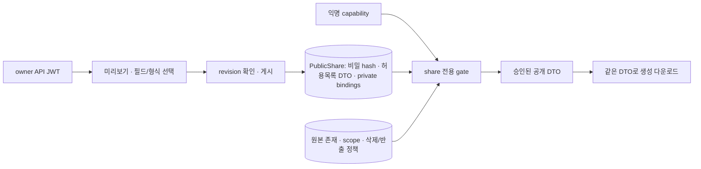

# ADR 0030 — 선택한 자원의 공개 스냅샷과 공통 내보내기

- 날짜: 2026-10-15
- 상태(2026-10-16): 핵심 권한·스냅샷·회수 경합·TXT/MD/JSON/CSV와 문서형 전사·선택 내보내기·공유 관리·별도 공개 UI를 구현했다. UI 검증 뒤 코드 기본값을 `public_sharing_enabled=true`로 전환한다. 회의는 자동 공개되지 않으며 명시적 false 설정으로 전달을 차단할 수 있다. 운영 배포 여부는 [UI 연결 작업기록](../work-history/2026-10-16-meeting-sharing-ui.md)을 따른다.
- 기준: backend `4a07739cc6bdba75ef8d4b2877c91ea3fabf9f84` + 조사 시점의 작업 트리. 다른 세션의 미커밋 변경은 보존한다.
- 선행: ADR 0010(회의록), 0012(PMS/WBS), 0028(STT); 상세 계약: [public-share-export-contract.md](../sharing/public-share-export-contract.md)

## 문제

따까리 본체는 개인 앱이다. 사용자는 선택한 회의록·PMS·WBS·자료실 자원만 로그인 없이 조회·다운로드하도록 공유하기 원한다. 기존 owner 응답을 익명에게 그대로 내보내면 녹음·실행 세션·기억 제안·프로젝트 관계까지 공개될 수 있다. 자료실은 이 설계에서 보관함 Artifact를 뜻한다. 맥락 도서관 전체 검색이나 서버 리소스 화면은 공개 대상이 아니다.

현재 근거는 계약 §1에 파일·행으로 기록했다. 현재 `/api/dl/{token}`은 짧은 파일 JWT를 통한 익명 다운로드이며, `share_file`은 개인 보관함 등록이다. 둘 다 새 공개 페이지의 자원별 회수 가능한 권한 모델과 같지 않다. PMS/WBS CSV·xlsx는 현재 프론트에서 생성한다.

## 선택한 구조

1. **owner 인증 유지 + 별도의 capability 인증.** 기존 `User`/API JWT를 바꾸거나 공개 예외를 넓히지 않는다. 새 `/api/public/shares/{share_id}` 계열만 별도 인증을 사용한다. 공개 권한은 root 자원 하나, 승인한 필드와 생성 다운로드 형식으로 한정한다. agent/session/transfer/download JWT를 owner 또는 공개 share 권한으로 승격하지 않는다.
2. **명시적 허용목록으로 만든 게시 스냅샷.** owner가 미리보기의 데이터 revision을 확인한 뒤 게시한다. 원본 편집·새 발화·새 작업·새 첨부는 자동 반영하지 않는다. 재게시만 새 revision을 만든다. 공개 DTO를 owner read model의 필드 제거로 만들지 않는다.
3. **매 요청 DB에서 회수·만료·원본 존속/범위·선택 항목 존속을 확인한다.** 스냅샷만 남아 있어도 원본 또는 선택 항목이 삭제되면 공개 조회와 모든 생성 다운로드를 막는다. 저장된 원본의 변경 내용은 자동 노출하지 않지만 scope 변경은 재승인을 요구한다.
4. **무작위 비밀값은 URL fragment → Authorization 헤더로 전달.** 공개 링크 형식은 `/share/{share_id}#key=<opaque-capability>`다. 서버에는 비밀의 SHA-256만 보관하고 발급 응답에서 한 번만 링크를 돌려준다. 자원 ID·서명 파일 URL·filesystem 경로를 공개 다운로드 URL의 권한으로 사용하지 않는다.
5. **공개 조회와 다운로드가 같은 투영된 데이터만 사용.** 익명 다운로드도 같은 share gate를 통과한다. 기존 `/api/dl`·`download-link`를 중간 단계로 만들지 않는다. 첫 구현은 메모리에서 작은 생성 파일을 반환하고, 공개 URL이 있는 파일 Artifact를 만들지 않는다.
6. **초기 범위는 회의록 한 종류.** TXT/MD/JSON/CSV를 첫 수직 기능 목표로 삼는다. SRT/VTT/DOCX/PDF와 PMS/WBS/Artifact는 상세 계약과 활성화 조건만 정의하며, 지원 완료로 광고하지 않는다. 일반 ACL 엔진·새 사용자 계정·플러그인 프레임워크·공개 검색 서비스를 만들지 않는다.

## 데이터·권한 경계

- `scope=shared`는 기존 내부 맥락 분류다. 공개 여부를 뜻하지 않는다. personal/work 모두 owner의 명시적 발급만 허용하며 work에는 별도 확인 필드를 요구한다.
- 원음·raw/words·모델 원시 결과·분석 프롬프트·제안/승인 기억·이웃 회의·프로젝트 연결·첨부를 따라가지 않는다.
- 첫 버전은 공개 권한을 일시 중지했다가 같은 링크로 되살리지 않는다. **끄기/폐기=비가역 revoke**, 다시 켜기는 새 링크다. 개별 링크 회수이며 별도 발급한 다른 자원 링크까지 자동 회수하지 않는다.
- 제목·본문 안의 이름이나 비밀을 자동으로 완전히 지우는 설계가 아니다. 구조적 이름 필드는 기본 제외하고, 게시 미리보기에서 실제 텍스트의 공개 범위를 확인한다. 인식 가능한 내부 서명 다운로드 링크가 본문에 있으면 게시를 거절한다.

## 기각한 대안

| 대안 | 기각 이유 |
|---|---|
| 기존 회의/PMS API에서 토큰 쿼리만 있으면 `User` 우회 | owner DTO·중첩 관계 노출, 새 private endpoint가 생길 때 공개 범위가 함께 넓어짐 |
| 긴 수명 download JWT/기존 파일 링크를 공개 페이지 권한으로 사용 | 자원별 게시 revision·회수에 연결되지 않고 별도 다운로드 통로가 남음 |
| 실시간 owner read model을 계속 렌더링 | 공유 뒤 작성한 발화·항목·첨부가 의도 없이 공개될 수 있음 |
| 스냅샷을 인증 없는 정적 파일/CDN 링크로 게시 | 회수·원본 삭제 이후에도 재요청을 막기 어려움 |
| 처음부터 모든 자원·형식용 ACL/변환 플랫폼 구현 | 첫 회의록 기능에 필요 없는 추상화와 운영 상태를 늘림 |

## 한계와 적용 상태

회수는 이후의 서버 접근을 차단한다. 이미 받은 파일·복사·스크린샷·이미 최종 인가된 전송까지 회수할 수 없다. no-store/noindex는 이 한계를 없애지 않는다. fragment는 HTTP 요청 URL에는 포함되지 않지만 브라우저 이력·확장·페이지 JS·수신자의 재공유에서 비밀이 보일 수 있다. 특정 수신자만 확인하는 신원 인증을 제공하지 않는다.

2026-10-15 구현 당시에는 migration `0028`, strict 공개 DTO, owner 관리와 public gate, DB trigger 회수, TXT/MD/JSON/CSV formatter 및 owner export까지 포함했고 공개 기능은 기본 off였다. 2026-10-16에는 별도 public UI와 owner 선택·검토·게시 흐름을 연결해 코드 기본값을 on으로 전환한다. 가상 자료·격리 PostgreSQL/HTTP·합성 브라우저 검증을 사용하며 실제 사용자 회의를 작업 중 임의 공개하지 않는다. 최신 범위·검증과 운영 배포 여부는 상세 계약 §14 및 작업기록을 따른다.
