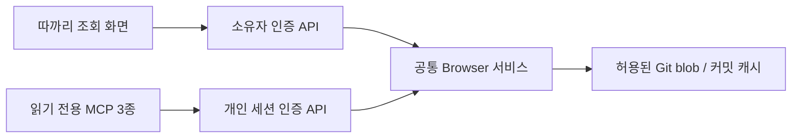

# ADR 0034. 개인 디자인시스템을 원본 커밋 기준으로 조회한다

- 상태: 구현(2026-10-18). 사용자 요청에 따른 에이전트의 구현 설계이며 별도 사용자 승인 기록을 뜻하지 않는다.
- 요청: 로깅 조회처럼 `winterholic-design-system`과 연결되는 화면과 도구를 만들어 디자인시스템 정보를 자세히 확인한다.

## 사용 흐름

부가 기능 → 디자인시스템 → 프로젝트의 시각 미리보기를 먼저 본다. 토큰·지침·컴포넌트·화면 예제는 종류 → 검색 → 상세로 탐색한다. 기본 프로젝트는 Ttakkari다. 모바일은 목록에서 상세로 전환하고, 데스크톱은 목록과 상세를 함께 둔다. 선택·검색·커밋은 URL에 남겨 뒤로 가기와 링크 공유를 지원한다.

| 종류 | 검색 범위 | 상세에서 확인하는 정보 |
|---|---|---|
| 토큰 | 이름, CSS 변수, 원본/해석 값, 라이트/다크, 용도 | 타입, CSS 변수 복사, 테마별 색상 견본·값·설명·직접 참조 링크, 원본 파일·JSON 포인터 |
| 사용 지침 | README, CLAUDE, CHANGELOG, docs 본문 | Markdown 열람/원문 전환, 저장소 내 상대 문서 링크, 구간 복사 |
| 컴포넌트 CSS | 컴포넌트 스타일 원본 전체 | 선택자·상태·사용 토큰을 포함한 CSS 원문 |
| 화면 예제 | examples 하위 HTML 전체, HTML title | 같은 커밋의 HTML/CSS/JS/이미지 시각 미리보기 우선, 원문 전환 |

시스템은 ttakkari, aip, winterholic-base, stock-gosu, memoir, notting, yeohaenggajya 7개다. 컴포넌트 CSS가 없는 시스템은 0건을 표시하며 문서·예제는 별도로 읽는다. 별도 로고·이미지 자산 검색, 디자인시스템 편집·배포, 프로젝트 사용 현황 추적, 대비 감사는 별도 범위다.

## 원본과 일관성

`TTAKKARI_DESIGN_SYSTEM_ROOT`의 기본값은 `~/development/projects/winterholic-design-system`이다. API 호출자는 경로나 저장소를 바꾸지 못한다. 카탈로그의 버전은 각 시스템의 커밋된 `package.json`에서 읽는다. README 버전 표와 다르면 package 값을 쓰며 임의로 보정하지 않는다.

Git `rev-parse`로 현재 로컬 HEAD를 확정하고 `ls-tree`와 `cat-file --batch`로 일반 blob만 읽는다. 작업 트리, 심볼릭 링크 대상, `.env`, 인증 파일은 읽지 않는다. 저장소 갱신·빌드·스크립트 실행도 하지 않는다. 원본 편집이 진행 중이어도 커밋된 상태만 조회한다. `최신 커밋 조회`는 서버 저장소의 현재 HEAD를 다시 읽으며 원격 fetch/pull은 하지 않는다.

캐시는 저장소 절대 경로와 전체 커밋 SHA를 키로 최대 4개다. 검색·상세 요청에 같은 SHA를 전달해 페이지 사이의 원본 변경을 막는다. 이전 커밋을 URL로 열면 프로젝트 선택기의 버전·개수는 최신 카탈로그 기준이라고 안내하고 본문에는 요청 SHA를 쓴다. 원본 삭제·파싱 실패·한도 초과는 503으로 드러내며 0건 성공으로 숨기지 않는다.

토큰은 `tokens/src/*.json`의 DTCG `$value`, 상속 `$type`·`$description`을 읽고 공통 + 테마별 정의를 합친다. 배열·복합 값도 해석하며 누락·순환 참조는 원본을 보존하고 명시적 오류로 표시한다. CSS 접두사는 커밋된 `tokens/build.mjs`의 PREFIX에서 읽는다. 정확한 원본 값과 CSS 변수 이름을 제공하며 복합 값을 CSS 문자열로 임의 변환하지 않는다.

## 공통 서비스와 API

| 용도 | 소유자 API | MCP |
|---|---|---|
| 카탈로그 | `GET /api/design-systems` | `design_system_catalog()` |
| 검색 | `GET /api/design-systems/{system}/items?q=&kind=&cursor=&revision=` | `design_system_search(system, query, kind, limit, cursor, revision)` |
| 상세 | `GET /api/design-systems/{system}/item?item=&offset=&length=&revision=` | `design_system_item(system, item, offset, length, revision)` |

MCP는 같은 경로의 `/api/agent/design-systems` API를 사용한다. 예: 카탈로그 → `design_system_search("ttakkari", query="승인", kind="document")` → 반환된 id와 revision으로 상세 → next_offset으로 이어 읽기. 모든 도구에 readOnlyHint와 읽기 전용 정책 목록을 적용한다.

## 권한·크기·상태

- 소유자 화면은 기존 사용자 JWT가 필요하다. MCP는 유효한 세션 토큰과 실제 세션을 검사하며 회사 세션은 403이다. 운영 인증은 우회하지 않는다.
- 읽기 대상은 고정 시스템 아래의 Markdown 문서·CSS 컴포넌트·HTML 예제·토큰 JSON과 package 메타데이터로 제한한다. 검색 결과의 id만 상세에서 읽을 수 있다.
- 검색은 기본 20, 최대 40건이며 전체 건수와 다음 커서를 반환한다. 요약의 응답 예산에 따라 쪽 길이가 줄면 실제 반환 수만큼 커서를 진행한다.
- 본문은 기본 6,000자, 최대 10,000자이며 offset/next_offset을 제공한다. API/MCP 응답은 16,000자를 넘기지 않는다. 고정 저장소 색인은 파일당 512 KiB, 최대 600개·16 MiB다.
- Markdown은 HTML을 무시하고 외부 이미지를 불러오지 않는다. CSS와 HTML 원문 탭은 이스케이프된 소스로 보여준다. HTML 시각 미리보기는 아래 별도 격리 계약을 따른다. 외부 링크는 http(s)만 허용한다. 문서 내용은 근거 자료이며 실행 지시나 권한 부여가 아니다.
- 로딩·빈 결과·원본 오류·미해석 참조·복사 실패를 각각 표시한다. 긴 경로는 줄바꿈하며 코드·표는 자신의 상자 안에서 스크롤한다.

DB·스키마·세대 프로토콜 변경은 없다. 백엔드는 검증된 커밋을 기존 generation 배포 예약으로 넘기고 프론트는 별도 저장소의 main 반영으로 배포한다. 예약 수락과 운영 검증은 별개다. 기존 Run의 MCP 프로세스가 신규 도구를 갖게 된다고 보장하지 않으며 새 Run에서 확인한다.

## 2026-10-18 확장: 시각 미리보기

사용자가 모바일 UX/UI 개선과 preview.html 렌더링을 요청했다. 이는 초기의 HTML 원문 전용 범위를 대체한다.

- owner 전용 `GET /api/design-systems/{system}/preview?item=&theme=light|dark&revision=`는 `{revision,system,source,html,sections,warnings}`를 반환한다. item 생략 시 해당 시스템 `examples/preview.html`, 명시 시 색인의 example 항목만 허용한다. MCP/agent 라우터에는 큰 HTML 번들을 추가하지 않으며 기존 세 도구·16k 텍스트 계약은 유지한다. 토큰 검색 요약에는 `values.light/dark`를 추가했다.
- HTML이 참조하는 해당 시스템 dist/examples/assets의 허용 확장자 CSS·JS·이미지·woff2만 정규 Git blob으로 읽고 data URL로 묶는다. 쿼리·fragment를 분리하고 URL 디코딩 후 경로를 정규화한다. 저장소 밖·다른 시스템·미허용 확장자·symlink는 읽지 않으며 누락/순환은 warnings, 크기 초과는 명시적 실패다. 파일 2 MiB·원본 자산 합 12 MiB·최종 HTML 20 MiB 한도다. 서버 실행·fetch·빌드는 없다.
- 프론트는 srcDoc을 `sandbox="allow-scripts"` iframe에만 넣는다. allow-same-origin, 폼·팝업·다운로드·상위 이동 권한은 주지 않는다. CSP는 API 연결·추가 프레임·object·base·폼을 차단하고 CSS/JS와 이미지는 번들, 글꼴은 원본이 사용하던 jsDelivr/Google Fonts CSS·font만 허용한다. 외부 자산 HTTP 요청을 서버에서 대신하지 않는다. 원본 예제의 비fragment 링크는 이동하지 않으며 다른 예제는 목록에서 고른다.
- 원본 컴포넌트 초기화가 저장소 접근 불가로 테마를 지울 수 있어 load 뒤 선택 테마를 다시 적용한다. 이후 예제 자체 토글은 원래대로 사용할 수 있다.
- 기본 진입은 시각 미리보기이며 라이트/다크·제목별 구간 이동·크게 보기·원문 전환·상태 복원이 있다. 모바일에서 원본/커밋은 펼침으로 내리고 토큰 목록에 두 테마 값과 색상 견본을 표시한다. `?q=` 기존 주소는 토큰 검색으로 유지한다.
- 격리 원본은 편집/서버 작업을 할 수 있는 실제 제품이 아닌 디자인 예제다. 원본 예제 자체의 좁은 폭 넘침은 프레임 내부 스크롤로 제공한다. 운영 로그인·실제 iOS는 별도 확인 범위다.
