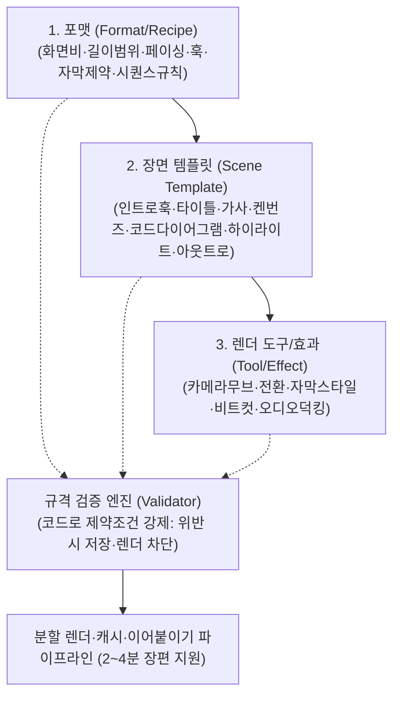

# ADR 0065. 크리에이티브 스튜디오 포맷 카탈로그·장면 조립기 및 장편 파이프라인

- 상태: 구현(2026-10-20). 사용자 요청에 따른 에이전트의 구현 설계이며 별도 사용자 승인 기록을 뜻하지 않는다.
- 요청: 1차 30초 제작 시스템을 "포맷 카탈로그 + 재사용 도구 조립" 구조로 정형화하고, 2분 이상 장편 영상까지 안전하게 제작할 수 있게 확장한다. 디자인시스템 조립기처럼 "카탈로그에서 부품을 골라 정해진 규격으로 조립, 규격은 코드로 강제"하는 발상을 영상 도메인에 적용한다.

## 1. 3층 구조 (Format → Scene Template → Tool)

### 1층: 포맷 (Format / Recipe)
전문 영상 분야의 제작 문법과 규격을 규정한 최상위 레시피:
1. `shorts_9_16`: 9:16 모바일 쇼츠. 15~60초, 빠른 컷(fast), 훅 필수, 중앙 강조 자막(2줄 이하).
2. `tech_explainer`: 16:9 기술 설명·교육. 30~240초, 중간 템포(moderate), 코드/다이어그램/타이틀 오버레이.
3. `music_video`: 16:9/1:1 뮤직비디오·비주얼. 30~240초, 비트/가사 중심, 켄번즈 무브, 하단 자막.
4. `narration_story`: 16:9 내레이션 스토리·다큐(장편). 60~240초(120초 이상 최적), 부드러운 페이드 전환, 하단 카드.
5. `meme_parody`: 9:16/1:1 밈·패러디. 5~30초, 초고속 컷 전개.
6. `image_motion`: 16:9/9:16 이미지 모션그래픽. 20~120초, 서정적 카메라 무빙.

### 2층: 장면 템플릿 (Scene Template)
재사용 가능한 시각 블록:
- `intro_hook`: 시선 집중용 훅 (2~5초, center_highlight, cut 전환).
- `title_card`: 프로젝트·챕터 제목 (3~6초, title_card 스타일, fade 전환).
- `lyric_scene`: 가사 중심 서사 (3~8초, bottom_card, pan/zoom_in).
- `ken_burns`: 이미지 서사 장면 (5~15초, bottom_card, zoom/pan).
- `split_screen`: 비교 분할 화면 (4~10초, still).
- `code_diagram`: 기술 코드/구조 설명 (5~20초, code_overlay, still/pan_down).
- `highlight_text`: 핵심 키워드 강조 (2~6초, center_highlight, pulse/zoom_in).
- `outro`: 엔딩 및 행동 유도 (3~8초, bottom_card/title_card, fade 전환).

### 3층: 도구 / 프리미티브 (Tool / Effect)
FFmpeg 렌더러가 직접 실행하는 단위 기능:
- 카메라 무브: `still`, `zoom_in`, `zoom_out`, `pan` (좌우), `pan_down` (상하), `pulse` (미세 줌 강조).
- 전환 효과: `cut`, `fade` (0.25초 디졸브 페이드).
- 자막/텍스트 스타일:
  - `bottom_card`: 하단 라운드 박스 + 본문 자막 (기본).
  - `center_highlight`: 중앙 대형 볼드 강조 (쇼츠 훅/키워드).
  - `title_card`: 다크 오버레이 + 대형 헤드라인 (타이틀).
  - `code_overlay`: 상단 다크 바 + 고정폭 코드 박스 (기술 설명).
- 오디오: `bgm_full`, `bgm_ducked` (추후 음성 합성 시 확장).

---

## 2. 규격 강제 (Validation Engine)

임의의 형식이나 제약 위반 조합을 생성·저장·렌더하지 못하도록 코드가 강제한다:
1. 화면비 일치: 포맷에서 허용하지 않은 화면비 거부 (예: 쇼츠에 16:9 거부).
2. 전체 및 장면 길이 범위: 포맷별 `min_duration`, `max_duration`, 템플릿별 길이 제한 검증.
3. 장면 시퀀스 규칙: 훅 필수 포맷은 첫 장면에 훅 템플릿 강제.
4. 자막 규격: 줄 수 및 글자 수 한도 초과 시 명시적 오류 발생.
5. 도구 허용 범위: 템플릿에서 정의된 허용 애니메이션·전환·자막 스타일만 선택 가능.

---

## 3. 2~4분 장편 영상 분할 렌더·캐시 파이프라인

단일 거대 FFmpeg 인코딩 대신, 장면 단위 분할 렌더링 + 캐시 + 무손실 컨캐트(concat) 파이프라인을 유지·강화한다:
1. **장면 캐시 키**: `hash(scene_spec, asset_sha256, aspect, renderer_version)`
2. **증분 재렌더링**: 장면 내용이 변경되지 않은 클립은 `cache/*.mp4`를 그대로 재사용 (`cached += 1`). 변경된 장면만 단독 인코딩.
3. **최종 합성**: 기 인코딩된 클립들을 FFmpeg `concat demuxer`로 무손실 비디오 카피(`-c:v copy`), 오디오 트랙만 재인코딩(`-c:a aac`)하여 결합.
4. **장편 안전성**: 120~240초(2~4분) 영상도 메모리 부하 없이 1개 씬씩 인코딩되므로 OOM(Out of Memory) 위험을 차단하고, 수정 시 전체 렌더 시간의 수 퍼센트만 소요.

---

## 4. API 및 UI 계약

- `GET /api/creative/catalog`: 지원 포맷, 장면 템플릿, 도구 목록 반환.
- `POST /api/creative/projects`: `format_id` 필드를 통해 포맷 규격에 맞는 초기 템플릿 장면 자동 생성.
- `PUT /api/creative/projects/{id}`: 규격 검증 엔진 통과 필수.
- `POST /api/creative/projects/{id}/render`: 유효성 검증 실패 시 즉시 400 반환.
- UI: 포맷 카탈로그 선택기 → 템플릿 기반 프리셋 생성 → 장면별 템플릿 교체 및 규격 검증 피드백 제공.
