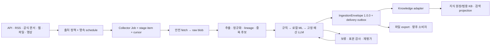

# 범용 수집 플랫폼 + ML 품질 평가 엔진 — 실행 설계 v1

2026-10-20 KST · 설계 및 PMS 등록 단계. 제품 구현·학습·운영 전환·배포 미실행.

## 기준과 결정

사용자 현재 지시 및 recall 결정 `6b599fd4-b667-405c-81f9-bd4495fa7fb0`(2026-10-20 13:26 UTC, 원 세션 cd62951a-bb9f-45f9-8c5b-4545863e704d)을 대조했다. recall 항목은 에이전트가 요약해 저장한 결정이다. 원 세션 read_session은 접수 프롬프트를 일부 절단하므로 독립된 원문 전체 검증으로 간주하지 않는다. 현재 사용자 지시의 “지식 도서관과 독립적인 범용 기능”, “정해진 표준 데이터 형식”, “관리 페이지도 별도로”를 직접 요구 정본으로 삼는다. 별도 서버·중복 인프라는 요구하지 않는다.

Route capsule: 범용 수집과 비용 제한의 실행 설계 / 두 조사 PASSED_WITH_CORRECTIONS 및 현재 작업 트리 / 모듈형 모놀리스와 DB job이면 충분하다는 가설(독립 확장·격리 필요 실측 시 재검토) / 설계·schema 검증·PMS만 / 지식 독립·기존 실행 기반 재사용·절대 예산 / fixture 양성·음성 검증과 PMS readback으로 인수. dev-experts→dev-chief-architect→dev-data-engineering ACCEPT; agentic-architecture의 평가·비용·지식 경계만 보강. 새 프레임워크·그래프 DB는 도입하지 않는다.

[정정 추적표](corrections.md), [평가·학습 설계](evaluation.md), [첫 구현 패키지](first-slice.md), [PMS WBS](wbs.csv), [검증 receipt](evidence/verification.txt), [ADR](../../adr/collector-platform-20261020.md)를 함께 읽는다.

## 1. 현황 → 목표의 차이

| 확인한 현재 코드/자료 | 목표 변화와 인수 표면 |
|---|---|
| generation_service.periodic/consume, generation.work 존재 | 영속 schedule/job을 추가하고 이 루프에서 실행. 별도 cron·Redis·Celery 미도입 |
| NotebookLM/LocalSTT 전용 job, Run 프로세스 관리 존재 | DB job 패턴만 재사용. 웹 수집마다 LLM Run을 생성하지 않음 |
| 범용 ingestion envelope/robots 강제는 조사 범위에서 미확인 | 독립 collector 모듈·schema·소스 정책·안전 fetch 추가 |
| knowledge/store.import_text는 개인 근거 원장용 | 수집 저장 정본으로 사용하지 않고 선택적 소비 어댑터 뒤로 이동 |
| 초기 조사 중 미커밋 kb_models/kb_store/0053/0054 발견(마감 시 커밋됨) | hash blob 저장을 중복 구축하지 않도록 blob port로 재사용 후보 격리. kb 대상은 소유자 합의 후 선택 |
| 과거 검색 감사는 고정 dev 질의 | source-first 신규 holdout에서 retrieval·citation·품질 각각 검증 |

현재 읽은 back HEAD와 dirty 목록은 evidence/repository.txt에 고정한다. front HEAD 630040b1b7007a219a93c9d3d4491fab714c555d는 ahead 3/behind 73과 dirty 상태였다. back 파일은 동시에 바뀔 수 있다. 조사 시점 로컬 코드 존재는 배포 runtime의 기능·DB 동일성을 입증하지 않는다. 현재 배포 revision/API/DB는 이번 범위에서 미검증이다.

## 2. 논리 경계와 소유권

collector는 지식 모델을 import하지 않는다. `CollectorStore`, `BlobStore`, `QualityScorer`, `BudgetAuthorizer`, `DeliverySink` port를 두되 구현은 현재 Python/FastAPI/PostgreSQL/파일 저장소 안에 둔다. 새 microservice나 공용 범용 프레임워크를 만들지 않는다. PMS는 개발 작업 정본, collector job은 제품 실행 상태 정본이다. PMS task를 수집 문서마다 생성하지 않는다.

raw blob은 읽기 권한을 가진 content-addressed handle+SHA를 반환한다. outbox는 사용자 납품용이며 상시 코퍼스 저장소가 아니다. 운영 blob 위치는 기존 artifact/kb 저장소 소유자와 결정한다. scope·tenant별 접근권한은 동일 bytes를 공유해도 독립 검사한다. `kb_store.ingest_source`는 현재 원본 bytes를 NFKC decode해 본문으로 만든다. 추출 HTML 본문과 raw를 분리 전달하고 parser 변경을 재처리하는 계약이 직접 맞는다고 추정하지 않는다. kb_models는 읽은 코드상 명시 scope 필드가 없다. 초기 조사 때 ADR 0062 참조 충돌을 관찰했으나 마감 재대조에서 ADR 0063으로 수정된 것을 확인했다. 이는 정적 관찰이며 운영 결함 판정은 아니다. 소유자와 ACL/visibility·parser 재처리 계약을 확인하기 전 기본 sink는 export/보류다. 최신 대조는 contract-compatibility.md를 따른다.

back 소유: 새 `src/ttakkari/collector/`, 전용 additive 모델·migration·API·테스트. front 소유: 새 `/collect` 페이지와 `features/collector/`, client/route/shell 접점. `models.py`, `main.py`, `generation_service.py`, `api/client.ts`, `App.tsx`, `shell/features.ts`는 통합 담당 한 명이 수정한다. 다른 작업의 dirty 파일·미추적 kb 파일은 이 작업에서 stage/commit하지 않는다. migration 번호는 착수 당시 heads를 확인해 할당하고 현재 0053/0054를 예약하지 않는다.

## 3. 표준 ingestion 계약

정본은 [JSON Schema 2020-12](contracts/ingestion-envelope.schema.json). 기존 knowledge 원장과 kb 함수는 전용 내부 계약이다. 마감 재대조에서 docs/kb/design-v1.md의 Collector(discover/fetch/parse) Protocol을 확인했다. 본 schema는 그 RawArtifact/NormalizedDoc 개념을 권리·scope·품질·버전·delivery까지 확장한 교환 계약이다. 기존 함수형 계약을 없다고 처리하지 않는다. 새 envelope는 이들과 경쟁하는 원장이 아니라 경계 교환 형식이다.

필드: envelope/schema version·UUID·producer/version·source key/kind/URL·수집/발행/기록 시각(unknown=null)·tenant/권한/scope·license/정책 근거/robots 상태·원본 handle/SHA/bytes·정규화 본문/SHA/원문 대비 변환 map handle·parser/normalizer/chunker·모델 revision/전처리/정책 버전·독립 품질 축·정확/근사중복 및 canonical 후보·결정·오류/재시도 가능성·lineage. secret·쿠키·HTML 활성 스크립트를 교환하지 않는다.

major 불일치는 `unsupported_schema` quarantine, minor는 명시 migration 후 수용한다. 현재 v1 strict schema는 unknown field를 거부한다. 확장은 허용된 `extensions`의 namespaced 값에만 넣고 정책 필드는 무시하지 않는다. schema 유효성은 SSRF·권한·hash 내용 검증을 대신하지 않는다. `verify_contracts.py`는 fixture의 hash·시각·축별 calibration/query 조건도 검사한다. 제품 런타임 검증은 다음 구현에 별도로 필요하다.

품질 벡터의 education/utility/spam/novelty/factuality/relevance는 독립이다. relevance는 query_id가 있는 질의별 점수이고 검색 nDCG/Recall은 corpus 평가다. 점수 미측정은 null+unmeasured; 0으로 채우지 않는다. factuality에는 unknown/supported/refuted/conflicting/not_applicable와 근거 locator를 남기고 education 점수로 사실 확정하지 않는다. raw logit은 raw_logit 척도 유지, calibrated probability는 독립 calibration artifact+gold hash가 있을 때만 기록한다.

## 4. 저장·상태·재시도

| 논리 객체(최소 테이블은 구현 시 확정) | 키·불변식 |
|---|---|
| SourcePolicy + Schedule | tenant/scope/source; policy version 불변, enabled=false 기본, next_due UTC·timezone·interval·misfire/coalesce 정책 영속 |
| CollectionJob + StageItem | UNIQUE(tenant,scope,source_key,request_key)이며 tenant/scope는 인증 주체 산출값, payload_hash는 JCS−recorded_at([intake-binding.md](intake-binding.md)), stage item UNIQUE(job,external_key,stage,input_hash,processor_version). stage와 terminal status 분리 |
| ContentRevision + QualityAssessment | 원본 SHA와 text SHA 분리. UNIQUE(scope/source/raw_hash/parser/normalizer), 판정은 append-only 모델·정책별 새 행 |
| BudgetBucket + Reservation + Usage | 일별 공용 한도와 job 한도 원자 예약. reservation request_key UNIQUE; usage 중복 정산 방지 |
| DeliveryOutbox + Receipt | UNIQUE(sink,scope,envelope_id,adapter_version); payload hash 고정, 성공 receipt FK |
| Audit/Registry | 기존 audit/ops/blob store 재사용, model/dataset/preprocess/calibration/code manifest hash 고정 |

단계: discover→fetch→extract→normalize→dedupe→score→deliver. job 상태: queued→running→succeeded/partial/failed/cancelled; running→retry_wait/budget_wait/policy_blocked/quarantined. 재개는 checkpoint item부터 같은 코드로; backfill은 기간/cursor 인자만 다르다. 한 page 결과와 다음 cursor·child item enqueue는 같은 DB transaction으로 commit한다. 성공 처리/명시 skip/hold/실패/잔여 합이 입력 manifest 수와 같아야 한다. 빈 200은 expected-empty 근거가 있을 때만 정상이며, parser drift/빈 본문은 명시 error/hold 후 cursor 전진 정책을 기록한다.

HTTP GET/HEAD의 timeout·5xx·429만 최대 3회(총 시도 3), exponential+jitter·Retry-After를 durable not_before로 저장한다. 401/403/CAPTCHA는 policy_blocked, parser/schema/rights 불명은 quarantine/hold; 무한 재시도 없음. 취소는 경계마다 검사하고 이미 저장한 raw/receipt는 보존한다. 외부 sink 성공 여부 불명은 `delivery_unknown`, 수신 receipt 조회로 조정 후 재전송한다. HTTP 재수집으로 원본이 바뀌면 새 revision이고 이전 검토를 덮어쓰지 않는다.

실행: maintenance_jobs에 `collector-schedule` scan 등록, generation.work('collector-consume') 안에서 한 bounded batch를 실행한다. DB claim은 SKIP LOCKED로 job을 잠그고 attempt UUID·owner_generation을 저장한다. commit은 token 일치 CAS로 fence; 같은 transaction에서 상태·cursor·outbox를 갱신한다. `RuntimeLease.run_id`는 Run FK이므로 수집 job ID를 넣지 않는다. 기존 generation.work는 active recheck+파일 lock 기반이며 DB 영속 job claim 자체가 아니다. 이를 재사용하고 collector job 행의 owner/token을 추가한다. draining은 새 claim 금지, 현재 bounded batch를 마감하고 lock 해제. heartbeat age만으로 살아 있는 이전 세대 작업을 탈취하지 않는다. owner offline와 lock 해제 확인 후만 복구, 확인 불가면 hold. generation 전환/ready/drain 계측에 collector batch를 연결해야 한다.

## 5. fetch·정책 경계

공식 API/feed·사용자가 제공한 파일 우선, HTML 본문 추출은 안전 fetch와 순수 parser를 분리한다. trafilatura는 후보 parser이며 fetch_url에 네트워크 소유권을 주지 않는다. datatrove는 대량 offline 비교 후보, 초기 운영 scheduler로 도입하지 않는다. Stock-gosu 비교: APScheduler coalesce/max_instances/misfire 개념·backfill cursor·run/result 계측을 가져오되 금융 캘린더·TimescaleDB·Redis TTL 마커·SEC 전용 정규식/빈 오류 결과는 이식하지 않는다. Ttakkari generation 실행기를 유지한다.

HTTPS/HTTP만 허용(초기 HTTPS와 443 우선), 사용자정보/임의 port/file/gopher 거부. URL 정규화 후 IP literal·DNS A/AAAA를 모두 검사해 loopback/private/link-local/multicast/metadata·IPv4-mapped IPv6를 거부한다. 매 redirect와 robots/feed의 URL에도 같은 검사를 적용한다. DNS 검사 뒤 다른 DNS로 재접속하는 TOCTOU를 막도록 transport에서 검증 IP에 연결하고 원래 Host/SNI와 인증서 검증을 유지한다. 인증 proxy를 사용하면 proxy 측 egress도 동일 정책으로 검증해야 한다. 이 기능 미검증 시 public-host allowlist로 제한하며 임의 URL 운영을 열지 않는다. 자동 redirect·환경 proxy/credential 전파는 기본 off, redirect 횟수 5·stream 크기/압축 해제 bytes·total timeout 30초 등은 초기 제안 상한이다. MIME 불일치·zip bomb·과대 응답은 hold. canonical URL은 비신뢰 후보로 기록하고 외부 host 병합을 자동 확정하지 않는다.

robots는 RFC9309 파서로 longest-match·UA group·redirect/cache를 검증한다. robots 404/410은 규칙 없음이지만 소스 license/정책 허용을 별도 확인한다. 401/403·429·5xx·네트워크 오류는 더 보수적으로 해당 host 수집 보류, Retry-After cooldown 저장. 보통 최대 24h cache, 더 짧은 source 정책 우선. robots 허용은 저작권·접근 권한이 아니다. 출처별 원문 보존/학습/재배포 권리와 확인 URL·시각을 분리하고 unknown은 export/training 제외다. 본문·자막의 지시문은 데이터로만 처리하며 LLM에 도구·계정·네트워크 권한을 주지 않는다. 브라우저 로그인·YouTube 전용 정책은 EXT-C04/Y 소유이며 첫 slice는 브라우저 미사용이다.

## 6. LLM 사용량이 수집량에 비례하지 않게 하는 강제 경로

[budget-policy.schema.json](contracts/budget-policy.schema.json)와 fixture는 **제안 기본값**이며 운영 확정값/현재 적용값이 아니다. 초기 권고: 일 60,000 total billable tokens/20 calls/USD 1, job 12,000 tokens/4 calls/USD .20, 요청 input 2,000/output+reasoning 1,000, sampling은 min(남은 예산, 고정 12건/day). 주간 학습 생성도 같은 일별 전역 bucket을 사용한다. 요청마다 새 job으로 일별 한도를 우회할 수 없다. provider 가격표가 아니라 운영자가 정한 지출 상한이다. 금액 환산표 미확인·상한 강제 불가능한 엔진은 LLM 경로 off.

순서: bytes/text hash→규칙→캐시→로컬 모델→uncertainty/OOD/불일치/보류 표본 중 고정 reservoir→예산 예약→bounded teacher. 단순 '상위 1%'가 아니다. 수집량 N에 대해 teacher calls ≤ min(20/day,4/job,정해진 reservoir+재시도 잔액), tokens ≤ min(60k/day,12k/job). 따라서 같은 day의 N→10N 시험에서 호출 절대 상한은 같다. 전체 collector 공용 day bucket과 job bucket을 일정 순서로 SELECT FOR UPDATE, worst-case 입력/출력/hidden reasoning/가격을 선예약하고 commit한 후 호출한다. 실패·retry·independent judge·synthetic generation도 모두 차감한다. 취소·실패했다고 예약을 임의 반환하지 않는다. usage 미확정/outcome_unknown은 전액 점유, provider receipt로 확인 후만 차액 해제한다. UTC 저장 + day zone Asia/Seoul, 자정에 실행 중 예약은 원래 day bucket에 정산한다.

CLI 계정 quota는 참고 신호이며 absolute enforcement가 아니다. 강제 input/output/reasoning cap·정산 증거를 제공하지 못하는 Run engine은 자동 teacher로 사용하지 않는다. 한도 지원 provider/host bounded port를 먼저 검증한 다음 routing에 연결한다. 예상 초과/설정 미정/usage 누락 시 budget_wait/hold로 끝내고 계정·모델 fallback으로 한도를 회피하지 않는다.

cache key는 tenant/scope+text SHA+model immutable revision+preprocess+rubric/prompt/schema+policy+query/context hash. negative/unknown도 TTL·사유와 함께 캐시하되 사실성은 근거 revision 변화 시 무효화한다. 정책 변경은 metadata 재판정과 비용 큰 재추론을 분리한다. hit/miss·saved calls·reserved/settled/unknown usage를 계측한다. teacher label은 자동 라벨이며 사람 확인으로 승격하지 않는다.

## 7. false-negative 제어와 보존

짧음/낮은 교육점수/새 언어/낯선 장르/AI 문체만으로 영구 폐기하지 않는다. quality hold와 security/rights block을 분리한다. 낮은 점수 문서는 격리 보관하고 정해진 stratified reservoir를 감사해 복구한다. 정확중복은 bytes를 재사용하되 각 provenance occurrence는 남긴다. 근사중복은 연결 후보와 선택 사유를 보존하고 역사/버전 차이를 지우지 않는다. 정책 허용 raw와 판정 이력은 초기 30일 회수 가능 보존을 제안하고 source retention 우선, 총 디스크 상한(제안 20GiB)에 도달하면 새 fetch를 중단한다. 권리상 원문 보존 불가면 hash/최소 허용 메타만 남기고 recovery 불가능을 명시한다. 자동 삭제 대신 만료 예정·권리/용량 정책에 따른 정리 작업을 감사 기록한다.

## 8. 별도 API와 화면

아래 API·UI는 제안 계약이며 이번에 구현하지 않았다. 사용자 기존 인증·scope 강제를 재사용한다. agent는 session scope 내 조회/명시 job 요청만, 정책/예산 확대·shared 승격은 사용자 권한 API로 제한한다.

| API prefix /api/assistant/collect | 의미 |
|---|---|
| GET/POST /sources; PATCH /sources/{id} | 소스·권리·정책 버전·enabled 설정 |
| POST /jobs (Idempotency-Key); GET /jobs?cursor= | 202+job ID, 충돌 payload면 409, access 결속 불일치면 403. GET job ID로 재개 가능 |
| GET /jobs/{id}; POST /jobs/{id}/cancel 또는 /retry | 단계별 카운터·오류·not_before·owner, 재시도는 새 attempt |
| GET /items/{id}; POST /items/{id}/reassess | 원문/해시/품질 벡터·보류·감사 이력 |
| GET /budgets; GET /models; GET /evaluations | 남은 절대 한도·미정산·registry·도메인별 성능 |
| GET /deliveries; POST /deliveries/{id}/reconcile | 소비 sink receipt·unknown 해소, 임의 상태 덮어쓰기 금지 |

`/collect`: Sources / Runs / Review / Quality & Models 탭. 첫 화면에 성공 수뿐 아니라 discovered/eligible/fetched/extracted/scored/held/failed/delivered/remaining, 예산 대기·권리 차단·재시도 시각을 표시한다. 상세는 점수 척도·미측정·모델/전처리·원문 대비 변환·canonical 후보·delivery receipt를 보여준다. empty/loading/error/partial·권한 없음·취소 중·정산 미확정 상태를 설계하고 모바일 320/390/768와 desktop 1440의 터치/키보드·포커스·오류 연결을 검증한다. `/context-library`, `/library`, 향후 `/knowledge`와 독립 root를 유지한다. shared client와 shell 접점은 front 통합 담당자가 조정한다.

## 9. 3단계 이행과 운영 게이트

S1 증거·설계: 정정 추적, 아키텍처/ADR/schema/평가/WBS/PMS. 이번 납품 범위.
S2 수집 플랫폼: 계약과 durable job→안전 fetch·정규화→예산/캐시→별도 관리 화면→export/knowledge adapter→복구·권한·부하. teacher 없이도 완료 가능.
S3 ML·검증·개선: 독립 라벨 protocol→실제/합성 corpus→고전 ML/공개 teacher/student→calibration/ablation→holdout·retrieval→registry/shadow/canary→오류 감사/재학습. 사람 검증 없으면 AI reference baseline까지만 보고한다.

상세 소유 역할·의존 UUID·완료기준·명령·산출 경로는 wbs.csv/PMS receipt가 정본이다. 날짜·개인 assignee는 근거 없이 약속하지 않는다. 역할은 구현 시 예약할 책임 경계이며 현재 실행자 배정 사실이 아니다. 기존 EXT-C 상위 조사/승인은 넓은 다른 서비스까지 포함하므로 일부 하위 설계 완료를 상위 전체 승인으로 읽지 않는다. 원요청의 개발 진행 의도는 유지하며 이번 worker의 구현 금지는 단계 경계다. 불필요한 재승인 질문을 만들지 않는다.

지식 adapter의 첫 의미 추출/운영 승격은 5.4.7.3.6 gate와 해당 sink ACL·schema·source revision 검증을 선행한다. collector 자체를 이 gate로 막지는 않는다. 운영 전환은 당시 full SHA/runtime path/API/DB identity/schema head·readiness·generation drain/ownership·scope canary를 실제 확인한다. 테스트 통과 후 clean 변경만 commit/push하고 기존 generation 배포 reservation 절차를 사용한다. 이번에는 코드·학습·배포를 실행하지 않는다.

rollback은 scheduler/LLM/sink feature flag off→새 claim 중지→진행 batch 안전 마감→registry 이전 champion 포인터로 복원→새 assessment 표시 비활성이다. 원본·이전 판정·delivery receipt를 삭제하지 않고 projection 재생성한다. additive schema downgrade 대신 forward repair를 우선한다.

## 10. 남은 블로커와 결정 트리

- 첫 slice는 back 동시 변경 소유권과 최신 migration heads 확인만 필요. 이를 해결하고 순수 계약 테스트부터 진행 가능.
- front 발산은 front 구현 전에 별도 clean checkout과 변경 소유자를 확인할 기술적 블로커이며 이번에 merge/reset하지 않는다.
- kb 병행 구현의 source/scope/visibility/parser 계약 확인은 knowledge sink만 보류(ADR 충돌은 마감 시 정정 확인). export sink와 플랫폼 개발은 가능.
- bound/usage를 강제하는 teacher port 미검증: LLM off로 시작, local model/규칙 경로 유지.
- 사람이 독립 라벨한 자체 gold는 현재 없다. human validation 미실행을 숨기지 않고 자동/독립 AI reference를 분리한다.
- 라이선스/재배포/학습 범위 미확정 source는 해당 용도 off, 확정된 public fixture로만 시작한다. 공개 카드의 모델 license가 원 웹 문서 권리를 대체하지 않는다.

## 11. 탐색·증분·어댑터 확장 상세

출처별 discovery frontier는 seed URL/API/feed와 depth·host/page/time 상한, 마지막 ETag/Last-Modified·cursor·watermark를 저장한다. sitemap/RSS/GitHub 문서/API page가 낸 각 후보는 normalized locator+external ID로 unique하게 enqueue하며 robots·권리·fetch 예산을 먼저 통과한다. 304는 이전 raw revision을 참조하고 fetch event는 별도 기록한다. API cursor는 성공 page accounting과 함께 commit하고 provider cursor 만료 시 lookback 재조회+dedupe로 복구한다. schedule overdue는 coalesce=1·misfire 정책을 source별 저장하고 새 job 폭증을 막는다. manual 요청 우선순위와 source별 quota·round robin을 두어 큰 source가 전체 frontier를 독점하지 않게 한다. 검색 API discovery는 provider/가격/약관을 검증한 adapter만 허용하며 하네스 WebSearch를 backend 수집 API로 가정하지 않는다.

공식문서/GitHub·API/feed·논문 metadata·일반 HTML은 동일 Envelope를 내는 adapter다. PDF·YouTube/자막·JS 브라우저는 미지원 상태와 이유를 ledger에 기록하고 전용 EXT-Y/C04 작업에서 확장한다. 미지원 입력을 silently skip하거나 텍스트 추출 성공으로 위장하지 않는다. known source revision의 재전송과 실제 source의 A→B→A 변경은 collection event 시각/외부 version을 분리해 처리한다. 오래된 delivery replay가 canonical/latest 포인터를 뒤로 돌리지 않도록 sink가 revision monotonicity와 source 계보를 검증하고 현재성 불명은 hold한다.

## 마감 재대조

최초 조사 HEAD 765056aaad980bda184170893e82f5df796eb7e7 이후 다른 세션이 KB1/KB2를 63cf7e02f052d3c4ebbfd9cc820257a8c40ea649로 커밋했다. 최종 문서 대조 HEAD c12eff6e753e9f438f37d1fc74999d5e47ced31a. 이 두 HEAD 사이 generation.py/generation_service.py 변경은 없었다. ADR 0063·0055 DELETE/RESTRICT 보강·기존 Collector Protocol을 새로 읽고 [계약 호환표](contract-compatibility.md)에 반영했다. 현재 배포 runtime 반영 여부는 별도 미검증이다. 초기 dirty 관찰을 마감 시 현황으로 일반화하지 않는다.
