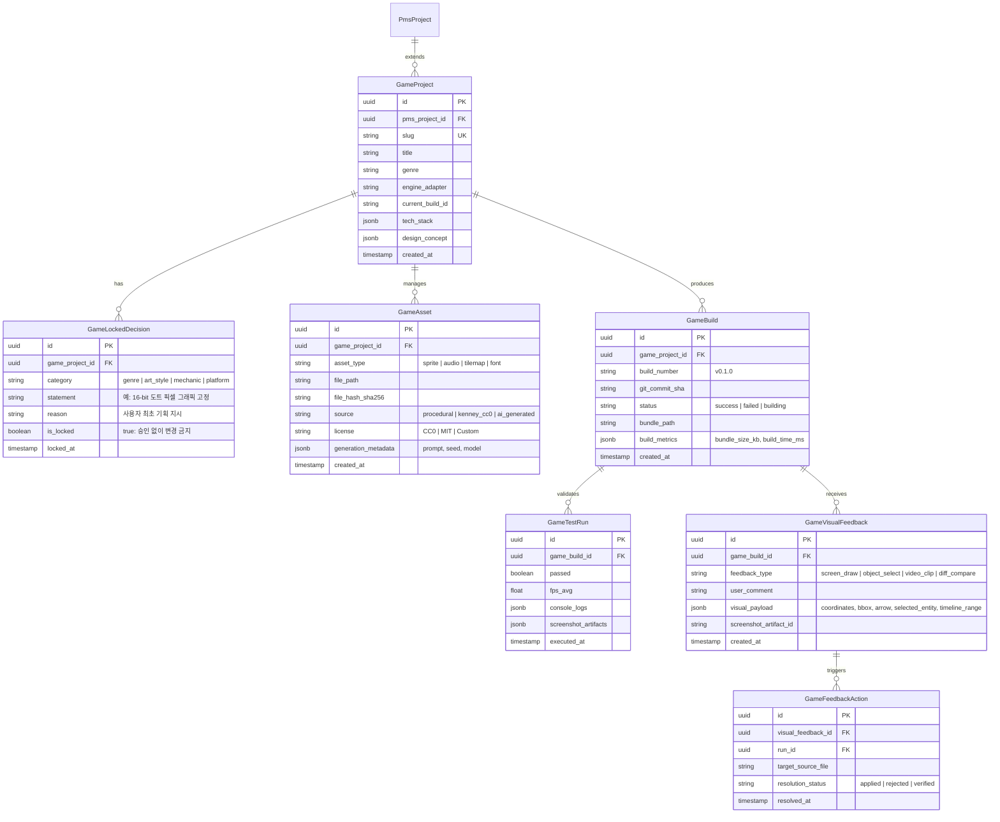
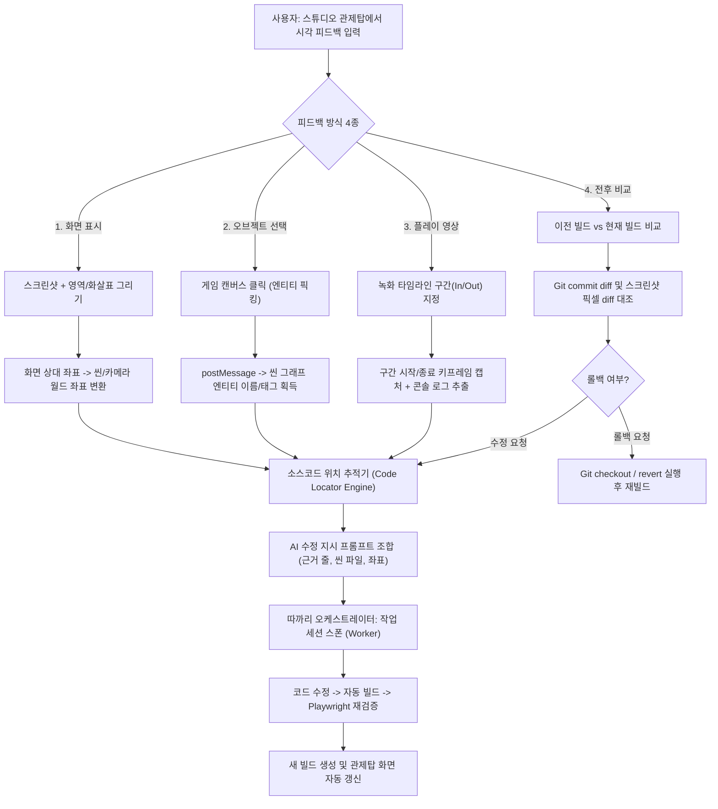

# 따까리 AI 게임 개발 스튜디오 (AI Game Development Studio) 조사·설계서

- **문서 위치**: `back/docs/design/game-studio.md`
- **작성일**: 2026-10-19
- **단계**: Phase 1 (조사·설계·WBS)
- **목표**: 코드와 게임 엔진을 모르는 사용자가 '게임 디렉터'로서 아이디어만 주면, 따까리 AI 에이전트들이 기획 → 기술 선정 → 개발 → 에셋 → 빌드 → 실행 → 플레이 테스트 → 피드백 → 수정 → 재검증을 무인/자율적으로 수행하는 게임 화면 중심 제작 스튜디오 구축.

---

## 1. 개요 및 설계 원칙

### 1.1 배경 및 목적
사용자는 모바일 PWA 환경에서 원격으로 Mac Studio의 AI 에이전트를 조작한다. 기존 IDE 기반의 텍스트 코드 편집 방식은 비개발자 사용자가 게임의 흐름과 시각적 상태를 이해하고 피드백하기에 부적합하다.
따라서 본 시스템은 **게임 화면 중심의 관제탑 스튜디오(Game-Centric Cockpit)**를 제공하여, 사용자가 직접 게임을 플레이하고, 시각적 주석(스크린샷 표시, 오브젝트 선택, 영상 구간 지정, 전후 비교)을 통해 에이전트에게 직관적으로 수정을 지시할 수 있도록 한다.

### 1.2 핵심 설계 원칙
1. **특정 엔진·장르 비종속 (Engine-Agnostic Adapter Architecture)**:
   - 특정 게임 엔진(Phaser, Godot, Unity 등)에 종속되지 않는 공통 추상 어댑터 인터페이스(`GameEngineAdapter`)를 둔다.
   - 엔진별 지원 기능, 제약, 대체 수단을 기능 매트릭스로 명시한다.
2. **기존 따까리 인프라 및 오케스트레이터 최대 재사용 (Zero Duplicate Systems)**:
   - 오케스트레이터, 작업 분배(worker routing), 계정 한도 폴백, 세션/Run 수명주기, Git 체크포인트, PMS/WBS, 맥락 도서관을 100% 재사용한다.
   - 중복 데이터베이스 테이블이나 별도 큐 서버를 추가하지 않는다.
3. **사용자 확정 방향 잠금 (Locked Decisions Ledger)**:
   - 사용자가 승인한 핵심 콘셉트(예: "2D 도트 픽셀 그래픽", "탑다운 뷰", "그리드 기반 턴제")는 데이터 모델 상 `locked_decisions`로 영속화하여, 에이전트가 후속 작업 중 임의로 변경하지 못하도록 잠금한다.
4. **에셋 출처 및 라이선스 엄격 관리 (Asset Provenance & License Tracking)**:
   - 생성되거나 임포트된 모든 에셋(이미지, 사운드, 3D 모델)에 출처, 라이선스(CC0, MIT, 상업적 허용 여부), 생성 프롬프트, 모델 버전을 필수로 기록한다.
5. **Git 기반 버전 관리·빌드 보존·회귀 테스트 (Deterministic Versioning & Rollback)**:
   - 모든 수정 단계는 Git 커밋 및 빌드 스냅샷으로 보존된다.
   - 플레이 테스트 실패 또는 사용자 요청 시 이전 정상 버전으로 원클릭 롤백이 가능해야 한다.
6. **실제 실행 및 플레이 검증 의무 (Verification Over Formality)**:
   - "코드를 작성했다"는 완료가 아니다. 실제 빌드 성공, 게임 실행, Playwright/엔진 테스트 러너를 통한 플레이 검증 증거(스크린샷, 콘솔 로그, FPS 측정값)가 수반되어야 완료로 인정한다.
7. **빌드 및 임의 코드 실행 보안 격리 (Isolated Build & Execution Boundary)**:
   - 게임 프로젝트 빌드 스크립트의 악성 코드 주입이나 탈출 위험에 대비하여, 샌드박스 정책 및 CSP(Content Security Policy) sandbox를 적용한다.

---

## 2. 조사 결과 및 실측 근거 (코드 근거: 파일:줄)

### 2.1 오케스트레이터 및 작업 분배 (Worker Routing)
- **근거 파일**:
  - `back/src/ttakkari/runs/worker_routing.py:21-81`
  - `back/src/ttakkari/runs/manager.py:34-120`
  - `back/src/ttakkari/orchestrator/runtime.py:12-95`
- **조사 내용**:
  - 따까리는 태스크 성격에 따라 5개 `TaskType`(`general`, `routine`, `design`, `verification`, `reasoning`)으로 모델을 자동 라우팅한다.
  - 기획 및 시스템 설계 단계: `design` 라우트(`SONNET` = Claude Sonnet 5.5 High) 또는 `reasoning`(`ARGON`, `AGY_OPUS`, `SOL`).
  - 게임 로직 구현: `general` 라우트(`SONNET`, `FLASH`, `NATIVE_SONNET`, `LUNA`).
  - 에셋 메타데이터 가공 및 단순 스크립팅: `routine` 라우트(`FLASH`, `LUNA`).
  - 회귀 검증 및 자동 플레이 테스트: `verification` 라우트(`LUNA` = Codex GPT-6 Luna, `SONNET` 교차 검증). 글로벌 규칙에 따라 구현한 컨텍스트와 독립된 신선한 컨텍스트에서 검증을 수행한다.
  - 계정 사용량 한도 발생 시 `profiles.choose`(`back/src/ttakkari/runs/profiles.py`)가 5시간/주간 잔여량과 실행 중인 Run 수를 계산하여 최적 계정으로 무중단 폴백한다.

### 2.2 브라우저 및 GUI 자동화, 멀티미디어 도구
- **근거 파일**:
  - `back/README.md:15` ("macOS Codex 화면 검증: Node.js 18+·설치된 Google Chrome·Playwright MCP 런타임")
  - `back/docs/adr/0043-remote-desktop.md:21-28` (noVNC 기반 원격 화면 스트리밍)
- **조사 내용**:
  - 기존 인프라에 Playwright 기반 화면 검증 규격이 정의되어 있으나, 시스템 전역 PATH 및 캐시에는 현재 Playwright CLI가 설치되어 있지 않음(§2.7 실측 참조).
  - 웹 기반 게임 구동 시 Playwright를 프로젝트 로컬 `devDependencies`로 설치하거나 프로젝트 러너로 구동하여 브라우저 콘솔 로그 수집, 키보드/마우스 이벤트 주입, 캔버스 스크린샷 캡처를 완전 자동화할 수 있다.

### 2.3 프로젝트 디렉터리, 장시간 프로세스, iframe 서빙 및 보안 경계
- **근거 파일**:
  - `back/README.md:32-34` (`TTAKKARI_ALLOWED_ROOTS`, 기본 `~/development` 하위 격리)
  - `back/src/ttakkari/api/artifacts.py:65-71` (아티팩트 서빙 시 `CSP: sandbox; default-src 'none'` 적용)
  - `back/src/ttakkari/broker/policy.py:35-85` (루트 탈출 차단, 심링크 방어)
  - `back/src/ttakkari/runs/desk_qwen.py:466-548` (자식 프로세스 관리 및 쿨다운)
- **조사 내용**:
  - 게임 프로젝트 작업 디렉터리는 `~/development/projects/games/<game_id>/`에 위치하여 기존 `TTAKKARI_ALLOWED_ROOTS` 범위 내에 안전하게 보관된다.
  - 현재 따까리 아티팩트 서빙(`/api/artifacts/{id}/content`)은 보안 강화를 위해 `sandbox; default-src 'none'` CSP가 적용되어 자바스크립트 실행이 차단된다.
  - **핵심 요구사항 해결**: 웹 게임을 관제탑 iframe에서 실행하려면 `allow-scripts`, `allow-same-origin`, WebGL, WebAudio가 허용되어야 한다. 이를 위해 별도의 게임 라이브 서빙 엔드포인트(`/api/games/{project_id}/live/{build_id}/...`)를 신설하고, 따까리 본체 PWA(토큰, 쿠키)와 분리된 전용 CSP 및 CORS 정책을 적용해야 한다.
  - 장시간 프로세스(dev 서버) 상시 구동 대신, **빌드 번들(`dist/`) 정적 서빙 방식**을 기본으로 채택하여 서버 자원 낭비와 프로세스 크래시 위험을 방지한다.

### 2.4 실행 화면 스트리밍 비교 분석
- **비교**:
  1. **브라우저 게임 iframe 서빙 (Web Canvas)**:
     - 지연시간: **0ms (클라이언트 직접 렌더링)**
     - 모바일 조작: 터치 이벤트가 캔버스에 직접 1:1 매핑되어 액션/아케이드 반응성 완벽.
     - 시각적 주석/오브젝트 선택: `canvas.toDataURL()`로 스튜디오에서 픽셀 단위 캡처 즉시 가능. 게임 내부 postMessage 통신으로 씬 오브젝트 ID/좌표 추출 가능.
     - 자원 소모: 서버 CPU/GPU 사용량 0 (정적 파일 서빙만 수행).
  2. **네이티브 창 캡처 스트림 (noVNC / WebRTC)**:
     - 지연시간: 네트워크 대역폭 및 비디오 인코딩에 따라 100~300ms 이상 발생 (LTE/원격 접속 시 조작감 저하).
     - 상호작용: 가상 마우스/키보드 오버레이 필요 (`archetypes/remote.html`).
     - 오브젝트 선택: 단순 영상 스트림이므로 씬 내부 게임 오브젝트 직접 픽킹 불가 (화면 픽셀 좌표 역추정 필요).
     - 자원 소모: 서버 측 GPU 캡처 및 비디오 압축 부하 발생.
- **판단**: Phase 2 구현 및 모바일 PWA 환경에서의 원활한 검증을 위해 **웹 게임 스택(iframe 임베딩)**이 압도적으로 유리하다.

### 2.5 기존 WBS/PMS 구조 및 맥락 도서관 연동
- **근거 파일**:
  - `back/src/ttakkari/api/pms.py:1-120` (PmsProject, PmsTask 모델 및 WBS 계층 트리)
  - `back/docs/adr/0008-context-library.md:1-25` (임베딩 없는 PostgreSQL 키워드/온톨로지 검색)
  - `back/README.md:57-81` (맥락 도서관 지침 및 중복 저장 금지 원칙)
- **조사 내용**:
  - 게임 기획 및 개발 단계는 기존 따까리 PMS에 프로젝트(`PmsProject`) 및 WBS 트리(`PmsTask`)로 등록한다.
  - 게임의 세계관, 캐릭터 설정, 시스템 규칙 등 영속적 맥락은 별도 DB를 만들지 않고 기존 `remember` 및 맥락 도서관 온톨로지에 링크하여 단일 정본을 유지한다.

### 2.6 결과물 버전 관리 및 에셋 라이선스/대용량 관리
- **근거 파일**:
  - `back/README.md:101-105` (`refs/ttakkari/runs/<run_id>` 체크포인트 메커니즘)
  - `back/src/ttakkari/models.py:Artifact` (아티팩트 메타데이터)
- **조사 내용**:
  - 소스코드와 타일맵/스크립트는 표준 Git으로 관리하며, 빌드 성공 시 태그(`build/v{major}.{minor}.{patch}`)를 생성한다.
  - 대용량 바이너리(BGM 오디오, 거대 스프라이트 시트): Phase 2 웹 게임 범위에서는 50MB 미만 에셋을 Git에 직접 추적하되, 추후 고화질 에셋 확장을 위해 SHA-256 기반 Content-Addressable Storage(CAS) 저장 구조를 에셋 메타데이터에 도입한다.
  - 롤백 메커니즘: Git 체크포인트 기반으로 이전 태그/커밋을 체크아웃하여 즉시 재빌드하는 무손실 복구 파이프라인을 설계한다.

### 2.7 Mac Studio 로컬 환경 실측 결과 (2026-10-19 18:09 KST 실측)
실제 쉘 명령을 통해 이 Mac Studio의 도구 설치 상태를 실측했다:
- **Node.js**: 설치됨 (`/opt/homebrew/bin/node`, version `v26.9.0`)
- **npm**: 설치됨 (`/opt/homebrew/bin/npm`, version `11.19.1`)
- **Python**: 설치됨 (`Python 3.14.7`)
- **uv**: 설치됨 (`uv 0.12.18`)
- **git**: 설치됨 (`git version 2.55.0`)
- **Godot**: **미설치** (`godot not found`, `/Applications/*Godot*` 없음)
- **Unity**: **미설치** (`Unity not found`, `/Applications/*Unity*` 없음)
- **Unreal Engine**: **미설치** (`UnrealEditor not found`, `/Applications/*Unreal*` 없음)
- **ffmpeg**: **미설치** (`/opt/homebrew/bin/ffmpeg` 없음)
- **Playwright 브라우저 캐시**: **미설치** (`~/Library/Caches/ms-playwright` 없음)
- **Host GPU/Metal**: 사용 가능 (Apple M5 Max, 53,084 MiB VRAM 정상 인식, MCP `execution_capabilities` 실측)

> [!IMPORTANT]
> 로컬 실측 결과, Node.js v26과 npm v11이 완벽히 준비되어 있어 웹 기반 게임 스택(HTML5/Vite/TypeScript)은 즉시 개발 및 빌드가 가능하다. 반면 Godot, Unity, Unreal은 미설치 상태이므로 이들을 구동하려면 추가 설치가 선행되어야 한다. 따라서 1차 어댑터로 웹 스택을 선정하는 실측 근거가 확고하다.

### 2.8 외부 오픈소스 및 자동화 기술 조사
1. **웹 게임 프레임워크 비교**:
   - **Phaser 3**: 2D 풀 프레임워크. Arcade/Matter 물리, 애니메이션, 씬 관리, 오디오, 타일맵이 내장되어 있어 AI 에이전트의 코드 생성 성공률이 가장 높음(방대한 훈련 데이터). MIT 라이선스.
   - **PixiJS (v8)**: 초고속 2D 렌더러이나 물리/사운드 엔진이 없어 AI가 매번 별도 라이브러리(Matter.js 등)를 조합해야 하므로 코드 결함 발생 확률 증가. MIT 라이선스.
   - **Three.js / React Three Fiber**: 3D 렌더링 표준. 3D 수학/좌표계 및 물리 연산 결함으로 인해 AI 에이전트의 단독 자율 수정 성공률이 2D에 비해 낮음. MIT 라이선스.
   - **Kaboom / KAPLAY**: 매우 간결한 문법을 제공하나 생태계와 LLM 학습 데이터 풀이 Phaser 대비 작음. MIT 라이선스.
2. **Godot 4 헤드리스 및 웹 Export**:
   - `godot --headless --path <project> --export-release "Web" <output/index.html>` CLI 지원.
   - Web Export Templates 및 `export_presets.cfg` 사전 설정 필요. SharedArrayBuffer/COOP/COEP 헤더 설정 필수. MIT 라이선스.
3. **Unity / Unreal CLI 빌드·테스트**:
   - Unity: `-batchmode -nographics -buildTarget WebGL -executeMethod ...` 지원되나 계정 라이선스 활성화 및 20GB+ 설치 필요. 독점 라이선스.
   - Unreal Engine: `RunUAT.sh BuildCookRun` 지원되나 수십~수백 GB 설치 및 C++ 컴파일 필요, Mac 빌드 오버헤드 큼. 독점/소스 공개 라이선스.
4. **AI 자동 플레이 및 에셋 생성 오픈소스**:
   - **자동 플레이/테스트**: Playwright(브라우저 이벤트 주입, 캔버스 스크린샷 캡처, `window.__GAME_STATE__` 내부 변수 검증).
   - **2D 픽셀 에셋**: Kenney.nl 에셋 팩(CC0 무제한 상업/개인 무료, 40,000+ 게임 에셋), 오픈소스 절차적 픽셀아트 생성기, Aseprite CLI 스크립트.
   - **절차적 사운드**: jsfxr / sfxr (8-bit 레트로 사운드 파라미터 생성 알고리즘, 순수 JS 라이브러리, 외부 API 결제 없음).
   - **AI 로컬 이미지 생성**: Mac Studio M5 Max GPU를 활용한 Stable Diffusion WebUI / ComfyUI (호스트 경로).

---

## 3. 시스템 아키텍처 설계

### 3.1 엔진 어댑터 추상 인터페이스 (GameEngineAdapter)
특정 엔진에 종속되지 않도록 다음과 같은 공통 인터페이스 계약을 정의한다.

```python
# back/src/ttakkari/games/adapter.py (설계 명세)
from abc import ABC, abstractmethod
from dataclasses import dataclass
from pathlib import Path
from typing import Any

@dataclass
class ProjectManifest:
    id: str
    name: str
    genre: str
    engine: str
    version: str
    entrypoint: str
    locked_decisions: list[str]

@dataclass
class BuildResult:
    success: bool
    build_id: str
    output_dir: Path
    bundle_files: list[str]
    log: str
    error: str | None = None

@dataclass
class TestResult:
    passed: bool
    fps_average: float
    error_logs: list[str]
    screenshots: list[str]
    game_state_dump: dict[str, Any]

class GameEngineAdapter(ABC):
    """모든 게임 엔진 어댑터가 구현해야 하는 표준 인터페이스"""

    @property
    @abstractmethod
    def engine_id(self) -> str:
        """엔진 식별자 (예: 'web-phaser', 'godot-4', 'web-threejs')"""
        pass

    @abstractmethod
    async def scaffold_project(self, project_path: Path, manifest: ProjectManifest) -> None:
        """초기 게임 프로젝트 보일러플레이트 생성"""
        pass

    @abstractmethod
    async def build(self, project_path: Path, build_id: str) -> BuildResult:
        """게임 빌드 및 정적 번들 생성"""
        pass

    @abstractmethod
    async def run_automated_test(self, project_path: Path, build_id: str, scenario: str) -> TestResult:
        """무인 플레이 테스트 및 캡처 실행"""
        pass

    @abstractmethod
    def get_runtime_serve_path(self, project_path: Path, build_id: str) -> Path:
        """iframe 또는 스트리밍 서빙을 위한 정적 빌드 디렉터리 경로 반환"""
        pass

    @abstractmethod
    def extract_scene_metadata(self, project_path: Path) -> dict[str, Any]:
        """게임 내 씬, 엔티티, 컴포넌트 목록 추출 (시각 피드백 매핑용)"""
        pass
```

### 3.2 엔진별 기능 지원 매트릭스 및 제약 대응

| 기능 축 | Web - Phaser 3 (1차 지원) | Godot 4 (2차 확장) | Web - Three.js (3차 확장) | Unity / Unreal (장기) |
|---|---|---|---|---|
| **렌더링 방식** | HTML5 2D Canvas / WebGL | WebGL 2.0 (WASM) / 네이티브 창 | WebGL / WebGPU | WebGL (WASM) / 네이티브 창 |
| **관제탑 서빙** | 정적 iframe 서빙 (0ms 지연) | 정적 iframe (WASM) or VNC | 정적 iframe 서빙 | 정적 iframe (대용량) or VNC |
| **모바일 터치 조작** | 완벽 지원 (PointerEvent) | WASM 캔버스 터치 지원 | 터치 카메라/제어 지원 | 가상 컨트롤러 오버레이 필요 |
| **오브젝트 선택/추적** | `postMessage` 씬 그래프 픽킹 | Debug protocol / AST 파싱 | Raycasting 씬 픽킹 | 원격 RPC 디버거 필요 |
| **빌드 도구/속도** | Vite / esbuild (수 초 이내) | Godot headless CLI (10~30초) | Vite / esbuild (수 초) | 엔진 CLI (수 분~수십 분) |
| **Mac Studio 의존성** | Node.js v26 (설치됨) | Godot 4 바이너리 (추가 설치) | Node.js v26 (설치됨) | 수십 GB 설치/라이선스 필요 |
| **결함 시 대체 방법** | 단일 HTML 스크립트 모드로 전환 | 헤드리스 실패 시 Web 빌드 대행 | 2D Canvas 폴백 | 클라우드 빌드 러너 위임 |

---

## 4. 게임 프로젝트 데이터 모델

기존 PostgreSQL 및 SQLAlchemy 모델 체계(`back/src/ttakkari/models.py`)에 정합하는 논리적 데이터 모델을 정의한다.



### 4.1 핵심 필드 명세
1. **`GameLockedDecision`**:
   - `statement`: 확정된 의사결정 내용.
   - 에이전트 프롬프트에 자동으로 주입되어 "사용자 확정 방향은 승인 없이 바꾸지 못한다"는 시스템 가드를 제공.
2. **`GameAsset`**:
   - `source` & `license`: 에셋의 저작권 투명성을 보장. CC0, MIT, 공용 도메인 또는 오픈소스 절차적 생성 알고리즘 여부를 명시.
3. **`GameVisualFeedback`**:
   - `feedback_type`: 4대 피드백 방식 구분.
   - `visual_payload`: 캔버스 상의 상대 좌표(`x: 0.42, y: 0.65`), 바운딩 박스(`[x1, y1, x2, y2]`), 선택된 게임 오브젝트 키(`player_sprite_01`), 타임라인 구간(`start_ms: 1200, end_ms: 3400`)을 구조화하여 저장.

---

## 5. 피드백 파이프라인 및 소스코드 추적 매핑

사용자의 시각적 피드백이 AI 에이전트의 구체적 코드 수정 작업으로 연결되는 파이프라인을 설계한다.



### 5.1 4대 피드백 방식 상세 설계

#### 1) 화면 표시 (스크린샷 주석 피드백)
- **동작**: 관제탑 뷰포트에서 '캡처' 버튼 클릭 → 현재 캔버스 프레임 캡처 → 사각형 영역 선택, 화살표 그리기, 텍스트 코멘트 입력.
- **추적 방법**:
  - 캔버스의 클릭 좌표 $(x_c, y_c)$는 0.0~1.0의 상대 비율로 저장.
  - 게임 런타임 헬퍼(`TtakkariBridge`)가 현재 씬의 카메라 위치 $(cam_x, cam_y)$ 및 줌 배율을 합산하여 월드 좌표 $(w_x, w_y)$로 변환.
  - 소스코드 내 씬 파일(`src/scenes/*.ts`)의 `add.image(w_x, w_y, ...)` 또는 타일맵 레이어 배치 좌표와 매핑.

#### 2) 게임 오브젝트 선택 (Entity Picking)
- **동작**: '오브젝트 선택' 모드 활성화 → 게임 화면 내 캐릭터/몬스터/UI 터치 → 해당 엔티티에 하이라이트 박스 표시 및 속성 팝오버 노출.
- **추적 방법**:
  - `Phaser.GameObjects.GameObject`에 등록된 `name`, `type`, `texture.key`, 바운딩 박스를 `TtakkariBridge.pickObjectAt(x, y)`로 질의.
  - 결과 페이로드: `{"entity_name": "player", "texture": "hero_run", "scene": "MainGameScene", "source_hint": "src/scenes/MainGameScene.ts:45"}`.
  - AI 수정 프롬프트에 `[대상 오브젝트: player (MainGameScene.ts:45)]`로 직접 전달되어 탐색 오버헤드를 0으로 축소.

#### 3) 플레이 영상 녹화 및 타임라인 구간 피드백
- **동작**: 사용자가 게임 플레이 중 '녹화' 버튼을 누르면 브라우저 `MediaRecorder` API로 캔버스 스트림을 WebM 형식으로 메모리 버퍼링.
- **구간 지정**: 녹화 완료 후 타임라인 슬라이더에서 문제 발생 구간(예: 00:03 ~ 00:05 "점프 시 벽에 끼임") 지정.
- **데이터 경량화**:
  - 전체 영상을 서버로 전송하지 않고, 시작/중간/종료 키프레임 3장(JPEG)과 해당 구간의 브라우저 콘솔 오류 로그, 게임 이벤트 로그(`[Collision: Wall, PlayerVelocity: {x: 10, y: 0}]`)만 추출하여 백엔드로 전송.
  - 네트워크 대역폭 절약 및 LLM 토큰 효율 극대화.

#### 4) 전후 비교 및 정상 버전 롤백
- **동작**: 관제탑 하단 갤러리/비교 탭(`archetypes/gallery.html`)에서 이전 정상 빌드(Build A)와 방금 수정한 빌드(Build B)를 스플릿 슬라이더로 비교.
- **롤백**: "이전 버전으로 복구" 버튼 클릭 시, 해당 빌드의 Git 커밋 태그로 `git checkout <tag> -- .` 수행 후 재빌드. 변경 사항은 새로운 복구 커밋으로 안전하게 보존.

---

## 6. 오케스트레이터 연동 및 빌드 보안 격리

### 6.1 오케스트레이터 연동 및 모델 분배 흐름
1. **접수 및 라우팅 (`back/src/ttakkari/runs/desk.py`)**:
   - 사용자가 "벽돌깨기 게임 만들어줘", "주인공 점프 높여줘"라고 입력하면 `kind="work"`로 분류.
   - 해당 게임 프로젝트의 전담 기획 세션(`lead_id`)으로 라우팅.
2. **기획 세션 (Lead Orchestrator)**:
   - 모델: `claude-opus-5-5-medium` / `gpt-6.1-sol`.
   - 역할: 아이디어 구체화, 장르/뷰포트 확정, `locked_decisions` 기록, Phase별 WBS 작업 분할.
   - MCP 도구 `spawn_worker`를 호출하여 전문 작업자에게 하위 태스크 위임.
3. **작업 세션 (Workers)**:
   - **엔진/코드 작업자**: `general` 라우트(`SONNET` / `LUNA`). Phaser 3 로직 작성, `npm run build` 실행.
   - **에셋/사운드 작업자**: `routine` 라우트(`FLASH` / `LUNA`). Kenney CC0 에셋 색인 또는 jsfxr 파라미터 생성.
   - **플레이 검증 작업자**: `verification` 라우트(`LUNA` / `SONNET`). Playwright 헤드리스 브라우저로 게임 기동, 30초 무인 플레이, FPS/콘솔 로그 측정, 스크린샷 수집.

### 6.2 빌드 보안 격리 및 안전장치 (Security Boundary)
- **임의 코드 실행 위험**: 사용자가 제공한 스크립트나 AI가 작성한 `package.json`의 `postinstall` 또는 빌드 스크립트가 호스트 시스템을 침해할 위험.
- **안전장치 3중 방어**:
  1. **파일 시스템 격리**: 워크스페이스는 `~/development/projects/games/<id>`로 제한되며, 따까리 File Broker 정책(`back/src/ttakkari/broker/policy.py`)이 상위 디렉터리(`..`), 심링크 탈출, `.env` 및 민감 파일 접근을 원천 차단.
  2. **빌드 명령 제한**: 에이전트 실행 환경(Codex/Claude)의 PreToolUse Guard hook 및 OS 샌드박스를 통해 시스템 바이너리 변조, 외부 임의 네트워크 아웃바운드 차단.
  3. **브라우저 iframe 런타임 격리**:
     - 게임을 서빙하는 iframe에 `sandbox="allow-scripts allow-same-origin allow-pointer-lock"` 설정.
     - `allow-top-navigation`, `allow-modals`, `allow-popups`는 엄격히 금지하여 게임 스크립트가 부모 따까리 PWA 화면을 조작하거나 리다이렉트하지 못하도록 방어.
     - 서빙 응답에 전용 CSP 헤더 적용:
       `Content-Security-Policy: frame-ancestors 'self' https://ttakkari.winterholic.net; default-src 'self' data: blob: 'unsafe-inline'; script-src 'self' 'unsafe-inline' 'unsafe-eval'; worker-src blob:;`

---

## 7. 관제탑 UX 설계 (모바일 PWA 우선)

디자인 시스템(`winterholic-design-system/ttakkari`)의 가이드 및 페이지 아키타입(`docs/21-page-archetypes.md`)을 100% 준수하여 설계한다.

### 7.1 화면 레이아웃 (H 창작 작업대 + J 결과 갤러리 변형)
- **기반 아키타입**: `archetypes/creative.html`(창작 작업대)을 뼈대로 하고, `archetypes/gallery.html`(결과 비교) 및 `archetypes/pull-request.html`(활동/승인)을 결합.
- **모바일 뷰포트 (320px · 390px)**:

```
┌────────────────────────────────────────────────────────┐
│ [헤더] ← 게임 스튜디오 / Flappy Dot (v0.1.2) [더보기]  │
├────────────────────────────────────────────────────────┤
│ [메타 칩 바] [장르: 아케이드] [엔진: Phaser 3] [FPS: 60]│
├────────────────────────────────────────────────────────┤
│                                                        │
│               [ 게임 캔버스 뷰포트 ]                   │
│          (16:9 또는 1:1 반응형 비율 고정)              │
│                                                        │
│  [HUD 오버레이: ▶ 재생  ❚❚ 일시정지  📷 캡처  ⛶ 전체화면] │
├────────────────────────────────────────────────────────┤
│ [피드백 액션 바 (세그먼트 탭)]                         │
│ [ ① 화면 주석 | ② 오브젝트 선택 | ③ 영상 녹화 | ④ 전후비교 ] │
├────────────────────────────────────────────────────────┤
│ [시각적 피드백 입력 영역]                              │
│ ┌────────────────────────────────────────────────────┐ │
│ │ "주인공 점프가 너무 무거워요. 20%만 가볍게 해주세요"│ │
│ └────────────────────────────────────────────────────┘ │
│ [📎 스크린샷/영역 첨부됨] [ 🚀 AI 수정 요청 (Primary) ] │
├────────────────────────────────────────────────────────┤
│ [하단 탭: 작업 이력(WBS) | 에셋 보관함 | 잠금된 결정]  │
└────────────────────────────────────────────────────────┘
```

### 7.2 디자인 시스템 토큰 및 컴포넌트 준수 규칙
- **원칙**: 디자인 시스템 절대 규칙 6종 준수 (`00-decision-guide.md:46-53`).
  - hex/rgb 하드코딩 금지, `--tk-*` 시맨틱 토큰 사용.
  - 사람이 누르는 주 버튼: Blue (`color.action.primary.bg` = `#296EB4`).
  - 에이전트 상태/실행 중: Mint (`color.text.agent` = `#1C684F` / `#00F0B5`).
  - 승인 대기/잠금: Amber (`color.status.warning`).
  - 오류/위험/롤백: Red (`color.action.danger.bg` = `#C93A35`).
- **핵심 컴포넌트**:
  - `tk-canvas` / `tk-stream`: 게임 뷰포트 래퍼.
  - `tk-toolbar`: 캔버스 상단/하단 조작 바.
  - `tk-segmented`: 피드백 모드 전환 (1 화면주석 / 2 오브젝트 / 3 녹화 / 4 비교).
  - `tk-chip`: 장르, 엔진, 빌드 버전, FPS 표시.
  - `tk-banner`: 롤백 알림 및 잠금된 결정 경고.
  - `tk-dialog`: 버전 롤백 최종 확인(되돌리기 어려운 행동).

---

## 8. 단계별 개발 범위 (Phase 1 ~ Phase 4)

### Phase 1: 조사·설계·WBS (현재 단계 - 완료 목표)
- Mac Studio 로컬 환경 및 도구 실측 완료.
- 아키텍처 및 엔진 어댑터 명세 수립.
- 게임 데이터 모델 및 피드백 파이프라인 설계.
- 관제탑 PWA UX 설계.
- ADR 0044 작성 (첫 엔진 어댑터 선정).
- PMS 프로젝트 및 세부 WBS 등록.

### Phase 2: 최소 기능 구현 및 E2E 검증 (차기 단계)
- 백엔드:
  - `GameEngineAdapter` 베이스 및 `WebPhaserAdapter` 구현.
  - 게임 프로젝트 CRUD 및 빌드 번들 정적 서빙 API (`/api/games/*`).
  - Playwright 무인 플레이 테스트 러너 구현.
- 프론트엔드:
  - 관제탑 기본 PWA 화면 (`/games/:id`) 구현.
  - 게임 iframe 임베딩 및 HUD (재생/일시정지/캡처).
  - 화면 스크린샷 캡처 및 주석(영역 박스, 코멘트) 입력 폼.
  - AI 수정 요청 트리거 및 빌드 갱신 반영.
- E2E 검증:
  - "Flappy Bird" 또는 "2D 도트 러너" 1종을 대상으로 [아이디어 입력 → 프로젝트 생성 → 빌드·실행 → 관제탑 직접 플레이 → 주석 피드백 → AI 코드 수정 → 재빌드·검증] 완주.

### Phase 3: 피드백 파이프라인 고도화 및 멀티 에셋 확장
- 오브젝트 픽킹(Entity Picking) postMessage 브리지 연동.
- 플레이 영상 녹화 및 타임라인 키프레임 추출 피드백 구현.
- 전후 빌드 스플릿 뷰 비교 및 원클릭 롤백 구현.
- 에셋 파이프라인: Kenney CC0 팩 자동 검색 및 jsfxr 절차적 사운드 생성기 연결.

### Phase 4: 다중 엔진 어댑터 확장 및 운영 안정화
- Godot 4 헤드리스 웹 export 어댑터 구현.
- Three.js 3D 웹 게임 어댑터 구현.
- 대용량 에셋 CAS 저장소 및 Git LFS 최적화.
- 다중 플레이어 웹소켓 테스트 지원.

---

## 9. Phase 2 상세 작업 단위 목록 (각 2시간 이하)

모든 작업은 2시간 이하로 완결될 수 있도록 분할되었으며, 각 작업마다 명확한 완료 기준과 검증 명령을 포함한다.

### [트랙 A: 백엔드 코어 & 어댑터]
1. **TASK-G01: Game 데이터 모델 및 Alembic 마이그레이션 (1.5시간)**
   - 내용: `GameProject`, `GameLockedDecision`, `GameAsset`, `GameBuild`, `GameTestRun`, `GameVisualFeedback` 테이블 추가.
   - 완료 기준: 마이그레이션 정상 적용, 모델 단위 테스트 통과.
   - 검증 명령: `uv run pytest tests/test_game_models.py`
2. **TASK-G02: GameEngineAdapter 인터페이스 및 WebPhaserAdapter 구현 (2.0시간)**
   - 내용: 보일러플레이트 스캐폴딩(Vite+TS+Phaser3), `npm run build` 서브프로세스 빌더, 정적 경로 반환.
   - 완료 기준: 임의 프로젝트 디렉터리 스캐폴딩 후 빌드 성공, `dist/index.html` 생성.
   - 검증 명령: `uv run pytest tests/test_game_phaser_adapter.py`
3. **TASK-G03: 게임 프로젝트 관리 API 및 라이브 서빙 라우터 구현 (1.5시간)**
   - 내용: `POST /api/games`, `GET /api/games/{id}`, `GET /api/games/{id}/live/{build_id}/{path:path}` CSP 격리 서빙.
   - 완료 기준: FastAPI 테스트 클라이언트로 프로젝트 생성 및 빌드 파일 서빙 HTTP 200 확인.
   - 검증 명령: `uv run pytest tests/test_api_games.py`
4. **TASK-G04: Playwright 기반 무인 플레이 테스트 러너 구현 (1.5시간)**
   - 내용: 헤드리스 Chromium으로 게임 서빙 URL 접속, 15초간 키보드 입력 주입, 콘솔 에러 수집, 캔버스 스크린샷 저장.
   - 완료 기준: 테스트 러너 실행 시 스크린샷 1장 이상 및 FPS 리포트 생성.
   - 검증 명령: `uv run pytest tests/test_game_automated_play.py`

### [트랙 B: 프론트엔드 관제탑 UX]
5. **TASK-G05: 게임 스튜디오 관제탑 셸 및 게임 뷰포트 컴포넌트 (1.5시간)**
   - 내용: React 라우터 `/games/:id`, 16:9 반응형 iframe 컨테이너, 재생/일시정지/전체화면 HUD.
   - 완료 기준: 샘플 Phaser 게임 iframe 임베딩 및 모바일 390px 가로 넘침 0 확인.
   - 검증 명령: `pnpm test --run GameCockpit`
6. **TASK-G06: 스크린샷 주석 피드백 캔버스 오버레이 구현 (2.0시간)**
   - 내용: 캔버스 프레임 캡처, 사각형 드래그 선택, 화살표 드로잉, 피드백 입력 폼.
   - 완료 기준: 영역 선택 후 주석 데이터가 구조화된 JSON으로 생성됨.
   - 검증 명령: `pnpm test --run VisualFeedbackOverlay`
7. **TASK-G07: 시각 피드백 제출 및 AI 수정 파이프라인 연동 (1.5시간)**
   - 내용: `POST /api/games/{id}/feedback`, 오케스트레이터 세션에 주석 및 수정 요구 전달.
   - 완료 기준: 백엔드로 피드백 전송 및 세션 Run 트리거 확인.
   - 검증 명령: `pnpm test --run FeedbackSubmission`
8. **TASK-G08: 전후 빌드 스냅샷 비교 및 롤백 UI 구현 (1.5시간)**
   - 내용: 이전 빌드와 현재 빌드의 2분할 뷰, "정상 버전으로 롤백" 확인 모달.
   - 완료 기준: 롤백 클릭 시 백엔드 롤백 API 호출 및 빌드 갱신 확인.
   - 검증 명령: `pnpm test --run GameRollback`

### [트랙 C: E2E 통합 검증]
9. **TASK-G09: 2D 아케이드 게임 생성 E2E 실측 검증 (2.0시간)**
   - 내용: 실제 에이전트를 통해 "2D 도트 회피 게임" 생성 → 빌드 → 관제탑 플레이 → 주석 피드백("속도 2배 빠르게") → AI 수정 → 재빌드 → 비교 → 롤백 전과정 실측.
   - 완료 기준: E2E 시나리오 전 과정 통과 및 증거 보고서(`outbox/`) 작성.
   - 검증 명령: `uv run pytest tests/test_e2e_game_studio.py`

---

## 10. 필수 E2E 시나리오 실측 방안

Phase 2 완료 인정을 위한 필수 10단계 시나리오 실측 절차:
1. **아이디어 입력**: 사용자가 "스페이스 인베이더 스타일의 2D 도트 슈팅 게임을 만들어줘" 입력.
2. **스택 선정**: 기획 세션이 `Web-Phaser 3` 어댑터 선택 및 16-bit 픽셀아트 콘셉트 확정.
3. **결정 잠금**: `locked_decisions`에 `genre=Shooter`, `art_style=PixelArt_16bit`, `perspective=TopDown` 영속화.
4. **프로젝트 생성 & 개발**: 작업 세션이 보일러플레이트 스캐폴딩, 플레이어 우주선 및 적기 로직 작성.
5. **빌드 & 정적 서빙**: `npm run build` 실행, `dist/` 생성, `/api/games/{id}/live/{build_01}/` 서빙 개시.
6. **무인 테스트 러너**: Playwright가 15초간 좌우 이동 및 발사 테스트 수행, FPS 60 확인, 스크린샷 캡처.
7. **관제탑 확인 & 직접 플레이**: 사용자가 모바일 PWA 관제탑에서 직접 터치 조작으로 우주선 이동 및 격추 플레이.
8. **스크린샷 주석 피드백**: 우주선 총알 영역에 빨간 사각형을 치고 "총알 발사 속도가 너무 느림. 2배로 늘려줘" 전송.
9. **AI 수정 & 재빌드 & 재검증**: 작업자가 `bullet.ts`의 발사 속도 상수 수정 후 재빌드(`build_02`), 무인 테스트 통과.
10. **전후 비교 및 롤백 검증**: 관제탑에서 `build_01`과 `build_02`의 차이를 확인한 후, 의도적으로 `build_01`로 롤백 버튼을 눌러 정상 복원됨을 실측.
