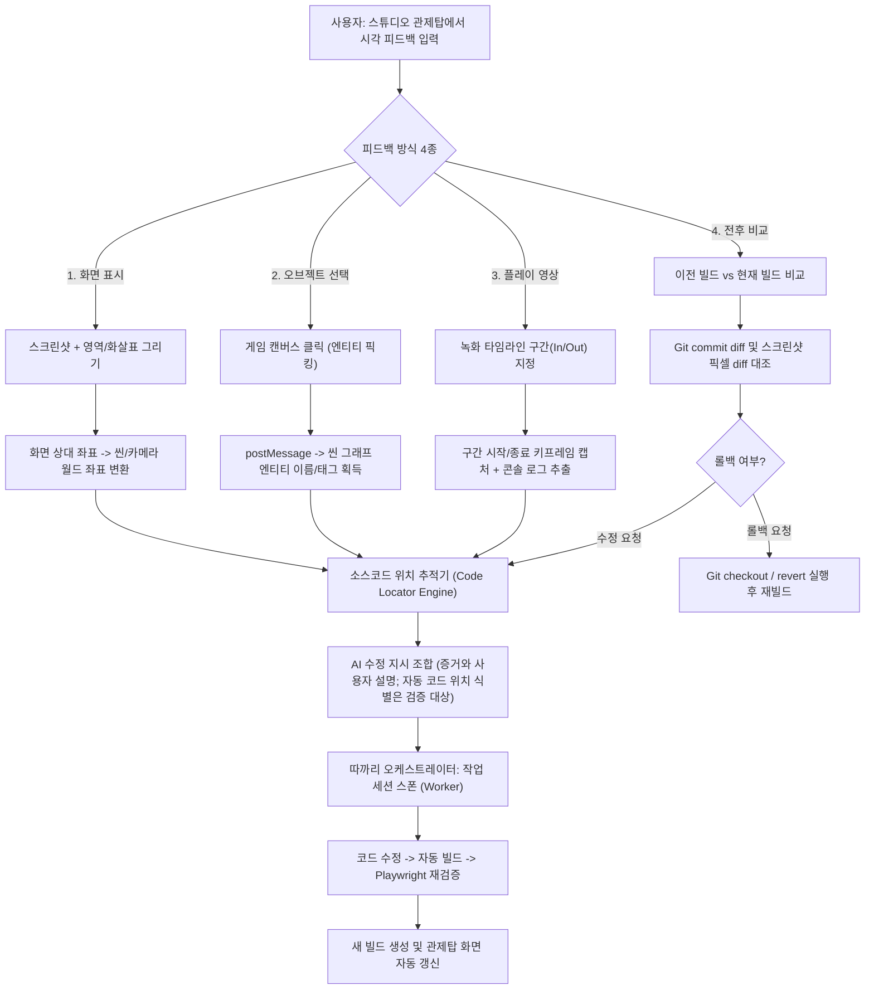

# 따까리 AI 게임 개발 스튜디오 (AI Game Development Studio) 조사·설계서

- **문서 위치**: `back/docs/design/game-studio.md`
- **작성일**: 2026-10-19
- **단계**: Phase 1 (조사·설계·WBS)
- **목표**: 코드와 게임 엔진을 모르는 사용자가 모바일 PWA에서 '게임 디렉터'로 아이디어를 제시하고 직접 플레이·시각 피드백을 주면, 기존 따까리 에이전트가 구현·빌드·검증·수정하는 게임 화면 중심 제작 스튜디오를 단계적으로 검증한다.

---

## 1. 개요 및 설계 원칙

### 1.1 배경 및 목적
사용자는 모바일 PWA 환경에서 원격으로 Mac Studio의 AI 에이전트를 조작한다. 기존 IDE 기반의 텍스트 코드 편집 방식은 비개발자 사용자가 게임의 흐름과 시각적 상태를 이해하고 피드백하기에 부적합하다.
따라서 본 시스템은 **게임 화면 중심의 관제탑 스튜디오(Game-Centric Cockpit)**를 제공하여, 사용자가 직접 게임을 플레이하고, 시각적 주석(스크린샷 표시, 오브젝트 선택, 영상 구간 지정, 전후 비교)을 통해 에이전트에게 직관적으로 수정을 지시할 수 있도록 한다.

### 1.2 핵심 설계 원칙
1. **특정 엔진·장르 비종속 (Engine-Agnostic Adapter Architecture)**:
   - 특정 게임 엔진(Phaser, Godot, Unity 등)에 종속되지 않는 공통 추상 어댑터 인터페이스(`GameEngineAdapter`)를 둔다.
   - 엔진별 지원 기능, 제약, 대체 수단을 기능 매트릭스로 명시한다.
2. **기존 따까리 인프라 재사용**:
   - 오케스트레이션·worker routing·Run 수명주기·PMS/WBS·Artifact·Git 작업 체크포인트를 우선 재사용한다. 실제 경로와 권한을 확인하지 않은 채 재사용률을 보장하지 않는다.
   - 새 작업 큐·버전 관리·빌드 보관 시스템은 만들지 않는다. 기존 모델로 표현할 수 없는 최소한의 게임별 상태만 코드 작성 전 설계·마이그레이션 필요성을 검증한다.
3. **사용자 확정 방향 잠금 (Locked Decisions Ledger)**:
   - 사용자가 승인한 핵심 콘셉트(예: "2D 도트 픽셀 그래픽", "탑다운 뷰", "그리드 기반 턴제")는 선택한 영속 저장소에 `locked_decisions`로 기록하고 worker prompt에 포함한다. 저장·revision·변경 승인 경로는 구현 전 확인하며, 이 guard는 아직 구현된 기능이 아니다.
4. **에셋 출처 및 라이선스 엄격 관리 (Asset Provenance & License Tracking)**:
   - 생성되거나 임포트된 에셋에 확인된 출처·라이선스 근거, 생성 모델/프롬프트(알려진 경우)를 연결해 추적성을 확보한다. 기록만으로 라이선스 적합성이 보장되지는 않는다.
5. **Git 기반 버전 관리·빌드 보존·회귀 테스트 (Deterministic Versioning & Rollback)**:
   - 모든 수정 단계는 Git 커밋 및 빌드 스냅샷으로 보존된다.
   - 플레이 테스트 실패 또는 사용자 요청 시 기존 버전을 보존하면서 이전 정상 상태로 복원하는 기능을 제공한다. 복원 절차와 승인 확인은 Phase 2에서 검증한다.
6. **실제 실행 및 플레이 검증 의무 (Verification Over Formality)**:
   - "코드를 작성했다"는 완료가 아니다. 실제 빌드 성공, 게임 실행, Playwright/엔진 테스트 러너를 통한 플레이 검증 증거(스크린샷, 콘솔 로그, FPS 측정값)가 수반되어야 완료로 인정한다.
7. **빌드 및 임의 코드 실행 보안 격리 (Isolated Build & Execution Boundary)**:
   - CSP와 iframe sandbox는 브라우저 렌더링 경계다. 호스트에서 실행되는 `npm install` 수명주기 스크립트·빌드 스크립트를 격리하지 않는다. 빌드 프로세스는 비밀이 없는 별도 OS/가상화 경계, 최소 권한, 네트워크 제한, CPU·메모리·시간 제한으로 실행하는 방안을 별도 검증한다. 그 경계가 입증되기 전에는 신뢰하지 않는 프로젝트의 설치·빌드를 자동 실행하지 않는다.

---

## 2. 조사 결과 및 실측 근거 (코드 근거: 파일:줄)

### 2.1 오케스트레이터 및 작업 분배 (Worker Routing)
- **근거 파일**:
  - `back/src/ttakkari/runs/worker_routing.py:21-80`
  - `back/src/ttakkari/runs/manager.py:248-360` (Run 접수·dispatch 경로)
  - `back/src/ttakkari/orchestrator/mcp_server.py:558-600` (worker 세션 도구 등록)
- **조사 내용**:
  - `TaskType`은 `general`, `routine`, `design`, `verification`, `reasoning` 다섯 가지이며 실제 후보 순서는 `worker_routing.py:71-80`의 `ROUTES`가 정본이다. 게임 작업에는 이 기존 분류만 사용하고 모델 이름·순서를 새로 가정하지 않는다.
  - 구현 뒤 검증 worker를 별도로 요청할 수 있지만, 라우팅만으로 독립된 컨텍스트·자동 플레이·회귀 테스트가 보장되지는 않는다. Phase 2는 worker 생성부터 결과 수신까지 실제 연결을 명시적으로 구현·검증한다.
  - 사용량 제한 시 프로필 선택과 대기는 기존 `profiles`/`RunManager` 경로를 재사용한다. 이는 항상 즉시 또는 무중단 폴백을 보장하는 계약이 아니다.

### 2.2 브라우저 및 GUI 자동화, 멀티미디어 도구
- **근거 파일**:
  - `back/README.md:15` ("macOS Codex 화면 검증: Node.js 18+·설치된 Google Chrome·Playwright MCP 런타임")
  - `back/docs/adr/0043-remote-desktop.md:21-28` (noVNC 기반 원격 화면 스트리밍)
- **조사 내용**:
  - README는 Node.js·Chrome·Playwright MCP 런타임을 일반 화면 검증 전제로 적는다. 이는 게임 프로젝트의 Playwright 패키지/API나 자동 테스트 러너가 이미 구현되어 있다는 뜻이 아니다.
  - 이 검토 실행 환경에서는 Playwright CLI는 PATH에 없지만 `~/Library/Caches/ms-playwright`에 Chromium·WebKit 브라우저 디렉터리가 있다. 설치된 브라우저 캐시만으로 게임 자동화 기능의 가용성을 보증할 수 없다.

### 2.3 프로젝트 디렉터리, 장시간 프로세스, iframe 서빙 및 보안 경계
- **근거 파일**:
  - `back/README.md:32-34` (`TTAKKARI_ALLOWED_ROOTS`와 기본 workspace 설정; 이 설정은 프로세스 샌드박스가 아님)
  - `back/src/ttakkari/api/artifacts.py:65-71,312-330` (Artifact CSP 및 bearer 인증)
  - `back/src/ttakkari/broker/policy.py:102-164` (파일 경로를 허용 루트에 제한; 임의 subprocess의 OS 접근을 격리하지 않음)
  - `back/docs/adr/0004-auth.md:8-11`, `back/src/ttakkari/api/auth.py:33-39` (메모리 access token, HttpOnly refresh cookie)
  - `back/src/ttakkari/main.py:229-232` (credential 포함 CORS; 런타임 allowlist 값은 설정 확인 필요)
  - `back/docs/design/generation-deployment.md:7,91` (기존 Cloudflare Tunnel → loopback Caddy/backend 진입점)
- **조사 내용**:
  - 게임 프로젝트 디렉터리 후보 `~/development/projects/games/<game_id>/`는 `~/development` 허용 상위 경로 아래에 둘 수 있다. 실제 Workspace 등록·경로 검증과 OS 프로세스 격리는 별개다.
  - 현재 따까리 아티팩트 서빙(`/api/artifacts/{id}/content`)은 보안 강화를 위해 `sandbox; default-src 'none'` CSP가 적용되어 자바스크립트 실행이 차단된다.
  - 기존 `/api/artifacts/{id}/content`는 `User` bearer 인증을 요구하며 `Content-Security-Policy: sandbox; default-src 'none'`로 실행을 막는다. 다운로드 링크는 짧은 수명 토큰으로 보호된다. 기존 경로를 iframe 게임 실행 용도로 재사용하면 안 된다.
  - 별도 게임 origin/서빙 계약은 아직 미설계·미구현이다. 기존 Cloudflare Tunnel은 loopback Caddy/backend 진입점으로 문서화되어 있어 같은 API origin의 경로만 나눠서는 origin 격리가 생기지 않는다. 새 게임 hostname/tunnel route는 운영 설정에서 확인하지 않았다.
  - access token은 프론트 메모리에, refresh token은 운영에서 HttpOnly/Secure/SameSite=None cookie로 API 도메인에 발급된다. credential CORS는 설정 allowlist 기반이나 운영 값은 확인하지 않았다. 게임 origin에는 cookie를 공유하지 말고 API 호출·credential 전달·CORS를 거부하는 별도 site origin을 tunnel/Caddy·쿠키 범위와 함께 보안 검증해야 한다.
  - 같은 origin에서 `allow-scripts`와 `allow-same-origin`을 함께 허용하면 게임 스크립트가 sandbox 해제를 시도할 수 있다. PWA와 분리된 origin, 세션 쿠키/토큰 미전달, 좁은 CSP, 명시적 `postMessage` origin/source/schema 검증을 우선 설계한다. CSP는 OS 빌드 프로세스의 격리 수단이 아니다.
  - 정적 빌드 산출물 서빙을 우선 검토하되, 경로 검증·빌드 스냅샷 권한·보관·삭제 정책과 서빙 origin을 Phase 2 보안 설계에서 확정한다.

### 2.4 실행 화면 스트리밍 비교 분석
- **비교**:
  1. **브라우저 게임 iframe 서빙 (Web Canvas)**:
     - 지연시간: 게임 렌더링은 클라이언트에서 수행되지만 다운로드·네트워크·브라우저 렌더링 지연은 남는다. 지연 실측 전 수치 보장은 하지 않는다.
     - 모바일 조작: Pointer Events 기반 입력을 구현할 수 있으나 지원 장치·전체 화면·회전·터치 상호작용 검증이 필요하다.
     - 시각 피드백: 부모는 cross-origin iframe canvas/DOM을 직접 읽을 수 없다. 캡처는 게임 origin 내부에서 만들고 `postMessage` 이미지 payload를 보내는 등 별도 계약이 필요하다. 부모는 허용된 `origin`·`source`·schema·크기만 검증한 뒤 표시하고, 메시지를 HTML로 실행하지 않는다.
     - 서버는 파일을 전달할 뿐 렌더링을 맡지 않는다. 정적 파일 전달 비용과 빌드 CPU/메모리는 별도다.
  2. **네이티브 창 캡처 스트림 (noVNC / WebRTC)**:
     - 지연시간: 네트워크 및 캡처·인코딩 구현에 따라 달라진다. 이 프로젝트에서 측정한 비교값은 없다.
     - 상호작용: 가상 마우스/키보드 오버레이 필요 (`examples/archetypes/remote.html`).
     - 오브젝트 선택: 단순 영상 스트림이므로 씬 내부 게임 오브젝트 직접 픽킹 불가 (화면 픽셀 좌표 역추정 필요).
     - 자원 소모: 서버 측 GPU 캡처 및 비디오 압축 부하 발생.
- **판단**: 기존 브라우저와 Node/npm 환경을 활용할 수 있어 웹 2D를 첫 실험 대상으로 택할 근거는 있다. 모바일 조작감·피드백·보안 적합성은 Phase 2에서 실측 후 유지 여부를 결정한다.

### 2.5 기존 WBS/PMS 구조 및 맥락 도서관 연동
- **근거 파일**:
  - `back/src/ttakkari/api/pms.py:20-27,43-77` (PMS API 모델; DB 모델은 `back/src/ttakkari/models.py:798-840`)
  - `back/docs/adr/0008-context-library.md:1-25` (임베딩 없는 PostgreSQL 키워드/온톨로지 검색)
  - `back/README.md:57-81` (맥락 도서관 지침 및 중복 저장 금지 원칙)
- **조사 내용**:
  - 게임 기획 및 개발 단계는 기존 따까리 PMS에 프로젝트(`PmsProject`) 및 WBS 트리(`PmsTask`)로 등록한다.
  - 게임의 세계관, 캐릭터 설정, 시스템 규칙 등 영속적 맥락은 별도 DB를 만들지 않고 기존 `remember` 및 맥락 도서관 온톨로지에 링크하여 단일 정본을 유지한다.

### 2.6 결과물 버전 관리 및 에셋 라이선스/대용량 관리
- **근거 파일**:
  - `back/README.md:101-105` (`refs/ttakkari/runs/<run_id>` 체크포인트 메커니즘)
  - `back/src/ttakkari/models.py:143` (`Workspace`), `:387` (`Artifact`), `:798` (`PmsProject`), `:815` (`PmsTask`)
- **조사 내용**:
  - README의 `refs/ttakkari/runs/<run_id>`는 Run 시작 시점 파일 복구 체크포인트다. 제품의 빌드 버전 목록·불변 빌드 아카이브·원클릭 롤백 API는 아니다.
  - 기존 Artifact는 파일 등록·미리보기·다운로드 메타데이터다. 성공한 게임 빌드의 불변 스냅샷과 선택적 Git 커밋을 별도 식별자로 연결하고, UI 노출·보존·검증을 하는 작업이 Phase 2에 필요하다.
  - 롤백은 기존 Run ref를 직접 checkout하는 것으로 처리하지 않는다. 선택한 정상 소스 상태에서 새 복구 커밋/빌드를 만들고 원본 빌드도 남기는 API 계약을 설계한다. 빌드 스냅샷 저장 방식은 구현 전 검증한다.

### 2.7 이 실행 세션에서 재확인한 도구 상태 (2026-10-19 18:22 KST)
아래는 문서 검토 세션에서 직접 실행한 결과다. Codex 실행 환경의 제한을 호스트 설치 상태로 일반화하지 않았다.
- **Node.js**: 설치됨 (`/opt/homebrew/bin/node`, version `v26.9.0`)
- **npm**: 설치됨 (`/opt/homebrew/bin/npm`, version `11.19.1`)
- **Godot / Unity / Unreal**: `command -v godot godot4 Unity UnrealEditor`에서 실행 파일 없음, `/Applications` 최상위 이름 검색 결과 없음(해당 검색 범위에서 미발견).
- **ffmpeg**: PATH 및 `/opt/homebrew/bin/ffmpeg`에 없음.
- **Playwright**: CLI는 PATH에 없으나 브라우저 캐시에 Chromium 1248·WebKit 2359/2370, Playwright ffmpeg 캐시가 있다. 게임 테스트 패키지·러너 설치와 동작은 미검증.
- **GPU/Metal**: 이 Codex 실행 세션의 `env_probe.py`에서 `gpu_metal`은 `MTLCreateSystemDefaultDevice returned nil`, `llama_list_devices`는 Metal 장치를 열거하지 못했다. 이 결과는 현재 실행 환경에 한정되며 호스트 GPU 사용 가능 여부를 판정하지 않는다.

> [!IMPORTANT]
Node/npm 버전이 확인됐다는 사실은 Phaser/Vite 의존성 설치 및 빌드가 검증됐다는 뜻이 아니다. 확인 명령은 `node --version`, `npm --version`, `command -v godot godot4 Unity UnrealEditor ffmpeg`, `/Applications` 이름 검색, Playwright 캐시 목록 조회였다.

### 2.8 외부 오픈소스 및 자동화 기술 조사
1. **웹 게임 프레임워크 비교**:
   - **Phaser 3**: 2D 게임 프레임워크 후보. 공식 프로젝트는 [MIT License](https://phaser.io/download/license)를 안내한다. 실제 도입 버전과 포함 패키지·플러그인 라이선스는 별도로 보존·확인한다. AI 생성 성공률 비교 자료는 수집하지 않아 상대 성공률 주장은 보류한다.
   - **PixiJS, Three.js / React Three Fiber, KAPLAY**: 기능·엔진 범위 후보. 코드 결함률, 학습 데이터 규모, 자동 수정 성공률을 비교 측정하지 않았다.
2. **Godot 4 헤드리스 및 웹 Export**:
   - 웹 Export와 CLI 사용을 후보로 둔다. 정확한 Godot 버전·템플릿·헤드리스 명령은 구현 시 공식 문서와 설치 환경에서 재검증한다.
   - SharedArrayBuffer를 사용하는 웹 빌드는 cross-origin isolation 헤더가 필요할 수 있다. 프로젝트·브라우저별 요구 헤더와 iOS 동작은 별도 실측한다. 엔진 라이선스와 포함하는 타사 플러그인은 선택 버전별로 확인한다.
3. **Unity / Unreal 빌드·테스트 후보**:
   - Unity Web 빌드의 모바일 지원·기능 제한은 현재 버전과 대상 브라우저에 따라 검증한다. 설치 용량과 라이선스 활성화 요구를 고정 수치로 단정하지 않는다.
   - Unreal 자동 빌드, Web/원격 실행 경로, 용량·라이선스는 선택 버전·플랫폼별 spike가 필요하다. 현재 비교 근거가 없어 Phase 2 지원 약속으로 취급하지 않는다.
4. **AI 자동 플레이 및 에셋 생성 오픈소스**:
   - **자동 플레이/테스트**: Playwright는 후보 도구다. 설치된 브라우저 캐시만으로 자동 실행이나 캔버스 내부 상태 검사 가능성을 보증하지 않는다. `window.__GAME_STATE__`는 게임이 별도로 제공해야 하는 계측 인터페이스다.
   - **2D 픽셀 에셋**: [Kenney는 에셋 페이지의 게임 자산을 CC0로 안내](https://kenney.nl/support)하지만, 사용할 각 파일과 타사 에셋은 포함된 license/source를 함께 보존한다. 절차적 이미지·Aseprite 도구는 도입 시 라이선스와 실행 경계를 확인한다.
   - **절차적 사운드**: jsfxr / sfxr는 후보 라이브러리다. 실제 패키지, 라이선스, 산출물 권리는 도입 시 확인한다.
   - **AI 로컬 이미지 생성**: 선택 사항이며 사용 가능한 호스트 GPU·모델·메모리·라이선스를 이번 실행에서 확인하지 않았다.

---

## 3. 시스템 아키텍처 설계

### 3.1 엔진 어댑터 추상 인터페이스 (GameEngineAdapter)
특정 엔진에 종속되지 않도록 다음과 같은 공통 인터페이스 계약을 정의한다.

```python
# back/src/ttakkari/games/adapter.py (설계 명세)
from abc import ABC, abstractmethod
from dataclasses import dataclass
from pathlib import Path
from typing import Any

@dataclass
class ProjectManifest:
    id: str
    name: str
    genre: str
    engine: str
    version: str
    entrypoint: str
    locked_decisions: list[str]

@dataclass
class BuildResult:
    success: bool
    build_id: str
    output_dir: Path
    bundle_files: list[str]
    log: str
    error: str | None = None

@dataclass
class TestResult:
    passed: bool
    fps_average: float
    error_logs: list[str]
    screenshots: list[str]
    game_state_dump: dict[str, Any]

class GameEngineAdapter(ABC):
    """모든 게임 엔진 어댑터가 구현해야 하는 표준 인터페이스"""

    @property
    @abstractmethod
    def engine_id(self) -> str:
        """엔진 식별자 (예: 'web-phaser', 'godot-4', 'web-threejs')"""
        pass

    @abstractmethod
    async def scaffold_project(self, project_path: Path, manifest: ProjectManifest) -> None:
        """초기 게임 프로젝트 보일러플레이트 생성"""
        pass

    @abstractmethod
    async def build(self, project_path: Path, build_id: str) -> BuildResult:
        """게임 빌드 및 정적 번들 생성"""
        pass

    @abstractmethod
    async def run_automated_test(self, project_path: Path, build_id: str, scenario: str) -> TestResult:
        """무인 플레이 테스트 및 캡처 실행"""
        pass

    @abstractmethod
    def get_runtime_serve_path(self, project_path: Path, build_id: str) -> Path:
        """iframe 또는 스트리밍 서빙을 위한 정적 빌드 디렉터리 경로 반환"""
        pass

    @abstractmethod
    def extract_scene_metadata(self, project_path: Path) -> dict[str, Any]:
        """게임 내 씬, 엔티티, 컴포넌트 목록 추출 (시각 피드백 매핑용)"""
        pass
```

### 3.2 엔진별 기능 지원 매트릭스 및 제약 대응

| 기능 축 | Web - Phaser 3 (Phase 2 첫 후보) | Godot 4 (후속 후보) | Web - Three.js (후속 후보) | Unity / Unreal (장기 검토 후보) |
|---|---|---|---|---|
| **렌더링 방식** | HTML5 2D Canvas / WebGL 후보 | Web export 또는 네이티브 창; 버전별 확인 | WebGL / WebGPU 후보; 브라우저별 확인 | Web export 또는 원격 렌더링 여부 확인 필요 |
| **관제탑 서빙** | 별도 보안 origin의 정적 iframe 후보; 미구현·지연 미측정 | Web export 또는 별도 원격 화면; 미검증 | 정적 iframe 후보; 미검증 | 대용량/원격 화면 선택 필요 |
| **모바일 터치 조작** | Pointer Events 처리 후보; 기기 실측 필요 | Web export 지원 확인 필요 | 게임별 제어 구현 필요 | 입력 UI·플랫폼별 확인 필요 |
| **오브젝트 선택/추적** | 게임별 계측·검증된 메시지 브리지 필요 | adapter/debug API 조사 필요 | Raycasting 구현 후보 | 엔진별 조사 필요 |
| **빌드 도구/속도** | Vite 후보; 설치·빌드 미실행 | CLI/export template 필요 | Vite 후보; 설치·빌드 미실행 | 설치·라이선스·시간 확인 필요 |
| **Mac Studio 의존성** | Node.js v26 (설치됨; 게임 빌드 미검증) | Godot 설치·템플릿 및 모바일 export 검증 필요 | Node.js v26 (설치됨; 게임 빌드 미검증) | 설치 용량·라이선스·실행 경로 확인 필요 |
| **제약 시 대체 방법** | 검증된 단순 2D scaffold로 범위 축소 | 지원 버전·템플릿 확인 후 플랫폼 대안 제시 | Phaser 2D 또는 검증된 Web 렌더러 후보 | 별도 환경·비용 검증 뒤 지원 여부 결정 |

이 표는 후보와 검증 항목을 구분하는 계획표다. Phase 2를 통과하기 전에는 엔진별 기능·기기 지원을 제공 기능으로 보장하지 않는다.

---

## 4. 기존 모델 재사용 및 게임별 데이터

현재 PMS 프로젝트/WBS, Workspace, ChatSession/Run, Artifact, Git Run 체크포인트가 있다. 게임 프로젝트는 이 정본들을 우선 연결한다. 아래 필드는 제품 요구사항이며 별도 SQLAlchemy 모델이 이미 존재한다는 뜻은 아니다.

- 게임 콘셉트/엔진 식별: PMS 프로젝트 설명 또는 project-scoped 설계 문서
- 사용자 확정 방향 잠금과 변경 승인 이력: 명시적 revision이 필요할 때에만 최소 도메인 저장소 추가
- 에셋: Workspace 파일 + Artifact 등록에 출처·라이선스 근거 연결
- 빌드/테스트: Run 결과·Artifact를 재사용하되, 불변 build ID·소스 commit·상태 연결이 불가능한 부분만 최소 확장
- 시각 피드백: Artifact 스크린샷 + 구조화 payload + 이를 처리한 worker Run 참조. 별도 큐/작업 시스템은 만들지 않는다.

신규 테이블 필요성은 구현 전 각 필드가 기존 `Workspace`, `PmsProject`/`PmsTask`, `Run`, `Artifact` 또는 project 문서로 보존되지 않는 사례를 보여 검증한다. Alembic migration은 `uv run ttakkari migrate` 경로로 적용한다. REST router는 `src/ttakkari/main.py`의 `include_router` 목록, MCP 도구는 `src/ttakkari/orchestrator/mcp_server.py`의 `@server.tool()` 등록 방식에 추가한다.

### 4.1 요구 데이터와 피드백 연결 (구현 전 검증 대상)
1. **잠금된 결정**:
   - `statement`: 확정된 의사결정 내용.
  - 구현 시 worker prompt에 포함한다. 기술적 강제와 사용자 변경 승인 이력은 별도 구현·검증 대상이다.
2. **에셋 출처**:
  - `source` & `license`: 출처와 근거를 기록한다. 이것만으로 저작권·라이선스 적합성이 보장되지는 않는다.
3. **시각 피드백**:
   - `feedback_type`: 4대 피드백 방식 구분.
   - `visual_payload`: 캔버스 상의 상대 좌표(`x: 0.42, y: 0.65`), 바운딩 박스(`[x1, y1, x2, y2]`), 선택된 게임 오브젝트 키(`player_sprite_01`), 타임라인 구간(`start_ms: 1200, end_ms: 3400`)을 구조화하여 저장.

---

## 5. 피드백 파이프라인 및 소스코드 추적 매핑

사용자의 시각적 피드백이 AI 에이전트의 구체적 코드 수정 작업으로 연결되는 파이프라인을 설계한다.



### 5.1 4대 피드백 방식 상세 설계

#### 1) 화면 표시 (스크린샷 주석 피드백)
- **동작**: 관제탑 뷰포트에서 '캡처' 버튼 클릭 → 현재 캔버스 프레임 캡처 → 사각형 영역 선택, 화살표 그리기, 텍스트 코멘트 입력.
- **추적 방법**:
  - iframe bridge가 지원되면 클릭 좌표 $(x_c, y_c)$는 0.0~1.0의 상대 비율로 저장한다.
  - 게임 런타임 헬퍼(`TtakkariBridge`)가 현재 씬의 카메라 위치 $(cam_x, cam_y)$ 및 줌 배율을 합산하여 월드 좌표 $(w_x, w_y)$로 변환.
  - 게임 런타임이 명시적 엔티티 ID·좌표를 보고하도록 계측한 경우에만 런타임 대상과 연결할 수 있다. 해당 ID를 소스 파일·줄 번호로 역추적하는 기능은 현재 존재하지 않으며 별도 구현·정확도 검증이 필요하다.

#### 2) 게임 오브젝트 선택 (Entity Picking)
- **동작**: '오브젝트 선택' 모드 활성화 → 게임 화면 내 캐릭터/몬스터/UI 터치 → 해당 엔티티에 하이라이트 박스 표시 및 속성 팝오버 노출.
- **추적 방법**:
  - `Phaser.GameObjects.GameObject`에 등록된 `name`, `type`, `texture.key`, 바운딩 박스를 `TtakkariBridge.pickObjectAt(x, y)`로 질의.
  - 결과 페이로드 예시의 `entity_name`, `texture`, `scene`은 게임이 bridge에 제공하도록 만들 후보 값이다. `source_hint`는 현재 제공되지 않는 가상 정보다.
  - AI에 화면 좌표와 관측 정보를 전달해 소스 후보를 조사하도록 한다. 코드 위치를 직접 식별하거나 탐색 시간을 0으로 보장하지 않는다.

#### 3) 플레이 영상 녹화 및 타임라인 구간 피드백
- **동작**: 사용자가 게임 플레이 중 '녹화' 버튼을 누르면 브라우저 `MediaRecorder` API로 캔버스 스트림을 WebM 형식으로 메모리 버퍼링.
- **구간 지정**: 녹화 완료 후 타임라인 슬라이더에서 문제 발생 구간(예: 00:03 ~ 00:05 "점프 시 벽에 끼임") 지정.
- **데이터 경량화**:
  - 구간 추출 시 선택 구간 클립 또는 대표 프레임/로그 중 실제 구현 가능한 형식과 개인정보·용량 제한을 검증한다. 3개 프레임만으로 문제 구간이 충분하다는 검증은 없다.
  - 전체 녹화 업로드를 기본으로 가정하지 않는다. Phase 3에서 필요한 구간만 추출하고 사용자가 전송 내용을 확인할 수 있게 한다.

#### 4) 전후 비교 및 정상 버전 롤백
- **동작**: 관제탑 하단 갤러리/비교 탭(`examples/archetypes/gallery.html`)에서 이전 정상 빌드(Build A)와 방금 수정한 빌드(Build B)를 비교.
- **롤백**: Phase 2 필수 범위. 선택한 정상 빌드의 소스 commit과 불변 빌드 artifact를 기준으로 복구 요청 API가 새 복구 변경/빌드를 만들고, 원래 버전과 실패한 변경 이력을 모두 보존하는 계약을 구현·검증한다. 공유 워크트리에 `git checkout <tag> -- .`를 직접 실행하는 구현은 동시 작업물을 덮을 수 있으므로 사용하지 않는다.

---

## 6. 오케스트레이터 연동 및 빌드 보안 격리

### 6.1 오케스트레이터 연동 및 모델 분배 흐름
1. 기존 `/chat`·`/work`의 어떤 접수 경로가 개인 게임 프로젝트 세션으로 이어질지 아직 미구현이다. 게임 전용 세션을 따로 만들기 전에 기존 `ChatSession`, workspace와 PMS 프로젝트의 연결 방법을 정한다.
2. 기존 MCP `spawn_worker(title, prompt, ..., task_type=...)`는 `orchestrator/mcp_server.py:558-600`에서 제공된다. 게임 피드백 기능은 여기에 별도 큐를 덧붙이지 말고 프로젝트·빌드 ID·스크린샷 주석·잠금 결정·테스트 기준을 self-contained prompt로 전달하고, 반환된 worker/session/Run을 기존 메시지 도구와 상태 표시로 이어야 한다.
3. 라우트 유형은 작업에 따라 `design`, `general`, `routine`, `verification` 중 선택한다. 엔진 코드 수정·빌드·Playwright 검증이 현재 자동 연결돼 있다고 간주하지 않는다. 먼저 빌드 보안 격리를 통과한 경로에서만 명령을 실행한다.

### 6.2 빌드 보안 격리 및 안전장치 (Security Boundary)
- **임의 코드 실행 위험**: 사용자가 제공한 스크립트나 AI가 작성한 `package.json`의 `postinstall` 또는 빌드 스크립트가 호스트 시스템을 침해할 위험.
- 기존 File Broker는 파일 API 경로를 검증할 뿐 임의 자식 프로세스의 읽기·쓰기 권한을 통제하지 않는다. workspace 루트 제한을 npm lifecycle/build 프로세스 격리로 표현하지 않는다.
- Codex OS sandbox는 해당 실행 형태에 적용될 수 있으나 engine별 동작 차이가 있으며 Claude hook은 독립적인 OS 격리 경계가 아니다. 외부 네트워크 차단도 호스트 프로세스에서 확인되지 않았다.
- **빌드 실행 관문**: 사용자 비밀·하네스 파일이 없는 임시 작업 복사본에서 무권한 계정/컨테이너/VM 중 실제 지원되는 경계를 검증한다. 읽기 전용 base, 제한된 쓰기 산출물, 네트워크 기본 차단(필요 시 정확한 registry만 허용), CPU/메모리/시간·디스크 한도, 종료 후 정리와 탈출 음성 테스트가 필요하다. Phase 2 시작 시 이 경계가 준비되지 않으면 `npm install`/build 실행을 막고 security spike에 머문다.
- **브라우저 실행 관문**: 기존 Artifact endpoint는 CSP sandbox이며 bearer 보호를 쓴다. 이를 실행 가능한 게임 응답으로 바꾸지 않는다. 게임은 PWA와 다른 registrable domain에서 제공해 API 쿠키의 same-site 전송 경로를 분리하고, 게임 요청에는 Ttakkari bearer/cookie를 붙이지 않는다. 프레임 CSP는 최소 권한(`default-src` 제한, `connect-src 'none'`, `form-action 'none'`, `base-uri 'none'`, 정확한 PWA `frame-ancestors`)으로 시작해 실제 엔진이 요구하는 자원만 허용한다. `allow-scripts`/`allow-same-origin` 사용은 별도 사이트 경계와 sandbox 설정을 함께 검토하고, top navigation·폼·팝업을 허용하지 않는다. 브리지 메시지는 `origin`, `source`, schema, 크기와 속도를 검증하고, 캡처 이미지/데이터를 HTML로 해석하지 않는다. iframe의 canvas/DOM을 부모가 직접 읽을 수 없으므로 캡처는 게임 측 bridge가 전달하는 흐름으로 설계한다. CSP만으로 호스트 빌드는 격리되지 않는다.

---

## 7. 관제탑 UX 설계 (모바일 PWA 우선)

디자인 시스템(`winterholic-design-system/ttakkari`)의 `H 창작 작업대` 아키타입을 기준으로 하고 비교는 `J 결과 갤러리` 패턴을 참조한다. 실제 구현 시 예제를 복사하고 디자인 시스템 규칙을 따른다.

### 7.1 화면 레이아웃 (H 창작 작업대 + J 결과 갤러리 변형)
- **기반 아키타입**: `examples/archetypes/creative.html`(창작 작업대)을 기준으로 하고, `examples/archetypes/gallery.html`(결과 비교) 및 `examples/archetypes/pull-request.html`(활동/승인)에서 필요한 패턴을 참조한다.
- **모바일 뷰포트 (320px · 390px)**:

```
┌────────────────────────────────────────────────────────┐
│ [헤더] ← 게임 스튜디오 / Flappy Dot (v0.1.2) [더보기]  │
├────────────────────────────────────────────────────────┤
│ [메타 칩 바] [장르: 아케이드] [엔진: Phaser 3] [상태]│
├────────────────────────────────────────────────────────┤
│                                                        │
│               [ 게임 캔버스 뷰포트 ]                   │
│          (16:9 또는 1:1 반응형 비율 고정)              │
│                                                        │
│  [HUD 오버레이: ▶ 재생  ❚❚ 일시정지  📷 캡처  ⛶ 전체화면] │
├────────────────────────────────────────────────────────┤
│ [피드백 액션 바 (세그먼트 탭)]                         │
│ [ ① 화면 주석 | ② 오브젝트 선택 | ③ 영상 녹화 | ④ 전후비교 ] │
├────────────────────────────────────────────────────────┤
│ [시각적 피드백 입력 영역]                              │
│ ┌────────────────────────────────────────────────────┐ │
│ │ "주인공 점프가 너무 무거워요. 20%만 가볍게 해주세요"│ │
│ └────────────────────────────────────────────────────┘ │
│ [📎 스크린샷/영역 첨부됨] [ 🚀 AI 수정 요청 (Primary) ] │
├────────────────────────────────────────────────────────┤
│ [하단 탭: 작업 이력(WBS) | 에셋 보관함 | 잠금된 결정]  │
└────────────────────────────────────────────────────────┘
```

### 7.2 디자인 시스템 토큰 및 컴포넌트 준수 규칙
- **원칙**: 디자인 시스템 절대 규칙 6종 준수 (`00-decision-guide.md:46-53`).
  - hex/rgb 하드코딩 금지, `--tk-*` 시맨틱 토큰 사용.
  - 사람이 누르는 주 버튼: Blue (`color.action.primary.bg` = `#296EB4`).
  - 에이전트 상태/실행 중: Mint (`color.text.agent` = `#1C684F` / `#00F0B5`).
  - 승인 대기/잠금: Amber (`color.status.warning`).
  - 오류/위험/롤백: Red (`color.action.danger.bg` = `#C93A35`).
- **핵심 컴포넌트**:
  - `tk-canvas` / `tk-stream`: 게임 뷰포트 래퍼.
  - `tk-toolbar`: 캔버스 상단/하단 조작 바.
  - `tk-segmented`: 피드백 모드 전환 (1 화면주석 / 2 오브젝트 / 3 녹화 / 4 비교).
  - `tk-chip`: 장르, 엔진, 빌드 버전, FPS 표시.
  - `tk-banner`: 롤백 알림 및 잠금된 결정 경고.
  - `tk-dialog`: 버전 롤백 최종 확인(되돌리기 어려운 행동).

---

## 8. 단계별 개발 범위 (Phase 1 ~ Phase 4)

### Phase 1: 조사·설계·WBS (검증 반영)
- Node/npm 버전과 CLI/브라우저 검색을 재실행하고 Codex sandbox 결과를 호스트 실측과 분리했다.
- 아키텍처 및 엔진 어댑터 명세 수립.
- 게임 데이터 모델 및 피드백 파이프라인 설계.
- 관제탑 PWA UX 설계.
- ADR 0046 작성 (Phase 2 실험용 첫 어댑터 선정; 번호 충돌 해결).
- PMS 프로젝트를 확인·보정했고 Phase 2의 14개 작업에 각각 시간 상한·검증 조건·선행 관계를 기록했다.

### Phase 2: 최소 기능 구현 및 E2E 검증 (차기 단계)
- 백엔드:
  - 프로세스 격리 spike 통과 후, 기존 PMS/Workspace/Session/Run/Artifact/Git 체계에 연결한 최소 데이터·Phaser adapter·불변 빌드 스냅샷 구현.
  - 사용자 인증 경로와 분리된 게임 origin 서빙, 실제 worker 개발 요청/상태 연결, Playwright 빌드 검증.
- 프론트엔드:
  - 관제탑 기본 PWA 화면 (`/games/:id`) 구현.
  - 게임 iframe 임베딩 및 HUD (재생/일시정지/캡처).
  - 화면 스크린샷 캡처 및 주석(영역 박스, 코멘트) 입력 폼.
  - AI 수정 요청 트리거 및 빌드 갱신 반영.
- E2E 검증:
  - 아래 12단계 시나리오와 정상 버전 복구를 1종의 실제 게임에서 끝까지 실측한다. 모의 응답/fixture만으로 Phase 2 완료를 인정하지 않는다.

### Phase 3: 피드백 파이프라인 고도화 및 멀티 에셋 확장
- 게임별 오브젝트 픽킹 bridge와 소스 위치 상관관계 고도화.
- 플레이 영상 녹화 및 선택 구간 피드백 추출.
- 에셋 파이프라인: Kenney CC0 팩 자동 검색 및 jsfxr 절차적 사운드 생성기 연결.

### Phase 4: 다중 엔진 어댑터 확장 및 운영 안정화
- Godot 4 헤드리스 웹 export 어댑터 구현.
- Three.js 3D 웹 게임 어댑터 구현.
- 대용량 에셋 CAS 저장소 및 Git LFS 최적화.
- 다중 플레이어 웹소켓 테스트 지원.

---

## 9. Phase 2 WBS 초안 (시간 상한 2시간, 초과하면 재분할)

아래 시간은 구현 견적이 아니라 한 작업 세션의 제한이다. 각 작업은 끝나면 명시된 완료 기준을 확인한다. `Game*` 테스트 경로는 해당 작업이 테스트를 추가한 뒤 실행하는 검증 명령이며, 존재하지 않는 테스트를 지금 실행한 결과가 아니다. 작업 단계는 백엔드 Alembic 및 `main.py` router 등록, 프론트 `BrowserRouter`와 Vitest, MCP `@server.tool()` 방식을 따른다.

### [트랙 A: 백엔드 코어 & 어댑터]
1. **TASK-G01: 격리 빌드 경계 spike (2h)** — 구현 후보(무권한/container/VM)에서 탈출·비밀·네트워크 음성 사례를 확인. 미통과 시 후속 빌드 작업 보류. `uv run pytest -q tests/test_game_build_isolation.py`
2. **TASK-G02: 기존 모델 연결 및 최소 schema/API 계약 (1.5h)** — PMS project, workspace, session, Run, Artifact의 소유권 표와 필요 최소 필드 결정; 전용 큐/버전 테이블 배제 사유 기록. `uv run pytest -q tests/test_game_contract.py`
3. **TASK-G05: 최소 Alembic migration 또는 no-migration 결정 (1.5h)** — G02 계약의 필요한 필드만 반영한다. 완료: migration 적용 또는 no-migration 근거 기록; migration이 있으면 `uv run ttakkari migrate` 및 테스트 DB upgrade/downgrade 확인. 검증: `uv run pytest -q tests/test_game_migration.py`
4. **TASK-G03: Phaser 프로젝트 scaffold·격리 build adapter (2h)** — 잠금 결정 manifest를 읽고 테스트 프로젝트 빌드; arbitrary paths 거부. `uv run pytest -q tests/test_game_adapter.py`
5. **TASK-G04: 불변 빌드 스냅샷·Artifact 등록 (1.5h)** — 성공/실패 빌드 ID, source commit, 번들 위치/해시, Run/Artifact 연결; 재빌드가 이전 산출물을 변경하지 않음. `uv run pytest -q tests/test_game_build_snapshots.py`
6. **TASK-G06: 프로젝트·빌드 API (1.5h)** — 인증된 사용자만 기존 project/workspace에 새 게임 연결, 상태·빌드 목록 조회; 권한 없는 ID와 잘못된 경로 거부. `uv run pytest -q tests/test_api_games.py`
7. **TASK-G07: 별도 게임 origin 정적 서빙 경계 (2h)** — 세션 bearer와 쿠키 없이 빌드 제공, CSP/sandbox/cookie/CORS·path traversal 검증. 같은 origin에서 PWA 토큰/API에 접근 못함. `uv run pytest -q tests/test_game_serving_security.py`
8. **TASK-G08: worker 개발·검증 연결 (2h)** — MCP `spawn_worker`에 project/build/locked decisions/작업 prompt 전달, 반환 session/Run 상태를 기존 도구로 읽고 보고. 중복 queue 없음. `uv run pytest -q tests/test_game_worker_flow.py`

### [트랙 B: 프론트엔드 관제탑 UX]
9. **TASK-G09: 프론트 라우트·게임 플레이어 (1.5h)** — 기존 `BrowserRouter` `../front/src/App.tsx`에 `/games/:id`, 앱 인증 셸, 별도 origin sandbox iframe. `cd ../front && pnpm exec vitest run src/features/games/GameCockpit.test.tsx`
10. **TASK-G10: 캡처·영역·화살표·주석 (1.5h)** — 캡처 출처/빌드 ID와 정규화 좌표를 payload에 저장. `cd ../front && pnpm exec vitest run src/features/games/VisualFeedback.test.tsx`
11. **TASK-G11: 피드백 저장·worker 시작·상태 연결 (1.5h)** — 사용자 코멘트와 screenshot Artifact, project/build ID를 worker prompt에 포함하고 Run 카드로 상태/완료를 표시. `cd ../front && pnpm exec vitest run src/features/games/FeedbackSubmission.test.tsx`
12. **TASK-G13: 실제 브라우저 플레이 smoke (1.5h)** — 격리 환경에서 1게임 실행, 터치/키 입력, 콘솔 에러와 스크린샷 확보. 임의 FPS 목표를 강제하지 않음. `uv run pytest -q tests/test_game_browser_smoke.py`
13. **TASK-G12: 재빌드 전후 확인·정상 버전 롤백 API/UI (2h)** — 이전 빌드와 새 빌드 확인, 명시적 롤백 API가 기존 빌드 보존 및 새 복구 commit/build 생성. `cd ../front && pnpm exec vitest run src/features/games/GameRollback.test.tsx` 및 `uv run pytest -q tests/test_game_rollback.py`

### [트랙 C: E2E 통합 검증]
14. **TASK-G14: 12단계 실제 에이전트 E2E (2h, 초과하면 시나리오 준비와 실행/증거 검토로 분리)** — 실제 worker가 코드를 쓰고 빌드/브라우저가 실행되는 흐름, 스크린샷 수정, 재빌드, 전후 확인, 정상 버전 복원을 증거로 남김. mock만으로 성공 판정 금지. `uv run pytest -q tests/test_e2e_game_studio.py`

---

## 10. 필수 E2E 시나리오 실측 방안

Phase 2의 필수 시나리오이며 실제 게임 화면·worker 변경·빌드에서 각 단계의 증거를 확인한다.
1. 아이디어 입력 및 사용자와 장르/플랫폼/제약 정리.
2. 스택·엔진 선택과 지원/제약/대체 방법 설명.
3. 게임 프로젝트·PMS/WBS와 전용 작업 컨텍스트 생성.
4. 잠금 결정 및 출처·라이선스 정책 기록.
5. 기존 오케스트레이터가 실제 개발 worker를 시작하고 소스/에셋을 생성.
6. 격리 빌드, immutable build snapshot 및 test 결과 보존.
7. 게임 origin의 관제탑 화면에서 빌드를 열고 사용자가 직접 플레이.
8. 스크린샷 캡처, 영역/화살표/주석을 넣어 선택 빌드와 함께 제출.
9. worker가 피드백과 잠금 결정을 읽고 실제 소스 수정.
10. 격리 재빌드·회귀 테스트 후 새 빌드와 증거를 보존.
11. 전후 빌드 화면/로그를 비교해 사용자가 수정 결과를 확인.
12. 이전 정상 버전 복원 API를 실행해 새 복구 빌드를 만들고 원래·수정·복구 빌드가 모두 남았음을 확인.

---

## 11. 검증 노트 (2026-10-19 독립 대조)

- **작업 라우팅**: `worker_routing.py:21,71-80`에는 다섯 `TaskType`과 후보 route가 있다. `manager.py:248-360`은 기존 Run 접수·dispatch 수명주기다. `mcp_server.py:558-600`에는 `spawn_worker`가 있지만 게임 프로젝트·피드백·빌드 연결은 없다. 자동 게임 worker 파이프라인을 이미 지원한다고 쓴 내용을 요구사항/Phase 2 작업으로 수정했다.
- **Artifact·보안**: `api/artifacts.py:65-71,312-330`은 bearer 인증과 `sandbox; default-src 'none'` CSP를 적용한다. `broker/policy.py:102-164`는 파일 경로를 검사하며 빌드 subprocess 격리가 아니다. iframe 실행과 npm lifecycle/build 프로세스를 분리하고, 별도 게임 origin 및 별도 OS 격리 경계를 검증 선행조건으로 기록했다.
- **인증·Cloudflare**: `adr/0004-auth.md:8-11`, `api/auth.py:33-39`, `main.py:229-232`는 메모리 access token, HttpOnly/Secure/SameSite=None refresh cookie, 설정 기반 credential CORS를 보여 준다. `design/generation-deployment.md:7,91`은 기존 tunnel이 loopback Caddy/backend의 8787 진입점임을 기록한다. 운영 CORS allowlist와 새 게임 hostname/tunnel route 설정은 확인하지 않아 별도 origin 분리를 배포된 경계로 표현하지 않았다.
- **기존 정본 재사용**: `models.py:143,158,243,387,798,815`는 Workspace, ChatSession, Run, Artifact, PMS project/task다. `README.md:101-105`의 `refs/ttakkari/runs/<run_id>`는 Run 복구용 체크포인트이지 제품 빌드 목록·불변 스냅샷·롤백 API가 아니다. 기존 모델·Artifact를 먼저 활용하고 별도 버전/작업 큐와 불필요한 6개 도메인 테이블 제안을 제거했다. 빌드 스냅샷·복구 API는 Phase 2 필수 작업으로 추가했다.
- **구현 경로**: Alembic 적용은 `uv run ttakkari migrate` (`src/ttakkari/cli.py:24-32`), API router 등록은 `src/ttakkari/main.py:264-285`, MCP worker tool은 `mcp_server.py:552-600`의 `@orchestrator_tool`/`server.tool()` 경로다. 프론트는 `../front/src/main.tsx:9`, `../front/src/App.tsx:47-105`의 `BrowserRouter/Routes`; 실제 Vitest 스크립트·명령을 기준으로 경로를 고쳤다. 디자인 시스템 `docs/21-page-archetypes.md`는 `examples/archetypes/` 아래 예제를 참조한다.
- **도구 실측**: `node --version` → `v26.9.0`, `npm --version` → `11.19.1`; Godot/Unity/Unreal/ffmpeg 실행 파일은 PATH에서 못 찾았고 `/Applications` 최상위 이름 검색에서도 미발견했다. Playwright CLI는 없지만 Chromium·WebKit·ffmpeg 캐시 디렉터리가 존재했다. Phaser/Vite 설치·빌드·게임 실행은 미실행. 상세는 §2.7.
- **외부 기술 근거**: [Phaser 공식 라이선스](https://phaser.io/download/license)는 MIT, [Kenney 지원 안내](https://kenney.nl/support)는 에셋 페이지의 게임 자산을 CC0로 안내한다. [Unity 6 시스템 요구사항](https://docs.unity3d.com/6000.0/Documentation/Manual/system-requirements.html)은 iOS Safari 15+ 등 브라우저 지원 조건을 제시하지만 특정 게임의 모바일 성능을 보장하지 않는다. [Unreal Pixel Streaming 문서](https://dev.epicgames.com/documentation/en-us/unreal-engine/pixel-streaming-in-unreal-engine)는 원격 앱·WebRTC 서비스 구성을 설명한다. 설치 용량·빌드 시간·AI 성공률 비교 수치는 근거가 없어 제거했다.
- **주장 축소**: `0ms`, `100% 자동화`, “AI 환각/수정 오류가 현저히 낮다”, FPS 60 강제, 1~3초 빌드 및 측정되지 않은 후보 우위 표현을 제거하거나 확인 필요로 바꿨다. Phase 2 WBS는 9개 포괄 작업을 14개 최대 2시간 작업으로 나누고 worker 연결, immutable build 보존, rollback API, 브라우저 smoke와 12단계 E2E를 분리했다.
