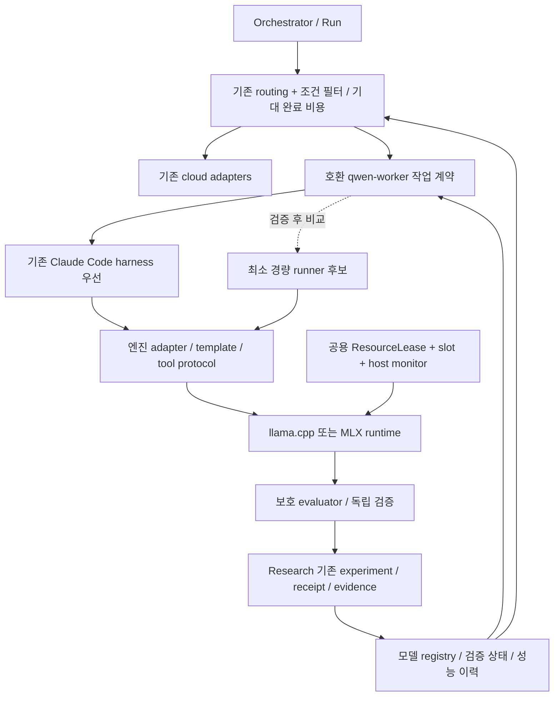

# 따까리 로컬 LLM 작업자 리팩토링 설계

작성일: 2026-10-23 KST. 상태: **설계·PMS 기준선, 구현 및 운영 성과 미검증**.

- 신규 PMS: **따까리 · 로컬 LLM 작업자 리팩토링**, personal, `0b1a2a57-eb19-4da0-b572-ab783d6a6735`.
- 연계 PMS: **따까리 AI Research Lab**, `664a2c29-b3d1-425c-b016-6c430cb7a7dc`.
- 조사 기준 main: `4f14f380c1aa3af435384bed53f762a11e6e2831`. 공유 checkout은 다른 작업의 변경이 있어 수정하지 않고 origin/main의 별도 worktree에서 작성한다.
- 운영 조회: 이번 Run의 `GET http://127.0.0.1:8787/api/version`은 `710f184c9a99616fad8cfaf28b77c4771f32e81e`, PID 88287을 반환했다. 해당 release 디렉터리의 존재도 확인했다. main 코드와 배포본이 같다고 가정하지 않는다.
- 이번 Run의 실행 범위는 **기존 자료·코드·공식 웹 확인, 이 문서 main 푸시, PMS 등록·조회**다. 구현, 새 모델 다운로드, 벤치마크, 모델 시작·종료, 학습, 운영 설정·배포 변경은 하지 않는다. 아래 명세와 숫자 중 ‘제안’은 향후 검증 기준이며 측정 결과가 아니다.

## 1. 결정과 목표

**모델을 먼저 정하지 않는다.** 기존 Qwen 작업자 계약과 Claude Code 하네스를 우선 재사용하고, 모델 레지스트리·엔진별 실행 설정·평가 receipt를 그 뒤에 연결한다. 기존 Qwen3.5-4B MLX 자산부터 작은 파일럿을 시작할 수 있게 계획하되, FlashNext보다 낫다는 결론은 같은 과제와 검증기에서 실측한 뒤에만 내린다. 별도 경량 실행기는 같은 기능을 다시 만드는 비용보다 실제 완료 효율의 이득이 클 때만 도입한다.

Mac Studio M5 Max 64GB에서 컨텍스트 능력과 코딩 품질을 유지하면서 자원과 검증된 작업 완료 시간을 줄인다. 로컬을 평시 클라우드와 협업하는 정식 작업자로 만들고, 최종적으로 사용자가 모델을 고르지 않아도 자원·작업 특성에 맞는 조합을 선택하게 한다. 로컬 사용량 자체는 목표 지표가 아니다.

비용은 레지스트리·receipt·검증기 유지, 엔진별 템플릿/도구 호환성 관리, 독립 검증과 모델 전환 시간이다. 기능을 추가했는데 E2E가 개선되지 않거나 실패/운영 간섭이 늘면 해당 변경을 기각한다. 원본 모델·실험·클라우드 경로와 되돌릴 수 있는 설정을 보존한다. AI Research를 별도 거대 MLOps 플랫폼으로 확장하지 않는다.

## 2. 근거와 신뢰도

### 2.1 근거 구분

| 표시 | 의미 | 이번 문서의 적용 범위 |
|---|---|---|
| 현재 확인 | 이번 Run에서 읽거나 조회한 사실 | version 응답, 별도 main 소스, 기존 raw/정정 문서, PMS API, 공식 모델 카드·엔진 코드 |
| 과거 실측 | 당시 환경의 원자료/정정 보고 | 10월 16~18일 벤치; 이번 Run 재실행 아님 |
| 코드 확인 | 구현 계약이 소스에 있음 | 운영에서 해당 경로가 성공했다는 증명과 별개 |
| 추정 | 근거로부터 해석한 원인/효과 | 페이징이 성능 저하의 주원인이라는 설명 등; 원인 확정 금지 |
| 제안 / 확인 필요 | 향후 정책·예산 또는 아직 검증하지 못한 사실 | 모든 신규 adapter·자동배정 확장·학습·후보의 실제 실행 |

반드시 읽은 직전 조사 정본은 `/Users/winterholic/.ttakkari/data/outbox/a4211b22-f79b-4460-9c1e-b0d2da7837de/local-llm-investigation-2026-10-23.md`(10:13~10:20 KST, 읽기 전용)다. 이번에는 경로에서 직접 읽었다. 그 문서의 당시 상태를 현재 상태로 바꿔 쓰지 않는다.

추가 원문: `docs/experiments/`, `docs/research-lab/architecture.md`, `docs/research-lab/verification.md`, ADR 0032·0037, `docs/work-history/2026-10-17-qwen-worker-validation-followup.md`, `2026-10-19-qwen-generation-account-lease.md`, `2026-10-22-g0-cpu-control.md`, `2026-10-22-g0-independent-review-fixes.md`, `2026-10-22-g1-host-resource-lease.md`. `~/work-history/2026-10-23.md`부터 최근 기록을 검색하고 10월 17~18일 사용량·라우팅·긴 컨텍스트 기록을 대조했다. recall의 FlashNext 정정 이력은 원문을 찾는 단서로 사용했다.

### 2.2 확인된 출발점

| 영역 | 사실과 범위 | 남은 확인 |
|---|---|---|
| FlashNext | 조사 정본상 GGUF 두 shard 합 83,128,778,432B = 77.42GiB, Q2_K 명칭이나 IQ4_NL/Q4_0/Q8_0 혼합; MTP 별도 약 2.2GB | 파일 크기는 active RAM/활성 파라미터 수가 아니다. 추론 중 메모리 재측정 |
| 서버 | 10:13~10:20 조사에서 18987은 llama.cpp b11655-47f5a64ae, ctx8192/slot1, worker 설정 기본은 18990/ctx32768/CPU6/GPU0/parallel1/ubatch4096 | 당시 18990 connection refused. 현재 기동·실행 argv·doctor를 이번 Run에서 새로 시험하지 않음 |
| 하네스 | `QwenLocalAdapter → qwen-worker → 전용 Claude Code profile/Seatbelt → local llama.cpp Messages API → Read/Edit/Bash → JSON 결과/session ID` | Claude Code는 실행 하네스다. 클라우드 Claude 추론 사용을 뜻하지 않음 |
| 작업자 계약 | main의 `agents/qwen_local.py`: 고정 MODEL, readiness v1의 seatbelt/hostmon/fixture; 짧은 task contract, 1~60턴 | 모델 식별과 capability를 일반화할 필요는 설계 판단. 실제 모델 실행 수락은 별도 |
| 배정 | `runs/worker_routing.py`, `runs/qwen_slot.py`: 평시 personal 형제 worker 병렬 시 routine 또는 조건부 general 자동배정; 명시 local/클라우드 소진 비상 경로도 있음 | 최근 200 완료 worker 중 qwen_attempted=0은 직전 조사 시점의 계측 범위. ‘평시 배정이 없다’고 되돌리지 않음 |
| 동시성 | 제품 Qwen worker는 DB 상태+호스트 공용 flock으로 1개. 시험용 host_gpu parallel1/2와 다름 | 동시성 확대는 8단계 실측 뒤 결정; 이번에는 그대로 유지 |
| 실패 | 직전 조사 worker-runs 12행 중 후속 9행이 PID88340 미식별 guard/exit2, 요청 전 차단 | PID의 정체·발생 원인은 아직 확정하지 않음. 다른 API 오류까지 이 원인으로 묶지 않음 |
| 기존 4B | Qwen3.5-4B GGUF와 LM Studio MLX-4bit 자산·과거 긴 컨텍스트 자료 존재 | 로컬 파일의 revision/hash·템플릿과 현재 엔진 호환을 고정하고 실제 코딩 재검증 |
| 도구 | 직전 조사에서 llama.cpp/MLX/PyTorch 파일·패키지 확인. host_gpu는 allowlist·guard·자원 lease를 가진 호스트 GPU 경로 | 설치는 변환·훈련·MPS/Metal 성공의 증명이 아니다. sandbox 차단은 해당 환경에만 적용 |
| Research | 배포 `710f184…`의 직접 execute는 retrieval_eval, 외부 보고는 needs_verification. main 소스에서도 이 경계 확인 | 모델 벤치/학습 통합·강제 메모리 한도·운영 UI 신규 비교는 미검증. 현재 실행기 부족을 배포 경로 확인 없이 단정하지 않음 |
| 공용 자원 | main `host_resource.py`의 ResourceLeaseManager와 host_gpu 사용, G1의 PRESENT/ABSENT/UNKNOWN·고아회수 검수 기록 | G1 기록은 주입/CPU child 회귀이며 실제 GPU/운영 Qwen 수락을 대신하지 않음 |

당시 available 27.18GiB·swap 25.54GiB는 직전 조사 시점의 공유 호스트 snapshot이다. 현재 가용 예산으로 재사용하지 않는다. 누적 swap을 특정 모델의 비용으로 귀속하지 않고 실험 시작 대비 증가와 압력을 기록한다.

### 2.3 과거 실험: 재활용과 재측정

| 자료 | 재활용할 것 | 재측정/교정할 것 |
|---|---|---|
| Common30-v2, 10/16 | 라우팅 데이터·시드·JSONL. Luna 허용80/90, Flash67/90, +MTP61/90은 당시 조건 | 코딩 벤치로 승격 금지. API·thinking·출력 상한 차이로 모델 우열·개선 근거 불충분 |
| 10/17 efficiency 정정 RESULTS | CPU6/8 등의 원시 속도·RSS34~39GiB, 가드 중단/미완행 보존 | footprint0.84~0.99GiB≠전체 RAM. disk-read≠SSD NAND 수명. 순서/OS cache/반복 부족, 원 검증 failed 유지 |
| harness WORK_LOG | 실제 Read/Edit/Bash·동일 대화 resume, 작은 fixture14턴/994.73초/6테스트의 사례 기록 | 주석 키워드만으로 통과했던 검증기 false positive. mutation으로 재판정; 1fixture를 범용 수락으로 확대 금지 |
| `bench/2026-10-18/C_table.md`, `raw/C_opt.jsonl` | 원시61행·정정표. CPU-MoE6/ctx4K/ubatch256/low, 3과제×2회 6/6, agent wall990.1초/성공165.0초 | 전체 판정 partial. setup·서버 start→ready·최종 hidden/mutation 시간 제외. 신규 E2E와 직접 비교 금지; 같은 프로토콜로 FlashNext 재측정 |
| C_opt 병렬 대조 | 같은 2과제에서 conc2:4/4·batch310.1초, warm serial:4/4·254.4초 | 표본에서는 병렬 이득 없음. 중첩 wall589.1초를 elapsed로 쓰지 않음. 동일 batch/슬롯ctx/반복으로 재측정 |
| C_opt/API·deadline | API26건의 발생/실패 비용·원인 unknown, 50ms 예산 취소 실제197~200ms | HTTP 상태·server identity 누락, mock 대상 오류·0초행 감사. timeout을 성공으로 인정 금지; hard deadline 초과와 cleanup 시간 별도 |
| B 다중파일 inventory | 공개 테스트 통과 후 hidden의 천 단위 출력 누락이라는 실패 사례 | ‘완료’ 자기보고를 정답으로 사용 금지. 보호된 hidden evaluator로 재측정 |
| ngram/MTP·thinking/cache | ngram 재출력22.4→42.5tok/s, 산문24.9→23.0의 단일 사례; 가짜 lookup prefix402/403 재사용 | 일반 코딩 E2E 이득 미증명. reasoning 요청 필드가 서버에 적용됐는지 readback. ubatch4096/512 직접 비교 미확보 |
| `bench/2026-10-18-longctx/RESULTS.md` | FlashNext29.5K TTFT 약1322초/needle3/3, ctx128K swap 중단. 별도로 4B MLX121K45.6초/255K154.3초 | FlashNext와 4B를 혼동 금지. 4B1M needle3/4·TTFT69분은 코딩 품질/실용 지연 증거 아님. 4B multi-file small4/8·explore2/8·dump3/8은 하네스/출력예산 효과 미분리 |
| 10/15 35B baseline | pinned GGUF/해시와 CPU load 후 available<16GiB·pressure warn 중단 기록 | 모델 응답·성능 측정 없음. Metal permission 실패를 호스트 GPU 불가로 일반화 금지 |

원자료는 `/Users/winterholic/development/projects/qwen-local-harness/bench/2026-10-18/`와 `2026-10-18-longctx/`, `/Users/winterholic/testing/qwen38-flashnext-{luna-20261016,efficiency-20261017}/`에 있다. 1.2에서 원본·정정본 hash, 행 번호, 제외 이유, 재산출 가능 여부를 manifest로 남긴다. 원본을 덮어쓰지 않고 정정 revision을 연결한다.

## 3. 목표 아키텍처

### 3.1 모델 레지스트리와 실행 프로필

처음에는 작은 versioned manifest와 기존 DB의 참조로 시작한다. 별도 서비스·범용 registry 제품·자동 HPO는 도입하지 않는다. 모델과 실행 엔진, 에이전트 하네스, 평가 프로토콜을 서로 다른 버전 키로 식별한다.

| 레코드 | 필수 필드와 계약 |
|---|---|
| ModelArtifact | model_id, source URL/revision/license, total/active 크기(공식 정의), artifact path/hash/bytes, 원본·양자화 제작자/정밀도/group/mode/calibration, tokenizer/template hash, native ctx. 미확인 값은 null+이유 |
| RuntimeProfile | model_id+engine_name/version/binary hash, 설정 digest, CPU/GPU/Metal 배치, batch/ubatch, KV/cache/speculative/thinking, 총ctx/슬롯ctx, 출력·턴 예산, endpoint/alias, 검증 revision |
| Capabilities | read/edit/exec/tools/result schema/resume/cancel/MCP별 supported/unsupported/unverified, 실제 확인한 fixture·receipt, hardware/runtime 범위. tool support를 단일 true로 축약하지 않음 |
| Acceptance | candidate→benchmarked→verified→canary→active/retired. 검증기/데이터/하네스 변경 시 stale로 재심사. 실험 성공만으로 active 전이 금지 |
| Performance | task family·난도·실입력 길이·모드별 성공/시도·시간/자원·실패 원인·검증 비용·불확실성, evidence IDs. 서로 다른 조건 자동 합산 금지 |

새 모델은 여러 profile을 가질 수 있지만 운영 선택은 수락된 profile의 고정 digest만 사용한다. 기존 `engine=qwen-local`과 task/result v1의 소비자는 유지하고 버전 협상으로 확장한다. engine 이름을 새 모델명마다 추가하지 않는다. 기존 MODEL 상수·허용목록·task contract의 불일치는 계약 테스트 대상으로 삼는다.

### 3.2 엔진 어댑터와 실행 수명

어댑터는 `validate_profile / inspect / load / wait_ready / infer_stream / cancel / unload`의 작은 공통 계약을 제공한다. 기능 미지원은 명시적으로 거부한다. llama.cpp는 GGUF·Messages/tool template·CLI/props 설정을, MLX는 safetensors/MLX 양자화·API/템플릿·Metal 메모리 계측을 각각 맡는다. API 형식이 같아도 같은 tool call·thinking·cache 동작이라고 보지 않는다.

수명은 `unloaded→reserved→loading→ready→busy→draining→stopped`와 `failed/unknown`으로 구분한다. 전환은 신규 배정 중지→기존 요청 drain→소유 runtime 종료 확인→lease 해제→새 profile load→readiness/모델 식별→canary 순서다. 외부 소유 서버를 unload하지 않는다. 요청 취소 반환시간과 실제 연산·자식 종료 시간을 각각 기록한다.

대화 resume는 **동일 모델 artifact·하네스·template/protocol 호환성**까지 확인한다. 엔진이 바뀌거나 조건을 확인할 수 없으면 새 대화와 구조화 handoff를 사용한다. 다른 공급자의 session ID나 기존 KV를 재사용하지 않는다. 모델 재로딩·실패 후 cache miss도 비용에 넣는다.

### 3.3 하네스 선택

| 안 | 재사용·추가 비용 | 선택 기준 |
|---|---|---|
| Claude Code 재사용(우선) | 이미 검증한 Seatbelt·전용 profile·Read/Edit/Bash·세션·출력 제한을 유지. prompt/출력 overhead, Messages 변환·template/effort 제약 있음 | 2단계 실패 해결 뒤 기준선. 모델별 파일 탐색·수정·명령·보고·resume를 실제 수락 |
| 별도 최소 runner(조건부) | 고정 read/search/edit/exec·tool loop·검증된 sandbox/monitor를 얇게 연결. parser·취소·재개·patch 실패 복구 구현/유지 비용 발생 | 같은 모델·fixture·예산에서 성공률/안전성 유지+E2E 이득 입증 때만. 검증된 기능 재구현 금지 |
| MLX를 Claude Code 뒤에 연결 | Messages 호환이 실제 없으면 얇은 protocol 변환 계층이 필요할 수 있음(미검증) | streaming/tool schema/오류/usage까지 호환 시험. 브리지 개발비가 크면 직접 최소 runner와 비교 |

경량 실행기 도입을 위한 새 agent framework·멀티에이전트 플랫폼은 만들지 않는다. 로컬 기본 capability는 좁은 파일 작업이며 MCP/위임/웹은 현재 하네스에서 지원하지 않는다. 요구되는 도구를 제공할 수 없는 모델/하네스에 작업을 배정하지 않는다.

### 3.4 하네스 실패 해결의 경계

기존 병행 작업자 **‘로컬 Qwen 하네스 실패 원인 분석’**, session `772b00ea-d1a4-4485-a55a-d517b734ca6c`의 지시와 running 상태를 조회했다. 결과는 아직 없다. 본 Run은 해당 코드를 고치거나 중복 조사 작업자를 띄우지 않는다. 2.1은 결과 수신, 2.2는 독립 검증, 2.3은 교체 가능한 계약·하네스 비교를 담당한다. 실제 담당 engine은 세션 조회에 없어 확인 필요로 등록했다.

수락할 해법의 요구사항은 다음과 같다.

1. PID 단독·프로세스 이름 단독으로 신뢰하지 않는다. executable 정본 경로/hash, PID+start time, owner/generation/runtime ID, 포트, 모델/alias/profile digest, 생존 상태를 대조한다. 다른 세대의 정상 desk 서버와 운영 FlashNext는 소유권에 따라 구분하고 메모리 예산에는 포함한다.
2. 포트 열림과 `/health`200만으로 ready를 선언하지 않는다. 기대 모델·template·설정 및 서버 identity가 맞아야 하며 포트 race는 bind 실패로 안전 종료한다. 고정 포트를 무조건 바꾸거나 모니터18987과 worker18990을 동일 서버로 취급하지 않는다.
3. PRESENT/ABSENT/UNKNOWN을 구분한다. 읽기 권한 거부·telemetry stale·불완전 열거는 UNKNOWN이며 자동 허용/종료/lease 회수 금지다. lease TTL 만료만으로 실제 프로세스가 죽었다고 보지 않는다. 서버 부재와 소유권을 입증한 기존 reconcile 절차를 재사용한다.
4. 미식별 프로세스 guard 제거·전체 허용목록·가드 우회·무차별 kill은 금지한다. 정당한 서버의 식별 계약과 소유 마커를 보완하고, 고아 정리는 소유자가 확정된 자기 runtime에만 적용한다. 병행 작업 지시의 18987/57170 보존 조건도 유지한다.
5. resource lease·Qwen slot·runtime 내부 슬롯은 역할이 다르다. DB 가시성+flock으로 제품 동시성, 공용 lease로 호스트 중량 자원 경합을 제어한다. acquire 순서와 실패시 역순 해제를 고정하고 lock 대기 중 중량 load를 시작하지 않는다.

운영 수락표는 **usage 조회, doctor/readiness, 실제 모델 응답, 파일 탐색·수정·명령 실행, 대화 resume, 취소·복구, MCP 요구 충족**을 별도 행으로 둔다. 설치나 하나의 성공으로 나머지를 통과 처리하지 않는다. sandbox 실패는 엔진·명령·단계·오류와 함께 해당 환경의 결과로만 보고한다. 코드 기반 원인은 추정으로 유지한다.

## 4. 초기 후보와 외부 확인

2026-10-23 공식 배포 카드와 엔진 문서를 웹으로 열어 확인했다. ‘가용’은 카드/파일 배포 경로가 있다는 뜻이며 다운로드·현 Mac 실행 성공을 뜻하지 않는다. 카드의 벤더 benchmark 점수로 승자를 정하지 않는다. 표의 Apache-2.0은 **원본 카드 표시**이며 파생 quant의 정확한 파일·LICENSE·revision은 3.1~3.3에서 확인한다.

| 후보 / 구조 | 가용성·원본 라이선스 | llama.cpp / MLX 확인 수준 | 초기 역할 |
|---|---|---|---|
| [Qwen3.5-4B](https://huggingface.co/Qwen/Qwen3.5-4B), Dense | 가용, Apache-2.0 | GGUF/MLX 과거 자산·실측 있음; MLX upstream qwen3_5 구현 확인. 현재 파일/버전·tool path 재수락 필요 | 가장 먼저 기존 자산 파일럿; 승자 미정 |
| [Qwen3.5-9B](https://huggingface.co/Qwen/Qwen3.5-9B), Dense | 가용, Apache-2.0 | 같은 아키텍처 upstream 경로; 고정 build·변환물·하네스 실제 호환 확인 필요 | 8B급 인접 규모 |
| [Qwen3-4B-Instruct-2507](https://huggingface.co/Qwen/Qwen3-4B-Instruct-2507), Dense | 가용, Apache-2.0 | Qwen3의 llama.cpp/MLX-LM 지원은 공식 카드 및 upstream 구현; 해당 quant/템플릿 수락 필요 | 작은 instruction 대조 |
| [Qwen3-8B](https://huggingface.co/Qwen/Qwen3-8B), Dense | 가용, Apache-2.0 | 공식 카드가 llama.cpp/MLX-LM 지원 명시; 고정 runtime 미실행 | 8B 명시 후보 |
| [Qwen3-14B](https://huggingface.co/Qwen/Qwen3-14B), Dense | 가용, Apache-2.0 | Qwen3 family 엔진 경로 있음; 해당 artifact·tool 실제 호환 확인 필요 | 14B 품질/메모리 대조 |
| [Qwen2.5-Coder-7B-Instruct](https://huggingface.co/Qwen/Qwen2.5-Coder-7B-Instruct), Dense/coder | 가용, Apache-2.0 | llama.cpp function template에 명시, MLX qwen2 구현 확인; 특정 실행 profile은 미검증 | 소형 코딩 특화 |
| [Qwen2.5-Coder-14B-Instruct](https://huggingface.co/Qwen/Qwen2.5-Coder-14B-Instruct), Dense/coder | 가용, Apache-2.0 | family 경로는 있으나 정확한 quant·template/tool 수락 확인 필요 | 코딩 특화14B |
| [Qwen3-Coder-30B-A3B-Instruct](https://huggingface.co/Qwen/Qwen3-Coder-30B-A3B-Instruct), MoE/coder | 가용, Apache-2.0 | 공식 카드 llama.cpp/MLX-LM 안내·MLX qwen3_moe 확인; 실제 tool/weight 메모리 미검증 | 작은 active 크기의 MoE 대조; 전체30B 가중치 예산 |
| [Qwen3.5-35B-A3B](https://huggingface.co/Qwen/Qwen3.5-35B-A3B), MoE | 가용, Apache-2.0 | llama.cpp converter·MLX qwen3_5_moe 경로 확인; 과거 CPU load 중 안전 중단 | reserve, 작은 후보가 미달일 때 |
| [Ministral-3-8B-Instruct-2512](https://huggingface.co/mistralai/Ministral-3-8B-Instruct-2512), Dense | 가용, Apache-2.0 | 카드의 배포 경로 확인. 정확한 GGUF/MLX 및 현 build의 Mistral tool/템플릿 호환 **확인 필요** | Qwen 외 소형 비교 |
| [Devstral-Small-2-24B-Instruct-2512](https://huggingface.co/mistralai/Devstral-Small-2-24B-Instruct-2512), 코딩 에이전트 특화 | 가용, Apache-2.0 | 공식 카드 local deployment 안내; 현 GGUF/MLX·tool protocol **확인 필요** | 품질 미달 시 상위 reserve |
| [Qwen3.8-27B](https://huggingface.co/Qwen/Qwen3.8-27B), qwen3_5 계열 | 최신 가용 카드, Apache-2.0 | 카드 아키텍처와 배포 경로 확인. 정확한 converter/build/MLX·하네스 **확인 필요** | 최신 비교군 reserve; 최신이라는 이유로 우선하지 않음 |

FlashNext는 비교 기준과 복구용으로 보존하며 후보 랭킹에서 빼서 유리하게 만들지 않는다. Qwen3.8 4B/8B/14B라는 이름의 URL은 웹 도구에서 접근 실패했다. 미출시라고 단정하지 않고 **해당 소형 release 가용성 확인 필요**로 남긴다. 후보 목록은 고정 상한이 아니며 3.1에서 새 가용 후보를 추가·기각할 수 있다.

엔진 근거: [llama.cpp Qwen 변환 코드](https://github.com/ggml-org/llama.cpp/blob/master/conversion/qwen.py), [function calling 가이드](https://github.com/ggml-org/llama.cpp/blob/master/docs/function-calling.md), MLX-LM의 [qwen2](https://github.com/ml-explore/mlx-lm/blob/main/mlx_lm/models/qwen2.py), [qwen3](https://github.com/ml-explore/mlx-lm/blob/main/mlx_lm/models/qwen3.py), [qwen3_moe](https://github.com/ml-explore/mlx-lm/blob/main/mlx_lm/models/qwen3_moe.py), [qwen3_5](https://github.com/ml-explore/mlx-lm/blob/main/mlx_lm/models/qwen3_5.py), [qwen3_5_moe](https://github.com/ml-explore/mlx-lm/blob/main/mlx_lm/models/qwen3_5_moe.py). 구현 파일 존재는 특정 양자화·API·하네스 성공의 증거와 구분한다.

Apple Silicon용 비교는 GGUF Q4_K_M/Q5_K_M/Q8과 MLX4/8bit 중 모델·엔진이 지원하는 것부터 고른다. ‘4bit’끼리 정확도가 같다고 가정하지 않는다. tokenizer/template/quantization recipe·calibration provenance를 고정한다. PyTorch MPS는 후보 학습/분석의 별도 지원 검토 경로이며 CUDA 전용 훈련법을 그대로 가용 처리하지 않는다.

## 5. 공정하고 재현 가능한 코딩 벤치

### 5.1 과제 세트와 실행

기존 fixture·Common30·오류 사례를 재사용하되 라우팅과 코딩 점수를 섞지 않는다. 초안은 **9유형×2변형=18과제**이며 유형별 하나는 개발용, 하나는 최적화에 사용하지 않는 holdout이다. 전체 세트는 개발 9개+holdout9개로 분리하고 4.1에서 명세·gold patch·hidden 기대행동을 확정한다. 모델에 주는 문제에는 hidden 조건까지 포함해 충족할 수 있는 완전한 기능 명세를 쓰며, hidden은 미공개 명세를 추가하는 수단으로 쓰지 않는다.

| 유형 | 과제/실제 행동 예 | 독립 판정 |
|---|---|---|
| 탐색 | 저장소에서 책임 함수·호출자·중복 구현을 찾아 근거 경로/행을 보고 | 누락 경로와 오인용 검사; 키워드 포함만으로 pass 금지 |
| 단일 파일 수정 | median/경계값·센트 half-up 버그 수정 | edge/property 검사, 기존 회귀 |
| 다중 파일 수정 | inventory 출력/legacy fees까지 일관 수정 | 두 경로 모두 검사, float1.005·locale 등 명세된 경계 |
| REST API | 작은 endpoint·validation·error status·persistence 경계 | HTTP 계약/잘못된 입력/원자성·기존 API 회귀 |
| 디버깅 | 주어진 stack/log에서 원인 추적 후 수정 | 원래 실패 재현·수정 뒤 회귀·원인 설명과 패치 대응 |
| 리팩토링 | 호출자 포함 중복 제거·외부 동작 유지 | 기존 public contract와 성능/부작용 회귀 |
| 테스트 작성 | 검증 없는 모듈에 실행되는 boundary tests 추가 | gold에서 pass, 사전 고정 buggy mutants 검출, 테스트 삭제/우회 금지 |
| 오류 후 자율 수정 | 첫 패치 실패/도구 오류 후 제한 안에서 수정·재실행 | 재현→오류 인지→수정→검증, 잘못된 성공 보고와 retry 비용 |
| 장시간 다중 턴 | 여러 요구/변경을 이어받고 중단·resume, 컨텍스트 압축 후 일관 작업 | 이전 제약/파일 상태 보존·숨은 회귀·세션 lineage·취소 후 복구 |

각 과제는 새로운 임시 worktree/작업 디렉터리·고정 base SHA·의존성 lock·동일 도구/권한으로 시작한다. 원본 checkout·운영 DB·사용자 비밀을 작업 fixture로 쓰지 않는다. 실제 파일 검색→읽기→patch→명령/테스트→구조화 보고가 trace로 남아야 한다. 답변 코드만 내거나 공개 테스트만 통과한 것은 완료가 아니다.

가벼운 파일럿은 기존 대표3과제×2회로 검사기/호환성 오류를 찾는다. 통과한 profile만 개발9과제×3회로 확대하고 FlashNext와 최대 신규3개를 비교한다. 6단계 튜닝에는 개발9개만 사용하며, 최종 profile을 동결한 뒤 6.3에서 보호 holdout9과제×3회와 FlashNext 대조를 독립 실행한다. 정식 개발+holdout은 총18과제×3회(54시도)다. holdout 결과를 보고 다시 튜닝하면 새 holdout revision을 확보해야 한다. 이는 최소 표본 설계이며 통계적 비열등성을 보장하는 크기가 아니다. 사전 등록한 신뢰구간이 넓으면 ‘미확정’으로 남기고 유형별 반복을 추가한다. seed를 지원하지 않는 엔진은 seed 통제를 주장하지 않고 반복·시간 블록·순서 교차로 변동을 기록한다.

기준선과 후보에 동일 과제 내용·도구·턴·출력/시간 상한을 준다. tokenizer가 달라 같은 bytes의 토큰수가 다르면 양쪽을 기록하고 단순 토큰 길이를 같게 맞추려 문제 내용을 바꾸지 않는다. 공통 기능 비교와 엔진 특화 최적 조건 비교는 별도 표다. cold/warm 모델·prompt cache hit/miss·프로세스 재시작·OS file cache 상태는 층화한다. 공유 호스트의 전역 캐시는 강제로 purge하지 않는다.

### 5.2 hidden test와 검증기 신뢰성

- 평가자는 agent write roots 밖에 있는 hidden tests/manifest를 고정하고 patch를 깨끗한 평가 worktree로 옮겨 실행한다. 모델은 hidden 파일·정답·평가 credential을 읽거나 수정할 수 없다. evaluator hash와 보호 여부를 receipt에 넣는다.
- **known-good gold는 통과**, **no-op·주석 키워드만 추가·한 파일 누락·테스트 삭제·skip/xfail·exit0 stub·checker monkeypatch·대상 없음·빈 결과는 실패**하는 양/음성 대조를 먼저 수행한다. gold의 대안 구현을 불합리하게 막는지도 검토한다.
- 모델이 만든 테스트는 실행 여부·수집 개수·assertion/경계와 고정 mutant 검출을 확인한다. 수집0/대상 없음/누락 artifact가 pass로 흘러가지 않게 한다. 기존 검사기 결함을 고치면 과거 결과의 새 검증기 재판정과 원래 판정을 모두 남긴다.
- HTTP status·response body hash/빈 응답·server/model identity·finish reason·tool schema·error stage·cleanup 결과를 수집한다. malformed/truncated/API error/timeout/guard·unknown을 서로 구분한다. 결측을0으로 채우지 않는다.
- 모델의 ‘완료’와 evaluator verdict는 독립이다. success는 public+hidden+요구행동+보고 근거가 충족된 경우에만 부여한다. 코딩 모델과 다른 검증 작업자가 패치·원시 명령/출력을 확인하며 LLM judge는 보조 설명 평가에만 쓴다.

### 5.3 핵심 지표와 분모

| 축 | 정의/측정 |
|---|---|
| 최우선 완료 비용 | `campaign 전체 경과시간 / 검증된 고유 작업 완료 수`. 큐·모델선택·로드·setup·모든 실패/재시도·도구·hidden/독립검증·handoff 포함. 성공0이면 N/A/∞와 총비용 표시 |
| 시간 분해 | queue, acquire, load→ready, first request→first streamed token(TTFT), prefill, decode, tool/명령, 검증, 복구/재배정, end-to-end. `prompt_tokens / pp_rate`는 실측 TTFT로 쓰지 않음 |
| 품질 | 시도별 pass@1·unique task 최종 성공률·유형별 성공률·동일 과제3회 모두 성공 비율(pass^3 경험치)·false done·회귀·지시 준수·구조화 보고 |
| 메모리 | server/worker/evaluator RSS peak 각각, physical footprint 별도, MLX active/cache/peak 지원지표, 최소 available·압축·pressure·swap baseline/Δ/peak. RSS와 footprint를 더해 전체 RAM으로 표시하지 않음 |
| 자원 비용 | 관측 가능한 process footprint 또는 engine 메모리의 GiB·초/완료, CPU시간/완료, GPU busy/메모리 시계열(지원될 때), 동시 운영 서비스의 지연·오류. 전력/에너지 미측정이면 공란 |
| 컨텍스트 | 예약ctx와 실제 prompt token/bytes·내용·위치·KV/cache를 구분. 4K/8K/32K/64K/128K 실제 채움별 TTFT·코딩/지시 유지. 무리한1M 재실험은 우선 범위 아님 |
| 병렬 | `검증 완료 수 / 실제 batch makespan`, per-task p50/p95·대기·재작업, 총ctx/slotctx, 공유 weights·각 KV·model switching. 중첩 task wall 합을 batch elapsed로 쓰지 않음 |
| 에이전트 적합성 | 유효 tool call/시도·파일 수정/명령 성공·하네스 호환·지시/컨텍스트 유지·복구·resume·보고·병렬 안정성 각각과 실패 단계 |

모델 비교 벤치는 cloud fallback 없이 local-only로 채점한다. 운영 혼합 검증에서는 local 첫 시도 성공과 fallback을 포함한 workflow 최종 성공을 별도 집계하며, cloud가 고친 결과를 로컬 모델 성공으로 세지 않는다. API/인프라 실패도 전체 시스템 비용과 성공률의 분모에서 빠지지 않는다. 모델 생성 품질만 보려면 원인이 입증된 비모델 장애 제외 표를 **추가**하고 제외 수·원시 시도·이유를 표시한다. 원인 unknown은 임의로 인프라 탓으로 제외하지 않는다. 동일 완료의 중복 retry를 완료 수에 더하지 않는다. mixed cloud+local의 검증·handoff 비용과 클라우드 비용도 함께 보고한다.

최종 후보는 같은 task×repeat의 paired 결과와 작업 유형 cluster 기준 불확실성/interval을 제공한다. 순서 무작위화/AB-BA·독립 프로세스 반복·다른 시간 블록을 사용하고, baseline 반복의 noise floor를 먼저 측정한다. 성공 subset만 비교하는 선택 편향을 막기 위해 전체 campaign과 공통 성공 subset을 따로 표기한다.

### 5.4 채택 gate 초안

아래는 사용자 지시의 수치를 인용한 것이 아닌 **사전 등록용 제안**이다. 4.3에서 측정 전 확정하고 결과를 본 뒤 유리하게 바꾸지 않는다. 변경하면 프로토콜 새 revision으로 baseline부터 다시 비교한다.

1. critical 오답·보안/권한 위반·검사기 우회·운영 서비스 침해 0. 신규 하네스/템플릿의 malformed 결과·false done은 재현되면 차단한다.
2. 해당 배정 범위의 observed 성공률≥90%이면서 재측정 FlashNext 이상, 주요 과제에서3회 일관 수행. 이는 작은 표본의 통계적 동등성 주장이 아니다. paired 차이의 신뢰구간이 품질 저하를 배제하지 못하면 자동배정 범위를 제한하거나 표본을 확대한다.
3. 보존할 컨텍스트 범위는 4.3에서 작업별 SLO와 baseline으로 고정한다. 최소4K/8K/32K 실제 코딩을 비교하고 더 긴 입력은 지원·예산에 따라 확인한다. advertised 최대ctx나 needle만으로 코딩 능력 유지 선언 금지.
4. 후보 목표는 baseline 대비 검증된 완료당 E2E20% 이상 감소와 peak 실행 메모리30% 이상 감소다. 개선은 반복 변동/신뢰구간과 함께 평가한다. 한 축만 개선되면 trade-off 후보로 남기고 양쪽 개선 완료로 표시하지 않는다. GiB·초·swap·검증비용도 악화 여부를 확인한다.
5. 병렬은 동일 batch의 품질·전체 makespan·서비스 영향이 직렬보다 좋아야 한다. 이득이 없으면 local1을 채택하고 ‘병렬 한계 실측’을 완료 항목으로 남긴다. 병렬 가동 자체를 성과로 세지 않는다.

### 5.5 자원 예산과 중단 조건 초안

| 항목 | 제안과 기존 가드의 관계 |
|---|---|
| 중량 작업 | 모델 load/bench/튜닝은 호스트 공용 lease 하나. 기존 host_gpu allowlist/감독/종료 계약 사용. 초기 동시에 중량 experiment1개, 제품 local worker1개 유지 |
| 메모리 | 시작과 실행 중 **available≥16GiB**, pressure normal, 실험 baseline 대비 swap 증가≤1GiB. RSS/MLX profile별 상한도 사전 고정. 이 기준은 기존 더 엄격한 guard를 완화하지 않음; 미충족이면 시작/확대하지 않음 |
| 측정 | 1초 주기 목표, timestamp/monotonic·freshness 저장. 5초 넘게 유효 telemetry가 없으면 중단(더 엄격한 기존 watchdog 우선). 관측 불능을0으로 대체하지 않음 |
| 시간/출력 | 단기과제 최대10분·20턴·모델 호출 출력상한4K를 초기안으로 삼고 유형별 동일 적용. 장기과제 최대30분·60턴. 실험 셀≤30분, host_gpu 기본1800초 사용; 큰 상한으로 우회하지 않음. 출력 byte guard 유지 |
| 디스크 | 모델·trace·backup까지 견적, free≥50GiB 제안. 기존 FlashNext/sidecar/원시 실험 삭제로 공간 마련 금지 |
| 서비스 | 같은 시간 블록의 접수/클라우드·STT 등 지연·오류 기준선 관측. p95가20% 이상 악화하는 관측 창2개(각5분) 또는 신규 서비스 오류가 실험과 함께 발생하면 중단·원인 확인. 단독 상관으로 원인 확정하지 않음 |
| 중단 | pressure 비정상, available 하한 미달, swapΔ 초과, profile 메모리/시간/출력 상한, stale telemetry, ownership/port/lease UNKNOWN, 명령 취소 실패면 신규 요청 중지→자기 runtime 취소/종료→부재 확인→lease 해제. UNKNOWN이면 해제하지 않고 복구 이슈 기록 |

시스템 swap은 다른 서비스 영향이 섞여도 안전 중단 지표로 쓰되 모델 단독 비용이라고 단정하지 않는다. 다모델 비교는 기존 exclusive lease를 두 개 발급해 우회하지 않는다. 향후 명시적으로 승인한 하나의 runtime group이 전체 weights/KV 예산을 소유하는 경로가 준비된 뒤에만 실행한다. 그 전에는 다모델 동시 구성은 미실행으로 남긴다.

## 6. 최적화 순서와 학습 gate

각 변경은 **적용 가능성→예상 효과(가설)→비용→검증→채택/기각** 순서다. 전수 조합 grid를 돌리지 않고 영향 큰 원인부터 한 변수씩 바꾼다.

| 순서 | 비교 | 비용/검증·기각 조건 |
|---|---|---|
| 1 | 기존 cache/자산, 4B·8~9B·14B/coder/MoE의 기본 profile | 가용성·라이선스·호환·실제 코딩 품질부터. 선택한 후보≤3, 후속 최적화≤2 |
| 2 | GGUF/MLX 경량 양자화, MLX 대 llama.cpp, CPU/GPU/Metal 배치, threads·batch/ubatch | weight+KV+activation 추정과 host 실측. 다른 quant recipe의 품질 손실·shared memory·swap 가드 |
| 3 | KV 정밀도·context/출력/턴 예산, 탐색형 prompt·compaction·필요 파일 선택 | 컨텍스트 축소로 중요한 파일/제약 누락하면 기각. 짧은 입력만 좋아져 전체 성과로 포장 금지 |
| 4 | prompt caching, speculative decoding/ngram/draft, thinking off/low/default | cache hit/miss와 실제 절약시간·draft 메모리, 구조화 tool·오류 후 수정·장기 품질. 요청 옵션이 무시되면 미적용으로 기록 |
| 5 | LoRA·QLoRA·증류 | 앞 단계로 품질/효율 미달이 재현되고 학습으로 해결할 오류군·데이터가 있을 때만 별도 실험계획 |

[MLX-LM 공식 문서](https://github.com/ml-explore/mlx-lm)는 Apple Silicon의 low-rank/full fine-tuning과 quantized model 지원을 안내한다. 이것은 특정 모델·양자화·64GB 호스트에서 학습 가능하다는 증거가 아니다. qwen4exp/FlashNext의 변환·학습, GGUF Q2_K 직접 훈련은 확인 필요다. PyTorch MPS에서 사용하려는 연산·optimizer·메모리/저정밀 kernel을 확인하고 CUDA 전용 bitsandbytes QLoRA를 자동 가정하지 않는다.

학습은 base revision·license/학습데이터 권리·train/dev/holdout 누출·optimizer/checkpoint·추가 메모리/시간·운영 공존 계획을 먼저 심사한다. 증류는 teacher 사용권·비용과 정확성 검증을 포함한다. 이 gate가 열려도 운영 서비스와 경합하는 학습을 자동 시작하지 않는다. checkpoint/adapter를 별도 artifact로 보존하고 base+adapter 조합을 새 후보로 전체 회귀한다. 설정/모델 선택만으로 충족하면 ‘학습 불필요’ 판단을 남기고 학습을 하지 않는다.

## 7. AI Research의 최소 확장

새 project를 모델 artifact family별로 구분하되 기존 Lab study/experiment/event/source/node/relation/decision/resume를 재사용한다. model_id+artifact revision, runtime profile, harness/bench/evaluator revision을 experiment에 연결한다. 모델별 project는 신규 PMS를 모델 수만큼 복제한다는 뜻이 아니라 Lab의 비교·이력 단위다.

snapshot/receipt에는 호스트·OS·engine/binary·하네스·model/tokenizer/template/data/code SHA, 설정·실제 readback·sampling/seed/thinking, task IDs/시도·자원 lease·budget·환경 경로, 실행/수집/검증 상태·오류·raw hash·부모 실험/후속 가설을 넣는다. 비밀·사용자 원문 전체를 기본 수집하지 않고 실험 fixture/마스킹된 trace와 hash를 남긴다. 미지원 메모리/GPU 지표는 null+원인으로 둔다.

외부 report는 기존 needs_verification을 유지하고 실행 주체가 발행한 검증 가능한 receipt와 독립 심사로 상태를 올린다. import는 receipt ID/hash로 멱등 처리한다. pause/resume/cancel UI 상태와 실제 연산 취소/자원 해제를 구분한다. 데이터를 다시 조회할 수 있는 resume와 실제 엔진 대화 resume도 별개다.

`/research` 첫 화면은 **수락 상태·비교 가능 조건·선택 이유·미확인·다음 행동**을 보여준다. 모델 표에는 완료율/시도수, 완료당E2E, p50/p95, peak 메모리/swap/GPU, context 구간별 실패, 병렬 batch 처리량, 검증비용, 전후 profile을 둔다. 필터로 과제유형/난도/ctx/하네스/engine을 맞춘 뒤 비교하고, 조건이 다르면 ‘비교 불가/부분 비교’를 표시한다. 상세는 실패 유형·강약점·원시 시도·검증기/commit·채택/기각 이유로 내려간다. 상위 tok/s 카드가 모델 선택을 대신하지 않는다.

**기존 PMS 업무를 중복 생성하지 않는다.**

| 기존 Lab 항목 | 원래 구현 소유권 | 신규 프로젝트의 책임 |
|---|---|---|
| 7.3 `c9af362b-fa6c-45d7-aa99-ec4e31df108a` | 장시간 실행·실제 예산·lease·중단/복구 | 코딩 실험 receipt·버전/오류 분류를 기존 경로에 매핑하고 수락 |
| 7.4 `a38e513a-333d-44d6-a880-a75c478dc30c` | 비교/분포/Pareto·화면 확장 | 로컬 코딩의 모델 선택 요구·metric 정의·비교 가능성·화면 수락 |
| 7.5 `95613b97-d471-449a-82c5-dc79048bfb0f` 및 6.3 | 운영 MCP·확대 연구 수락/재개 검증 | 실제 배포 revision에서 코딩 이력과 선택 이유 조회·재개 통합 증거 |

외부 프로젝트 선행 항목은 task UUID와 수락조건을 설명 gate로 남긴다. PMS가 프로젝트 간 native predecessor를 지원한다고 가정하지 않는다. 기존 작업의 상태·선행 관계를 새 계획 때문에 바꾸지 않는다. 상호 참조 note를 양쪽 project에 둔다. MLflow/Optuna/Ray/DVC 도입·새 상시서비스·범용 auto-HPO는 이번 목표를 위한 필수 구성으로 넣지 않는다.

## 8. 병렬 운용과 배정 규칙 초안

### 8.1 병렬 구성

비교는 (1)단일 모델·단일 작업자, (2)단일 모델·복수 작업자, (3)다모델, (4)클라우드+로컬, (5)작업 유형별 동적 동시성이다. 같은 task batch·도착시각·지연 SLO·검증 예산과 실제 makespan을 쓴다. 단일 서버의 여러 slot은 weights를 공유할 수 있지만 KV/활성 메모리와 slot별 context는 늘거나 나뉜다. 별도 프로세스는 같은 weight file이라도 메모리 공유가 보장되지 않는다. 이를 실측한다.

로컬1과 클라우드 worker는 이미 평시 병렬 배정 경로가 있다. 이 경로를 유지하고 적용 조건과 실제 성공률을 검증한다. local N 확대·다모델 자동교체·동적동시성은 8단계 이후 검증된 profile/task family에만 적용한다. 오버헤드/메모리 압박으로 느려지면 해당 구성을 기각한다. 다른 서비스의 SLA를 희생해 얻은 처리량은 이득으로 채택하지 않는다.

### 8.2 규칙 기반 라우팅

1. **필수 필터**: personal/기존 scope 정책, 명시 엔진·모델 정책, 검증된 profile·fresh readiness, 도구/MCP/파일 권한, 필요ctx+출력+도구 예산, lease·memory/GPU·slot·deadline·가용성. 미확인 capability를 지원으로 취급하지 않는다. 기존 routine/general의 평시 병렬 조건과 독립 검증 경계부터 유지한다.
2. **난도/유형 분류**: 변경 파일수·기술 영역·테스트 존재·요구되는 추론·외부 API/MCP·장시간/ctx를 사용한다. 새로운 작업 유형은 과거 성공률이 없으므로 보수적인 cloud 경로 또는 제한된 검증된 범위만 사용한다.
3. **기대 완료 비용**: 조건별 보수적 성공률, queue+load+실행+검증 예상시간, 실패 후 handoff/재배정·재검증 비용, 메모리/GPU 공존 비용으로 순위를 만든다. 예시 `E=time_first+verify+(1-p_success)*(handoff+fallback+reverify)`. 수치 보정 전에는 검증된 조건 lookup과 명시 규칙만 쓰며 가짜 정밀 확률을 만들지 않는다. 클라우드/local 가용성과 사용자 deadline도 포함한다.
4. **실패 처리**: 분류된 일시 연결 오류에만 동일조건 retry 최대1회(제안), 총시간 예산 안에서 수행한다. 소유권/가드/잘못된 tool schema/반복 오답은 그대로 재시도하지 않는다. 원인·시도·artifact·handoff를 보존하고 auto는 적합한 다른 profile/cloud로 재배정한다. 명시 qwen-local은 현재 정책대로 임의 cloud 대체하지 않고 실패/대기를 드러낸다.
5. **보호**: critical 실패1회 또는 같은 원인 연속2회면 해당 profile 자동배정 중지(제안), 검증 후 복귀. 기존 quota exhausted와 네트워크/unknown 오류는 분리한다. 운영 qwen-local의 MCP 미지원·design/verification/reasoning 경계를 검증 없이 풀지 않는다. cloud adapter·계정·기본 정책을 훼손하지 않는다.
6. **설명/피드백**: 선택 후보/제외 이유·estimated/actual 시간과 성공·검증비용·부하·profile/규칙 버전을 기록한다. outcome이 쌓이면 lookup을 갱신하고 사용자에게 모델 선택 부담을 넘기지 않는다.

## 9. 운영 안전·리스크·롤백

| 리스크/확인 경계 | 조기 관측·대응 | 복구 |
|---|---|---|
| 프로세스 오인/고아·포트·세대 경합 | identity와 UNKNOWN fail-closed, G1 반례 및 실제 환경 검증. 과거 PID를 현재 PID로 취급 금지 | 신규 profile 배정 정지, 자기 소유만 reconcile. 불명 프로세스 임의 종료 금지 |
| 품질 회귀/false done·검사기 결함 | 보호 hidden·양/음성/mutation·독립 검증·고정 protocol. 검증기 수정 시 과거 판정 재심사 | 이전 accepted profile·기존 cloud 경로로 복귀, 결과 정정 연결 |
| 메모리·swap·서비스 간섭 | weights+KV+활성+운영 여유, host monitor·lease, budget hard-stop | 자기 실험 취소/종료·부재확인·lease 해제; 기존 서비스 재시작 금지 |
| 모델 전환·API/템플릿·thinking 무시 | binary/profile/template hash와 실제 response/props readback | 이전 model+harness+config digest와 호환 session/handoff로 복귀 |
| 배정 효율 악화/무한 재시도 | 전체 완료당 시간·비용·유형별 실패·retry/circuit 상태 관측 | 신규 규칙/후보 자동배정만 비활성, 기존 평시 경로/클라우드 유지 |
| 라이선스·학습 지원/데이터 | 공식 원본과 파생 quant·teacher 조건·Apple Silicon 연산 지원 확인 | 해당 후보/학습 미채택, 보존된 비교군으로 진행 |
| Lab 확장 중복/미검증 보고 승격 | 기존 task 소유권·schema/gap 검토, needs_verification·불변 evidence | 최소 import/read-only 비교로 제한; 기존 Lab 구조/이력 보존 |

운영 변경 전 model/sidecar 원본, registry·runtime/라우팅 설정, binary·harness revision, DB 백업/호환 schema, 평가 원자료·receipt manifest를 저장한다. 백업 위치·hash·복구 명령·소유권까지 10.1에서 dry-run한다. 단순 설정 교체에 불필요한 schema 변경을 넣지 않는다.

전환은 검증된 후보만 local1 canary로 시작하고, 제안상 최소20개 실제 작업과 핵심 regression을 관측한 뒤 확대한다. 신규 critical 오답/false done/ownership 실패·guard 연속·지연/서비스 영향 기준 초과 시 신규 배정 중지→진행 요청 안전 drain/cancel→소유 runtime 확인→이전 profile/라우팅 복구→독립 smoke·실작업 검증 순서다. 기존 FlashNext가 하네스 문제로 아직 수락되지 않은 동안에는 ‘복구용 보존’과 ‘즉시 사용 가능’을 구분하고 검증된 기존 cloud 경로를 우선 유지한다.

향후 backend 구현은 관련 검사→clean commit/main push→full SHA `request_backend_deploy` 예약 정책을 따른다. requested/waiting_slot/waiting_idle/draining/succeeded를 구분한다. draining은 신규 요청 전환이 된 상태다. 다른 Run이 있다는 이유로 세대배포를 지연하지 않되 중량 실험·모델전환 창과 충돌하지 않도록 lease 계획을 조율한다. launchctl/Run 내부 재시작 스크립트는 사용하지 않는다. **이번 문서 전용 커밋은 배포 요청하지 않는다.**

## 10. WBS·PMS

10단계 순서는 사용자 지시를 따른다. 독립된 자료 감사·웹 후보 조사·과제/receipt 명세는 병행할 수 있으나 5단계 실측은 2.3/3.3/4.3 수락 후에만 시작한다. 7단계 계약은 일찍 작성할 수 있고 구현/운영 수락은 기존 Lab 외부 gate와 실험 evidence를 기다린다. 단계별 상세 task의 predecessor UUID는 PMS에 등록한다. 번호는 직렬 실행을 강제하는 번호가 아니다.

담당은 `engine/task_type`으로 표기한다. 2.1은 이미 진행 중인 기존 Run이며 engine 값은 미확인이다. 나머지는 후속 Run 배정 제안이며 현재 작업자를 생성한 것이 아니다. 독립 검증은 구현 작업자와 별도 컨텍스트/검증 역할에서 수행한다. PMS의 할 일 등록은 구현·중량 실험·운영 변경을 이번 Run에서 승인/실행했다는 뜻이 아니다.

<!-- WBS_GENERATED_START -->

### 1. 현황·실험 기록 정리

- PMS 단계 ID: `fde5caa4-b8d1-4f0b-9d90-210e7d069f8b`
- 담당: `codex/design`(후속 배정 제안)
- 선행: 아래 작업별 의존성과 외부 gate.
- 단계 산출물: 기존 근거와 실험 신뢰도·자원 경계 확정
- 완료 기준: 자료별 재활용/재측정과 미확인 범위, 운영/실험 자원 분리
- 검증: 문서 원문·raw hash·코드 리비전 대조

#### 1.1 설계·요구사항·PMS 기준선 확정

- PMS task ID: `7341170b-b2ac-4f4a-b621-158dddfbe9f8`
- 선행: 없음(독립 착수; 2.1은 기존 진행 중)
- 담당(engine/task_type): `codex/design`
- 산출물: 설계 정본 main 커밋·40개 WBS readback·요구사항 추적
- 완료 기준: 사용자 지시 전체와 8개 최종 기준 포함, 문서만 변경
- 검증 방법: git diff/remote SHA, PMS 전수 조회
- 자원·운영 경계: 문서/네트워크 조회만

#### 1.2 과거 raw·정정 기록 신뢰도 감사

- PMS task ID: `f4a5ab31-4d6c-4107-917f-40f83b29e94d`
- 선행: 없음(독립 착수; 2.1은 기존 진행 중)
- 담당(engine/task_type): `codex/verification`
- 산출물: attempt manifest·raw 해시·재활용/재측정 표
- 완료 기준: 6/6·165초, 310/254초, API26·hidden·검증기 오류의 범위 명시; 누락행 0
- 검증 방법: 61행 재집계·수정 전후 검증기와 최소 2-hop 원문 추적
- 자원·운영 경계: 읽기·bounded CPU; 모델 미기동

#### 1.3 운영 런타임·자원·lease 소비자 지도

- PMS task ID: `02ebb85a-605f-4d66-aeff-5389cebd06e9`
- 선행: 없음(독립 착수; 2.1은 기존 진행 중)
- 담당(engine/task_type): `codex/reasoning`
- 산출물: revision/실행경로·포트/소유권·자원 manifest
- 완료 기준: 배포/checkout/하네스 구분; desk·FlashNext·host_gpu·Comfy/STT 경합 명시
- 검증 방법: read-only version/설정/host receipt 대조; 비밀 미열람
- 자원·운영 경계: 읽기 전용; 운영 중단 없음

### 2. 실행 실패·하네스 해결

- PMS 단계 ID: `ee291f0f-23db-408c-939d-0a370005a923`
- 담당: `codex/general`(후속 배정 제안)
- 선행: 아래 작업별 의존성과 외부 gate.
- 단계 산출물: 원인 보고·안전한 lifecycle/adapter 계약
- 완료 기준: 프로세스 식별·소유권·포트·readiness·가드 및 하네스 호환 증거
- 검증: 부정 사례 회귀와 환경별 실제 실행 분리

#### 2.1 로컬 Qwen 하네스 실패 원인 분석

- PMS task ID: `1dfe1083-36d6-458d-a328-4ae5f59ccd9a`
- 선행: 없음(독립 착수; 2.1은 기존 진행 중)
- 담당(engine/task_type): `기존 Run 유지(engine 미확인/task_type=reasoning)`
- 산출물: session 772b00ea-d1a4-4485-a55a-d517b734ca6c의 원인·수정SHA·테스트·배포예약
- 완료 기준: 기존 작업자 결과 참조; 프로세스별 미식별 이유 입증; 가드 제거/타 프로세스 종료 금지
- 검증 방법: 원본 명령/출력·운영 revision/path·프로세스 신원 대조; 작업자 결론만으론 수락 안 함
- 자원·운영 경계: 외부 진행 중; 모델 로딩/벤치 금지, 18987/57170 보존

#### 2.2 하네스 수정 독립 검증·수락

- PMS task ID: `22fe64f5-6109-4de0-82dd-11ed477c0a89`
- 선행: 2.1, 1.3
- 담당(engine/task_type): `codex/verification`
- 산출물: 소유권·포트·readiness 회귀/실행 evidence
- 완료 기준: UNKNOWN fail-closed, PID재사용/고아/desk/다세대 동시성 반례 통과; 원인과 미검증 분리
- 검증 방법: usage/readiness/실모델응답/파일작업/resume/MCP 요구를 별도 체크; 실행은 승인 범위 내
- 자원·운영 경계: 운영 변경 창과 실험 lease 분리; 중량 실행은 5단계

#### 2.3 모델 교체 계약·엔진 어댑터·하네스 비교 구현

- PMS task ID: `c16a9d54-d15d-4849-8b2a-1f9be6cfb09f`
- 선행: 2.2, 3.2, 4.3
- 담당(engine/task_type): `codex/general`
- 산출물: registry/lifecycle/task-result 계약·llama.cpp/MLX adapter·하네스 ablation
- 완료 기준: 기존 qwen-worker 호환; 검증된 sandbox/Read/Edit/Bash/resume 재사용; 경량 runner는 동등 기능·효율 입증 때만
- 검증 방법: 계약 회귀·모델/엔진 불일치·budget/취소·native tool/구조화 결과 검사
- 자원·운영 경계: 구현은 후속 Run; 모델 실측 lease는 5단계와 직렬

### 3. 후보 선정

- PMS 단계 ID: `f227c487-20aa-4370-8da4-d638594af84a`
- 담당: `codex/design`(후속 배정 제안)
- 선행: 아래 작업별 의존성과 외부 gate.
- 단계 산출물: 버전 고정 후보 manifest·상위 3개 이내 실험군
- 완료 기준: 가용성·라이선스·엔진·메모리 계획 심사; 승자는 미지정
- 검증: 공식 카드/엔진 코드·artifact SHA 대조

#### 3.1 공식 모델·라이선스·Apple Silicon 호환 재확인

- PMS task ID: `1b6a9a10-c43f-451f-bc25-5957754aba1c`
- 선행: 1.2
- 담당(engine/task_type): `codex/design`
- 산출물: 4B/8~9B/14B·coder·Dense/MoE 후보 카드
- 완료 기준: 공식 카드/License/engine commit·양자화 공급망·학습 지원 확인; 미확인 라벨 유지
- 검증 방법: 웹 1차 출처·converter/model implementation 대조; 다운로드 없음
- 자원·운영 경계: 문서/네트워크 조회만

#### 3.2 후보 최대 3개와 실험 예산 사전 등록

- PMS task ID: `58538d98-cfbf-4e15-971c-e776f5ccab6a`
- 선행: 3.1, 1.3
- 담당(engine/task_type): `codex/design`
- 산출물: shortlist·메모리/KV/시간/디스크·컨텍스트 계획
- 완료 기준: 기존 4B 우선 비용 절감, 승자 미정; FlashNext 비교 유지; 운영/클라우드 영향 예산 포함
- 검증 방법: 가중치+KV+활성+안전여유 계산·기존 lease 계약 심사
- 자원·운영 경계: 모델 기동 전 계획만

#### 3.3 후보 artifact 확보·버전/템플릿 고정

- PMS task ID: `77ddce73-5b9a-4ef3-bcdb-6719a736e8ad`
- 선행: 3.2
- 담당(engine/task_type): `codex/routine`
- 산출물: 허용된 artifact/코드/tokenizer/template hash manifest
- 완료 기준: 기존 캐시 재사용; 필요 파일만 후속 승인 범위에서 확보; 원본·파생 license 구분
- 검증 방법: 파일 SHA·source revision·정밀도·엔진 지원 readback
- 자원·운영 경계: 후속 Run만 다운로드; disk free≥50GiB 계획

### 4. 공정하고 재현 가능한 코딩 벤치

- PMS 단계 ID: `bdeb4af5-2d44-4ec5-b927-bb61c8e08fe7`
- 담당: `codex/general`(후속 배정 제안)
- 선행: 아래 작업별 의존성과 외부 gate.
- 단계 산출물: 과제·hidden/mutation 검증기·실험 프로토콜
- 완료 기준: 탐색~다중 턴 과제와 검사기 양/음성 대조, 누락 시 실패
- 검증: gold/no-op/주석/우회 패치·timeout/API 실패 반례

#### 4.1 과제군·개발/holdout·장시간 시나리오 확정

- PMS task ID: `7bad4b21-2a0c-45d2-9934-2cf7a1871e89`
- 선행: 1.2
- 담당(engine/task_type): `codex/design`
- 산출물: 9종×2형의 18과제 명세·분리된 holdout
- 완료 기준: 탐색/단일·다중파일/REST/디버그/리팩토링/테스트/자율수정/장시간 다중턴 포함
- 검증 방법: 요구사항↔hidden 기대행동 매핑·참조해 검토·데이터 누출 검사
- 자원·운영 경계: 문서/작은 fixture; 모델 없음

#### 4.2 hidden·mutation 검증기와 실패 분류 강화

- PMS task ID: `c698a2e6-5b39-43fd-a27c-43baa487ff26`
- 선행: 4.1
- 담당(engine/task_type): `codex/general`
- 산출물: 독립 평가 fixture·양/음성 대조·부정행위 방지
- 완료 기준: gold 통과, no-op/주석/테스트삭제/누락파일/대상없음/빈결과 실패; 오탐 검토
- 검증 방법: 기존 false-positive·hidden 누락 재현; verifier 자체 회귀
- 자원·운영 경계: CPU 테스트만; 운영 DB/서비스 미사용

#### 4.3 측정·budget·receipt·재현 실행 프로토콜 고정

- PMS task ID: `7098be56-249b-4edd-bd40-4e0d36efbedc`
- 선행: 4.2, 1.3
- 담당(engine/task_type): `codex/general`
- 산출물: 실험 runner 계약·attempt ledger·환경 snapshot schema
- 완료 기준: 큐/로딩/추론/도구/검증/재시도·GPU/KV/메모리 분리; API unknown 보존; guard hard-stop 측정
- 검증 방법: 누락/timeout/HTTP 오류/telemetry stale·cancel 반례와 receipt 검증
- 자원·운영 경계: 기존 host_gpu/ResourceLease 재사용; 가드 모의실험

### 5. 성능·효율 비교

- PMS 단계 ID: `3ab172da-a1dd-44c6-bf5d-c4d00a0d1ec5`
- 담당: `codex/general`(후속 배정 제안)
- 선행: 아래 작업별 의존성과 외부 gate.
- 단계 산출물: FlashNext 대 후보 paired raw·성공당 시간/자원 표
- 완료 기준: 동일 과제·제한·반복으로 품질/컨텍스트/효율 비교, 모든 실패 비용 보존
- 검증: raw 독립 재집계·신뢰구간·오류 단계 감사

#### 5.1 FlashNext·후보 동일 과제 baseline 실측

- PMS task ID: `0de5207a-ef0c-4d94-9046-136709b69d16`
- 선행: 2.3, 3.3, 4.3
- 담당(engine/task_type): `codex/general`
- 산출물: 고정 shortlist 개발9과제×3회 paired raw·cold/warm 분리; holdout은6.3까지 봉인
- 완료 기준: 모든 조건 실패 포함; 대표 과제는 탐색→수정→테스트→보고 실제 실행; 최소실험→확대
- 검증 방법: host GPU path 또는 배포 runtime 명령/출력·모델/하네스/검증기 SHA
- 자원·운영 경계: exclusive lease; 셀≤30분/단기과제≤10분, 장기≤30분

#### 5.2 컨텍스트·자원·TTFT·장시간 안정성 비교

- PMS task ID: `0e108fd8-35ad-4008-b1e1-be9822ebd8bf`
- 선행: 5.1
- 담당(engine/task_type): `codex/general`
- 산출물: 4K/8K/32K/64K/128K 실입력별 품질·TTFT·메모리
- 완료 기준: 지원/예산 되는 구간만 확대; ctx예약과 실입력, needle와 코딩 품질 분리; 중단도 기록
- 검증 방법: prompt bytes/token수·stream 첫토큰·prefill/decode·peak RSS/footprint/MLX·swapΔ
- 자원·운영 경계: exclusive lease; 정상 pressure·available≥16GiB·swapΔ≤1GiB

#### 5.3 정량 비교 독립 감사·진출 후보 판정

- PMS task ID: `f4ab2c00-2aa6-4fc3-bdd4-6ef813c6c86c`
- 선행: 5.1, 5.2
- 담당(engine/task_type): `codex/verification`
- 산출물: 성공당 E2E 시간·GiB초·성공률/신뢰구간·Pareto
- 완료 기준: 재측정 FlashNext 대비 품질 하한과 시간/자원 개선 검증; 불충분이면 미확정
- 검증 방법: attempt 수/분모/공통성공 subset 편향·infra 실패·모든 재시도 포함 재집계
- 자원·운영 경계: 읽기/bounded CPU; 추가 실험은 별도 lease

### 6. 후보 최적화

- PMS 단계 ID: `4f477823-5364-4a28-9f7d-6c230707c5bc`
- 담당: `codex/general`(후속 배정 제안)
- 선행: 아래 작업별 의존성과 외부 gate.
- 단계 산출물: 단일 변수 비교·채택/기각·학습 필요성 판정
- 완료 기준: 적용 가능성→효과→비용→검증→채택, holdout 회귀
- 검증: 재현 반복·ablation·품질/안전 가드

#### 6.1 저비용 설정·양자화·엔진 최적화

- PMS task ID: `650d0bf4-6826-4872-9857-d89d1c38b208`
- 선행: 5.3
- 담당(engine/task_type): `codex/general`
- 산출물: Q4/Q5/Q8·MLX/llama.cpp·GPU/CPU·KV·ctx 비교
- 완료 기준: 하나씩 변경하고 모델별 적용 가능성→효과→비용→검증→채택; 전수조합 금지
- 검증 방법: paired 반복·quality holdout·잔여 메모리/서비스 영향
- 자원·운영 경계: exclusive lease; 후보 2개 이하·셀≤30분

#### 6.2 프롬프트·cache·speculative·thinking ablation

- PMS task ID: `4a26745d-3b19-4cb1-beff-2c845f4146eb`
- 선행: 6.1
- 담당(engine/task_type): `codex/general`
- 산출물: prompt/cache hit·cold/warm·ngram/draft·thinking 비교
- 완료 기준: 실제 코딩 E2E 개선일 때만 채택; 요청필드/서버 readback·지원 여부 확인
- 검증 방법: 동일 과제/예산·단일요인·희귀오답/잘림/재개 회귀
- 자원·운영 경계: exclusive lease; draft 가중치까지 예산

#### 6.3 학습 필요성·지원범위 gate 및 최종 후보 수락

- PMS task ID: `0d9cf981-b2b4-4715-a671-74724d5c7e7c`
- 선행: 6.2
- 담당(engine/task_type): `codex/verification`
- 산출물: LoRA/QLoRA/증류 go/no-go·최종 후보 blind holdout9과제×3회 및 FlashNext 대조
- 완료 기준: 설정/모델로 미달 원인 입증될 때만 학습 별도 예산·Apple Silicon 지원/데이터권리 검토; 불필요는 기각 근거. 개발9+blind9 총18과제의 품질/효율 판정
- 검증 방법: MLX-lm quantized LoRA와 CUDA 전제 분리; 동결 후보와 FlashNext의 blind holdout을 독립 검증하고 결과를 보고 튜닝하면 새 holdout 필요
- 자원·운영 경계: 이 WBS의 자동 학습 착수 금지; 별도 조건 충족 후 계획

### 7. AI Research 보완

- PMS 단계 ID: `c9a2ea6d-032a-489d-9808-ac239f497ae2`
- 담당: `codex/general`(후속 배정 제안)
- 선행: 아래 작업별 의존성과 외부 gate.
- 단계 산출물: 모델별 이력 매핑·로컬 코딩 비교 수락
- 완료 기준: 기존 Lab 실행·시각화 업무를 재사용하고 모델 선택 근거 탐색 가능
- 검증: API/MCP/UI readback·원자료 drilldown·재개 수락

#### 7.1 모델별 Research snapshot·receipt 매핑 계약

- PMS task ID: `c6d9bf64-78d0-4c60-82f7-0daa70707e39`
- 선행: 1.2, 4.3
- 담당(engine/task_type): `codex/design`
- 산출물: model study↔experiment/attempt/evidence·전후버전 매핑
- 완료 기준: 기존 source/observation/external_report/version/resume 재사용; provenance와 실패·후속가설 포함
- 검증 방법: 기존 Lab schema/API와 gap diff·needs_verification 불변
- 자원·운영 경계: 문서/bounded CPU; 기존 Lab 구현 중복 금지

#### 7.2 기존 Lab 실행·예산·복구 확장에 코딩 실험 연결

- PMS task ID: `9ad4768d-c73f-4a51-9af5-b111d04971cd`
- 선행: 7.1, 5.3
- 담당(engine/task_type): `codex/general`
- 산출물: 기존 Lab 7.3 적용 결과·코딩 receipt import/acceptance
- 완료 기준: 외부 선행: Lab c9af362b-fa6c-45d7-aa99-ec4e31df108a 및 7.5 95613b97-d471-449a-82c5-dc79048bfb0f 수락. 범용 runner/lease 중복 생성 금지
- 검증 방법: 동일 결과 재수집 멱등성·실패보존·재개/owner crash·외부보고 미검증 유지
- 자원·운영 경계: 모델 실행 시 기존 lease; 외부 선행은 설명 gate(프로젝트 간 native edge 미가정)

#### 7.3 기존 Lab 비교 UI 확장에 모델 선택 화면 수락

- PMS task ID: `3cb11add-da4d-4692-8562-fa5c88fcbee3`
- 선행: 7.2, 6.3
- 담당(engine/task_type): `codex/verification`
- 산출물: 기존 Lab 7.4 기반 모델 비교/선택 근거·브라우저 수락
- 완료 기준: 외부 선행 a38e513a-333d-44d6-a880-a75c478dc30c. 성공률/시간/메모리/GPU/ctx/병렬/강약점/전후·비교불가 표시
- 검증 방법: 운영 API/MCP와 모바일/데스크톱 실제 화면·raw drilldown; 설치/코드만으로 완료 금지
- 자원·운영 경계: 브라우저 검증은 ttakkari_browser; 이번 Run 미실행

### 8. 병렬·오케스트레이터 연동

- PMS 단계 ID: `2fcef876-1a98-4303-b2b6-3ca8bfedd54c`
- 담당: `codex/general`(후속 배정 제안)
- 선행: 아래 작업별 의존성과 외부 gate.
- 단계 산출물: 병렬 비교표·규칙 기반 배정·재배정
- 완료 기준: 공유 가중치/KV/메모리·서비스 영향 포함 전체 생산성 이득일 때만 활성
- 검증: 동일 batch makespan·클라우드 회귀·과부하/실패 주입

#### 8.1 단일·복수 작업자·다모델·클라우드 혼합 실측

- PMS task ID: `5e21a7b9-05d9-4997-8643-a0983d7117ac`
- 선행: 6.3, 7.2
- 담당(engine/task_type): `codex/general`
- 산출물: 5가지 구성 동일 batch makespan/자원/품질 비교
- 완료 기준: shared weights와 독립 KV·총ctx/슬롯ctx·중복프로세스 고려; serial보다 개선 없으면 비채택
- 검증 방법: 1모델1worker/1모델Nworker/다모델/클라우드+로컬/유형별 동적동시성 paired 반복
- 자원·운영 경계: 초기 운영 local 1 유지; 다모델은 하나의 lease 내 승인 runtime group만

#### 8.2 배정 규칙·가용성·원인별 bounded 재배정

- PMS task ID: `a8d2dde9-e55a-4f67-b3f3-c133a8e79157`
- 선행: 8.1, 7.3
- 담당(engine/task_type): `codex/general`
- 산출물: 조건필터→생산성 score·routing reason·실패 이력
- 완료 기준: 평시 병렬 자동경로 유지; 난도/유형/성공률/ctx/tool/MCP/예상시간/메모리GPU/가용성/검증비용 포함; 무한재시도 없음
- 검증 방법: 정책 replay·MCP 필요/회사/명시local/unknown telemetry·클라우드 소진/단순오류 반례
- 자원·운영 경계: 운영 flag는 10단계; MCP 불가 경로에 MCP 작업 배정 금지

#### 8.3 슬롯·자원 lease·장애복구 통합 검증

- PMS task ID: `ab565fa4-befc-4470-9681-590a3d071511`
- 선행: 8.2
- 담당(engine/task_type): `codex/verification`
- 산출물: DB+flock+자원lease 경합·drain·재배정 evidence
- 완료 기준: 한 호스트 예산 원장, ownership/UNKNOWN 보존; 클라우드 회귀 0; fail→handoff→검증 추적
- 검증 방법: 다세대·owner crash·port busy·memory pressure·quota/cancel 주입
- 자원·운영 경계: exclusive lease; 운영 변경 창과 중량 실험 분리

### 9. 실제 프로젝트 통합 검증

- PMS 단계 ID: `2a21f6a8-9289-4d02-aec7-53bbbbd7271f`
- 담당: `codex/verification`(후속 배정 제안)
- 선행: 아래 작업별 의존성과 외부 gate.
- 단계 산출물: 실프로젝트 패치·테스트·독립 수락 증거
- 완료 기준: 좁은/복합/장시간 과제에서 파일 탐색·수정·테스트·보고와 자동배정 검증
- 검증: 원본 명령/출력·hidden 회귀·resume/복구 별도 확인

#### 9.1 실프로젝트 좁은·복합 과제 통합 검증

- PMS task ID: `e3321790-6f30-4631-b962-1296ab7002f4`
- 선행: 8.3, 4.2
- 담당(engine/task_type): `codex/verification`
- 산출물: 별도 worktree 실제 프로젝트 6과제 이상 패치/명령/보고
- 완료 기준: 최소 두 저장소에서 탐색/다중파일/REST/테스트/디버그·리팩토링 포괄; 독립 검증
- 검증 방법: fresh clone·기존 회귀+보호 hidden·패치 심사·false done 검사
- 자원·운영 경계: 실프로젝트 prod DB/비밀 제외; 실험 lease

#### 9.2 장시간 resume·자율수정·자동배정 acceptance

- PMS task ID: `fc13f959-1fd4-4d14-8105-b389ccf95223`
- 선행: 9.1
- 담당(engine/task_type): `codex/verification`
- 산출물: 다중턴/중단재개/클라우드+로컬 평시 자동배정 증거
- 완료 기준: usage 조회·실응답·파일·명령·resume·MCP 경계 각각 수락; 복구 비용까지 포함
- 검증 방법: 엔진/모델/세션 lineage·tool trace·실제 backend revision·실패 후 재배정 확인
- 자원·운영 경계: lease·턴/시간 상한; 크로스엔진 resume ID 재사용 금지

#### 9.3 최종 8개 완료 기준·교체/유지 판정

- PMS task ID: `1a9a9207-1863-4997-8943-809701890240`
- 선행: 9.2, 7.3
- 담당(engine/task_type): `codex/design`
- 산출물: 항목별 pass/fail/unverified·정량 비교·운영 전 gate
- 완료 기준: 경량코딩/FlashNext개선/하네스/Lab/자동배정/검증/병렬실측/복구 모두 증거 연결; 미달 성공표시 금지
- 검증 방법: 독립 raw 재집계·회귀·복구계획 review; 6/6 과거 기록 단독 승격 금지
- 자원·운영 경계: 읽기/bounded CPU; 검증된 모델만 다음 단계

### 10. 운영 적용·모니터링

- PMS 단계 ID: `94e35e26-8070-4fea-80b7-a249b2b6d7d8`
- 담당: `codex/general`(후속 배정 제안)
- 선행: 아래 작업별 의존성과 외부 gate.
- 단계 산출물: 백업·canary·롤백·운영 관측
- 완료 기준: 8개 최종 완료 항목별 evidence, 미달은 미완; 검증된 모델만 자동 운영
- 검증: 회귀 게이트·canary·복구 drill·운영 지표 확인

#### 10.1 백업·canary·롤백 준비

- PMS task ID: `0500ec3f-108a-4f39-9a14-5f0b38235826`
- 선행: 9.3
- 담당(engine/task_type): `codex/general`
- 산출물: 설정/registry/DB/receipt 백업·복구 manifest·canary 정책
- 완료 기준: FlashNext·원자료 보존; 이전 모델/하네스/라우팅 digest로 복구; 예산/관측 준비
- 검증 방법: backup restore dry-run·구신 모델 계약 회귀·역호환/세대 drain
- 자원·운영 경계: 배포·모델전환 창 단독 사용; 무검증 자동투입 금지

#### 10.2 검증된 모델 점진 운영·자동배정 관측

- PMS task ID: `8e536872-6061-4cfb-bad6-6b2a04fb4a48`
- 선행: 10.1
- 담당(engine/task_type): `codex/general`
- 산출물: 운영 canary·routing/성공당 시간/자원 대시보드
- 완료 기준: 초기 local 1 worker·동등 검증, 최소 20 canary 후 기준 충족; 배포접수≠성공
- 검증 방법: 관련 테스트→clean commit/push→full SHA 배포예약; succeeded/draining 구분·운영 readback
- 자원·운영 경계: 다른 Run 때문에 세대배포 지연 금지; 실험은 창 종료 후

#### 10.3 복구 drill·운영 회고·후속 가설 등록

- PMS task ID: `be326745-f434-4e74-941e-41dbdd918226`
- 선행: 10.2
- 담당(engine/task_type): `codex/verification`
- 산출물: 롤백 실행 evidence·운영 추세·채택/기각·미달 목록
- 완료 기준: critical 오답/guard/지연/서비스영향 시 후보 배정 중지·소유자만 정리·이전경로 복구; 8항목 재확인
- 검증 방법: 운영 기준선 대비 p50/p95·실패율/false done·전후 관측 및 rollback 검증
- 자원·운영 경계: lease·서비스보존; 미완은 PMS에 남김

<!-- WBS_GENERATED_END -->

## 11. 바로 착수할 다음 작업(최대 3개)

1. **P0 · 1.2 과거 raw·정정 기록 신뢰도 감사**(`codex/verification`). 비교의 분모와 검사기 오류를 먼저 고정해야 재실험이 같은 실수를 반복하지 않는다. 원시61행·API26건·6/6 및 병렬 대조를 source hash/행과 연결한다. 모델을 띄우지 않고 바로 진행 가능하다.
2. **P0 · 기존 2.1 결과 수신 후 2.2 독립 수락**(`codex/verification`, 1.3 read-only runtime 지도 병행). 이미 실행 중인 원인분석을 중복 구현하지 않는다. 프로세스별 식별 근거·수정 SHA·테스트·배포 reservation/status를 확인하고 fresh readiness와 실제 요청의 증거를 분리한다. 결과가 오기 전에는 수락 완료로 표시하지 않는다.
3. **P1 · 4.1→4.2 과제·보호 hidden/mutation 검증기 확정**(`codex/design→general`). 원자료 감사로 확정된 오류 사례를 과제에 반영한다. 4.1 명세 초안은 감사와 병행 가능하며 확정/구현은 predecessor를 따른다. 후보 공식 카드 확인(3.1)은 같은 read-only 창에서 이어갈 수 있다.

조율안: 이 세 작업의 자료/명세·CPU fixture 검사는 중량 lease를 점유하지 않는다. 2단계 작업자의 운영 수정/배포·모델전환 창에서는 새 실험을 시작하지 않는다. 5단계의 모델 load·bench는 2.2/2.3 결과·배포 runtime 수락 뒤 fresh 자원 snapshot과 공용 lease를 확보한 단독 창에서 수행한다. 활성 cloud 작업자는 유지하고 desk/FlashNext/Comfy·STT 자원과 겹치면 실험을 대기·축소·중단한다. 자원 압박을 해결하려 운영 서버를 임의 종료하지 않는다.

## 12. 최종 완료 판정과 요구사항 추적

| 최종 기준 | 증거와 담당 WBS | 현재 상태 |
|---|---|---|
| 경량 모델≥1이 실제 코딩 안정 수행 | 5·6·9의 파일/명령/검증·반복·실프로젝트 receipt | 미검증 |
| FlashNext 대비 정량 개선 | 같은 프로토콜의5.3/6/9.3 E2E·품질·메모리/ctx·interval | 미검증 |
| 하네스 실패 원인 해결 | 2.1 원인/수정+2.2 독립 검증, 배포/runtime 경로·실제 readiness | 병행 조사 중, 해결 주장 안 함 |
| AI Research 모델 성능·이력 | 7의 model study·버전/실패/비교·원자료·resume·실 UI | 미검증 |
| 평시 자동배정 실제 동작 | 8·9.2·10의 routing trace/real outcomes; 기존 평시 정책 유지 | 코드 경로 확인, 운영 성공 미검증 |
| 테스트·결과 검증 정상 | 4.2의 검사기 양/음성·9의 protected evaluator/독립 검증 | 설계만, 미실행 |
| 병렬 이득과 한계 실측 | 8.1 동일 batch·공유weights/KV·서비스 영향 | 과거 역효과 표본 있음, 새 계획 미실행 |
| 기존 환경 복구 | 10의 backup/restore·accepted profile·cloud 회귀·실제 drill | 설계만, 미실행 |

요구사항군의 연결: 목표·원칙→1/5.3/5.4, 기존 자산·실험 신뢰도→2/1단계, 후보·최신성/라이선스→4/3단계, 탐색~장시간 코딩·agent 적합성/효율→5/4~5단계, 최적화·학습 순서→6/6단계, AI Research·시각화/비대화 방지→7/7단계, 모델교체/프로세스 안전·하네스 비교→3/2단계, 병렬 구성·전체 생산성→8/8단계, 실제 프로젝트/운영수락→9~10단계, 안전/롤백→5.5/9. 목표 중 달성하지 못한 행은 이후에도 미완/미검증으로 남긴다.

## 13. 미확인 항목과 실행 경계

- 병행 원인분석의 결과/실제 engine, 패치와 배포 상태, PID88340 등의 현재 소유권·정당성. 과거 관측/작업 지시의 PID·포트는 현재 상태 증명이 아니다.
- 이번 Run에서 fresh doctor·신규 모델 응답·Read/Edit/Bash·resume·취소·MCP·브라우저는 실행하지 않았다. 운영18987과 작업자18990의 현재 관계·주기적 성공률도 재측정하지 않았다.
- 후보별 실제 artifact/라이선스·revision/hash·현 b11655/MLX0.32 계열의 호환·tool/stream/thinking/caching, Mistral·최신 Qwen의 GGUF/MLX 정확한 실행 범위, 모델별 context/메모리 안전 예산.
- MLX/PyTorch로 FlashNext/Qwen4exp를 학습·변환할 수 있는지, 64GB에서 LoRA/QLoRA/증류의 실제 필요성과 메모리/품질. 설치·upstream 파일 존재만으로 통과 처리하지 않는다.
- 신규 benchmark/동적동시성/배정 규칙·model registry·Lab 연결·새 UI는 설계다. 현재 구현/배포했다고 주장하지 않는다. 16GiB/시간/SLO/20%·30%/90%/canary20 등 제안 숫자는 실험 전에 확정할 계획값이다.
- 본 Run의 완료 범위는 이 설계와 PMS 기준선의 등록·문서 푸시다. **프로젝트의 최종 8개 완료 기준은 아직 충족했다고 판정하지 않는다.**

## 14. 읽은 원자료 snapshot

체크섬은 이번 설계 Run에서 읽은 파일 bytes의 SHA256이며 새 실험 실행 receipt가 아니다. 이후 병행 작업자가 정정하면 새 revision과 비교한다.

| 원자료 | bytes | SHA256 |
|---|---:|---|
| `/Users/winterholic/.ttakkari/data/outbox/a4211b22-f79b-4460-9c1e-b0d2da7837de/local-llm-investigation-2026-10-23.md` | 21399 | `5aa2a50700cb40570101a6c5ee9faa3573d6c3ed7a8ab9f47de007a5c8f6f575` |
| `/Users/winterholic/development/projects/qwen-local-harness/bench/2026-10-18/C_table.md` | 5194 | `099814ab44af3932e03c39cab866d926a0989486632e776b4fa8157490117897` |
| `/Users/winterholic/development/projects/qwen-local-harness/bench/2026-10-18/raw/C_opt.jsonl` | 136608 | `d525733d010a2efa284ee6b40a8d5c10c31db1a8fbf8cbbdff2c3733e1362be0` |
| `/Users/winterholic/development/projects/qwen-local-harness/bench/2026-10-18-longctx/RESULTS.md` | 16626 | `0b3ea96bdb1b5d61989e0237177c277b94a3a42005397a4ecaf96f2854b2b531` |
