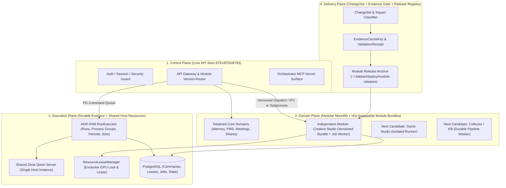

# 따까리 플랫폼 V2 아키텍처 대안·계약·모듈 전환 설계 (`architecture-options.md`)

- 문서 소유: Worker A (Runtime / Delivery / Architecture)
- 작성 시각: `2026-10-24T21:46:00+09:00`
- 근거 데이터:
  - `/Users/winterholic/development/projects/winterholic-ttakkari/back-platform-v2-a/review/platform-v2/20261024/A-runtime-delivery.md`
  - `/Users/winterholic/development/projects/winterholic-ttakkari/back-platform-v2-a/review/platform-v2/20261024/A-runtime-delivery-evidence.json`

---

## 1. 소스 및 운영 실측에서 증명된 아키텍처 제약 조건 (Proved Constraints)

모듈 경계와 목표 아키텍처를 선택할 때 추측이 아니라 `origin/main`(`c8f10156845d007ec6496a65d6d8417be19260bd`) 코드 및 Mac Studio 운영 실측으로 증명된 아래 6가지 제약을 반드시 만족해야 한다.

1. **호스트 메모리 및 Swap 한계 (`server_resources` 실측)**:
   - Apple M5 Max (RAM 64GiB)에서 현재 Swap 사용률이 **`95.3%` (`31.7 / 33.3 GiB`)**이며, 단일 `llama-server`(`pid=44129`)가 **RSS `7.20 GiB`**를 점유하고 있다.
   - 따라서 도메인마다 상주 FastAPI 데몬이나 멀티슬롯(3슬롯) 프로세스를 복제하는 아키텍처는 즉시 호스트 OOM/Swap 고갈을 일으키므로 물리적으로 불가능하다.
2. **Core API 3슬롯(`8791/8792/8793`)과 모듈 생명주기의 결합 문제 (`generation_deployment.py`, `deployment.py`)**:
   - 현재 모든 코드는 단일 `git archive <sha>`로 묶여 `validate_release()`(전체 `pytest` 17분 25초)를 거친 뒤 새 API 세대 슬롯을 띄운다.
   - 그 결과:
     1. 특정 도메인(`Creative Studio`, `Desk`, `Collector`) 테스트 1건 실패가 전체 백엔드 배포를 100% 차단하고(`LOG-194`, `LOG-195` 등 33개 이슈 그룹/54회 실패),
     2. 도메인 모듈 1줄만 고쳐도 Core API 슬롯 전체가 교체되며(`standby` → `active` → `draining`), 그때마다 `DeskQwenService`가 새 `llama-server` 자식 프로세스를 띄운다.
3. **API 세대 내부에 남아 있는 비영속·비추적 실행 상태 (`tts/jobs.py`, `api/creative_v2.py`)**:
   - `tts/jobs.py:42`는 합성할 원문 텍스트를 DB가 아닌 API 프로세스 메모리 `_pending_texts`에만 들고 있고, 슬롯이 `draining`이 되면 `_fail_queued_draining`(`jobs.py:154`)이 이미 `202 Accepted`로 수락된 `queued` 작업을 `generation_draining`으로 강제 실패시킨다.
   - `api/creative_v2.py:418`의 `_ASSET_GENERATION_TASKS`는 `generation.work()`나 `ready()`의 `finalizers`에 등록되지 않아 세대 은퇴 시 작업이 증발하거나, 하위 TTS 단계(`asset_generation_managed.py:478`)에서 `generation.work("tts")`가 `draining`을 거부해 실패한다.
4. **ADR 0036 `RunExecutor` 및 ADR 0066 `ChangeSet`의 미완성 연결 (`executor.py`, `delivery/*`)**:
   - `0064_run_executor`와 `0062_delivery_change_sets`는 이미 `origin/main` 및 운영(`9f82c9c1`)에 병합되어 있으나 모두 `feature-off` 상태다.
   - 특히 `delivery/validation.py:158`은 Stage 2에서 여전히 전체 `pytest -q --timeout=120`을 실행하며, 배포 게이트(`generation_deployment.py`)와 검증 증거(`ValidationReceipt`)를 공유하지 않는다.
5. **테스트 실행 시간의 구조적 원인 (`tests/conftest.py:189`)**:
   - `tests/conftest.py`의 `_schema_and_app` 세션 픽스처가 `autouse=True`로 설정되어 있어 순수 정적 계약 테스트만 돌려도 PostgreSQL 스키마 초기화가 강제되며, 매 테스트마다 106개 테이블 대상 `selective reset`이 수행된다(배포 `4a6e09a8`에서 `2,822`회 실행).
6. **고결합 코어 파일(`models.py`, `config.py`) 집중도 (`A-runtime-delivery-evidence.json`)**:
   - `config.py`(`fan_in=34`), `models.py`(`fan_in=32`), `db.py`(`fan_in=22`)를 거의 모든 모듈이 직접 import하므로, 이 공유 코어 파일들이 바뀌면 반드시 Fail-Closed 광역 게이트(Broad Gate)를 태워야 하며, 독립 모듈은 점진적으로 좁은 계약 인터페이스만 참조하도록 의존성을 줄여야 한다.

---

## 2. 아키텍처 대안 비교 (3 Architecture Alternatives)

4대 논리 평면(`Control`, `Execution`, `Domain`, `Delivery`)을 물리 프로세스와 배포 단위에 매핑하는 3가지 대안을 비교한다.



### 2.1 대안 1: 보수적 모놀리스 유지 + 선택적 테스트 게이트 + ADR 0036 Executor 활성화 (Option 1: Selective-Gate Monolith)

- **구조**:
  - 물리 배포 단위를 지금처럼 단일 백엔드 릴리스 아카이브(`~/.ttakkari/deploy/releases/<sha>`) 하나로 유지한다.
  - ADR 0036 `RunExecutor`를 켜서 장기 실행 `Run`과 주기 작업을 API 세대에서 분리하고, 배포 게이트(`generation_deployment.py`)에 변경 영향 분석과 `EvidenceCacheKey`를 도입해 배포 시 실행하는 `pytest` 범위만 줄인다.
- **장점**:
  - 코드 구조 변경이 가장 적고, 라우팅이나 모듈 로더 변경이 필요 없다.
- **결정적 한계 (기각 사유)**:
  - 도메인 모듈(`Creative Studio` 등) 1줄만 수정해도 **여전히 Core API 3슬롯(`8791/8792/8793`) 전체를 새 프로세스로 교체(Core Redeploy)해야 한다.**
  - 따라서 사용자 핵심 요구사항인 **9대 실증 시나리오 #3/#4("모듈 단독 릴리스 시 Core 재배포 0회, `unnecessary Core deploy = 0`")를 원천적으로 달성할 수 없다.**

### 2.2 대안 2 (권장): Core Control Plane + ADR 0036 RunExecutor + 버전드 모듈 번들/워커 핫스왑 (Option 2: Hybrid Modular Platform with Hot-Swappable Module Releases)

- **구조**:
  1. **Control Plane (`Core API` 3슬롯 `8791/8792/8793`)**:
     - 인증, 세션, 권한, SSE 스트림, 공통 레지스트리, 그리고 자주 바뀌지 않는 경량 내장 도메인(메모·일정·체크리스트·공유 등)을 호스팅한다.
     - 독립 전환된 모듈(1차: `Creative Studio`)에 대해서는 **버전드 모듈 디스패처(Versioned Module Dispatcher)** 역할만 수행한다.
  2. **Execution Plane (`RunExecutor` 단일 상주 + 단일 `Desk Qwen` 서버 + `ResourceLeaseManager`)**:
     - ADR 0036 `RunExecutor`를 활성화하여 모든 AI CLI `Run`, 프로세스 그룹 원장(`run_process_groups`), 주기 작업(`maintenance_jobs`), 영속 미디어/문서 큐(`TTS`, `STT`, `Preview`, `Creative` 렌더·자산 생성 잡)를 실행한다.
     - `Desk Qwen`(`llama-server`)은 API 세대 밖 단일 인스턴스로 고정하고 `desk_qwen_base_url`로 공유한다.
  3. **Domain Plane (독립 모듈 릴리스 번들 — 1차 `Creative Studio`)**:
     - 독립 모듈은 `~/.ttakkari/deploy/module-releases/<module_id>/<module_sha>/` 아래에 불변 아카이브로 배포되고, 활성 포인터(`active.json`: `module_id`, `active_revision`, `previous_revision`, `receipt_key`, `updated_at`)로 버전이 관리된다.
     - 모듈 요청 처리 방식:
       - **동기/경량 API 요청(카탈로그, 계획 조회/편집, 검증 등)**: Core API의 버전드 모듈 로더(또는 온디맨드 경량 워커 프로세스 풀)가 `active.json`이 가리키는 `module_sha` 번들을 로드해 처리하고 응답 헤더/메타에 `X-Ttakkari-Module-Revision: <module_sha>`를 태깅한다.
       - **장기/무거운 잡(FFmpeg 렌더, ComfyUI+TTS+ACE-Step 자동 자산 생성)**: 시작 시점의 `module_sha`와 계획 스냅샷을 잡 레코드에 고정(pin)하고, 해당 `module_sha` 코드 경로의 워커 프로세스에서 완료될 때까지 실행한다.
       - 따라서 **모듈 버전이 `v1`에서 `v2`로 전환되는 순간, Core API(`8791/8792/8793`)는 단 한 번도 재시작되지 않으며(`Core redeploy = 0`), 이미 돌고 있던 `v1` 잡은 `v1` 번들 워커에서 끝까지 드레인(Scenario 5)되고, 전환 직후 들어오는 신규 요청과 신규 잡은 즉시 `v2` 번들로 실행(Scenario 6)**된다!
  4. **Delivery Plane (`ChangeSet` + `EvidenceCacheKey` + `Module Release Controller`)**:
     - 변경 파일이 독립 모듈(`src/ttakkari/creative/**`, `tests/test_creative*.py`, `unit_tests/test_creative*.py`) 내부로 완결되고 공유 계약/스키마/보안 파일 변경이 없으면:
       1. `pytest -m contract` (무DB 정적 실행 `~5초`) + 해당 모듈 테스트 스위트만 실행해 `ValidationReceipt`(`EvidenceCacheKey`)를 생성한다.
       2. Core API 슬롯 전환(`generation_deployment.py`)을 부르지 않고 **모듈 릴리스 컨트롤러**가 `module-releases/creative/<sha>`를 아카이브·스모크 검증한 뒤 `active.json` 포인터만 원자적으로 교체(`os.replace`)한다.
     - 반대로 코어/공유 파일/스키마/미분류 파일이 함께 바뀌면 자동으로 기존 **Fail-Closed 광역 게이트 + Core 세대 배포**로 승격된다.

### 2.3 대안 3: 도메인별 상주 마이크로서비스 + 개별 멀티슬롯 포트 분리 (Option 3: Per-Domain Resident Microservices)

- **구조**:
  - `Creative`, `Games`, `Collector`, `KB`, `NotebookLM`, `Meetings` 등을 각각 별도 포트(예: `8801~8820`)에 상주하는 독립 FastAPI 서버 프로세스(및 무중단 교체를 위한 2~3슬롯)로 분리한다.
- **기각 사유**:
  1. 상주 Python+FastAPI+SQLAlchemy 풀 프로세스가 10개 이상 늘어나며 호스트 메모리 수 GiB와 PostgreSQL 연결 수(`database_pool_size=5` × 프로세스 수)를 소모하여 Swap `95.3%` 상태인 Mac Studio에서 안정 운영이 불가능하다.
  2. 사용자 불변 조건("4프로세스 전제 금지", "모든 모듈에 3슬롯 복제 금지")에 정면으로 위배된다.

### 2.4 아키텍처 대안 종합 트레이드오프 비교표

| 평가 항목 | 대안 1 (보수적 모놀리스 + 선택 게이트) | **대안 2 (권장: 하이브리드 코어 + 독립 모듈 번들/워커 핫스왑)** | 대안 3 (도메인별 상주 마이크로서비스) |
| :--- | :---: | :---: | :---: |
| **모듈 단독 수정 시 Core API 재배포 횟수** | `1회` (불만족) | **`0회` (완전 만족)** | `0회` |
| **실행 중 모듈 잡 드레인 및 구버전 보존** | 세대 슬롯 의존 | **완전 보장 (잡별 `module_revision` 고정 실행)** | 서비스별 슬롯 재구축 필요 |
| **타 모듈 배포 차단 격리 (Failure Isolation)** | 부분적 (`main` 병합 후에는 여전히 누적 차단) | **완전 격리 (모듈 ChangeSet/번들 단위 독립 승격·차단)** | 완전 격리 |
| **롤백 속도 및 부작용** | Core 슬롯 재전환 (수십 초~수 분) | **`active.json` 원자적 포인터 복원으로 1초 미만 즉시 롤백 (Core 무중단)** | 데몬 재기동 필요 |
| **호스트 RAM / Swap 추가 비용** | 낮음 (단, Qwen 분리 전엔 전환 시 +7.2GiB) | **최소 (상주 데몬 추가 없이 버전드 모듈 로더 + 온디맨드 잡 워커만 사용, Qwen 단일화로 오히려 -7.2GiB 절감)** | 매우 높음 (상주 프로세스 다중 기동으로 Swap 고갈 위험) |
| **구현 복잡도 및 점진 전환 적합성** | 낮음 | **중간 (1차 `Creative Studio`부터 한 모듈씩 점진 적용 가능)** | 매우 높음 (전면 재작성 수준) |
| **최종 판정** | 기각 (Scenario 4 불만족) | **채택 (Recommended)** | 기각 (자원 한계 및 불변 조건 위배) |

---

## 3. 최소 공용 기반 변경 명세 (Minimum Foundation Changes — P3 구현 범위)

첫 독립 모듈(P4)을 전환하기 전에 P3에서 반드시 선행 구현해야 하는 공용 기반 변경은 아래 5가지로 최소화한다.

1. **`FND-01` TTS 큐 영속화 및 Draining 수락 작업 보호**:
   - `alembic` 마이그레이션(또는 기존 `tts_jobs` 확장)으로 `tts_jobs.chunks_json` 컬럼을 추가해 `accept()` 시점에 분할된 원문 청크를 DB에 저장하고 프로세스 로컬 `_pending_texts`를 제거(또는 캐시로만 격하)한다.
   - `tts/jobs.py`의 `_fail_queued_draining`을 제거하고, `generation.py`에 `enter_accepted_work()`를 도입해 이미 `202 Accepted`로 수락된 작업은 슬롯이 `draining`이어도 완료될 때까지 실행되거나 `RunExecutor`가 소비하도록 보장한다.
2. **`FND-02` API 비동기 태스크 생명주기 등록 (`api/creative_v2.py`, `generation_service.py`)**:
   - `_ASSET_GENERATION_TASKS` 등 API가 스폰하는 모든 장기 비동기 작업을 `RuntimeGeneration`의 작업 카운터 및 독립 모듈 잡 실행기로 편입하여, 작업 실행 중 세대 슬롯이 조기 종료(`SIGTERM`)되지 않도록 막는다.
3. **`FND-03` Desk Qwen 서버 세대 외부 단일화 (`runs/desk_qwen_service.py`)**:
   - 호스트(또는 `RunExecutor`)가 단일 `Desk Qwen` `llama-server`를 관리하고 API 세대 슬롯(`8791/8792/8793`)은 `desk_qwen_base_url`을 통해 공유 호출하도록 전환한다.
4. **`FND-04` ADR 0036 `RunExecutor` 활성화 및 Reconcile 연결 (`deploy/generation-contract.json`, `executor.py`)**:
   - `run-executor` 서비스를 활성화하고 `run_executor_mode="remote"` 전환 게이트를 검증하여, `Run` 자식 프로세스 그룹(`run_process_groups`)과 주기 작업이 API 슬롯 재배포와 무관하게 유지되도록 한다.
5. **`FND-05` 정적 계약 픽스처 분리 + ChangeSet 영향 분류기 + `EvidenceCacheKey` 배포 게이트**:
   - `tests/conftest.py`에서 `pytest -m contract` 및 무DB 단위 테스트 실행 시 `_schema_and_app` DB 픽스처가 돌지 않도록 분리한다.
   - `src/ttakkari/delivery/`에 변경 영향 분류기(`classify_change_impact`), `EvidenceCacheKey` 계산기, `ValidationReceipt` 저장·검증기를 연결하고, 모듈 단독 변경 시 모듈 릴리스 컨트롤러가 전체 `pytest` 재실행 없이 모듈 번들만 승격하도록 구현한다.

---

## 4. 4대 핵심 계약 명세 (API · Job · Event · Module Contracts)

### 4.1 Module Release & Dispatch Contract (모듈 릴리스·디스패치 계약)

- **릴리스 아카이브 경로**: `~/.ttakkari/deploy/module-releases/<module_id>/<module_revision>/`
- **활성 포인터 (`~/.ttakkari/deploy/module-releases/<module_id>/active.json`)**:
  ```json
  {
    "schema_version": "module-release-pointer-v1",
    "module_id": "creative",
    "active_revision": "c8f10156845d007ec6496a65d6d8417be19260bd",
    "previous_revision": "9f82c9c16cd604e81ddf43180b0be2e895ec85cb",
    "core_contract_version": 2,
    "evidence_cache_key": "evk-v1-creative-...",
    "activated_at": "2026-10-24T22:00:00+09:00"
  }
  ```
- **버전 노출 계약**:
  - `GET /api/version` 응답에 `module_revisions: {"creative": "<active_revision>", ...}` 필드를 추가(하위 호환 확장)하고, 모듈 라우트 응답 헤더에 `X-Ttakkari-Module-Revision`을 포함한다.
- **롤백 계약**:
  - 모듈 스모크 실패 또는 운영 이상 감지 시 `active.json`의 `active_revision`을 `previous_revision`으로 원자적 교체(`os.replace`)한다. Core API 재시작은 0회이며, 롤백 소요 시간은 1초 미만이다.

### 4.2 Durable Job Ownership & Drain Contract (영속 잡 소유권·드레인 계약)

- 모든 비동기·장기 잡(`Run`, `TTS`, `STT`, `Creative Render`, `Creative Auto-Assets`, `Collector`)은 생성 시 아래 5개 필드를 영속 기록한다:
  1. `job_id` / `idempotency_key`
  2. `module_id` 및 `pinned_module_revision` (잡이 수락된 시점의 모듈 버전)
  3. `owner_runtime_id` 및 `fencing_token`
  4. `owner_pid` 및 `owner_process_started_at` (커널 프로세스 신원)
  5. `lease_expires_at` (하트비트 TTL)
- **드레인 규칙**:
  - 모듈 포인터가 새 리비전(`v2`)으로 바뀌더라도, 이미 `running` 상태인 `v1` 잡은 `pinned_module_revision = v1` 워커가 끝까지 실행해 완료시킨다.
  - 신규 요청만 `v2`를 사용한다.

### 4.3 Event & Fencing Contract (이벤트·펜싱 계약)

- 모든 상태 전이와 이벤트 기록은 `fencing_token` 단조 증가 조건을 따른다 (`SELECT ... FOR KEY SHARE` / `WHERE fencing_token = :expected`).
- 펜싱 토큰이 불일치하는 구세대 워커의 쓰기는 즉시 `StaleExecutionFenceError`로 거부되고 롤백된다.

### 4.4 API & Frontend Compatibility Contract (외부 호환성 계약)

- 프런트엔드가 호출하는 API 엔드포인트 경로 및 라우트, 백엔드 전체 HTTP 라우트 시그니처, 오케스트레이터 MCP 도구 스키마(참고: Worker B가 보고한 `497 route / 102 tool`은 `Bv` `1d994e50-c900-4f90-9975-1ff082522a35` 검증 중이고, Worker C가 보고한 프런트 `38 vs 36 route / 179 API`는 `Cv` `fed2c630-a867-42f1-9574-4a92905de864` 검증 중이므로 모두 `확인 필요`)는 모듈 분리 전후 동일하게 유지된다 (`pytest -m contract`로 강제).

---

## 5. 첫 독립 전환 모듈 후보 실측 평가 및 Worker B·C 미검증 수치 대조 (First Independent Module Evaluation)

> **주의 (Worker B·C 산출물 검증 대기 격리)**:
> 1. Worker B(`c1e9cd73-83ef-4240-99c8-809e500bd903`, `back-platform-v2-b` HEAD `86373cedda20e298ad2b82d857352f845ae70980`)가 보고한 수치(`25모듈 / 497 route / 102 tool / 88 table / 62 migration / 212 config / 321 .py / unmatched 0`, `Creative = artcraft_tasks 1 / FK 0`, `collector = 2 tables`, `cycle = 34`)는 Flash 모델로 공유 `/back`의 과거 커밋(`607f8bda0df7dbdd458e4f0e54d703ce9edd3def`, `origin/main` 대비 111커밋 뒤처짐)에서 추출되었으며 현재 **독립 검증 워커 `Bv = 1d994e50-c900-4f90-9975-1ff082522a35` (`auto/verification`, GPT-6 Luna 예정)**가 검증 중이다(`확인 필요`).
> 2. Worker C(`9a3215de-01d4-4efd-b3ff-9e282de9b766`, 공유 `/back` untracked 산출물)의 초기 감사 역시 Flash 모델로 실행되었고 내부 불일치(요약 `38 routes` vs 스캐너 `36 routes`, 10분류 주장 대비 `runtime/ownership` 누락으로 dict 9종·`257 files` vs 요약 합 `262`) 및 미검증 항목(`main missing security test` / `deploy security duplicate 31` 조건, C 측 `front 5.48s` / `back 1045.97s` 원시로그 검증)이 있어 **독립 검증 워커 `Cv = fed2c630-a867-42f1-9574-4a92905de864` (`auto/verification`)**가 검증 중이다(`확인 필요`).
> 3. 따라서 본 문서에서는 Worker B·C의 수치를 확정 모듈 경계나 구현 근거로 채택하지 않고, Worker A가 `origin/main`(`c8f10156845d007ec6496a65d6d8417be19260bd`) 및 `ops_deploy_log(4a6e09a8)` 원시 로그에서 직접 추출·검증한 실측치와 Baseline Drift(`+64 .py`, `+5 migrations 0063~0067`, `+21 tables`)만을 근거로 평가한다.

사용자 지침("첫 독립 모듈은 `Creative Studio`를 우선 평가하되, 데이터 결합도·변경 빈도·검사 비용·장애 이력·운영비 실측으로 다른 후보와 비교할 것")에 따라 `origin/main`(`c8f10156`)에서 4개 주요 후보를 정량 비교하였다.

| 평가 지표 (`origin/main` `c8f10156` 실측) | **1순위: `Creative Studio` (`creative`)** | 2순위: `Game Studio` (`games`) | 3순위: `Collector Platform` (`collector`) | 기반 대상: `Local TTS` (`tts`) |
| :--- | :--- | :--- | :--- | :--- |
| **코드 규모** | **25개 파일 / 13,194줄** (가장 큰 단일 도메인; `607f8bda` 대비 `creative/v2/*` 19개 파일 + `api/creative_v2.py` 신설) | 11개 파일 / 2,407줄 | 26개 파일 / 5,915줄 (`607f8bda` 대비 21개 파일 신설) | 5개 파일 / 1,105줄 |
| **전용 테스트 파일 수** | **19개 파일** (`tests/` + `unit_tests/`) | 22개 파일 | 22개 파일 | 6개 파일 |
| **PostgreSQL 테이블 결합도** | **전용 테이블 `0개`** (파일시스템 JSON 매니페스트 + 불변 미디어 저장소 사용; 단, `creative/v2/run_extraction.py`가 공통 `ChatSession`/`Run`(`worker_task_type="creative_intent"`)을 생성하며, B가 보고한 `artcraft_tasks 1 / FK 0`(`확인 필요`)은 별도 레거시 `src/ttakkari/artcraft.py` 테이블임) | 높음 (`game_projects`, `game_builds`, `game_sessions` 등 다수 테이블 + `models.py` 강결합) | 매우 높음 (B의 `607f8bda` 보고치 `2 tables`(`확인 필요`)와 달리, `origin/main` `c8f10156`에서는 `0063`/`0065`/`0066`/`0067`로 **`collector_*` 16개 테이블 + 연관 `kb_*` 3개 테이블**이 존재함) | 중간 (`tts_jobs` 1개 테이블, 단 `creative`와 `api`가 직접 호출하는 공용 실행 기능) |
| **타 도메인 역의존성 (`external_dep_reverse_modules`)** | **도메인 역참조 `0개`** (`api`, `generation_service`, `main`, `orchestrator`만 진입점으로 참조) | `cli`, `main`, `runs`(`manager.py` 자동 빌드·수리 훅과 결합) | `kb_delivery`, `kb_library`, `models`, `generation_service`와 강결합 | `creative`가 직접 호출 |
| **최근 배포 전역 차단 사고 이력 (`ops_list_issues`)** | **최다 발생 (최근 `LOG-194`, `LOG-190`, `LOG-186` 등 3건 연속 전체 배포 차단)** | `LOG-185` 1건 | `LOG-191` 1건 (현재 `/back` 공유 트리에 미커밋 변경 30여 건 혼재) | 0건 (단, 세대 전환 시 `generation_draining` 결함 보유) |
| **독립 전환 시 얻는 즉시 이득** | **최대**: 가장 빈번하게 수정되며 16분 이상 배포를 막던 주원인을 Core 배포에서 즉시 분리하고, DB 마이그레이션 위험 없이 파일·워커 경계만으로 9대 실증 시나리오를 가장 깨끗하게 증명 가능 | 중간 (`runs/manager.py` 내부 훅 분리 선행 필요) | 낮음 (공유 작업 트리 미커밋 정리 및 `kb` 결합 해소가 먼저 필요해 P5가 적합) | P3 공용 기반으로 먼저 수리해야 함 |
| **최종 판정** | **P4 첫 독립 전환 모듈로 확정 권고 (`Rank 1`)** | P5 1차 전환 대상 (`Rank 2`) | P5 2차 전환 대상 (`Defer to P5`) | **P3 필수 선행 기반 (`Foundation Prerequisite`)** |

### `Creative Studio`를 P4 첫 독립 모듈로 선정한 결정적 이유 요약

1. **변경 빈도와 배포 차단 비용이 가장 높음**: 최근 커밋과 배포 실패 로그(`794447f3` `LOG-194`, `d4f439d6` `LOG-190`, `bf9a853d` `LOG-186`)에서 확인되듯, 자막 줄바꿈이나 프롬프트 조정을 한 번 할 때마다 17분짜리 전체 백엔드 배포 게이트가 돌고 실패 시 전체 서버 배포가 막히고 있다.
2. **DB 스키마 결합도가 0에 수렴**: `Studio`(`creative/service.py`), `DirectorStore`(`creative/director.py`), `PlanStore`(`creative/v2/plans.py`), `ProductionStore`(`creative/v2/dispatch.py`), `StyleStore`(`creative/v2/style_dna.py`) 모두가 이미 파일시스템 원자적 JSON 매니페스트(`manifest.lock` + `os.replace`)와 `sha256` 불변 자산 위에 구축되어 있어, DB 스키마 분리 없이도 즉시 독립 모듈 릴리스 번들로 떼어낼 수 있다.
3. **런타임 자원 경계가 명확함**: FFmpeg 렌더(`renderer.lock`), Managed ComfyUI + ACE-Step(`ResourceLeaseManager` `host-gpu/lock`), Supertonic TTS(`tts.service.budget`)가 이미 파일 잠금과 리스 매니저를 통해 프로세스 간 동기화되도록 짜여 있어, P3에서 TTS `draining` 결함과 `_ASSET_GENERATION_TASKS` 추적만 고치면 Core API 재배포 없이 모듈 번들/워커만 독립 교체하는 9대 실증 시나리오를 100% 실측 입증할 수 있다.
