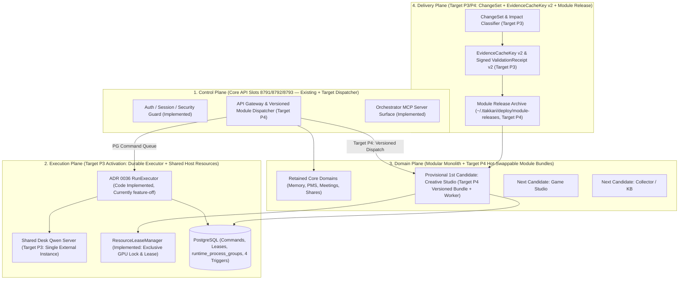

# 따까리 플랫폼 V2 아키텍처 대안·계약·모듈 전환 설계 (`architecture-options.md` — 독립 검증 교정판)

> **2026-10-25 대체 결정:** 아래는 이전 대안 비교 및 기각 전 제안의 원문이다. 특히 §2의 bundle/dispatcher와 §4.1 module-releases/active.json, §4.2의 모든 잡 공통 새 소유권 필드, §4.3 신규 공통 fence 의무화는 현재 채택안이 아니다. [현재 실행부 분리 계약](current-execution-contract.md)이 우선한다. 기존 lease·자원·domain queue를 재사용하며 FND1 전송 장벽은 미해결이다. 과거 메모리·시간·코드 결함 수치는 그 당시 입력의 이력으로만 읽는다.

> 현재 교정 및 실제 배포 범위는 [검증 실패 교정·통합 기록](verified-corrections-20261024.md)이 우선한다. 아래의 이전 후보 완료 표시는 당시 이력이며 V2 전체 완료나 현재 운영 검증을 뜻하지 않는다.


- 문서 소유: Worker A (Runtime / Delivery / Architecture / 세션 ID `e65430e3-0775-4e2c-910a-5050cdb7d216`)
- 갱신 시각: `2026-10-24T22:50:00+09:00` (독립 재검증 `d3f7189` 지적 교정 및 Gate A 격리 공용 기반 코드 구현 반영)
- 근거 데이터:
  - `/Users/winterholic/development/projects/winterholic-ttakkari/back-platform-v2-a/review/platform-v2/20261024/A-runtime-delivery.md`
  - `/Users/winterholic/development/projects/winterholic-ttakkari/back-platform-v2-a/review/platform-v2/20261024/A-runtime-delivery-evidence.json`

---

## 1. 소스 및 운영 실측에서 증명된 아키텍처 제약 조건 (Proved Constraints)

모듈 경계와 목표 아키텍처를 선택할 때 `origin/main`(`c8f10156845d007ec6496a65d6d8417be19260bd`) 코드 및 Mac Studio 호스트 관측으로 확인된 아래 6가지 제약을 반드시 만족해야 한다.

1. **호스트 메모리 및 Swap 현황 (`server_resources` 단일 시점 직접 관측)**:
   - Apple M5 Max (RAM 64GiB)에서 현재 Swap 사용률이 **`94.8%~95.3%` (`31.5~31.7 / 33.3 GiB`, `memory_pressure=normal`)**이며, 현재 호스트 스냅샷에는 단일 `llama-server`(`pid=44129`, RSS **`7.20 GiB`**) 1개와 `backend`(`pid=44104`, RSS `374 MiB`)가 관측된다.
   - 현재 `llama-server`가 여러 개 떠서 Swap 포화를 일으켰다고 단정할 수는 없으나, Swap 여유가 약 1.6GiB뿐인 상태에서 도메인마다 상주 FastAPI 데몬이나 멀티슬롯(3슬롯) 프로세스를 복제하거나 세대 전환 시 `llama-server` 자식 프로세스가 중복 스폰되면 메모리 압박이 급격히 커지므로 상주 데몬 다중화 아키텍처는 배제해야 한다.
2. **Core API 3슬롯(`8791/8792/8793`)과 모듈 생명주기의 결합 (`generation_deployment.py`, `deployment.py`)**:
   - 현재 모든 코드는 단일 `git archive <sha>`로 묶여 `validate_release()`(완주 배포 `4a6e09a8` 기준 `pytest` **`1,045.97초`**, 전체 벽시계 **`1,576.48초`**)를 거친 뒤 새 API 세대 슬롯을 띄운다.
   - 그 결과 특정 도메인(`Creative Studio` `LOG-194` `-x` `985.34s` 중단, `Desk` `LOG-195` `-x` `172.23s` 중단) 테스트 1건 실패가 전체 백엔드 배포를 차단하고, 도메인 모듈 1줄만 고쳐도 Core API 슬롯 전체가 교체된다.
3. **API 세대 내부에 남아 있는 비영속·비추적 실행 상태 및 레거시 자동 재큐잉 (`tts/jobs.py`, `api/creative_v2.py`, `runs/manager.py`)**:
   - `tts/jobs.py:42`는 합성할 원문 청크를 API 프로세스 메모리 `_pending_texts`에만 보관하고, 슬롯이 `draining`이 되면 `_fail_queued_draining`(`jobs.py:154`)이 이미 `202 Accepted`된 `queued` 작업을 `generation_draining`으로 강제 실패시키며, `service.py:130` `budget()`도 `generation.work("tts")`(`state == "active"`만 허용) 때문에 `draining`을 거부한다.
   - `api/creative_v2.py:418`의 `_ASSET_GENERATION_TASKS`는 `generation.work()`나 `ready()`의 `finalizers`에 등록되지 않고, `asset_generation_managed.py:345`의 `_write_checkpoint`는 `.tmp`+`os.replace`만 수행할 뿐 `os.fsync()`·`sha256` 검증·태스크 레벨 DB 펜스가 없다.
   - `main.py:201` → `runs/manager.py:1941`의 레거시 `resume_interrupted()`는 세대 런타임 비활성 시 중단된 Run을 최대 3회 자동 재큐잉하는 코드를 여전히 갖고 있어, `executor_reconcile.py`의 무-replay 원칙과 불일치한다.
4. **ADR 0036 `RunExecutor` 및 ADR 0066 `ChangeSet`의 비활성 상태 (`executor.py`, `delivery/*`)**:
   - `0064_run_executor`(`runtime_process_groups` 1개 테이블 신설 + `runtime_generations`/`runtime_control` 컬럼 추가 + 4개 PL/pgSQL 트리거)와 `0062_delivery_change_sets`는 이미 `origin/main`에 병합되어 있으나 모두 `feature-off`(`run_executor.activation="disabled"`, `delivery_pipeline_enabled=False`) 상태다.
5. **테스트 실행 인프라의 세션 픽스처 결합과 DB-Free 표본의 한계 (`tests/conftest.py:189`)**:
   - `tests/conftest.py`의 `_schema_and_app` 픽스처가 `autouse=True`로 설정되어 있다.
   - 본 감사에서 5개 파일(`test_contract_marker.py`, `test_migration_single_head.py`, `test_executor_migration_contract.py`, `test_executor_reconcile.py`, `test_creative_v2_lease_handoff.py`)을 `--noconftest`로 실행하면 **`35 passed in 3.34s`**에 통과하지만, 이는 **좁은 DB-free 표본**일 뿐이며 `--noconftest` 우회로 DB 트리거 계약이나 운영 드레인을 입증할 수는 없다. 따라서 정적 계약(`contract_static`)과 DB 계약(`contract_db`)을 명시적으로 분리해야 한다.
6. **고결합 코어 파일(`models.py`, `config.py`, `db.py`) 집중도 (`A-runtime-delivery-evidence.json`)**:
   - 최상위 모듈 이름 기준 역의존성에서 `config`(`fan_in=34`), `models`(`fan_in=32`), `db`(`fan_in=22`), `runs`(`fan_in=14`)를 다수 모듈이 import하므로, 공유 코어·스키마·보안·불완전 클로저 변경은 반드시 Fail-Closed 광역 게이트(`broad_fail_closed`)로 승격해야 한다.

---

## 2. 아키텍처 대안 비교 (3 Architecture Alternatives — 현재 상태 vs 목표 설계 구분)

> **구현 상태 명확화**:
> 아래 대안 2에 포함된 **독립 모듈 릴리스 아카이브(`~/.ttakkari/deploy/module-releases`), 활성 포인터(`active.json`), 버전드 모듈 디스패처, 모듈 릴리스 컨트롤러, 원자적 포인터 롤백, 모듈 단독 릴리스 시 `Core 재배포 0회`**는 현재 `src/ttakkari`에 구현되어 있지 않은 **목표 아키텍처(Target Architecture) 및 P4 인수 기준**이다. (근거 없는 '1초 미만' 임의 목표는 배제하고 향후 실제 롤백 소요 시간 측정 대상으로 교정함).



### 2.1 대안 1: 보수적 모놀리스 유지 + 선택적 테스트 게이트 + ADR 0036 Executor 활성화 (Option 1: Selective-Gate Monolith)

- **구조**:
  - 물리 배포 단위를 단일 백엔드 릴리스 아카이브(`~/.ttakkari/deploy/releases/<sha>`) 하나로 유지하고, ADR 0036 `RunExecutor` 활성화와 `EvidenceCacheKey v2`를 통해 배포 시 `pytest` 실행 범위만 줄인다.
- **한계 및 기각 사유**:
  - 도메인 모듈 1줄만 수정해도 여전히 Core API 3슬롯(`8791/8792/8793`) 전체를 교체해야 하므로, **9대 실증 시나리오 #3/#4("모듈 단독 릴리스 시 Core 재배포 0회")를 달성할 수 없다.**

### 2.2 대안 2 (권장 목표 아키텍처): Core Control Plane + ADR 0036 RunExecutor + 버전드 모듈 번들/워커 핫스왑 (Option 2: Hybrid Modular Platform)

- **구조 (P3 공용 기반 + P4 모듈 번들 목표 설계)**:
  1. **Control Plane (`Core API` 3슬롯 `8791/8792/8793`)**:
     - 인증, 세션, 권한, SSE 스트림, 공통 레지스트리 및 경량 내장 도메인을 호스팅하고, 독립 전환 모듈에 대해서는 **버전드 모듈 디스패처(Target P4)** 역할을 수행한다.
  2. **Execution Plane (`RunExecutor` 단일 상주 + 단일 `Desk Qwen` + `ResourceLeaseManager`)**:
     - P3에서 ADR 0036 `RunExecutor`를 활성화하고, `Desk Qwen`(`llama-server`)을 세대 외부 단일 인스턴스(`desk_qwen_base_url`)로 분리한다.
  3. **Domain Plane (독립 모듈 릴리스 번들 — Target P4)**:
     - 독립 모듈은 `~/.ttakkari/deploy/module-releases/<module_id>/<module_sha>/` 아래에 불변 아카이브로 배포되고, 활성 포인터(`active.json`)로 관리된다.
     - **불변 잡 리비전 핀(`pinned_module_revision`) 및 구버전 워커 드레인**:
       - 장기 잡(렌더, 자동 자산 생성 등)은 수락 시점의 `active_revision`을 `pinned_module_revision`에 기록하고 해당 버전 번들 워커에서 끝까지 실행한다.
       - 전환 직후 신규 요청만 새 리비전(`v2`)으로 라우팅되며, 구버전(`v1`) 워커는 실행 중인 `v1` 잡이 0개가 될 때 안전하게 종료된다.
     - **DB 스키마 확장 호환성(Expand-Only Compatibility) 규칙**:
       - Core API 무재배포 모듈 단독 릴리스는 **DB 스키마 변경이 없거나 하위 호환이 보장되는 Expand-only 변경(nullable 컬럼 추가, 모듈 전용 신규 테이블 추가)**일 때만 허용된다.
       - 공유 테이블 컬럼 삭제·타입 변경·비호환 마이그레이션이 포함된 ChangeSet은 변경 영향 분류기가 즉시 **Core 광역 배포(`broad_fail_closed`)**로 승격한다.
  4. **Delivery Plane (`ChangeSet` + `EvidenceCacheKey v2` + `Module Release Controller` — Target P3/P4)**:
     - 모듈 단독 변경이면서 전이 의존성 클로저가 완전하고 공유 코어/스키마/보안 변경이 없을 때만 `ValidationReceipt v2`를 통해 모듈 번들을 승격하며, 공유 상태가 불명확하거나(`recovery_pending`, `UNKNOWN` 프로세스) 코어 경계를 건드리면 즉시 Fail-Closed로 차단한다.

### 2.3 대안 3: 도메인별 상주 마이크로서비스 + 개별 멀티슬롯 포트 분리 (Option 3: Per-Domain Resident Microservices)

- **기각 사유**:
  - 상주 Python+FastAPI+SQLAlchemy 프로세스가 도메인 수만큼 늘어나면 Swap `94.8%~95.3%` 상태인 호스트에서 메모리/커넥션 풀 고갈 위험이 크고, "모든 모듈에 3슬롯을 복제하지 말 것"이라는 불변 조건에 위배된다.

### 2.4 아키텍처 대안 비교표

| 평가 항목 | 대안 1 (보수적 모놀리스 + 선택 게이트) | **대안 2 (권장 목표: 하이브리드 코어 + 버전드 모듈 번들/워커)** | 대안 3 (도메인별 상주 마이크로서비스) |
| :--- | :---: | :---: | :---: |
| **모듈 단독 수정 시 Core API 재배포 횟수 (목표)** | `1회` (불만족) | **`0회` (P4 목표 시나리오 #4 만족)** | `0회` |
| **실행 중 모듈 잡 드레인 및 구버전 보존** | 세대 슬롯 의존 | **`pinned_module_revision` 고정 실행으로 구버전 드레인 보장** | 서비스별 슬롯 재구축 필요 |
| **DB 스키마 호환성 통제** | 단일 배포와 동일 | **무변경/Expand-only만 모듈 단독 릴리스 허용, 그 외엔 Core 광역 배포로 Fail-Closed 승격** | 서비스별 DB 분리 필요 |
| **롤백 방식 및 목표 시간** | Core 슬롯 재전환 (수십 초~수 분) | **`active.json` 원자적 포인터 복원 (Core 무중단, 실측 대상)** | 데몬 재기동 필요 |
| **호스트 RAM / Swap 추가 비용** | 낮음 | **최소 (상주 데몬 추가 없음, Qwen 외부 단일화로 전환 시 중복 스폰 방지)** | 매우 높음 (기각) |
| **최종 판정** | 기각 (Scenario 4 불만족) | **목표 아키텍처로 채택 (Target Recommended)** | 기각 (자원 및 불변 조건 위배) |

---

## 3. 최소 공용 기반 변경 명세 (Minimum Foundation Changes — P3 구현 순서)

`A-runtime-delivery.md` 4.1절과 동일하게, P3에서 아래 **6단계(`FND-00` ~ `FND-05`)**를 순서대로 구현하고 `ACC-01`~`ACC-04` 인수 시나리오로 검증한다.

1. **`FND-00` (`origin/main` `LOG-195` 차단 해소)**:
   - `tests/test_desk_qwen_service.py`의 `PROMPT_VERSION` 기대값을 `'harness-v3-topic-boundary'`와 일치시켜 현재 막혀 있는 기본 테스트 스위트를 개통한다.
2. **`FND-01` (2계층 드레인 계약 + TTS DB 영속화 + 레거시 자동 재큐잉 차단)**:
   - `tts_jobs.chunks_json`(JSONB, nullable expand-only 마이그레이션 `0068`)에 원문 청크를 영속 저장하여 `_pending_texts` 메모리 의존을 제거한다.
   - `tts/jobs.py`의 `_fail_queued_draining`을 제거하고, `generation.py`에 `enter_admission()`(`state == "active"`)과 `enter_accepted_work()`(`state in ("active", "draining")`)를 분리 구현하여 이미 `202 Accepted`된 작업이 `draining` 중에도 끝까지 완료되도록 보장한다 (`ACC-01`).
   - `runs/manager.py:1941` `resume_interrupted()`의 무조건 자동 재큐잉을 비활성화하여 모든 기동 모드에서 미검증 자동 replay를 원천 차단한다 (`ACC-03`).
3. **`FND-02` (Creative V2 태스크 드레인 등록 + 체크포인트 `fsync`/`sha256`/펜스 보강)**:
   - `api/creative_v2.py`의 `_ASSET_GENERATION_TASKS`를 `RuntimeGeneration`의 `accepted_work` / `finalizers`에 등록하여 슬롯 은퇴 시 조기 `SIGTERM`을 막고, `asset_generation_managed.py`의 `_write_checkpoint`에 `os.fsync()`, 산출물 `sha256` 검증, 태스크 `fencing_token` 검사를 추가한다 (`ACC-02`).
4. **`FND-03` (Desk Qwen 세대 외부 단일화)**:
   - `runs/desk_qwen_service.py`가 세대 슬롯마다 자식 `llama-server`를 띄우지 않고 단일 외부 관리 인스턴스(`desk_qwen_base_url`)를 공유하도록 전환한다.
5. **`FND-04` (ADR 0036 `RunExecutor` 활성화 및 Ownership/Fence Cutover 검증)**:
   - 격리 환경에서 `run_executor.activation="enabled"` 및 `run_executor_mode="remote"` 전환을 실증하고, `0064`의 `runtime_process_groups`와 4개 PL/pgSQL 트리거(`guard_executor_control`, `guard_executor_api`, `guard_executor_lease`, `route_executor_command`) 아래에서 API 슬롯 재기동 중에도 Run이 중단되지 않음을 검증한다.
6. **`FND-05` (정적/DB 계약 픽스처 분리 + `EvidenceCacheKey v2` / `ValidationReceipt v2` 게이트 연동)**:
   - `tests/conftest.py`에서 무DB 정적 계약(`contract_static`)과 DB 계약(`contract_db`)을 분리한다.
   - `A-extract-runtime-delivery-evidence.py`에 참조 구현된 `compute_evidence_cache_key()`(v2: 전체 입력 파일·전이 클로저·테스트·`conftest`·`uv.lock`·`models.py`·67개 마이그레이션 개별 내용 해시 강제)와 `verify_validation_receipt()`(v2: provenance `import_origin_file` 및 HMAC 검증)를 `delivery/validation.py`와 `generation_deployment.py`에 통합한다 (`ACC-04`).

---

## 4. 4대 핵심 계약 명세 (API · Job · Event · Module Contracts)

### 4.1 Module Release & Dispatch Contract (Target P4 설계 목표)

- **릴리스 아카이브 경로**: `~/.ttakkari/deploy/module-releases/<module_id>/<module_revision>/`
- **활성 포인터 (`~/.ttakkari/deploy/module-releases/<module_id>/active.json`)**:
  ```json
  {
    "schema_version": "module-release-pointer-v2",
    "module_id": "creative",
    "active_revision": "c8f10156845d007ec6496a65d6d8417be19260bd",
    "previous_revision": "9f82c9c16cd604e81ddf43180b0be2e895ec85cb",
    "core_contract_version": 2,
    "schema_compatibility": "none_or_expand_only",
    "evidence_cache_key": "evk-v2-creative-...",
    "receipt_signature": "<hmac-sha256>",
    "activated_at": "2026-10-24T22:20:00+09:00"
  }
  ```
- **롤백 및 Fail-Closed 계약**:
  - 모듈 스모크 실패 시 `active.json`을 `previous_revision`으로 원자적 복원(`os.replace`, Core API 무재기동, 실제 소요 시간 실측)하며 Core API는 재시작하지 않는다.
  - 단, 공유 리소스 리스 불일치나 DB 마이그레이션 오류 등 공유 상태 불명이 감지되면 즉시 `recovery_pending`으로 전환하여 Fail-Closed로 멈춘다.

### 4.2 Durable Job Ownership & State Transition Contract (영속 잡 소유권·상태 전이 계약)

- 모든 비동기·장기 잡(`Run`, `TTS`, `STT`, `Creative Render`, `Creative Auto-Assets`, `Collector`)은 생성·실행 시 아래 필드를 영속 기록한다:
  1. `job_id` / `idempotency_key` (유니크 제약)
  2. `module_id`, `accepted_generation_id`, `pinned_module_revision`
  3. `owner_generation_id`, `lease_token`, `fencing_token` (단조 증가 bigint)
  4. `owner_pid`, `owner_process_started_at`, `pgid` (커널 프로세스 신원)
  5. `lease_expires_at` (하트비트 TTL)
- 상세 상태 전이(`Admission` → `Claim & Fence` → `Accepted Work Drain` → `Fenced Write` → `Cancel` → `Restart/Reconcile` → `Retire`)는 `A-runtime-delivery.md` **2.4절 상태 전이 계약표**를 정본으로 따른다.

### 4.3 Event, Checkpoint & Fencing Contract (이벤트·체크포인트·펜싱 계약)

- DB 이벤트/상태 반영 직전에는 `SELECT execution_fencing_token ... FOR KEY SHARE`로 `expected_fence`를 검증하고, 불일치 시 즉시 `StaleExecutionFenceError`로 롤백한다.
- 파일/미디어 산출물 및 체크포인트(`_write_checkpoint` 포함)는 반드시 임시 파일(`*.tmp`) 작성 → `os.fsync(fd)` → `sha256` 해시 검증 → `os.replace()` 순서로 커밋하며, 체크포인트 메타데이터에 `(fencing_token, artifact_sha256)`을 함께 기록한다.

### 4.4 API & Frontend Compatibility Contract (외부 호환성 계약)

- 프런트엔드가 호출하는 API 경로, 백엔드 HTTP 라우트 시그니처, 오케스트레이터 MCP 도구 스키마는 모듈 분리 전후 100% 하위 호환을 유지한다 (구체적인 라우트/도구 전수 인벤토리 수치는 Worker B·C 교정본의 독립 재검증 완료 후 확정 반영한다).

---

## 5. 첫 독립 전환 모듈 후보 비교 및 `Creative Studio` 잠정(`provisional`) 1순위 판정

> **중요 (잠정 `provisional` 등급 부여 및 확정 보류 사유)**:
> 1. Worker A가 추출한 최상위 모듈 이름 기준 역의존성(`fan_in=4`: `api`, `generation_service`, `main`, `orchestrator`)만으로는 DB 외래키(FK), 공통 `ChatSession`/`Run`(`creative/v2/run_extraction.py`의 `worker_task_type="creative_intent"`), 호스트 GPU 리스(`ResourceLeaseManager`), 하위 TTS 호출(`asset_generation_managed.py:478`), 파일시스템 부수효과 경계가 완전히 분리되었다고 단독 입증할 수 없다.
> 2. 또한 Worker B(`c1e9cd73`, `86373ce`/`2cc` 검증 `failed`, 현재 `d492` 교정 중)와 Worker C(`9a3215de`, 초회 검증 `failed`, 현재 교정 중)의 백엔드/데이터/프런트/테스트 감사가 아직 독립 재검증을 통과하지 않았다.
> 3. 따라서 아래 비교표의 **`Creative Studio` 1순위 선정은 `provisional` (잠정 1순위 후보)**로 기록하며, B·C 재검증 통과 후 루트 오케스트레이터 통합 단계에서 최종 확정한다.

| 평가 지표 (`origin/main` `c8f10156` 기준) | **잠정 1순위 (`provisional`): `Creative Studio` (`creative`)** | 잠정 2순위: `Game Studio` (`games`) | 잠정 3순위: `Collector Platform` (`collector`) | P3 필수 선행 기반: `Local TTS` (`tts`) |
| :--- | :--- | :--- | :--- | :--- |
| **코드 규모 (`c8f10156`)** | **25개 파일 / 13,194줄** (`607f8bda` 대비 `creative/v2/*` 19개 + `api/creative_v2.py` 신설) | 11개 파일 / 2,407줄 | 26개 파일 / 5,915줄 (`607f8bda` 대비 21개 파일 신설) | 5개 파일 / 1,105줄 |
| **전용 테스트 파일 수** | **19개 파일** (`tests/` + `unit_tests/`) | 22개 파일 | 22개 파일 | 6개 파일 |
| **데이터 및 런타임 결합 특성 (확인된 결합 포함)** | - 전용 영속 저장소는 파일시스템 JSON 매니페스트 위주이나, **`creative/v2/run_extraction.py`가 공통 `ChatSession`/`Run`을 생성**하고, **`asset_generation_managed.py`가 `ResourceLeaseManager`(GPU) 및 `tts.service.budget()`을 직접 호출**함<br>- 레거시 `artcraft_tasks`와의 관계 및 전수 FK는 Worker B 재검증으로 최종 확인 필요 (`확인 필요`) | `game_projects`, `game_builds`, `game_sessions` 등 다수 DB 테이블 및 `runs/manager.py` 자동 빌드·수리 훅과 결합 | `0063`/`0065`/`0066`/`0067`로 신설된 `collector_*` 14개 + `kb_*` 3개 테이블 및 `kb_delivery`/`kb_library`/`models`와 강결합 | `tts_jobs` 1개 테이블; `creative`와 `api`가 호출하는 공용 실행 기능 (`_pending_texts` 및 `draining` 결함 보유) |
| **최근 배포 차단 영수증 (`historical_receipt`)** | 배포 `794447f3`(`063002a1`, `LOG-194`): `985.34s` 지점 단일 단위 테스트 실패로 전체 배포 차단 | 과거 이슈 `LOG-185` | 과거 이슈 `LOG-191` 및 공유 `/back` 미커밋 변경 다수 | 세대 전환 시 `generation_draining` 강제 실패 결함 보유 |
| **선행 해결 과제 (P3 Prerequisite)** | P3 `FND-01`(하위 TTS `draining` 보호) + `FND-02`(`_ASSET_GENERATION_TASKS` 드레인 추적 및 체크포인트 `fsync`/`sha256`/펜스 보강) 선행 필수 | `runs/manager.py` 내부 훅 분리 필요 | 공유 작업 트리 정리 및 `kb` 데이터 경계 확정 필요 | **P3 `FND-01`에서 최우선 수리** |
| **현재 판정 등급** | **`provisional` Rank 1 (잠정 1순위 — B/C 재검증 통합 후 최종 확정)** | `provisional` Rank 2 (P5 후보) | `provisional` Rank 3 (P5 후보) | **`Foundation Prerequisite` (P3 공용 기반)** |
