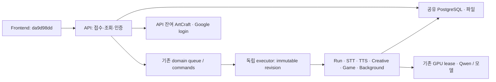

# 현재 실행부 분리 계약과 미완료 경계

2026-10-25 · 소스 `6f9802ab3197edb3f8257d36362d1e1b4e056341` · P2 review

이 문서는 기존 사용자 요구를 유지하면서 2026-10-25의 실행부 분리 결정과 실제 후보를 통합한다. `00-request-and-status.md` 및 `architecture-options.md`의 2026-10-24 제안과 충돌하면 이 문서와 최신 `manage_work`를 우선한다. 코드 존재, 과거 테스트, 현재 운영 증거를 서로 대신하지 않는다.

## 범위와 기존 제안의 처리

API는 접수·조회·인증·응답, 독립 executor는 장기/백그라운드 실행을 맡는다. DB·파일·GPU·로컬 모델은 공유한다. 단일 사용자이며 MSA, 버전별 모듈 번들, `module-releases/active.json`, 동적 module loader, 새 다중 세대 lease/fence 플랫폼을 추가하지 않는다. 기존 ADR0036의 command/lease/process identity와 자원 리스를 재사용한다.

| 과거 제안 | 현재 적용 |
|---|---|
| 버전별 도메인 번들·module pointer 교체 | 기각. 실행부만 분리하며 현재 immutable backend release와 executor manifest 사용 |
| 모든 잡에 공통 `pinned_module_revision`/새 lease·fence 필드 의무화 | 기각. 각 도메인의 기존 영속 레코드와 소유권/원자 claim 사용. 없는 필드를 구현된 것으로 가정하지 않음 |
| Creative API 세대 finalizer에 장기 작업을 묶기 | 실행부 큐 이관으로 대체. 기존 파일 원자 쓰기와 체크포인트는 유지; 신규 태스크별 fence 플랫폼 도입 안 함 |
| HMAC 영수증/동적 클로저를 배포 shortcut 필수 기반으로 연결 | 현재 운영 전환 요건에서 제외. 기존 prototype은 자동 통과 근거가 아님. 관련 코드·역사 증거는 보존 |
| FND-01에서 TTS queued 0만 확인해 첫 전환 허용 | 기각. pre-counter 요청 반례 보존. 접수 계약을 보고하지 않는 구세대는 stock 전송 완료 ack가 없어 전환 명시 거절 |
| P4·P6 자체 삭제 | **요구 유지.** 번들 메커니즘만 폐기. Core 무배포, accepted work 보존, 요청 전환, 실패 격리, rollback/restart와 E2E 실증은 여전히 필수 |

## API·Job·Event·자원 경계

| 표면/영속 상태 | API | 실행 소유자와 종료 계약 |
|---|---|---|
| Run / RuntimeCommand / 기존 lease·process group | 생성·조회·cancel/reset 명령 | executor RunManager. claim-stop 뒤 소유한 Run·작업의 자연 완료까지 대기. ownership 상실/timeout을 완료로 치환하지 않음 |
| STT/preview/주기 작업 | 접수·조회 | executor 기동 서비스 및 `maintenance_jobs`. local API rollback은 기존 소비자 경로 유지 |
| TTS / `tts_jobs.chunks_json` | text chunks를 영속 기록하고 접수 응답 | remote 큐 소유권으로 executor 소비. 구 local 세대 accepted work는 첫 전환 장벽의 별도 문제 |
| Creative / production record 및 checkpoint | 작업 의도 영속 기록 | executor 주기 소비. `queued_work.run_tracked`가 claim 후 작업을 loop 취소와 분리 |
| Games / game_builds | build 요청 및 상태 조회 | executor 주기 소비, domain별 조건부 claim. 신규 schema는 기존 0069 |
| NotebookLM·Reverse·Context index | remote에서 queue 기록 | `BackgroundConsumers`가 domain pump 실행. restart가 다른 소유자의 running 일을 임의 탈취하지 않음 |
| ArtCraft·Google login | API 잔여 실행 유지, drain 중 새 시작503 | API 소유. 각각 30s/20s 상한 후 취소/정리 시도. 실제 inflight로 퇴역 판정; cleanup 실패시 ready=false, 예외 재시도 |
| 상태/event/checkpoint | 기존 도메인 schema/응답 호환 유지 | 공통 신규 event bus나 모든 도메인 공통 fence를 전제하지 않음. commit·상태 쓰기는 해당 도메인의 기존 계약으로 검증 |
| PostgreSQL·파일·GPU·Qwen | 공유 데이터/조회 | 기존 `ResourceLeaseManager`, domain 예산 및 파일 원자 쓰기 유지. remote API Qwen owner=false, executor owner=true; 외부 모델 URL은 자식 소유와 구별 |

5개 runtime 파일의 정확한 source hash와 정의 위치, frontend 현재 main과 backend 테스트 delta는 [P1 현재 대조](../../../review/platform-v2/20261025/p1-frontend-runtime-tests-review.md)에 있다. 이 표는 코드에서 읽은 실행 배선이고 운영 프로세스/DB 소유권 실측은 아니다. 외부 API의 응답/body/권한 보존은 정적 URL 수집만으로 완료 처리하지 않는다.

## 전환·drain·rollback 계약

1. **기본값은 실행부 활성화 아님.** `deploy/generation-contract.json.run_executor`는 protocol2, activation disabled다. `config.py`의 local/runtime_generation 기본값과 운영 환경 적용값은 구별한다. source 기본값 확인이 현재 운영 활성화 증거가 아니다.
2. **API local→remote 최초 전환**: 등록된 구세대 identity·실행 모드를 확인한다. 구세대가 이미 remote/executor_protocol2이면 legacy TTS gate만 생략한다. 전체 ownership/기동/DB/E2E 검증 면제를 뜻하지 않는다.
3. **FND1**: legacy local TTS는 입구 close→구 route 전체의 전송 완료 ack→HTTP0→queued와running0 순서를 만족해야 activate할 수 있다. identity 변경·ack 없음/False·timeout·오류는 거절한다. 부분 close/취소도 원래 route 복원을 시도하며 복원 실패는 로그와 원오류를 보존한다. stock Caddy 구현은 ack 없이 거절한다. 단, 구세대가 `/api/ready`로 `tts_admission=generation-state-v1`을 보고하고 같은 응답의 generation이 기록과, revision이 `previous_revision`과 같으면 전송 ack 대신 이 접수 계약을 경계로 쓴다. accepted work는 구세대가 커밋한 `tts_jobs` 행이다. 구세대 accept는 커밋 전에 DB 상태가 active가 아니면 503으로 거절한다. 커밋한 일은 draining 중에 끝내며, 같은 identity의 `drain_ready`가 그때까지 퇴역을 막는다. 이 경로는 프록시를 조작하지 않는다. 계약을 보고하지 않는 23e0cbe 이하는 첫 remote 전환을 받을 수 없다. 계약을 보고하는 local 릴리스를 먼저 활성화한 뒤 remote를 활성화한다([검증](../../../review/platform-v2/20261025/fnd1-admission-handoff.md)).
4. **기각된 장벽**: proxy counter0, app HTTP0, DB queue0, 고정 sleep, `/stop` 응답, 프로세스 exit0만으로 완료를 선언하지 않는다. 격리 Caddy native graceful 무제한은 새 접속 가용성을 잃고, 유한 grace는 미완료 POST/SSE에도 exit0을 반환했다. 이 경로는 채택하지 않는다. 운영 proxy는 조작하지 않는다.
5. **executor 교체**: signal/ownership 종료 경로에서 queued_work/background/TTS 새 claim을 먼저 닫는다. 진행 Run/runtime work/각 pending drain 완료를 기다리고 이후 자식·서비스를 정리한다. 유한 drain timeout 후 자연 완료를 계속 기다릴 수 있다. 무기한 cleanup 실패를 퇴역 성공으로 보고하지 않는다.
6. **local rollback**: API local 경로는 STT/TTS/background/주기 및 Creative/Game 소비자를 다시 시작할 수 있어야 한다. 세대 draining→active는 claim pause를 resume하고 residual watcher를 취소·join한다. lifespan 재진입은 claim 스위치를 reopen한다. 종료의 1,800초 예산 초과 취소는 executor 자연 완료와 다른 계약이다. 실서비스 rollback/restart 증거는 아직 없다.
7. **외부 controller**: 배포/retire의 소유자는 기존 외부 controller다. API/Run 내부에서 launchctl·재시작·운영 proxy 조작을 하지 않는다. 첫 bootstrap 유휴 예외를 일반 무중단 전환 성공으로 확장하지 않는다.
8. **migration**: 단일 head는 `0071_library_platform_v2_merge`, 부모는 기존 library0068과 executor queue0070을 유지한다. DB 복수 version row는 거절한다. merge를 한 부모로 downgrade하면 다른 branch가 남으므로 완전 복원이라고 부르지 않는다. 후속 격리 PostgreSQL 왕복은 아래에 기록했으며, 운영 backup restore는 미검증이다.

## 요구·증거·미완료 연결

| 요구 | 재사용할 증거 | 남은 검증 |
|---|---|---|
| P0 | `p1-current-inventory-review.md`의 운영 예약 d56455c8 메타데이터 | 현재 serving/실시간 ownership, 백업·복원 영수증, 비교 가능한 성능 기준선 |
| P1 | backend 현 snapshot + 이번 frontend/runtime/tests delta | helper15, 신규 화면 의미/권한/상태, loader byte binding, 배포 shell/설정 의미 및 실시간 자원 소유권 |
| P2 | 본 계약과 원래 요구/13산출물/9시나리오의 연결 | 운영 E2E 근거·전체 산출물/PMS 최종 대조; 문서 통합만으로 done 아님 |
| P3/S2/INT | 3a49526 residual 교정, a3a29ec merge, 2fde901 fail-closed. 각 범위의 과거 검사는 기존 원문 재사용 | 후속 격리 DB9건·library 통합 통과는 아래 참조. 현재 후보 전체 gate·독립 residual은 미완료; 과거 전체gate 수치를 현재 후보로 인용하지 않음 |
| FND1 | `fnd1-transport-completion-guard.md`, `fnd1-native-graceful-verdict.md`, `fnd1-admission-handoff.md` 및 반례 JSON | 2단계 전환의 운영 실증(계약 보고 local 릴리스 활성 → 새 controller 코드의 supervisor → remote activation·rollback). 현재는 격리 실제 Caddy·앱·PostgreSQL 검증만 있음 |
| P4/P5/P6 | Step2~6 source 배선과 도메인별 좁은 증거 | Core 무배포 독립 변경/릴리스, 진행 accepted work·장기 Run 보존, 요청 전환·격리·rollback/restart, 실제 모델 응답/MCP/재개·보안·사용자 E2E·검증된 재배포 |

known `initdb shmget Operation not permitted`은 Codex 명령 샌드박스에서의 관측이다. 변경 없는 재시도나 다른 interpreter/engine을 통한 동일 거부 우회를 하지 않는다. 승인된 기존 DB 검증 경로/영수증을 먼저 찾고 그 범위 안에서 진행한다. main push와 배포 예약은 계속 보류한다.

## 2026-10-25 격리 DB 후속

위 미완료 표는 source6f9802a 시점이다. 이후 d31e3a0에서 test-only 접속 helper와 0048 검사 범위를 교정했고, 주입된 Run 테스트 PostgreSQL17.11에서 migration9건·library/실행부6파일161건·DB helper39건(범위 중복 합산 금지)을 확인했다. 실제 main0068→merge0071에서 보관 의도 metadata 보존, merge→한부모 downgrade시 두 version행 잔류, 공통조상0067→head schema/합성 payload 왕복을 실행했다. 운영backup restore·전체gate·FND1·P4/P6 완료가 아니다. [정확한 명령·결과·한계](../../../review/platform-v2/20261025/db-validation-followup.md)와 [변경3입력 manifest](../../../review/platform-v2/20261025/p1-db-correction-manifest.json)를 우선한다.
