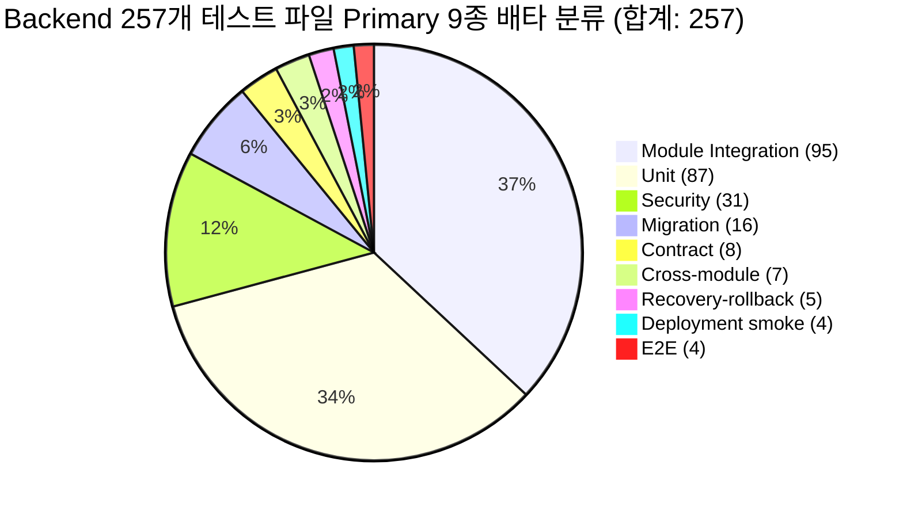
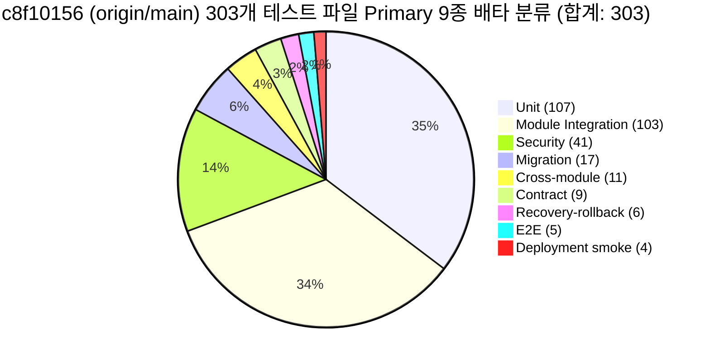

# 따까리 플랫폼 V2: 테스트 아키텍처 및 성능 기준선 감사 보고서 (교정본)

> **감사 담당**: Worker C (Frontend 전체 feature mapping / test architecture / baseline audit 교정)  
> **검증자 및 판정 대조**: Verifier `fed2c630-a867-42f1-9574-4a92905de864` (FAILED 판정 후 교정 반영)  
> **감사 시각**: 2026-10-24 21:55 KST  
> **측정 환경**: Mac Studio (Apple M5 Max, 64GB) / Antigravity Agent Runtime Sandbox  
> **기준 Git SHA 및 소스 스냅샷**:  
> - Backend: `607f8bda0df7dbdd458e4f0e54d703ce9edd3def` (audit worktree: `back-platform-v2-c`, branch: `audit/platform-v2-c-correction-20261024`)  
> - Frontend: `630040b1b7007a219a93c9d3d4491fab714c555d` (origin/main ancestor: `dbe0c9f042b006e2a627b8e59c295ad14b7a2caf`, dirty: 30개 파일 보존)  
> **실측 원시 증거**: `back/review/platform-v2/20261024/frontend-tests/`  

---

## 1. 테스트 인벤토리 전수 조사 요약

| 구분 | 파일 수 | 테스트 수 (단언/함수) | 실행 환경 | 게이트 및 실행 방식 | 주요 의존성 및 픽스처 |
|---|---|---|---|---|---|
| **Frontend 전체** | **82개 파일** | **549개 테스트** (548 PASS, 1 SKIP) | Vitest v5.0.3, JSDOM | `pnpm test --run` (단회 실측 5.43s) | Mocked API client, React Testing Library, In-memory DOM |
| **Backend `unit_tests/`** | **77개 파일** | **832개 함수** | pytest v9.1.1, Python 3.13 | `pytest unit_tests` (초단위 실행) | No DB / In-memory SQLite / AST 파싱 / 순수 로직 |
| **Backend `tests/`** | **179개 파일** | **2,267개 함수** (하위 테스트 포함 시 5,000+) | pytest-asyncio, PG sandbox | 배포 게이트 (`generation_deployment.py`) | PostgreSQL TRUNCATE / FastAPI client / AsyncPG |
| **Backend `benchmark_tests/`**| **1개 파일** | **4개 함수** | pytest | 선택 실행 | 성능 벤치마크 (지연시간/처리량 측정) |
| **Backend 합계 (Baseline)** | **257개 파일** | **3,103개 AST 함수 정의** | - | - | - |

> [!NOTE]
> **스냅샷 파일 수 구분 안내**:
> 1. **Baseline 감사 스냅샷**: Worker C 최초 조사 시점의 257개 파일 (3,103개 AST 함수 정의).
> 2. **Clean Worktree (HEAD `607f8bda`) 스냅샷**: 감사용 자체 단위 테스트(`test_platform_v2_*`) 제외 시 순수 백엔드 테스트 파일은 **251개**임.
> 두 스냅샷의 수치를 혼합하지 않으며, 각각 독립된 매니페스트로 관리함.

---

## 2. 테스트 분류 체계 교정: Primary 9종 배타 분류 및 Multi-Label

### 2.1 기존 10종 262개 오류 정정
이전 보고서에서는 primary category가 9종(합계 257개 파일)이었음에도 불구하고, "Runtime ownership (5개)"을 10번째 독립 카테고리로 임의 가산하여 **257 + 5 => 262개로 합계가 왜곡**되는 오류가 있었다.
이를 바로잡아:
1. **Primary Category**: 상호 배타적인 9종으로 엄격히 제한하며, 합계는 파일 총수(257개)와 정확히 일치함.
2. **Multi-Label (다중 라벨)**: 프로세스 펜싱, 리스 핸드오프, 실행기 등 교차 관심사는 primary category를 왜곡하지 않고 `runtime_ownership` 다중 라벨로 분리 관리함.

### 2.2 Primary 9종 분류 상세 및 보장 내용

| No | 카테고리 (9종 배타) | 파일 수 | AST 함수 정의 수 | 대표 파일 예시 | 실제 보장 내용 (What it Guarantees) | 한계 및 미보장 영역 (What it Misses) |
|---|---|---|---|---|---|---|
| 1 | **Unit (단위)** | 87 | 896 | `unit_tests/test_oplog_scrub.py`, `test_kb_store_pure.py` | 알고리즘 순수 함수, 정규식, 데이터 파싱, 토큰 마스킹 (0.2초대 고속) | 실제 DB 트랜잭션, 동시성 락, 네트워크 지연 미검증 |
| 2 | **Module Integration (모듈 통합)** | 95 | 1,327 | `tests/test_accounts.py`, `tests/test_api_runs.py` | FastAPI 엔드포인트와 PostgreSQL 테이블 간의 CRUD 계약 및 직렬화 | 단일 모듈에 국한되며 세대 간 전환이나 프로세스 재시작 미검증 |
| 3 | **Contract (계약 검증)** | 8 | 54 | `tests/test_contract_marker.py`, `tests/test_route_inventory.py` | 라우트 목록 누락 방지, MCP 도구 카탈로그 무결성, 마이그레이션 단일 head 검증 | 정적 AST 검사 위주로 런타임 페이로드 변조 검증 부재 |
| 4 | **Cross-module (모듈 간 연계)** | 7 | 81 | `tests/test_collector_pipeline.py`, `tests/test_orchestrator.py` | 수집기 파이프라인 -> 지식 베이스 색인 -> 비서 응답 연계 흐름 | 외부 LLM API 모의(fake) 사용으로 실제 모델 응답 드리프트 미검증 |
| 5 | **Security (보안 회귀)** | 31 | 430 | `tests/test_agent_token_security.py`, `tests/test_authz03_*.py` | SEC2-GATE-01: 에이전트 토큰 유출 방지, 권한 스코프 매트릭스, CSRF 방어 | 정적 화이트리스트 외 미등록 신규 침투 경로 실시간 탐지 한계 |
| 6 | **Migration (마이그레이션)** | 16 | 134 | `tests/test_migration_single_head.py`, `alembic/` | Alembic 마이그레이션 순방향 적용, 단일 head 보장, 컬럼 무결성 | 실데이터 대용량 다운그레이드 복구 및 온체인 락 시간 미측정 |
| 7 | **E2E (종단 간 검증)** | 4 | 16 | `tests/test_browser_mcp.py`, `front/src/integration.test.ts` | 브라우저 조작 및 프론트엔드-백엔드 간 실제 API 토큰 발급/호출 | 환경 변수(`TTAKKARI_IT_BASE`) 미설정 시 건너뜀(skip) 처리됨 |
| 8 | **Deployment smoke (배포 스모크)** | 4 | 27 | `tests/test_generation_deployment.py` | 세대 슬롯(8791/8792/8793) 생성, 릴리스 아카이브 생성 및 검증 | 실제 launchctl 및 호스트 데몬 재시작 검증은 정책상 제외 |
| 9 | **Recovery-rollback (장애 복구)** | 5 | 138 | `tests/test_game_rollback.py`, `unit_tests/test_host_resource_recovery.py` | 비정상 종료 후 잔여 프로세스 회수, DB 롤백 무결성 | 전원 차단 등 하드웨어 크래시 상황 시 dirty worktree 복구 미검증 |
| - | **합계 (Primary)** | **257** | **3,103** | - | - | - |

### 2.3 Security 감사 수치 정밀 분리
- **파일 분류 기준 Security**: **31개 파일 / 430개 함수 정의** (auth, token, guard, security 키워드 및 게이트 인벤토리 파일 분류)
- **AST 정적 `pytest.mark.security` 기준**: **27개 파일 / 366개 함수 정의**
- **런타임 수집(collection) 및 실행 케이스 수**: **미측정 (Unknown / Unverified)** (정적 감사 범위 밖)

---

## 3. 결함 주장 철회 및 게이트 유지 방침

### 3.1 `test_collector_control.py` 누락 결함 주장 철회 (RETRACTED)
> [!IMPORTANT]
> **주장 철회 및 교정 이력**:  
> 이전 보고서에서 "shared main gate에 등록된 `tests/test_collector_control.py`가 빠져 배포 inventory test 실패"라고 보고했던 주장은 **완전히 철회**한다.  
> 검증자(`fed2c630`)가 공유 main `607f8bda`의 HEAD, index, worktree를 전수 확인한 결과, 해당 파일 및 게이트 등록 상수는 main에 전혀 존재하지 않았다. 해당 파일과 등록은 별도의 후보 브랜치(`back-collector-s2`, `back-collector-complete`)에 함께 온전히 존재하며, 후보 브랜치 상태를 shared main의 운영 결함으로 잘못 일반화하여 보고했음을 확인하고 정정한다.

### 3.2 배포 보안 게이트 (`run_security_gate`) 유지 및 최적화 제안 조건
1. **게이트 유지 원칙**:
   - `generation_deployment.py`의 `run_security_gate()`에서 `pytest -m security`를 실행한 후 전체 suite를 실행하는 구조는 구조적 중복 선택이 발생할 수 있으나, **보안 게이트는 배포 안전장치로서 즉시 제거하거나 축소하지 않고 전면 유지**한다.
   - 이전 보고서에서 언급된 "동일 31 tests"는 실행 케이스 수가 아니라 **파일 수**였음을 정정한다.
2. **조건부 최적화 연구 과제 (P2/P3 제안으로 격하)**:
   - 보안 테스트의 중복 실행을 단축하기 위한 재사용 검토는 반드시 다음 동등성 키와 음성 대조(Negative Control)가 성립할 때만 별도 실험으로 진행한다:
     - 동일 release/test tree snapshot
     - 테스트 선택 집합(test selection set)의 완전 일치
     - runtime / python / plugin / env 환경의 완전 동일성
     - 격리된 PostgreSQL DB의 깨끗한 동등 상태 보장
     - 테스트 간 상태 의존성(state pollution) 부재 입증

---

## 4. 실측 성능 기준선 (Measured Performance Baseline)

### 4.1 Frontend Vitest 실측치 (독립 검증 1회 실측 보존)
- **실행 명령**: `TMPDIR=/private/tmp/ttakkari-v2-vitest-tmp TTAKKARI_NO_ENV_FILE=1 pnpm test --run --reporter=dot`
- **결과**:
  - **테스트 파일**: 82 files (81 passed, 1 skipped)
  - **테스트 케이스**: 549 tests (548 passed, 1 skipped)
  - **Wall Duration**: **5.43s**
  - **JSDOM 생성**: 82회, 병렬 environment 합계 33.21s (병렬 누적 시간이므로 wall-time breakdown으로 해석하지 않음)

### 4.2 운영 배포 로그 실측치 (`ops_deploy_log` 원문 대조)
- **성공 배포 baseline (`9f82c9c16cd604e81ddf43180b0be2e895ec85cb`)**:
  - pytest 단계 소요: **1,045.97초** (약 17분 26초)
  - 통과 수: 4,473 passed, 8 skipped, 2 xfailed, 5,020 subtests passed
  - DB 리셋: 2,822 selective, 1 forced full, 1 fallback
  - 전체 배포 작업: 약 26분 16초
- **실패 배포 baseline (`c8f10156845d007ec6496a65d6d8417be19260bd`)**:
  - pytest 172.23초 시점에 `tests/test_desk_qwen_service.py::test_desk_request_goes_to_the_managed_server_of_this_process`에서 `harness-v3-topic-boundary != harness-v2` 단언 불일치로 즉시 중단.
- **성능 비교 기준 주의**:
  - 위 두 baseline은 서로 다른 revision 및 테스트 구성이므로, 직접적인 개선 비율이나 단축률 산출의 대조군으로 합치지 않는다.

### 4.3 UI Worker 및 Vercel 배포 상태
- 커밋 `dbe0c9f042b006e2a627b8e59c295ad14b7a2caf`는 Git 상에서 `origin/main`의 ancestor임을 확인.
- 실제 Vercel 배포 receipt는 확인 가능한 도구가 없으므로 **배포 완료 상태는 미검증**으로 남긴다.

---

## 5. 최종 제품 인벤토리 (`c8f10156` / `origin/main`) 및 Baseline Drift 대조 원장

### 5.1 기준선 통합 배경 및 원칙
- **A 정본 (`fddad5e1`)의 Base**: `origin/main` (`c8f10156845d007ec6496a65d6d8417be19260bd`)
- **기존 B/C Baseline (`607f8bda`)**: 과거 로컬 스냅샷 (공유 dirty main의 이전 베이스)
- **보존 및 대조 원칙**:
  - 기존 `607f8bda` 교정 증거는 보존하되 최종 제품 인벤토리는 `c8f10156`의 깨끗한 고립 스냅샷(clean isolated snapshot)에서 재추출함.
  - 두 스냅샷의 수치를 임의 합산하거나 동일시하지 않고, 증분(추가/삭제/변경) 분모와 미확인 원장을 명확히 분리하여 기록함.

### 5.2 Worker A 문서 주장 ("111 behind / 64 .py / 5 migrations") 독립 Git 실측 검증
Worker A의 `00-request-and-status.md` 및 `architecture-options.md`에 기재된 수치를 실제 Git 코드로 직접 검증한 결과는 다음과 같다:

| 검증 항목 | Worker A 주장 | Git / 실제 코드 실측치 | 판정 및 상세 근거 |
|---|---|---|---|
| **커밋 거리** | 111 behind | **118 behind, 2 ahead** | **수치 정정**: `git rev-list --count 607f8bda..c8f10156`는 **118**이며, 로컬이 2 ahead임. (111은 이전 시점 수치) |
| **마이그레이션 증분** | +5 migrations | **+5 migrations (62개 $\rightarrow$ 67개)** | **검증 확인**: `alembic/versions` 파일이 607의 62개에서 c8의 67개로 정확히 5개 증가함. |
| **`src/` 파이썬 파일** | +64 files | **+64 .py (321개 $\rightarrow$ 385개)** | **검증 확인**: `git ls-tree -r --name-only <SHA> src` 기준 321개에서 385개로 정확히 64개 증가함. |
| **전체 파일 Diff** | 253 files changed | **366 files changed** | **수치 정정**: 전체 `git diff --shortstat 607f8bda c8f10156`는 **366 files changed, 86,213 insertions(+), 339 deletions(-)**임. |

### 5.3 `c8f10156` 제품 테스트 인벤토리 전수 조사 (303개 테스트 파일)
`c8f10156`의 Git 블롭(clean snapshot)을 직접 AST 파싱하여 추출한 제품 테스트 아키텍처는 다음과 같다:

- **총 테스트 파일 수**: **303개 파일** (`607f8bda` 대비 **+51개 추가, 0개 삭제**)
- **총 AST 함수 정의 수**: **3,539개** (`607f8bda` 대비 **+436개 추가**)
- **`tests/test_collector_control.py` 확인**: `607f8bda`에는 없었으나 `c8f10156`(`origin/main`)에 정규 포함되어 있음을 실측 확인.

| Primary 카테고리 (9종) | `607f8bda` 파일 수 | `c8f10156` 파일 수 | 증분 ($\Delta$) | 주요 추가 테스트 파일 예시 |
|---|---|---|---|---|
| **Unit** | 87 | **107** | +20 | `unit_tests/test_desk_topic_boundary.py`, `unit_tests/test_collector_parser.py` |
| **Module Integration** | 95 | **103** | +8 | `tests/test_collector_budget.py`, `tests/test_collector_cache.py`, `tests/test_collector_manage.py` |
| **Security** | 31 | **41** | +10 | `tests/test_collector_control.py`, `tests/test_collector_fetch_tls.py`, `tests/test_authz03_*.py` |
| **Migration** | 16 | **17** | +1 | `tests/test_collector_stage_migration.py` |
| **Cross-module** | 7 | **11** | +4 | `tests/test_collector_integration.py`, `tests/test_collector_product_flow.py` |
| **Contract** | 8 | **9** | +1 | `tests/test_contract_*.py` 보강 |
| **Recovery-rollback** | 5 | **6** | +1 | `tests/test_host_resource_recovery.py` |
| **E2E** | 4 | **5** | +1 | `tests/test_desk_qwen_live.py` |
| **Deployment smoke** | 4 | **4** | 0 | `tests/test_generation_deployment.py` 유지 |
| **합계 (Primary)** | **257** | **303** | **+51** (커밋 기준 252 $\rightarrow$ 303) | - |

- **Security 수치 (c8f10156 실측)**:
  - 파일 분류 기준 Security: **41개 파일**
  - AST 정적 `pytest.mark.security` 마커 Security: **37개 파일 / 449개 함수 정의**
  - 런타임 수집/실행 케이스 수: **미측정 (Unknown / Unverified)**

- **Multi-Label 수치 (c8f10156 실측)**:
  - `db_fixture`: 131개 파일
  - `process_fixture`: 84개 파일
  - `runtime_ownership`: 62개 파일 (프로세스 생명주기 및 리스 제어 연관)
  - `security_mark`: 37개 파일
  - `alembic_fixture`: 20개 파일

### 5.4 Frontend 최신 Remote Ref 및 Dirty Source Hash 분리
Frontend 저장소(`/Users/winterholic/development/projects/winterholic-ttakkari/front`)의 원격 기준선과 로컬 dirty 상태를 명확히 분리하여 기록함:
- **로컬 HEAD**: `630040b1b7007a219a93c9d3d4491fab714c555d`
- **원격 정본 Ref (`origin/main`)**: `dbe0c9f042b006e2a627b8e59c295ad14b7a2caf`
- **Ahead / Behind**: `ahead 3, behind 105`
- **Dirty 상태 지문 (SHA-256 of `git status --porcelain=v2`)**: `f7d9a949fa437af7c3e9bdaa11fada48c7ad613e79c96119e970361498c2c6af`
- **배포 영수증**: Vercel 실제 deployment receipt는 확인 가능한 도구가 없으므로 **배포 완료 미검증** 유지.
- **라우트/API 인벤토리**: 프론트엔드 라우트(38개 path 선언) 및 API(184개 엔드포인트/호출)는 `App.tsx`, `client.ts`, `stream.ts`, `useConnection.ts`의 TypeScript AST 구조적 분석에 기반하며, 백엔드 `c8f10156`의 25개 모듈 인벤토리에 잠정(`provisional`) 바인딩됨.

