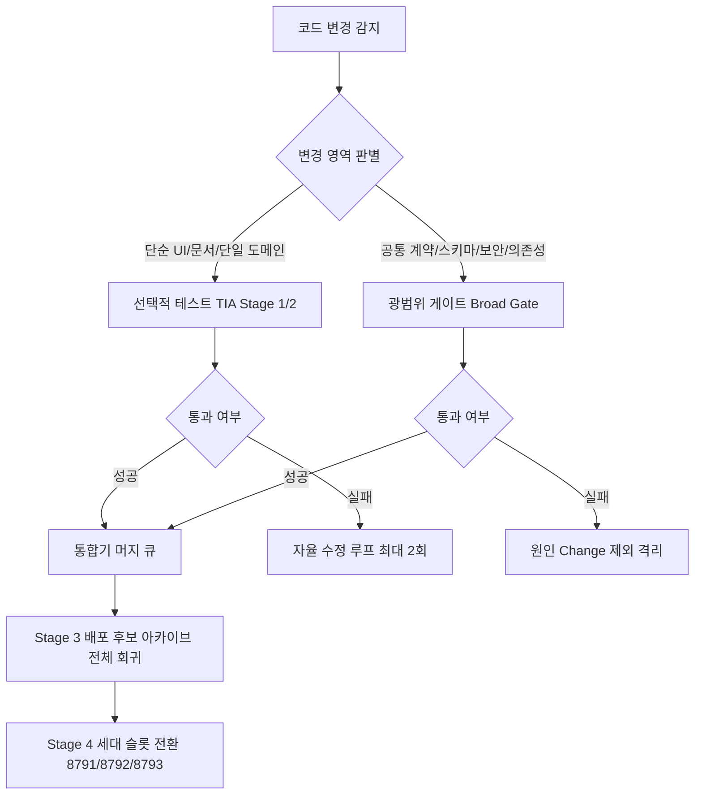
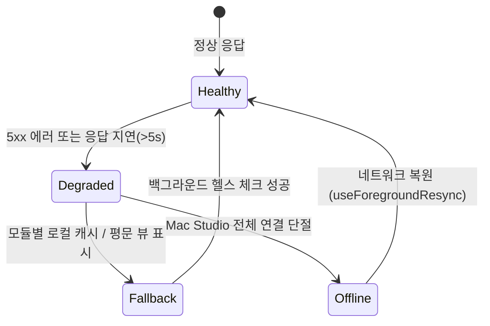

# 따까리 플랫폼 V2: 테스트 임팩트 및 딜리버리 재설계 제안서 (교정본)

> 현재 교정 및 실제 배포 범위는 [검증 실패 교정·통합 기록](verified-corrections-20261024.md)이 우선한다. 아래의 이전 후보 완료 표시는 당시 이력이며 V2 전체 완료나 현재 운영 검증을 뜻하지 않는다.

> **설계 담당**: Worker C (Frontend 전체 feature mapping / test architecture / baseline audit 교정)  
> **검증자 및 판정 대조**: Verifier `fed2c630-a867-42f1-9574-4a92905de864` (FAILED 판정 후 교정 반영)  
> **설계 시각**: 2026-10-24 21:55 KST  
> **입력 기준**: ADR 0066 (AI-Native 개발·검증·배포 파이프라인), ADR 0036 (실행기 수명 분리), 배포 로그 실측치  
> **동반 산출물**:  
> - `back/docs/design/platform-v2/frontend-feature-map.md`  
> - `back/docs/design/platform-v2/test-architecture-and-baseline.md`  

> [!CAUTION]
> **현재 운영 게이트 불변 및 범위 한계 고지**:
> 1. 본 제안서는 향후 V2 안정화 단계(P2/P3)를 위한 장기 아키텍처 제안이며, **현재 운영 배포 게이트(`run_security_gate`)를 제거하거나 축소하지 않고 100% 유지**한다.
> 2. `run_security_gate()`의 "31"은 실행된 테스트 케이스 수가 아니라 **파일 수**였음을 정정한다. 보안 테스트 재사용 검토는 release/test tree snapshot, selection set, runtime/plugin/env, 격리 PostgreSQL 동등 상태 및 Negative Control이 입증된 이후의 조건부 과제로 제한된다.
> 3. 프론트엔드 모듈별 헬스 UI는 현재 코드베이스(`useConnection.ts`의 전역 `/api/health` 30초 폴링)에 구현되어 있지 않으며, 순수 제안 조사 범위로 한정한다.  

---

## 1. 배경 및 핵심 문제 정의

현재 따까리 배포 및 테스트 시스템은 다음과 같은 구조적 한계를 안고 있다.

1. **사후·직렬·누적의 배포 게이트 (17분+ 소요)**:
   - main에 커밋이 올라간 뒤 전체 테스트(4,473개, 17분 25초)를 `-x`로 돌린다.
   - 단 하나의 테스트(예: `test_desk_qwen_service.py`)가 어설션 실패하면 뒤따르는 수십 개의 무관한 정상 변경(문서, 프론트엔드 UI, 메모 기능 등)이 전부 배포 차단된다.
2. **검증 재사용(Verification Reuse) 메커니즘 부재**:
   - 코드가 전혀 바뀌지 않은 하위 모듈도 매 배포마다 106개 테이블 TRUNCATE와 함께 전수 재실행된다.
3. **사용자의 관제 관리자화 (UX 문제)**:
   - 배포 실패나 모듈 장애 발생 시 사용자가 직접 Ops 로그를 뒤지거나 콘솔을 확인해야 하며, 프론트엔드는 모듈 단위 상태를 모르고 전역 "Mac Studio 연결 끊김"으로 처리되어 전체 사용성을 떨어뜨린다.

---

## 2. 테스트 임팩트 분석(TIA) 및 게이트 재설계 원칙

### 2.1 광범위 게이트(Broad Gate) vs 선택적 테스트(TIA) 기준

ADR 0066 D4의 4단계 검증 체계를 계승하되, 모듈 경계와 위험도에 따라 명확한 분기 규칙을 정립한다.

#### 광범위 게이트 (Broad Gate) 강제 조건:
다음에 해당하는 변경은 TIA 선택을 금지하고 반드시 상위 연계 테스트 및 정규 회귀를 수행한다.
1. **공유 계약 변경**: `src/ttakkari/api/assistant.py`, `orchestrator.py`, `models.py`, `client.ts`의 스키마 변경
2. **보안/인증 경계**: `ttakkari/security/`, `authz03`, 에이전트 토큰, 실행 가드 정책
3. **데이터베이스 마이그레이션**: `alembic/versions/` 추가/수정, Alembic single-head 검증
4. **런타임 소유권/리스/프로세스 제어**: `runs/manager.py`, `generation.py`, `executor.py`
5. **역의존성 및 소유권 불확실(Ownership Unknown)**: 변경 파일의 소비자를 정적 분석으로 100% 확정할 수 없는 경우

#### 선택적 테스트 (TIA) 적용 조건:
- `front/src/features/<module>/`: 해당 모듈 컴포넌트 단위 테스트 + 상위 페이지 테스트만 선택 실행 (5초 이내 완료)
- `back/src/ttakkari/<isolated_module>/`: 단위 테스트(`unit_tests/`) + 해당 모듈 통합 테스트

---

## 3. 검증 재사용 키 (Verification Reuse Key) 설계

불필요한 반복 전체 테스트를 방지하기 위해 다음 7개 튜플로 불변 캐시 키를 정의한다.

$$Key = \text{SHA256}(R_{\text{source}} \parallel V_{\text{module}} \parallel L_{\text{dep}} \parallel R_{\text{suite}} \parallel C_{\text{runtime}} \parallel S_{\text{schema}} \parallel F_{\text{env}})$$

1. **`source_revision` ($R_{\text{source}}$)**: 모듈 소스 코드의 Git 트리 해시
2. **`module_version` ($V_{\text{module}}$)**: `package.json` 또는 백엔드 모듈 메타데이터 버전
3. **`dependency_lock` ($L_{\text{dep}}$)**: `pnpm-lock.yaml` 또는 `uv.lock`의 관련 의존성 다이제스트
4. **`suite_revision` ($R_{\text{suite}}$)**: 해당 모듈을 검증하는 테스트 코드 자체의 트리 해시
5. **`runtime_config` ($C_{\text{runtime}}$)**: 환경 설정 지문 (포트, 활성화 플래그, 프로필 목록)
6. **`schema_fingerprint` ($S_{\text{schema}}$)**: 현재 Alembic 마이그레이션 head 해시
7. **`environment_fingerprint` ($F_{\text{env}}$)**: Python/Node 런타임 버전 및 OS 아키텍처 지문

### 캐시 제외 불변 원칙 (Always Fresh):
- **Readiness 프로브**: 백엔드 세대 전환 시점의 `/api/health`, `/readiness`는 **절대 캐시하지 않고 항상 실시간 측정**.
- **외부 연계 상태**: Apple 푸시 서버, Cloudflare 터널, Open-Meteo 외부 API 연결 상태는 캐시 금지.

---

## 4. 프론트엔드 모듈 결함 격리 및 UX 제안 (사용자 관제화 방지)

### 4.1 기본 철학: "사용자는 관제 모니터링 관리자가 아니다"
- 사용자는 모바일 폰으로 일상 업무를 지시하는 주체이며, 특정 모듈의 백엔드 배포 실패나 일시 장애 때문에 전체 앱이 멈추거나 빨간 에러 화면을 마주해서는 안 된다.
- **점진적 성능 저하(Graceful Degradation)** 원칙: 특정 모듈에 장애가 생기면 **그 기능 화면만 인라인으로 우아하게 fallback**하고, 나머지 대화·작업·파일 기능은 100% 정상 작동해야 한다.

### 4.2 모듈별 UI 상태 머신 제안

1. **회의록 전사 (`domain.meetings`)**:
   - 로컬 STT 엔진이 준비 중이거나 배포 중일 때: "전사 엔진 준비 중" 인라인 알림을 띄우고, 업로드된 원본 음성 청취와 기존 텍스트 메모 기능은 정상 유지.
2. **날씨 브리핑 (`domain.weather`)**:
   - 외부 기상청 API 장애 시: 에러 팝업 대신 "마지막으로 수신된 08:00 예보"를 캐시에서 표시하고 작은 시각 배지만 갱신.
3. **산출물 뷰어 (`domain.artifacts`)**:
   - PWA 청크 배포 교체 시: 화면을 강제 새로고침하여 사용자의 작성 중인 메시지를 날리지 않고, `UpdateToast`("새 버전이 준비되었습니다")를 띄우거나 뷰어 닫기 시 자동 갱신.
4. **파일 전송 (`domain.files`)**:
   - 네트워크 단절 시: 조각 전송을 중단하고 대기열(`queued`)로 유지하며, 화면이 다시 켜질 때 끊긴 바이트부터 자동 재개 (사용자 개입 불필요).

---

## 5. 단계별 실행 계획 (WBS 제안)

| 단계 | 목표 | 주요 작업 내용 | 성공 판정 기준 |
|---|---|---|---|
| **Phase 1** | 배포 게이트 안전 유지 및 환경 안정화 | - `run_security_gate` 및 회귀·복구 게이트 100% 불변 유지 - `test_collector_control.py` 누락 결함 주장 전면 철회 확인 - vitest 환경 안정화 (과거 5.48초 실측치 기준, 장기 2초 목표와 분리 관리) | 배포 게이트 무결성 유지, 과거 실측치(5.48초/17분)와 장기 목표치의 명확한 분리 관리 |
| **Phase 2** | TIA & 머지 큐 도입 | - ADR 0066 기반 `submit_change` 및 통합기 루프 가동 - 모듈별 TIA 1단계/2단계 분기 구현 | 독립 모듈 변경 시 2분 이내 빠른 피드백 제공 |
| **Phase 3** | 모듈 건전성 UI 도입 | - `/api/modules/health` 계약 신설 - 프론트엔드 모듈별 인라인 Fallback 뷰 적용 | 특정 모듈 장애 시 타 모듈 정상 작동 검증 |
| **Phase 4** | 검증 재사용 캐시 | - Verification Reuse Key 7개 튜플 캐시 계층 구현 | 문서/UI 단독 변경 시 백엔드 전체 회귀 건너뜀 |
