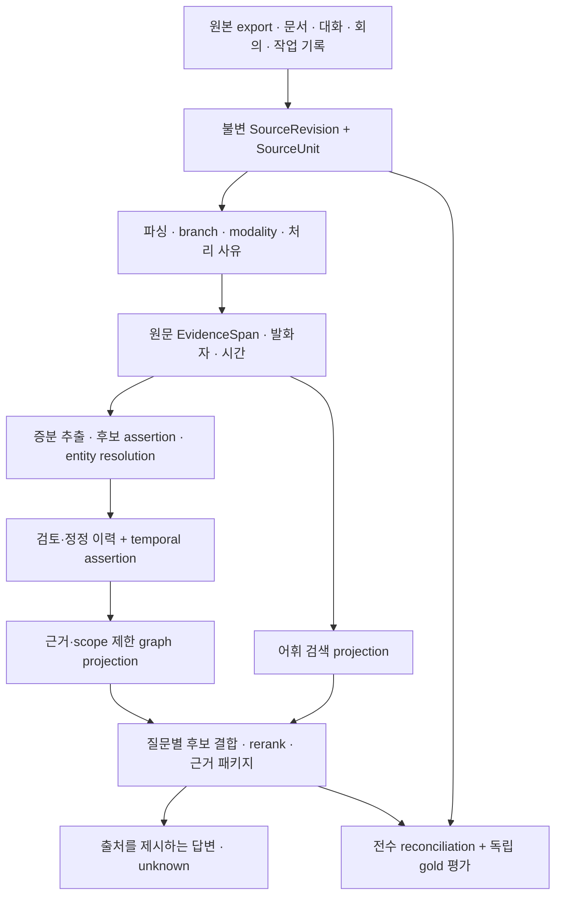

# 따까리 지식 기반 재설계 — 실행 설계 v1

상태: 2026-10-16 사용자 구현 착수 지시 반영. 감사 완료나 기존 계획 승인을 기다리지 않는다.
기준 코드: origin/main 6b07313. 범위: 원본 수용부터 근거 추적, 관계·기억, 검색, 평가, 운영 전환.
이번 첫 구현 범위: 읽기 전용 ChatGPT 전체 분기 인벤토리 CLI. 아래 나머지 구조는 구현 예정이며 현재 기능으로 읽으면 안 된다.

## 1. 요구와 설계 계약

| 사용자 요구 | 설계 결정 | 인수 증거 |
|---|---|---|
| 제공한 모든 자료가 어떻게 쓰였는지 알 수 있어야 함 | 원본과 의미 추출을 분리. 원본 revision·message·branch·attachment occurrence 원장에 모든 단위의 처리 결과와 사유 기록 | 입력 수 = 대기+처리+명시 제외+오류 수. 지원하지 않는 입력도 누락시키지 않고 quarantine |
| 기술 외 건강·정체성·가치관·진로도 맥락 | 도메인 때문에 선별 탈락시키지 않음. 민감도·발화 주체·검색 scope는 별도 축 | 범주별 처리 coverage 및 제외 사유. 구체적 건강 원문은 보고서에 싣지 않음 |
| 프로젝트 경계를 넘는 관계 발견 | 프로젝트는 엔터티와 다대다 연결. 대화·문서·결정·구현 evidence 연결. 관계는 버전 있는 assertion | 스톡고수→따까리, 아리아리→AIP, 디자인 자산 재사용, 진로 변화, 설계→구현 원문 기반 사례 |
| 정확한 관계만 조금 저장하는 문제 해소 | 원본에서 독립 추출한 relation gold와 저장/검색 결과를 비교, precision과 recall 동시 측정 | 누락 edge 목록, 근거 span, 불확정 라벨 비율, 표본 단위와 CI |
| 초기부터 확장 가능한 기반 | 수집·해석·지식·검색·평가 경계 분리. 각 단계 독립 재실행 및 버전 기록 | 한 단계 교체·중단·재개·재실행이 다른 단계의 정본을 덮어쓰지 않는 테스트 |
| 틀린 기억과 과거 결정을 정정 가능 | 유효시각/기록시각 분리, correction·supersession 이력. 최신이라는 이유만으로 과거의 근거 폐기 안 함 | 당시 결정 조회와 현재 결정 조회, 오판 정정, 삭제 뒤 재수입 부활 방지 |

기존 ADR 0009의 회사 Run=work/shared, 개인 Run=전체 맥락 정책을 유지한다. 권한은 Run/ACL에서 결정하고 KG가 권한을 부여하지 않는다. 새 임베딩 모델 도입은 이번 기본 경로에 포함하지 않는다. 기존 벡터 부족률은 현 정책의 결함 지표가 아니다. 의미 검색 후보는 교체 가능한 실험 경로로 둔다.

## 2. 현재 증거와 한계

- 10/16 작업자 local PostgreSQL snapshot: source 79, document 347, chunk 5,159, active memory 134, entity 46, relation 15. 배포 런타임 동일성 미검증.
- frozen source-reviewed dev gold 24질의/32 target rows: 31건 색인, Recall@5 .458. 전체 지식 보존율·관계 발견률 아님. 과거 .417과 실행 경로가 달라 향상으로 읽지 않는다.
- 코드 직접 확인: CtxDocument는 파일 단위 SHA만 보유. 변경 시 chunk 삭제·재생성. CtxRelation은 triple unique와 note/source/created_at만 보유. 원문 evidence·유효시각·정정 상태를 표현할 구조가 부족하다.
- 기존 53카드 선별은 전체 원본 수용의 대체물이 아니다. 무손실 원장은 모든 원본을 기록하고, 검색·추출 대상 선택은 별도 파생 상태로 남긴다.
- 원본 census·검색 성능·관계 recall·답변 근거 정확도는 별도 검사다. 한 검사 성공을 다른 검사의 성공으로 보고하지 않는다.

## 3. 목표 구조와 정본

PostgreSQL은 원본 메타데이터·이력·파생 작업의 초기 정본 저장소로 선택한다. 근거는 현재 트랜잭션·FK·scope 경로의 재사용과 원본 추적성 확보다. 현재 스키마를 그대로 유지한다는 결정이 아니다. graph/text projection은 재생성 가능하게 해 추후 그래프 DB·검색 엔진을 바꿔도 원본과 지식 이력이 그 엔진에 종속되지 않게 한다.

대안 검토: (a) 현 triple에 필드 몇 개 추가는 여러 근거·충돌·재추출 이력에 부족. (b) 그래프 DB 우선 교체는 출처/수용 누락 자체를 해결하지 않으며 이중 정본·운영비를 추가. (c) 모든 질문에 전역 GraphRAG 요약은 갱신 비용과 원문 근거 희석 우려가 있어 전역 질문 실험 경로로 배치. (d) 원본 전체를 매번 long context에 넣는 방식은 직접검색 baseline으로 비교하고 상시 경로로 고정하지 않는다.

## 4. 데이터 모델과 불변식

이름은 목표 계약이며 Alembic 구현 시 현재 스키마와 대조해 확정한다. 논리 객체를 무조건 테이블 하나씩 만들지는 않는다.

| 객체 | 식별과 핵심 필드 | 강제 규칙 |
|---|---|---|
| SourceRevision | source_id, content_sha256, parser_version, imported_at, original_locator, scope, sensitivity | UNIQUE(source_id,sha,parser_version); 원본 bytes는 기존 파일을 보존, 원장에는 검증 가능한 hash/locator |
| SourceUnit | revision FK, external conversation/message/node ID, JSON pointer, parent, branch, modality, outcome/reason | revision+pointer UNIQUE; 정규 ID와 occurrence를 분리. 오류·미지원·비활성 branch도 행 존재 |
| EvidenceSpan | unit FK, content_revision_hash, JSON part pointer, char_start/end, speaker, event_time | 정확한 원문 문자열의 좌표; 0<=start<end<=원문 길이 검사. 변환문은 원문 offset으로 가장하지 않음 |
| ExtractionRun / Item | input revision, extractor/prompt/schema/model versions, idempotency key, status, cursor, attempts, usage | 성공·실패·검토대기 명시, 실패를 빈 후보로 취급 금지. 입력 revision 변경 시 새 run |
| Entity / Alias | canonical ID, typed namespace, scope, alias language/source/conflict | 동명이인 자동 병합 금지. alias 후보와 검토된 동일성 분리. 기존 entity ID 유지 |
| Assertion | subject, predicate, object(entity or typed value), modality, polarity, speaker, valid_from/to, recorded_at | 사실/제안/질문/부정/회상 구분. 관계와 scalar 선호를 동일 근거 모델로 수용 |
| AssertionEvidence | assertion FK, evidence FK, supports/refutes, extraction_run FK | 근거 없는 기계 추출을 확정 사실로 서빙 금지. 여러 독립 근거와 반박 동시 보존 |
| ReviewEvent / AssertionVersion | candidate/source_reviewed/user_confirmed, active/disputed/superseded/retracted, actor, reason, prior version | 검토수준과 현재상태는 독립 축. AI 검토를 사용자 확정으로 바꾸지 않음. 변경은 append |
| Projection / DerivedFrom | generation, input revision IDs, entity/memory/chunk/edge references, tombstone | 재생성·삭제 영향 추적. legacy 출처 불명은 legacy_unverified로 남김 |
| RetrievalTrace / EvalCase | query family, corpus/gold/index/code version, candidate reasons/ranks, evidence IDs, cost/latency | 민감 질의 원문은 기본 로그 제외, trace TTL. dev/holdout 분리, 정답 외삽 금지 |

시간: event_time(발언·사건), valid time(내용이 유효한 기간), recorded_at(시스템이 안 시각)을 구별한다. unknown은 NULL이며 수입시각으로 사건시각을 채우지 않는다. 끝 경계는 exclusive, UTC timestamptz. 모순은 오류로 덮어쓰지 않고 경쟁 assertion으로 남긴다.

스키마: FK/CHECK/UNIQUE로 고아·불법 상태를 차단. 격리 scope는 모든 join·후보 조회·graph traversal에 적용. 서로 다른 scope 근거의 공개 범위는 허용 집합의 교집합이며 개인 근거로 만든 요약을 shared로 올리지 않는다. 프로젝션 저장과 다음 작업 enqueue는 동일 트랜잭션/outbox로 연결한다.

## 5. 수집·추출과 운영 흐름

1. 원본의 manifest와 hash를 고정한다. 모든 export shard·대화·message·null node·branch를 열거한다. 첨부는 참조 존재/파일 존재/해석 가능을 분리하고 payload 미해석 상태를 명시한다. 원본과 staging 출력 경로를 분리한다.
2. ChatGPT·Markdown·앱 대화·회의·work-history별 adapter가 동일 SourceUnit 계약을 낸다. 요약카드도 파생 문서로 보존하며 원본으로 오인하지 않는다. 전체 원본 기록이 의미 전체 추출을 보장하는 것은 아니다.
3. 발화자와 branch를 유지해 user 자기 진술, assistant 제안, 인용된 타인 정보를 분리한다. 변경분만 추출하고 기존 엔진 계정/범위/예산 경로를 사용한다. 재시도 상한·체크포인트·백오프·오류 큐·수동 재개를 둔다.
4. 도메인에 관계없이 entity/사건/결정/선호/관계 후보를 만든다. 원문 evidence 없는 후보와 alias ambiguity는 검토대기. 인과관계는 시간적 선후나 동시등장만으로 만들지 않는다.
5. 원문 명시·검토된 비민감 관계는 출처를 표시해 활용할 수 있다. user_confirmed는 실제 사용자 행위만 생성한다. 민감 추론·성격/건강 자동 확정·pinned 자동 승격은 하지 않는다. 이 제약이 일반 후보 생성까지 막지는 않는다.
6. 작업별 입력 manifest와 completion ledger를 검산한다. 일부 실패면 partial이며 성공한 staging은 보존하고 실패 지점부터 재개한다. 원본 삭제는 구현 범위에 포함하지 않는다.

## 6. 질문별 검색과 답변 계약

- 공통: 요청 scope/시간/상태 필터 → 후보 생성 → 문서/근거 단위 중복 제거 → rerank → budget 내 근거 패키지. LLM 기반 query rewriting 실패 시 원질의 경로가 동작한다.
- 사실 조회: 현재 FTS/trigram/alias를 control로 보존하고 BM25(비교용)와 metadata filter를 같은 corpus에서 평가. 한국어 조사·코드 토큰·약어·동음 alias를 회귀 문항에 포함한다.
- 프로젝트 연결·설계 이력: entity 해소 후 증거가 있는 제한적 traversal, hop/edge/시간 budget 및 cycle 차단. 2-hop을 구현·실험할 수 있으나 서빙 활성화는 해당 cohort 검증 뒤 한다.
- 진로·선호 변화: event/valid time으로 검색. 과거 결정과 현재 입장을 함께 제시하고 supersession 근거를 표시한다.
- 전역 회고·여러 프로젝트 공통점: community summary와 원문 직접검색을 challenger로 비교. 요약은 revision 묶음에 종속, stale 판정과 원문 내려가기를 제공한다.
- 모든 결과: source revision·span·speaker·시각·검토/현재 상태·검색 이유. 명시 사실과 해석을 구분. 근거가 부족하면 unknown과 누락 구간을 말한다. 답변이 실제로 인용했는지 별도 검사한다.

임베딩·새 리랭커·graph depth는 adapter와 feature flag로 교체한다. 설치·목록 존재를 실제 모델/MCP 실행 검증으로 대신하지 않는다.

## 7. 평가와 전환 조건

기존 24문항은 dev baseline. 원본에서 source-first로 프로젝트·시간·도메인을 층화해 별도 holdout을 만든다. 같은 대화 계열이 dev와 holdout에 걸치지 않게 group split. 각 cohort 최소 10문항, 전체 최소 80질의를 초기 목표로 두되 이것만으로 충분한 통계력이 있다고 주장하지 않는다. 검색 결과로 정답을 역으로 만들지 않는다. 사용자에게 모든 정답 라벨링을 떠넘기지 않고 애매한 개인 의도만 짧게 확인한다.

단계 지표를 분리한다: input accounting, eligibility coverage, parsing success, extraction evidence precision/recall, assertion acceptance, indexed-gold coverage, retrieval Recall/MRR/nDCG, citation entailment, answer correctness/usefulness. 전체 의미지식의 분모는 정답셋 없이 계산하지 않는다. recall은 질의별 관련 근거 회수율의 macro 평균이며 hit-rate와 구분한다. relation은 edge 발생 단위와 canonical triple 단위를 함께 보고한다.

초기 인수 목표(실측 아님):
- 원본 단위 처리상태 설명 가능 100%, hash/span 검증 100%, 비의도적 원본 수정 0.
- fixture의 scope 누출·정정 후 잘못된 active 상태·재수입 중복/삭제 부활 0. 모든 known-bad negative control이 실패해야 한다.
- 원문 검토 relation holdout 최소 60 edges, precision >=.90 / recall >=.80을 목표로 하고 CI·unknown 비율 공개. 미달 시 후보 생성은 유지, 확정 graph 서빙은 제한.
- 동일 holdout/corpus/code에서 baseline 대비 전체 Recall@5 비열등, 목표 cohort nDCG@5 +.05 절대 개선, 다른 cohort 하락 .05 미만을 초기 검토 기준으로 사용. CI가 넓으면 판정 유보하되 기반 구현을 막지 않는다.
- 어휘/관계 경로 p95 2초, 선택적 모델 경로 p95 10초, 추출 batch 기본 100 message/run 및 계정 남은 용량 검사. 이는 설계 budget이며 K0 실측으로 조정·기록. 모델 사용량 미측정이면 무료/무한으로 취급 금지.
- 운영 전환은 실제 배포 revision/runtime/DB identity·schema head·scope canary·원본→evidence→검색→답변 인용 경로까지 확인. 로컬 단위시험으로 대체하지 않는다.

## 8. 단계별 이행·롤백

WBS 5.4.6 아래 기존 task를 갱신해 중복 계획을 만들지 않는다. 상세 task UUID·선행관계는 PMS가 정본이며 실행용 JSON 스냅샷을 함께 제공한다.

| 코드 | 단계 | 선행 | 검증/산출 |
|---|---|---|---|
| KD | 요구 추적·아키텍처·계약 | 없음 | 본 문서·WBS·가정/대안·첫 tranche 범위 |
| K0 | 배포 identity·corpus baseline | KD | revision/runtime/DB 식별 및 범위별 기준선; schema 적용 전 필수 |
| K1 | 원본 인벤토리·revision·lineage | KD | 이번은 ChatGPT metadata census CLI. 후속 SourceRevision/Unit 저장·adapter·chunk lineage 포함 |
| K2 | 시간·근거·정정 지식 모델 | K1 | migration up/down fixture·legacy adapter·불명 근거 상태·event history |
| K3 | 증분 후보 추출·entity resolution | K2 | budgeted batch·resume·evidence validation·개인 도메인·충돌 queue |
| K4 | 질문별 검색·근거 패키지 | K2,K3 | 동일 gold에서 raw/현행/BM25/filter/rerank/graph challenger 비교 |
| K5 | 정정·비활성·삭제 영향 전파 | K2 | 합성 fixture·tombstone replay·권한 변경 즉시 반영·사용자 동작 이력 |
| K6 | 독립 holdout·측정 자동화 | KD | 원본 기반 정답·group split·단계 지표·paired bootstrap·negative controls |
| K7 | 도서관·관계·누락 사유 가시화 | K2,K5 | 모바일 근거·상태·과거/현재·오류 큐·실제 브라우저 검증 |
| K8 | 전수 staging→shadow→canary→활성화 | K0,K1,K2,K3,K4,K5,K6,K7 | 검증된 작은 배치부터 source 전수 연결, shadow diff·동일 DB 확인·전환·rollback drill |

Expand→backfill→검산→shadow→활성화 순서. schema는 additive부터, 기존 기억·entity ID·문서 및 source는 보존. 기존 출처 없는 관계는 조작해서 근거를 채우지 않고 legacy_unverified로 표시. 불변 SourceUnit을 기존 chunk id에 매달지 않는다(chunk는 갱신 시 바뀜). projection generation은 하나의 활성 pointer로 전환한다. 부분 run이 active pointer를 옮기지 못하게 한다.

롤백: 검색 flag/active generation을 이전 값으로; additive schema와 수입 원장은 보존. 정정·삭제·scope 제한 이벤트는 되돌리지 않고 이전 projection에도 overlay로 적용한다. 보안 제한을 되돌리는 것이 롤백이 되어선 안 된다. 원본 영구삭제·backup retention 변경은 이번 구현과 분리한다.

첫 tranche는 CLI parser+전수 처리 원장 생성으로 시작한다. schema/runtime 기능 변경 없이 실데이터의 분기·첨부·미지원 분모를 즉시 얻는다. 이를 전체 리팩터링 완료로 표시하지 않는다. 검증된 코드 변경은 standing policy에 따라 commit/push 후 generation 배포를 예약하며 requested/waiting_slot/draining/succeeded를 구분한다.

## 9. 비용·실패 조건·재검토 신호

대가: 원본/정정 이력 저장 증가, 추출 검토 queue, 재처리 비용과 운영 지표 추가. 오래된 summary가 최신 사실처럼 나오는 것, 무근거 alias 병합, 후보를 확정으로 오인, scope join 누락, parser 부분성공을 전수성공으로 보고하는 것을 주요 실패 조건으로 둔다.

원장 증가율·p95·graph traversal explain plan이 budget을 넘거나 PostgreSQL에서 필요한 graph 질의가 유지되지 않으면 외부 검색/그래프 projection을 검토한다. 검색 품질의 병목이 paraphrase 누락으로 판명되면 임베딩 경로 도입을 별도 결정한다. 데이터 모델을 엔진 선택에 종속시키지 않는다.

## 10. 근거와 기록

- 사용자 지시: 이 세션의 2026-10-16 대화. 기존 유지안 승인 대기에서 설계+즉시 착수로 변경.
- 코드: src/ttakkari/context/{indexer,store,search,library}.py, models.py의 Ctx* 모델, ADR 0009, tests/test_context*.py.
- 감사: testing/ttakkari-knowledge-audit-20261015 및 ...-20261016-reaudit. 원본 규모·로컬 DB 수치는 해당 snapshot 조건을 함께 읽는다.
- [W3C PROV-O](https://www.w3.org/TR/prov-o/): Entity/Activity/Agent 및 derivation·revision·invalidation 개념 참고. 이 설계는 OWL 전체 구현을 요구하지 않는다.
- [Microsoft GraphRAG query overview](https://microsoft.github.io/graphrag/query/overview/): local/global/DRIFT 검색 구분 참고. 사용자 데이터에서 우월성을 검증했다는 뜻이 아니다.
- [PostgreSQL text search controls](https://www.postgresql.org/docs/current/textsearch-controls.html): FTS 후보·랭킹 구현 근거. 한국어 의미 이해를 보장하지 않는다.

외부 자료는 2026-10-16 공식 원문 확인. 선택·수치 목표·단계 구성은 본 프로젝트 설계 판단이며 외부 문헌의 성능 보증이 아니다.

## 11. API·작업·오류 계약 (구현 예정)

현재의 remember/link/recall API를 깨지 않고 새 지식 계약을 additive로 도입한다. 아래 경로는 목표 API이며 아직 구현되지 않았다.

| 경로·동작 | 입력/응답 계약 | 정합성 |
|---|---|---|
| POST /api/assistant/knowledge/imports | source/adapter/manifest_hash/dry_run; 202 job_id·counts 상태 | 인증된 사용자 범위. idempotency_key+입력 hash가 다르면 409. 완료 pointer는 검산 뒤만 이동 |
| GET /api/assistant/knowledge/imports/{id} | 단계/처리량/오류/unknown/cursor/시각 | 본문 없는 진행 metadata; partial를 succeeded로 반환하지 않음 |
| GET /api/assistant/knowledge/units | source/revision/outcome/domain/시간 필터, cursor pagination | 권한 필터 후 조회. total은 동일 snapshot과 단위 명시; ID 목록과 query 추적으로 drill-down |
| GET /api/assistant/knowledge/assertions/{id} | 현재/과거 버전, 근거·반박, 검토수준·상태 | 모든 evidence join에 scope, 누락된 근거는 redacted/unknown |
| POST /api/assistant/knowledge/assertions/{id}/reviews | expected_version, decision, reason | 사용자/시스템 actor 구별, stale version 409, append event. user_confirmed 위조 금지 |
| POST /api/assistant/knowledge/recall | query/as_of/family/k; 기존 recall과 병행 | 결과+evidence package+trace_id+각 단계 fallback/partial 상태. 현재 scope는 클라이언트가 임의 확대 불가 |
| POST /api/assistant/knowledge/corrections/preview | 원본/기억/assertion ID 및 기대 version | 파생 영향 수와 차단 항목. 실제 삭제·정정 적용과 구분 |

작업 상태: queued→running→succeeded/partial/failed/cancelled; 입력이 바뀌면 기존 작업을 수정하지 않고 새 revision 작업을 만든다. 재개 cursor는 input hash와 parser/extractor 버전에 묶는다. 오류는 discovery/parse/unsupported/evidence_validation/alias_conflict/budget/provider/storage/projection 단계와 retryable 여부를 기록하며 민감 원문·자격 증명은 오류 문자열에 포함하지 않는다. 성공한 shard 결과를 보존하고 실패 shard만 재실행하는 checkpoint 저장은 K1/K3의 후속 구현이다. 이번 CLI는 bundle 단위 보고이며 deadline으로 중단되면 미관측 counts를 unknown으로 둔다.

## 12. 첫 tranche 실행 환경 관측

- origin/main에서 분리한 back-knowledge-foundation 작업 트리에서 구현. 운영 데이터 migration·재색인·원본 변형은 실행하지 않았다.
- CLI의 fixture 검증은 새 프로세스에서 수행. DB/모델 호출 경로가 없다. tests/conftest.py의 운영 DB 보호를 유지하고 전체 회귀는 별도 ttakkari_knowledge_test_20261016 DB에서 실행한다.
- 실제 export 폴더의 존재는 확인했지만 이 Run의 명령 환경에서 os.scandir 열거가 종료되지 않았다. 원본 census와 metadata probe를 중단했으며 traceback은 모두 directory enumeration 단계였다. 이 사실만으로 배포 환경의 파일 접근이나 RAG 서비스 실패를 추론하지 않는다.
- CLI에 POSIX deadline을 추가해 이 조건을 unknown/incomplete+명시 오류로 종료하도록 회귀 검사한다. 실제 원본 처리량·전체 지식 보존율·성능 개선은 여전히 미검증이다.

검증 갱신: 첫 CLI unit25 passed, 전용 DB 전체 회귀969 passed/2 xfailed/6 subtests. 이는 첫 tranche 코드 회귀 결과이며 전체 지식 보존·관계 recall·검색 개선 측정이 아니다. WBS는 KD/K0/K1/K2/K3/K4/K5/K6/K7/K8 순으로 정렬, K1은 5.4.6.3 doing이다.
