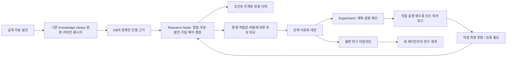

# AI Research Lab — 초기 실행 아키텍처

작성: 2026-10-20 KST. 기준 코드: 기존 따까리 `c12eff6` 위 Research Lab 작업 브랜치. 이 문서는 사용자 요구사항 전체와 첫 실행 범위를 구분한다. 모든 AI 연구를 수집하거나 모든 실행기를 구현했다는 뜻이 아니다.

## 목적과 불변식

Research Lab은 연구 방법의 고정된 목록도, 실험 추적 도구의 복제본도 아니다. 기존 공개 연구를 발견하고, 원문에 연결된 방법·주장·경험적 발견·가설을 보존하고, 현재 환경에 맞는 후보를 비교하여 실험과 의사결정의 기록을 다음 연구로 전달하는 독립 도메인이다.

1. 연구 방법 이름, 개념 종류, 관계 술어, 연구 단계는 열린 문자열이다. 새 기법이나 새로운 분야를 등록할 때 스키마·코드를 바꾸지 않는다.
2. 원문 보고(`source_reported`), 미검증 가설/해석(`unverified`), 서버 직접 실행 관찰(`locally_measured`)은 서로 다른 상태다. 저자의 주장을 보편 사실로 승격하는 경로는 없다.
3. 원문과 인용의 실재성은 해시·문자 오프셋·정확한 부분 문자열로 검사한다. 이는 그 주장의 과학적 진실성을 검증한 것과 다르다.
4. 근거·지식·관계·타임라인은 덮어쓰지 않는다. 정정은 새 노드와 `supersedes_id`, 후속 관계로 남긴다. DB 트리거도 수정/삭제와 다른 연구·범위의 참조를 거부한다.
5. 조건 미상과 조건 불일치를 구분한다. 서로 다른 조건의 결과에 자동으로 우열을 붙이지 않는다.
6. 외부 에이전트가 전달한 결과는 `external_report`로 남긴다. 실행했다고 말하는 텍스트만으로 관찰을 생성하지 않는다.
7. 개인·회사 범위는 세션 토큰으로 결정한다. 회사 세션은 개인 연구 ID나 원문 ID를 알아도 조회·연결할 수 없다.

## 현재 시스템 조사와 재사용 경계

| 영역 | 현재 코드와 재사용 | Lab의 책임 |
|---|---|---|
| 프론트엔드 | React, React Query, `/src/shell/features.ts`, 공통 토큰·접속 상태·인증 client | `/research` 관제탑, 공유 가능한 study query, 연구·근거·실험·타임라인 |
| 백엔드 | FastAPI, SQLAlchemy, PostgreSQL, Alembic, `api/deps.py`, `security/auth.py` | `api/research.py`, `research/` 독립 도메인 |
| 범용 지식 도서관 | **병행 작업에서 main에 들어온 KB1+KB2**, `kb_store.ingest_source`, `segment_revision`, `kb_sources/revisions/passages/evidence`, ADR 0063 | 원문 복제 저장소를 만들지 않는다. 원본 bytes·해시·정규화·패시지는 KB에 위임하고 연구 개념/관계만 소유 |
| 개인 맥락 도서관 | `context/search.py`, `context/library.py`, `knowledge_*`는 개인 기록/주장 원장 | 공개 논문을 개인 사실 풀에 섞지 않는다. 초기 연구 기억은 같은 scope의 연구를 검색하고 일반 맥락 검색과 병합하지 않음 |
| 오케스트레이터·이중 하네스 | 세션 토큰, 기존 Run, 공급자별 실행, 재개 정책, `orchestrator/mcp_server.py` | `manage_research` 공통 MCP와 영속 resume 계약. 특정 CLI의 대화 이력을 정본으로 쓰지 않음 |
| 호스트 연산 | `host_gpu.py`, 기존 단일 llama 시험 인스턴스, 런타임/스왑 가드, Whisper의 별도 워크로드 | 새 모델 서버를 띄우지 않는다. 실제 GPU 도구 결과는 원점이 구분된 외부 보고로 가져옴 |
| 운영·계획 | PMS/WBS, generation 배포, audit/ops, 기존 DB 백업 | 실제 개발 WBS `664a2c29-b3d1-425c-b016-6c430cb7a7dc`, 개발/검증/운영 상태를 구분 |
| 범용 수집 플랫폼 | `docs/adr/collector-platform-20261020.md`, `docs/design/collector-platform/`는 별도 개발의 실행 설계 제안 | Lab은 범용 크롤러·robots 엔진을 중복 구현하지 않는다. 초기에는 공식 arXiv 메타데이터 API와 확보된 텍스트 가져오기만 제공 |

## 데이터 구조

`research_studies`: 목표, scope, 유연한 연구 단계, 현재 환경, 평가 기준, 다음 행동, 낙관적 version.

`research_nodes`: 종류, 제목, 요약, 적용 조건, 비정형 세부 속성, epistemic status, `kb_evidence` FK, 정정 대상. Method/Claim/Finding/Hypothesis/Constraint/Decision 등은 노드로 독립 식별되며, 관찰은 서버 실행 경로가 생성한다. 설정·예산·실행은 별도 타입 테이블로 관리하므로 모든 데이터를 범용 문자열 속성으로 바꾸지 않는다.

`research_relations`: 출발·도착 노드, 확장 가능한 술어, 조건, 관계를 제안한 근거. `improves`, `contradicts_under_conditions`, `fails_to_reproduce`, `combines_with` 등을 데이터로 표현할 수 있다. 관계는 연구자의 제안이며 인과관계 확정 판정이 아니다.

`research_experiments`: 가설, 선택 이유, 방법 ID manifest, adapter, 실행 상태, 설정, 환경, 예산, 입력 hash, 원본 측정·오류·출처가 담긴 receipt. 실제 연산을 하지 않은 계획도 보존한다.

`research_events`: 연구/선택/실행/외부 보고/중단/다음 작업의 불변 타임라인. 에이전트 교체 시 DB에서 복원한다.

연구 원문 키에는 `research:{scope}:` namespace를 사용하여 동일한 외부 ID의 회사/개인 메타데이터를 분리한다. 원본 파일은 KB의 내용 주소 저장소가 동일 bytes를 한 번만 보관한다. 정규화와 인용 오프셋은 **KB의 NFKC+LF, 패시지 기준 Unicode 코드포인트**를 따른다. 원본 bytes와 정규화된 인용 텍스트가 다를 수 있음을 API에 명시한다.

## 수집과 갱신

첫 제공자는 arXiv의 공식 Atom API이다. 호출은 발견 단계이고, 반환은 초록뿐이다. 초록을 전체 논문으로 표시하거나 발견을 검증으로 승격하지 않는다. 텍스트 가져오기는 출처 키·제목·주소·실제로 확보한 본문만 받는다. 같은 자료 재수집은 KB의 멱등 저장을 사용하고 새 bytes는 새 리비전이 된다. 기존 인용은 옛 리비전에 남고 현재성도 표시한다.

규칙 파싱과 구조 검증은 LLM 호출 없이 수행한다. 주장·효과·조건의 의미 추출은 `pending_review` 이후 기존 에이전트가 정확한 인용을 붙여 수행한다. 이 버전에는 모든 자료를 LLM으로 처리하는 숨은 작업이나 자동 사실 승격이 없다. 범용 수집 플랫폼이 제공할 envelope/권리/예산/스케줄을 후속 adapter에서 소비한다.

## 방법 선택과 연구 기억

같은 scope의 연구에서 `kind=method`를 검색한다. 조건은 값/허용 목록/수치 min·max를 지원하며 조건 없음·환경 누락·미지원 표현은 `unknown`이다. 불일치는 `incompatible`이다. 비용 미상은 0으로 취급하지 않는다. 조건 적합성과 예산으로 `candidate / needs_review / excluded`를 만들고 근거 링크 수를 제한적으로 참고한다. 신규성이나 LLM 점수는 진실성·효과의 대용 지표가 아니다.

이 단계의 순위는 **조사 우선순위**이며 최적의 기대 효용을 계산한 수치가 아니다. 에이전트는 원문과 제약, 실패·상충 관계를 검토한 뒤 Decision 노드에 선택 이유·대안·불확실성·기대 정보 가치를 기록한다. 조합 효과는 별도 가설과 실험으로 취급한다. 지난 실패는 그 조건의 관찰이며 다른 환경에서 자동 제외하는 규칙이 아니다.

resume 응답은 목표·환경·다음 작업·노드·인용·관계·실험·실패 receipt·타임라인을 함께 반환한다. 재개 계약은 이전 환경을 현재 환경으로 가정하거나 외부 텍스트를 실행 지시로 취급하지 않도록 명시한다. 현재 각 컬렉션 500개를 넘으면 `truncated`와 UI 경고를 준다. 대형 연구의 페이지 단위 탐색은 후속 범위이며 초기 UI를 무제한 메모리로 읽는 설계가 아니다.

## 실험과 자원 정책

연구 단계는 열려 있지만 실행 상태는 안전한 운영 전이를 위해 별도 제한한다. queued/running/paused/blocked/completed/failed/cancelled/needs_verification를 사용한다. 사용자 연구 절차와 프로세스 실행 상태는 다른 개념이다.

첫 직접 실행 adapter는 bounded CPU 검색 평가다. 문서 1~500개, 질문 1~50개, 설정 200,000자, k 1~50, 시간 1~600초로 제한한다. 쿼리별 deadline을 검사하고 PostgreSQL transaction advisory lock으로 세대 간 동시 직접 평가를 하나로 제한한다. 단어 overlap과 BM25의 질의별 순위·Recall@k·MRR·입력 hash·알고리즘 버전·경과시간·Python/OS를 남긴다. 잘못된 qrels, 빈 corpus, 중복 문서 ID, 제한 초과를 점수에서 조용히 누락하지 않고 실패 receipt로 남긴다.

메모리 budget은 현재 **계획값**이며 OS 수준 RSS 강제 상한이 아니다. 입력량은 제한하지만 Python 전체 프로세스 RSS를 격리하지는 않는다. 무거운 학습·GPU 실행은 기존 하네스/호스트 가드를 재사용하고 외부 실행 receipt로 기록한다. 상시 MLflow/Ray/모델 서버를 추가하지 않는다. 실행 중 강제 중단·학습 checkpoint·자동 탐색 큐·자동 모델 교체는 이 초기 adapter에서 제공하지 않는다. 대기 실험의 중단·재개·보류·취소와 외부 작업의 다음 행동 보존을 제공한다.

서버 직접 평가는 짧은 동기 요청이며 실행 transaction이 commit될 때 receipt가 공개된다. 요청 도중의 별도 running 상태 실시간 관측, 서버 중단 후 자동 재실행은 미제공이다. 재호출로 완료한 실험을 몰래 다시 실행하지 않고 409로 거부한다.

## UI와 에이전트 계약

관제탑은 연구 목록 → 목표/다음 행동 → 지식·근거/실험/타임라인으로 이어진다. 출처 인용, 이전 원문 버전, 선택 근거, 실패, 외부 보고, 직접 측정이 구분된다. 동일 실험의 비교는 접근 가능한 meter와 수치/표본 수로 표현한다. 서로 다른 실험 조건의 공정 비교 판정은 `/compare`가 모델·데이터·지표·프로토콜·하드웨어·코드 버전의 누락과 차이, 명시적으로 바꾼 변수와 통제되지 않은 차이를 반환한다. 임의 결과는 원본 탐색을 제공하고 새 시각화 renderer를 확장할 수 있다. 현재 loss curve·Pareto·임베딩 공간의 전용 renderer는 미제공이다.

`manage_research`는 사용자 API와 동일한 저장·검증 경로를 쓰며 모든 공급자의 Run에 등록한다. list/create/resume/update/source/node/relation/select/experiment/execute/report/control/discover가 있으며 스키마는 도구 설명에 포함한다. 임의 shell 명령을 받는 연구 전용 실행기를 만들지 않는다.

## 오픈소스·선행 기술 검토

확인일: 2026-10-20. 공식 문서·저장소를 열어 확인했다. 운영 비용·통합 난이도는 이 프로젝트의 설계 판단이며 실측 RAM/가격이 아니다. 이 표는 설치·운영 검증을 뜻하지 않는다.

| 후보 | 역할·라이선스 근거 | 이 환경에서의 판단 |
|---|---|---|
| MLflow | [tracking server](https://mlflow.org/docs/latest/self-hosting/architecture/tracking-server/), [라이선스](https://github.com/mlflow/mlflow/blob/master/LICENSE.txt) Apache-2.0 | 전통 ML 실험·artifact 호환에 유용. 현재 연구 주장/조건/선택을 대체하지 못함. 초기에는 상시 서버 없이 receipt 계약, 필요 시 실행 단위 export adapter 검토 |
| Optuna | [RDBStorage](https://optuna.readthedocs.io/en/stable/reference/generated/optuna.storages.RDBStorage.html), [MIT](https://github.com/optuna/optuna/blob/master/LICENSE) | 실제 HPO 수요가 생기면 on-demand library로 우선. 기존 PostgreSQL/SQLite로 study를 저장할 수 있지만 Lab 지식과 다른 study 식별자를 구분해야 함 |
| Ray Tune | [자원 문서](https://docs.ray.io/en/latest/tune/tutorials/tune-resources.html), [Apache-2.0](https://github.com/ray-project/ray/blob/master/LICENSE) | 분산 탐색이 필요할 때 후보. 단일 64GB 공용 호스트에 새 런타임·worker pool을 상시 추가할 근거가 없어 보류. 논리 자원 예약을 물리 메모리 격리로 오해하지 않음 |
| DVC | [실험 관리](https://doc.dvc.org/user-guide/experiment-management), [Apache-2.0](https://github.com/treeverse/dvc/blob/main/LICENSE) | 대형 모델/데이터셋 버전과 재현 가능한 pipeline에 유용. 초기 공개 텍스트에는 KB의 bytes hash를 재사용. 대형 artifact가 생기면 도입 검토 |
| Hugging Face | [Hub 모델 버전](https://huggingface.co/docs/huggingface_hub/guides/download), [Datasets fingerprints](https://huggingface.co/docs/datasets/about_cache) | 모델/dataset revision을 고정할 provenance 입력으로 사용. 라이브러리 라이선스와 개별 모델·데이터 라이선스는 별도 확인. 무단 다운로드/상시 로딩 없음 |
| PROV-O | [W3C 표준](https://www.w3.org/TR/prov-o/) | Entity/Activity/Agent, derived-from/attributed-to 사고방식을 provenance에 반영. 별도 RDF triple-store 도입은 하지 않음 |
| SciFact | [AllenAI 원저자 저장소](https://github.com/allenai/scifact) | claim/evidence의 supports/refutes/insufficient evidence 구분을 참고. 생의학 평가 결과를 AI 연구 전체의 자동 사실 판정으로 일반화하지 않음 |

MLflow/Optuna/Ray/DVC는 현재 공식 문서와 프로젝트 저장소의 존재·라이선스를 확인했다. 최신 릴리스별 호환성과 Mac Studio 자원량을 실측하지 않았으므로 도입 시 다시 확인한다. ORKG 등 연구 지식 그래프 및 다중 에이전트 연구 플랫폼의 운영 비교는 후속 조사로 남긴다. 초기 코드에 효과를 입증하지 못한 서비스를 추가하지 않는다.

## 실제 사례와 완료 판단

| 사례 | 실제 수행 범위 | 판정의 한계 |
|---|---|---|
| A Qwen | 기존 host GPU 도구로 Qwen3.5-4B Q4_K_M, context 4096, threads 4, FA on, 96 출력 토큰, f16/q8 KV 각각 3회. 도구 원본을 외부 report로 저장 | 35B 미실행. 품질/장치별 layer 로그/메모리 피크 미검증. 0.6% 수준 차이를 유의한 개선으로 주장하지 않음 |
| B RAG | 최신 KB 반영 후 실제 ADR 문서 54개(이전 파일럿 53개), 수작업 qrels 질문 3개, lexical/BM25 직접 실행 및 질의별 결과 저장 | 소표본; 운영 RAG·생성 품질/통계적 유의성 아님. 두 방식 Recall@5 0.667로 개선 미확인 |
| C 경험적 발견 | Zero-shot CoT 원문 excerpt와 저자 보고, 작동 원리 미확정 가설을 분리 저장 | 따까리에서 원 논문 결과 재현한 것이 아님. [원문](https://arxiv.org/abs/2205.11916v4) |
| D 상충 결론 | RAG/LC 논문 두 편의 주장과 조건 미확정·상반된 결론 관계를 함께 저장 | 자동 승자 결정 없음. 초록만으로 본문 실험 조건을 채우지 않음. [LC 연구](https://arxiv.org/abs/2407.16833v2), [OP-RAG](https://arxiv.org/abs/2409.01666v1) |
| E 재개 | 독립 HTTP 요청·새 에이전트 세션 토큰에서 DB 목표/결과/다음 행동 복원; 브라우저에서 계획 저장 후 재진입. 사용자 지정 사례 E의 실제 별도 에이전트 세션 검증은 독립 작업 중 | 실제 공급자 CLI의 새 대화에서 MCP를 통한 의미 복원까지와 별도 구분 |

실행 명령·결과·브라우저 스크린샷·배포 상태는 `verification.md`와 Run outbox에 별도 기록한다. 사례 자료는 격리 테스트 DB에서 생성하며 운영 데이터라고 표시하지 않는다.

## 다음 확장 경계

우선순위는 KB의 검색/수집 adapter와 연결 → 후보의 근거·실패·상호작용 탐색 강화 → 고정 환경/독립 qrels로 검색·임베딩·리랭킹 실험 확대 → 기존 작업 큐·호스트 가드를 이용한 장시간 실행/체크포인트 → 목적별 시각화 renderer 순서다. 자동 주기 수집, 전체 논문 파서, calibrated information-value 계산, 운영 RAG 개선 채택은 현재 구현 범위 밖이다. 이 경계는 사용자 요구사항을 삭제한 것이 아니라 초기 구현과 후속 작업을 혼동하지 않기 위한 것이다.
