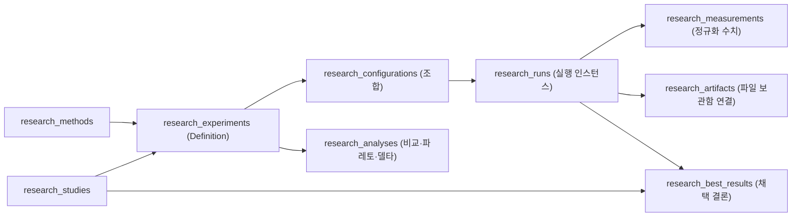

# AI Research Lab v2 아키텍처·설계 계약 (`refactor-v2.md`)

본 문서는 [refactor-v2-requirements.md](file:///Users/winterholic/development/projects/winterholic-ttakkari/back-research-v2/docs/research-lab/refactor-v2-requirements.md)를 구현 가능한 기술 계약으로 구체화한 단일 설계 문서다. 백엔드·프론트엔드 구현자는 본 문서의 데이터 모델, 어댑터 프로토콜, API 스키마, 컴포넌트 경계를 기준으로 작업한다.

---

## 0. 기존 실행기 코드 경로·제약·실측 가능성 조사 요약

신규 상시 데몬이나 별도 작업 큐를 만들지 않고 따까리 백엔드의 기존 실행기와 자원 가드를 어댑터로 감싸서 재사용한다.

| 실행기 영역 | 실제 코드 경로 (file:line) | 자원 가드 및 실행 제약 | 실제 측정 가능 항목 (Measured) | 측정 불가 및 주의 항목 (Unavailable / Caveats) |
| :--- | :--- | :--- | :--- | :--- |
| **1. 호스트 GPU / `llama-server`** | [host_gpu.py](file:///Users/winterholic/development/projects/winterholic-ttakkari/back-research-v2/src/ttakkari/host_gpu.py#L72-L140) (`StartRequest`, `build_args`)<br>[host_gpu.py](file:///Users/winterholic/development/projects/winterholic-ttakkari/back-research-v2/src/ttakkari/host_gpu.py#L491-L849) (`HostGpu.start/status/bench/stop`)<br>[host_gpu_guard.py](file:///Users/winterholic/development/projects/winterholic-ttakkari/back-research-v2/src/ttakkari/host_gpu_guard.py#L137-L155)<br>[host_env.py](file:///Users/winterholic/development/projects/winterholic-ttakkari/back-research-v2/src/ttakkari/api/host_env.py#L95-L123) | • 개인(`personal`) 범위 전용 ([host_env.py](file:///Users/winterholic/development/projects/winterholic-ttakkari/back-research-v2/src/ttakkari/api/host_env.py#L36-L38))<br>• 허용 모델 별칭만 실행 ([config.py](file:///Users/winterholic/development/projects/winterholic-ttakkari/back-research-v2/src/ttakkari/config.py#L354-L358))<br>• `ResourceLeaseManager` 파일 락(`host-gpu/lock`)으로 단일 인스턴스 독점 보장 ([host_resource.py](file:///Users/winterholic/development/projects/winterholic-ttakkari/back-research-v2/src/ttakkari/host_resource.py#L124-L311))<br>• 운영 Qwen 포트(`18987, 57170`) 회피 ([config.py](file:///Users/winterholic/development/projects/winterholic-ttakkari/back-research-v2/src/ttakkari/config.py#L365))<br>• 스왑 증가 상한(`1.0GB`) 초과 시 watchdog 강제 종료 ([host_gpu.py](file:///Users/winterholic/development/projects/winterholic-ttakkari/back-research-v2/src/ttakkari/host_gpu.py#L468-L473)) | • `generation_tokens_per_second` (Decode tok/s)<br>• `prompt_tokens_per_second` (Prefill tok/s)<br>• `median_generation_tokens_per_second`, `median_prompt_tokens_per_second`<br>• `prompt_tokens`, `generated_tokens`, `wall_seconds`<br>• `swap_growth_bytes`, `swap_peak_growth_bytes`<br>• `device_evidence` (Metal/GPU 오프로드 로그 최대 8줄)<br>• `output_preview` (앞 200자) | • **순수 스트리밍 TTFT(ms) 미반환**: `stream=False` 호출 후 `timings`에서 `prompt_per_second`와 `prompt_n`만 읽음 (`prompt_n / prompt_per_second * 1000`으로 역산한 근사 prefill_ms만 산출 가능하며 순수 첫 토큰 도달 시각은 미계측)<br>• **프로세스별 Metal VRAM 피크(MB) 실측 불가**: 호스트 전체 스왑 증가량만 계측<br>• Draft 모델 기반 Speculative Decoding 미지원 (`--spec-type ngram-mod`만 지원) |
| **2. Qwen 로컬 실행기 / Desk 라우터** | [qwen_local.py](file:///Users/winterholic/development/projects/winterholic-ttakkari/back-research-v2/src/ttakkari/agents/qwen_local.py#L21-L211) (`QwenLocalAdapter`)<br>[qwen_slot.py](file:///Users/winterholic/development/projects/winterholic-ttakkari/back-research-v2/src/ttakkari/runs/qwen_slot.py#L40-L78) (`qwen_local_slot`)<br>[desk_qwen.py](file:///Users/winterholic/development/projects/winterholic-ttakkari/back-research-v2/src/ttakkari/runs/desk_qwen.py#L484-L566) (`decide`)<br>[desk_eval.py](file:///Users/winterholic/development/projects/winterholic-ttakkari/back-research-v2/src/ttakkari/runs/desk_eval.py#L98-L112) | • `~/.ttakkari/run/qwen-local-slot.lock` 단일 슬롯 락<br>• `qwen_local_enabled` 기본값 `False` ([config.py](file:///Users/winterholic/development/projects/winterholic-ttakkari/back-research-v2/src/ttakkari/config.py#L191))<br>• 외부 바이너리 `qwen-worker` 존재 및 `doctor` 통과 여부는 런타임 `확인 필요` | • Desk 라우터 평가: `accuracy`(`correct/n`), `median_ms`, `calls`, `abstained`, `verified`, `grounded` (`FLAGS`: `verify`, `social_guard`, `lexical_overlap` ablation 가능)<br>• 워커 실행 시 stdout JSON의 `metrics` 및 `host_peaks` | • 범용 LLM 하이퍼파라미터(`gpu_layers`, `cache_type_k` 등) 실험은 `qwen-worker`가 아닌 `host_gpu`(`llama-server`) 경로를 사용해야 함 |
| **3. 로컬 TTS (Supertonic 3 & 정규화)** | [normalize.py](file:///Users/winterholic/development/projects/winterholic-ttakkari/back-research-v2/src/ttakkari/tts/normalize.py#L523-L599) (`normalize_text`, `split_sentences`, `chunk_text`)<br>[service.py](file:///Users/winterholic/development/projects/winterholic-ttakkari/back-research-v2/src/ttakkari/tts/service.py#L93-L121) (`budget`)<br>[supertonic.py](file:///Users/winterholic/development/projects/winterholic-ttakkari/back-research-v2/src/ttakkari/tts/supertonic.py#L86-L116)<br>[worker_supertonic.py](file:///Users/winterholic/development/projects/winterholic-ttakkari/back-research-v2/src/ttakkari/tts/worker_supertonic.py#L130-L185) | • **중요 사실**: 지시서에 언급된 `Kokoro TTS`는 한국어 음성 부재로 폐기된 가설([local-tts.md](file:///Users/winterholic/development/projects/winterholic-ttakkari/back-research-v2/docs/design/local-tts.md#L6), [service.py](file:///Users/winterholic/development/projects/winterholic-ttakkari/back-research-v2/src/ttakkari/tts/service.py#L37-L41))이며 실제 운영 엔진은 **Supertonic 3 (`SupertonicProvider`, ONNX CPU)**임 (어댑터는 `supertonic`을 기본으로 하되 `kokoro` 별칭 요청 시 사유 안내 및 호환 매핑 제공)<br>• `generation.work("tts")` (`work-tts.lock`) 직렬 1개 제한 및 `defer_to_stt` 정책<br>• `model_process.run_json_worker`로 고아 프로세스 방지 ([model_process.py](file:///Users/winterholic/development/projects/winterholic-ttakkari/back-research-v2/src/ttakkari/model_process.py#L15-L85)) | • 정규화 전후 텍스트, 문장·청크 분할 수(`chunk_count`), 글자 수 변화<br>• `load_seconds`, `synth_seconds`, `audio_seconds`, `rtf`(`synth_seconds / audio_seconds`), `peak_rss_bytes`, `wall_seconds`<br>• 청크별 WAV 아티팩트(`duration_seconds`, `sample_rate=44100`, `bytes`)<br>• 로컬 Whisper STT 연계 시 재인식 텍스트 및 `cer`(음절 오류율), `wer`(어절 오류율) | • **MOS / 운율 자연스러움 자동 채점 불가**: STT 재인식 `cer`/`wer`는 발음 명료도의 간접 지표일 뿐 청취 자연스러움이 아님 (사람 청취 평가와 강제 분리)<br>• 원문(숫자·영문 표기) 대비 CER과 정규화 텍스트(한글 발음 표기) 대비 CER이 다르므로 두 기준을 모두 기록해야 함<br>• `.tts-runtime/supertonic` venv 및 ONNX 모델 실존 여부는 런타임 `확인 필요` |
| **4. 로컬 Whisper STT** | [runner.py](file:///Users/winterholic/development/projects/winterholic-ttakkari/back-research-v2/src/ttakkari/meetings/local_stt/runner.py#L9-L32) (`run_worker`)<br>[worker.py](file:///Users/winterholic/development/projects/winterholic-ttakkari/back-research-v2/src/ttakkari/meetings/local_stt/worker.py#L109-L255)<br>[core.py](file:///Users/winterholic/development/projects/winterholic-ttakkari/back-research-v2/src/ttakkari/meetings/local_stt/core.py#L169-L189) (`error_rates`)<br>[quality.py](file:///Users/winterholic/development/projects/winterholic-ttakkari/back-research-v2/src/ttakkari/meetings/local_stt/quality.py#L27-L85) | • `faster-whisper` large-v3 (CPU int8) + Silero VAD<br>• `baseline`, `improved`, `robust` 프로파일 지원 (`production=False` 호출 시 전환 가능)<br>• `.stt-runtime/venv/bin/python` 존재 여부는 런타임 `확인 필요` | • `load_seconds`, `audio_decode_seconds`, `inference_seconds`, `enhancement_seconds`, `rtf_inference`, `peak_rss_bytes`<br>• `cer`, `wer`, `character_edits`, `word_edits` ([core.py](file:///Users/winterholic/development/projects/winterholic-ttakkari/back-research-v2/src/ttakkari/meetings/local_stt/core.py#L169-L189))<br>• 반복 이상치(`repeated_seconds`, `repeated_characters`) 및 세그먼트 품질 플래그 | • 화자 분리 정답이 없을 때 `der`, `overlap_performance` 측정 불가 ([benchmark.py](file:///Users/winterholic/development/projects/winterholic-ttakkari/back-research-v2/src/ttakkari/meetings/local_stt/benchmark.py#L58-L64))<br>• 사람 판정 없는 `hallucination_rate` 확정 불가 |
| **5. KB / RAG 검색·임베딩** | [benchmark.py](file:///Users/winterholic/development/projects/winterholic-ttakkari/back-research-v2/src/ttakkari/research/benchmark.py#L22-L114)<br>[metrics.py](file:///Users/winterholic/development/projects/winterholic-ttakkari/back-research-v2/src/ttakkari/kb_eval/metrics.py#L15-L180)<br>[kb_retrieval.py](file:///Users/winterholic/development/projects/winterholic-ttakkari/back-research-v2/src/ttakkari/kb_retrieval.py#L116-L154)<br>[embedder.py](file:///Users/winterholic/development/projects/winterholic-ttakkari/back-research-v2/src/ttakkari/context/embedder.py#L34-L99) | • `pg_try_advisory_xact_lock(hashtextextended('research-cpu', 0))`로 CPU 벤치마크 직렬화 ([research.py](file:///Users/winterholic/development/projects/winterholic-ttakkari/back-research-v2/src/ttakkari/api/research.py#L287))<br>• 코퍼스 최대 500문서, 질의 최대 50개, payload 200KB 제한<br>• `HashEmbedder`(결정론적 2-gram 해시)는 상시 사용 가능, `E5Embedder`(`intfloat/multilingual-e5-large`)는 로컬 모델 캐시 존재 시 사용 가능(`확인 필요`) | • `recall_at_k`, `mrr_at_k`, `ndcg_at_k` ([metrics.py](file:///Users/winterholic/development/projects/winterholic-ttakkari/back-research-v2/src/ttakkari/kb_eval/metrics.py#L84-L120)에 등급 관련도 0~3 기반 순수 함수 구현 완료)<br>• 질의별 검색 지연(`latency_ms_mean`, `latency_ms_p95`), 인덱싱·총 소요시간(`wall_seconds`)<br>• 청크 분할 수(`chunk_count`), 평균 청크 길이(`avg_chunk_chars`) | • 로컬 신경망 Cross-Encoder 리랭커 가중치 미설치 (토큰 오버랩·BM25 재정렬만 즉시 가능, 신경망 리랭커는 `adapter_required` 또는 `environment_unavailable`)<br>• LLM 생성 답변 기반 Faithfulness / Answer Relevance 자동 채점 불가 |
| **6. 파일 보관함 (Artifacts)** | [service.py](file:///Users/winterholic/development/projects/winterholic-ttakkari/back-research-v2/src/ttakkari/artifacts/service.py#L54-L151) (`register_file`)<br>[kinds.py](file:///Users/winterholic/development/projects/winterholic-ttakkari/back-research-v2/src/ttakkari/artifacts/kinds.py#L1-L45) | • `200MB`(`copy_max_bytes`) 이하는 `data_dir/artifacts/<id>/`로 복사(`copy`), 초과는 원본 경로 참조(`reference`) + `sha256` 검증<br>• `area='files'`(사용자 파일 보관함)와 AI 작업 영역 분리 | • 생성된 WAV 샘플, JSON/CSV 벤치마크 결과, Markdown/HTML 연구 리포트를 `artifacts` 테이블에 정식 등록 및 다운로드·미리보기 제공 | • 연구 실험 임시 출력물을 무조건 `area='files'`로 넣으면 보관함이 오염되므로 기본은 Run 연결로 두고 사용자가 채택·내보내기할 때 `area='files'`로 승격 |

---

## 1. 유지/교체 결정

불필요한 재작성을 피하기 위해 기존 지식 원장·증거 검증 기반은 유지하고, 방법론 탐색·실험 실행·비교 분석 계층을 확장·교체한다.

| 대상 | 결정 | 설계 이유 (1~2줄) |
| :--- | :--- | :--- |
| **`research_studies`** ([models.py](file:///Users/winterholic/development/projects/winterholic-ttakkari/back-research-v2/src/ttakkari/research/models.py#L15-L33)) | **유지 + 보조 컬럼 확장** | 목표(`objective`), 환경(`environment`), 낙관적 락(`version`), `scope` 격리가 이미 견고하다. 기본 대상 도메인(`primary_target`)과 채택된 최선 결과 참조만 가볍게 연결한다. |
| **`research_nodes` & `research_relations`** ([models.py](file:///Users/winterholic/development/projects/winterholic-ttakkari/back-research-v2/src/ttakkari/research/models.py#L36-L86)) | **유지 (역할 명확화)** | `claim`, `finding`, `hypothesis`, `observation`, `decision`, `constraint` 노드는 연구별 불변 지식 원장으로 유지한다. 기존 `kind='method'` 노드는 연구 내부 메모·가설로 호환 유지하되, 범용 방법론 카탈로그는 전용 테이블로 분리한다. |
| **KB 인용·해시 검증 및 불변 트리거** ([rules.py](file:///Users/winterholic/development/projects/winterholic-ttakkari/back-research-v2/src/ttakkari/research/rules.py#L94-L141)) | **유지** | `exact_quote`와 `sha256`로 허위 인용을 차단하고 `research_immutable_row` 트리거로 과거 판단 근거를 보존하는 핵심 안전장치이므로 그대로 유지한다. |
| **`research_events`** ([models.py](file:///Users/winterholic/development/projects/winterholic-ttakkari/back-research-v2/src/ttakkari/research/models.py#L113-L128)) | **유지** | 연구 내 모든 변경·실행·채택 이력을 감사(Audit) 타임라인으로 남기는 데 그대로 사용한다. |
| **`personal` / `work` scope 격리** ([research.py](file:///Users/winterholic/development/projects/winterholic-ttakkari/back-research-v2/src/ttakkari/api/research.py#L39-L74)) | **유지 + `system` 카탈로그 공유** | 연구·실험·실측 데이터는 세션 토큰의 `scope`로 엄격히 격리한다. 단, 시드 카탈로그 방법은 `scope='system'`으로 저장해 개인·회사 어디서든 조회하되 실측 이력 집계만 호출자의 `scope`로 필터링한다. |
| **단일 `research_experiments` 구조** ([models.py](file:///Users/winterholic/development/projects/winterholic-ttakkari/back-research-v2/src/ttakkari/research/models.py#L89-L110)) | **교체·확장 (Definition / Config / Run / Measurement 분리)** | 기존 테이블은 실험 정의와 단발 실행 영수증이 한 행에 묶여 있어 다중 조합(A/B, Grid, Repeat, Ablation)과 시계열·파레토 분석이 불가능하다. `research_experiments`를 실험 정의(Definition)로 확장하고 하위에 Configuration, Run, Measurement, Analysis 테이블을 신설한다. |
| **하드코딩된 `benchmark.py` 단독 실행** ([benchmark.py](file:///Users/winterholic/development/projects/winterholic-ttakkari/back-research-v2/src/ttakkari/research/benchmark.py#L22-L114)) | **교체 (`ExecutionAdapter` 플러그인 체계)** | 단어 오버랩과 고정 BM25만 실행하던 함수를 `ExecutionAdapter` 프로토콜로 추상화하고 `llm_inference`, `retrieval_eval`, `tts_synthesis`, `external_report` 4개 어댑터로 확장한다. |
| **단일 파일 `ResearchPage.tsx`** ([ResearchPage.tsx](file:///Users/winterholic/development/projects/winterholic-ttakkari/front-research-v2/src/pages/ResearchPage.tsx#L1-L558)) | **전면 교체 (6대 화면 모듈화)** | 노드 입력 폼 위주의 단일 페이지를 대시보드, 방법론 라이브러리, 실험 설계실, 실험 모니터, 결과 비교·분석, 연구 기록·결과물의 6개 화면 모듈로 재구성한다. |

---

## 2. Method Registry 데이터 모델 & 카탈로그 시드 수용

### 2.1 병렬 시드 파일(`catalog_seed/`) 무손실 수용 규칙
병렬 작업자가 작성 중인 `src/ttakkari/research/catalog_seed/taxonomy.json` 및 도메인별 시드 파일(`llm_inference.json`, `rag_retrieval.json`, `speech_tts_stt.json`, `quantization_compression.json`, `finetuning_alignment.json`, `evaluation_ops.json` 등)을 변환 없이 그대로 적재하기 위해 `src/ttakkari/research/catalog_loader.py`를 둔다.
- **적재 시점**: 백엔드 기동 시(또는 `POST /api/research/catalog/sync` 호출 시) `catalog_seed/*.json`의 파일 SHA-256을 확인해 변경된 파일만 멱등 업서트(`INSERT ... ON CONFLICT (scope, slug) DO UPDATE`)한다.
- **시드 보존 원칙**: 사용자가 UI에서 시스템 시드 방법을 수정하거나 실험 결과로 보강할 때, `origin='system_seed'` 행의 정적 시드 원본 필드를 덮어쓰지 않고 버전 업(`supersedes_id`) 또는 연구별 측정 집계(`research_measurements`)로 분리해 시드 재동기화 시 유실되지 않게 한다.

### 2.2 테이블 스키마

#### (1) `research_taxonomy_terms` (6축 동적 분류 사전)
코드 배포 없이 새 분류 축 값을 추가할 수 있도록 DB 테이블로 관리한다.
- `id`: `UUID PK`
- `axis`: `VARCHAR(32) NOT NULL` (`target`, `layer`, `goal`, `intervention`, `research_method`) ※ F축(`execution_status`)은 런타임 계산이므로 정적 코드 사전과 분리
- `code`: `VARCHAR(64) NOT NULL` (예: `llm`, `rag`, `tts`, `model_weights`, `latency`, `quantization`, `ablation`)
- `label`: `VARCHAR(120) NOT NULL` (영문 표준명)
- `label_ko`: `VARCHAR(120) NOT NULL` (한국어 표시명)
- `description`: `TEXT NOT NULL DEFAULT ''`
- `parent_code`: `VARCHAR(64) NULL`
- `sort_order`: `INTEGER NOT NULL DEFAULT 0`
- `is_system`: `BOOLEAN NOT NULL DEFAULT TRUE`
- `UNIQUE (axis, code)`

#### (2) `research_methods` (방법론 레지스트리 본체)
- `id`: `UUID PK`
- `scope`: `VARCHAR(16) NOT NULL DEFAULT 'system'` (`system | personal | work`)
- `slug`: `VARCHAR(120) NOT NULL` (예: `kv-cache-quantization`, `bm25-plus-dense-rrf`)
- `version`: `INTEGER NOT NULL DEFAULT 1`
- `supersedes_id`: `UUID NULL REFERENCES research_methods(id)` (정정·개정 시 이전 버전 가리킴)
- `origin`: `VARCHAR(32) NOT NULL DEFAULT 'system_seed'` (`system_seed | user_registered | hypothesis_promoted`)
- `lifecycle_status`: `VARCHAR(24) NOT NULL DEFAULT 'validated'` (`hypothesis | candidate | validated | deprecated`)
- `name`: `VARCHAR(200) NOT NULL` (영문/표준 명칭)
- `name_ko`: `VARCHAR(200) NOT NULL` (한국어 명칭)
- `summary`: `TEXT NOT NULL` (한 줄 요약)
- `principle`: `TEXT NOT NULL DEFAULT ''` (작동 원리 설명)
- `category`: `VARCHAR(64) NOT NULL DEFAULT 'general'` (상위 카테고리 그룹)
- **다축 분류 배열 (JSONB `list[str]`, GIN 인덱스 적용)**:
  - `targets`: 적용 대상 (A축: `llm`, `vlm`, `tts`, `stt`, `embedding`, `reranker`, `rag`, `agent`, `image_video`, `tabular_timeseries`)
  - `layers`: 개입 계층 (B축: `data_corpus`, `preprocessing_chunking`, `tokenizer_normalizer`, `model_weights`, `attention_kv_cache`, `decoding_sampling`, `prompt_context`, `retrieval_index`, `postprocessing_reranking`, `runtime_hardware`, `serving_scheduling`, `evaluation_protocol`)
  - `goals`: 최적화 목표 (C축: `accuracy_quality`, `latency_ttft`, `throughput_tps`, `memory_vram`, `cost_efficiency`, `stability_hallucination`, `pronunciation_prosody`, `controllability`, `reproducibility`)
  - `interventions`: 개입 방식 (D축: `parameter_tuning`, `algorithm_swap`, `model_swap`, `quantization`, `pruning_distillation`, `caching`, `batching_concurrency`, `speculative_execution`, `hybrid_ensemble`, `dictionary_rule_injection`, `Adapter_finetuning`)
  - `research_methods`: 적합한 연구 방법 (E축: `baseline`, `ab_test`, `grid_search`, `random_search`, `bayesian_opt`, `ablation`, `sensitivity`, `scaling_law`, `error_analysis`, `pareto_frontier`, `regression_test`)
- **파라미터·호환성·근거 (JSONB)**:
  - `parameters`: `JSONB NOT NULL DEFAULT '[]'` — 아래 §2.3의 11종 타입 스키마 배열
  - `compatibility`: `JSONB NOT NULL DEFAULT '{}'` — `{ "requires": [...], "hardware": ["apple_silicon", "cpu", "cuda"], "runtimes": ["llama_cpp", "onnxruntime", "python"], "notes": "..." }`
  - `metrics`: `JSONB NOT NULL DEFAULT '[]'` — 권장 측정 지표 코드 배열 (예: `["decode_tps", "prefill_tps", "swap_growth_mb"]`)
  - `expected_effects`: `JSONB NOT NULL DEFAULT '[]'` — 기대 효과 목록 (문자열 배열 또는 텍스트)
  - `side_effects`: `JSONB NOT NULL DEFAULT '[]'` — 알려진 부작용·트레이드오프 목록
  - `evidence`: `JSONB NOT NULL DEFAULT '[]'` — 외부 문헌·원문 근거 배열 `[{ "kind": "paper|doc|benchmark|repo", "title": "...", "url": "...", "year": 2024, "claim": "...", "kb_evidence_id": null }]`
  - `evidence_status`: `VARCHAR(24) NOT NULL DEFAULT 'source_reported'` (`source_reported | widely_practiced | unverified`) ※ `locally_measured`는 실행 기록에서 동적 합산
  - `adapter_hints`: `JSONB NOT NULL DEFAULT '[]'` — 연결 가능한 어댑터 ID 배열 (예: `["llm_inference"]`)
  - `tags`: `JSONB NOT NULL DEFAULT '[]'` — 검색용 별칭·키워드 배열
- **출신 추적**:
  - `source_study_id`: `UUID NULL REFERENCES research_studies(id)`
  - `source_node_id`: `UUID NULL REFERENCES research_nodes(id)`
  - `promoted_from_run_id`: `UUID NULL` (승격 근거가 된 대표 Run ID)
  - `created_at`, `updated_at`: `TIMESTAMPTZ NOT NULL`
- `UNIQUE (scope, slug, version)`

#### (3) `research_method_relations` (방법 간 조합·충돌·선행 그래프)
- `id`: `UUID PK`
- `scope`: `VARCHAR(16) NOT NULL DEFAULT 'system'`
- `from_method_id`: `UUID NOT NULL REFERENCES research_methods(id) ON DELETE CASCADE`
- `to_method_id`: `UUID NOT NULL REFERENCES research_methods(id) ON DELETE CASCADE`
- `relation_type`: `VARCHAR(32) NOT NULL` (`combines_with | conflicts_with | requires | precedes | alternative_to | specializes`)
- `conditions`: `JSONB NOT NULL DEFAULT '{}'` (예: `{"when_parameter": {"cache_type_k": "q4_0"}}`)
- `note`: `TEXT NOT NULL DEFAULT ''`
- `UNIQUE (from_method_id, to_method_id, relation_type)`

### 2.3 파라미터 스키마 11종 타입 계약 (`parameters` JSONB 원소)
프론트엔드 실험 설계실이 하드코딩 없이 입력 폼과 탐색 공간(Sweep Space) 빌더를 자동 렌더링하도록 모든 파라미터 원소는 아래 인터페이스를 따른다.

```json
{
  "key": "cache_type_k",
  "label": "K 캐시 양자화 타입",
  "type": "enum",
  "default": "f16",
  "required": false,
  "min": null,
  "max": null,
  "step": null,
  "options": ["f16", "q8_0", "q4_0"],
  "unit": null,
  "description": "KV 캐시 Key 텐서의 데이터 타입. q8_0/q4_0 사용 시 메모리 절감.",
  "advanced": false,
  "sweepable": true
}
```
- **지원 `type` 11종**:
  1. `number`: 실수 (`min`, `max`, `step`, `unit` 지원, Sweep 시 목록/범위 지정 가능)
  2. `integer`: 정수 (`min`, `max`, `step`, `unit` 지원)
  3. `range`: `[min_val, max_val]` 구간 쌍
  4. `enum`: 단일 선택 드롭다운 (`options` 필수)
  5. `boolean`: 토글 (`true`/`false`, Ablation·Grid 시 `[true, false]` 자동 확장 가능)
  6. `multi_enum`: 다중 선택 칩 (`options` 필수)
  7. `model`: 로컬 허용 모델 별칭 선택 (`config.host_gpu_allowed_models` 또는 TTS/임베딩 모델 목록과 연동)
  8. `dataset`: 벤치마크 데이터셋/코퍼스 프리셋 또는 Study 내 코퍼스 선택
  9. `file`: 아티팩트 보관함 파일 ID 또는 업로드 파일 경로 참조
  10. `environment`: 실행 디바이스/프로파일 선택 (예: `default`, `cpu`, `baseline`, `robust`)
  11. `text`: 자유 문자열 또는 JSON 사전(예: TTS 사용자 발음사전 `{"API": "에이피아이"}`)

### 2.4 수명주기 및 "검증 후 카탈로그 편입(Promote)" 경로
1. **가설 등록 (`hypothesis`)**: 연구 중 떠오른 새 아이디어를 `POST /api/research/methods`로 등록(`origin='user_registered'`, `lifecycle_status='hypothesis'`, `evidence_status='unverified'`, `scope=현재_세션_scope`)하거나 기존 `Node(kind='hypothesis'|'method')`에서 생성한다.
2. **실험 연결 및 측정**: 해당 `method_id`를 사용해 실험(`research_experiments`)을 설계하고 최소 1개 이상의 `Run`을 완료(`status='succeeded'`)하여 `research_measurements`를 확보한다.
3. **카탈로그 승격 (`POST /api/research/methods/{id}/promote`)**:
   - **승격 조건**: 연결된 완료 `Run` ID(`run_id`)와 판단 요약(`decision_note`)을 제출해야 한다.
   - `external_report` 어댑터 결과만 있는 경우 `lifecycle_status='candidate'`로 승격한다.
   - 로컬 실행 어댑터(`llm_inference`, `retrieval_eval`, `tts_synthesis`)로 측정된 `Run`과 Baseline 대비 비교(`research_analyses` 또는 대조군 Run)가 존재하면 `lifecycle_status='validated'`로 승격한다.
4. **원문 근거와 실측 근거 분리**:
   - `evidence` JSONB와 `evidence_status`(`source_reported | widely_practiced | unverified`)는 문헌·이론 출처만 담는다.
   - 따까리 실측 여부(`locally_measured: bool`, `measured_run_count: int`, `best_improvement_summary: dict | null`)는 API 응답 시 현재 `scope`의 `research_runs` + `research_measurements`를 조인해 별도 필드(`local_measurements`)로 반환한다.

---

## 3. 실행 가능 상태(F축) 산출 규칙 (`execution_status`)

방법론 시드에 실행 가능 여부를 정적으로 박아넣으면 환경 변화 시 거짓 표시가 된다. F축은 `src/ttakkari/research/readiness.py`의 `compute_execution_status(method, adapter_registry, scope)`가 런타임에 결정론적으로 산출한다.

| 상태 코드 (`execution_status`) | 한국어 배지 | 판정 조건 (위에서 아래 순서로 평가) | UI 동작 |
| :--- | :--- | :--- | :--- |
| **`hypothesis_stage`** | 가설 단계 | `method.lifecycle_status == 'hypothesis'` 이거나 `parameters`와 `metrics`가 모두 비어 있어 구체적 실행 명세가 없는 경우 | "실험 프로토콜 구체화 필요" 안내, 가설 편집 또는 `external_report` 기록만 허용 |
| **`adapter_required`** | 어댑터 필요 | `method.adapter_hints`에 매칭되는 등록된 로컬 `ExecutionAdapter`가 하나도 없는 경우 (예: VLM, Image/Video 생성, 분산 학습 등) | 로컬 즉시 실행 버튼 비활성화, `external_report`(외부 실험 결과 수동/JSON 반입) 모드로 실험 설계실 진입 허용 |
| **`environment_unavailable`** | 현재 환경 불가 | 매칭 어댑터는 있으나: ① `compatibility.hardware`가 `["cuda"]` 전용이거나, ② `scope == 'work'`인데 개인 전용 실행기(`host_gpu`)를 요구하거나, ③ 어댑터의 `check_environment()`가 필수 런타임/모델 부재(`ready=False`)를 반환한 경우 | 불가 사유(`unavailable_reason`: 예 "회사 범위에서는 호스트 GPU 실행 불가", "CUDA 전용 기법")를 명시적으로 표시 |
| **`partially_supported`** | 일부 지원 | 어댑터의 `check_environment()`는 통과했으나, `method.parameters` 중 어댑터의 `supported_parameters`에 매핑되지 않는 핵심 파라미터가 있거나 대리 실행(예: 신경망 리랭커 대신 토큰 오버랩 재정렬, Draft 모델 대신 `ngram-mod`)만 가능한 경우 | 지원되는 파라미터와 미지원/대체 항목(`unsupported_params`)을 설계실 상단에 경고 배지로 표시하고 실행 허용 |
| **`tool_integrated`** | 기존 도구 연동 | 호스트 외부 프로세스 감독자(`host_gpu` `llama-server` 또는 `qwen_local`)를 통해 실행되며, `check_environment()`가 `ready=True`이고 필수 파라미터가 모두 매핑되는 경우 | "호스트 GPU 도구 연동 실행" 배지 표시, 자원 임대(Lease) 상태 확인 후 즉시 실험 시작 가능 |
| **`immediately_executable`** | 즉시 실행 가능 | 백엔드 내장 파이썬/서브프로세스 평가기(`retrieval_eval`, `tts_synthesis` 정규화·Supertonic 워커)에 매핑되고 `check_environment()`가 `ready=True`이며 모든 필수 파라미터가 지원되는 경우 | 녹색 "즉시 실행 가능" 배지 표시, 원클릭으로 실험 설계실에 파라미터 프리필 후 즉시 실행 가능 |

---

## 4. 실행 어댑터 계약(Python Protocol) 및 3+1 우선 어댑터

### 4.1 `ExecutionAdapter` 프로토콜 (`src/ttakkari/research/adapters/base.py`)
모든 어댑터는 무거운 라이브러리를 모듈 최상단에서 import하지 않고 메서드 내부에서 지연 import한다.

```python
from dataclasses import dataclass, field
from typing import Any, Protocol
from uuid import UUID

@dataclass(frozen=True)
class AdapterEnvironmentStatus:
    adapter_id: str
    ready: bool
    execution_mode: str  # "in_process" | "subprocess_worker" | "host_supervisor" | "manual"
    reason: str | None = None
    available_models: list[str] = field(default_factory=list)
    details: dict[str, Any] = field(default_factory=dict)

@dataclass(frozen=True)
class ResourceEstimate:
    estimated_seconds: int
    estimated_memory_mb: int
    requires_gpu_lease: bool = False
    requires_tts_lock: bool = False
    requires_cpu_lock: bool = False

@dataclass(frozen=True)
class AdapterRunResult:
    status: str  # "succeeded" | "failed" | "cancelled"
    raw_output: dict[str, Any]
    environment_snapshot: dict[str, Any]
    error_code: str | None = None
    error_message: str | None = None
    wall_seconds: float = 0.0
    artifacts: list[dict[str, Any]] = field(default_factory=list)

@dataclass(frozen=True)
class MeasurementRecord:
    metric_key: str          # 예: "decode_tps", "recall_at_k", "rtf", "cer_normalized"
    metric_label: str        # 한국어 표시명
    value: float
    unit: str                # "tok/s", "ms", "ratio", "bytes", "count"
    direction: str           # "higher_is_better" | "lower_is_better"
    is_proxy: bool = False   # 간접 대리 지표 여부 (예: STT 재인식 CER)
     aggregator: str = "mean" # "single" | "mean" | "median" | "p95" | "std"
    slice_key: str = "overall"
    meta: dict[str, Any] = field(default_factory=dict)

class ExecutionAdapter(Protocol):
    id: str
    version: str
    name_ko: str
    domains: list[str]
    supported_methods: list[str]      # method slug 목록 ("*" 또는 prefix 지원)
    supported_parameters: list[str]   # 어댑터가 실제 소비하는 파라미터 key 목록
    required_inputs: list[str]        # 예: ["prompt"] | ["corpus", "queries"] | ["texts"]

    def check_environment(self, *, scope: str) -> AdapterEnvironmentStatus: ...
    def validate_config(self, config: dict[str, Any], *, scope: str) -> list[str]: ...
    def estimate_resources(self, config: dict[str, Any]) -> ResourceEstimate: ...
    async def execute_run(
        self,
        run_id: UUID,
        config: dict[str, Any],
        *,
        scope: str,
        cancel_event: Any,
    ) -> AdapterRunResult: ...
    def to_measurements(self, result: AdapterRunResult, config: dict[str, Any]) -> list[MeasurementRecord]: ...
```

### 4.2 백그라운드 실행 및 취소 메커니즘 (신규 상시 데몬 금지 준수)
- 실험 시작(`POST /api/research/experiments/{id}/run`) 시:
  - 단일 빠른 실행(`estimated_seconds <= 15`인 `retrieval_eval`, `external_report`)은 요청 내에서 즉시 실행하거나 백그라운드 태스크로 전환한다.
  - 다중 Configuration Sweep 또는 `llm_inference`, `tts_synthesis`처럼 수초~수분이 걸리는 실행은 현재 프로세스의 `asyncio.create_task`로 백그라운드 코루틴(`src/ttakkari/research/runner.py`)을 띄우되, 반드시 `generation.enter_accepted_work("research")` 컨텍스트로 감싸서 3슬롯 배포 전환(`draining`) 시 작업이 중간에 잘리지 않고 안전하게 마무리되게 한다.
  - 진행 중인 Run별 `asyncio.Event`(`_CANCEL_EVENTS[run_id]`)를 메모리에 유지하여 `POST /api/research/runs/{run_id}/cancel` 호출 시 즉시 취소 플래그를 세우고, 다음 Configuration 실행을 중단하며, 실행 중인 `host_gpu`는 `stop()`을 호출한다.
  - 실행기에서 세분화된 진행률을 제공하지 않으면 Run 단위 완료 개수(`completed_runs / total_runs`)만 보고하고 개별 Run 내부의 `progress`는 `null`로 반환한다(가짜 퍼센트 생성 금지).

### 4.3 3+1 우선 어댑터 상세 명세

#### 어댑터 1: `llm_inference` (`src/ttakkari/research/adapters/llm_inference.py`)
- **재사용 모듈**: `HostGpu(settings)` ([host_gpu.py](file:///Users/winterholic/development/projects/winterholic-ttakkari/back-research-v2/src/ttakkari/host_gpu.py#L491-L849))
- **지원 파라미터 매핑**:
  - `model` (`qwen3.5-4b-q4_k_m`, `qwen3.8-flash-next-q2k`), `gpu_layers`(0~999), `cpu_moe`(bool), `n_cpu_moe`(0~256), `ctx_size`(512~131072), `threads`(1~64), `batch_size`(32~8192), `ubatch_size`(32~4096), `flash_attn`(`on|off|auto`), `device`(`default|none`), `spec_type`(`none|ngram-mod`), `parallel`(1|2), `cache_type_k`(`f16|q8_0|q4_0`), `cache_type_v`(`f16|q8_0|q4_0`), `rope_scaling`(`none|yarn`)
  - 벤치마크 입력: `prompt`(필수, 최대 8000자), `n_predict`(1~512, 기본 128), `temperature`(0.0~2.0, 기본 0.0), `repetitions`(1~5, 기본 2)
- **실행 흐름**:
  1. `scope != "personal"`이면 즉시 `environment_unavailable` 거부.
  2. `HostGpu.start(StartRequest(...))`로 서버 기동 후 `/health` ready 폴링(최대 45초, `cancel_event` 확인).
  3. `HostGpu.bench(BenchRequest(prompt=..., n_predict=..., temperature=..., repetitions=...))` 실행.
  4. `finally` 블록에서 반드시 `HostGpu.stop(reason="research_run_complete")` 호출하여 GPU/메모리 임대 해제.
- **산출 측정값 (`to_measurements`)**:
  - `decode_tps` (`median_generation_tokens_per_second`, `tok/s`, `higher_is_better`)
  - `prefill_tps` (`median_prompt_tokens_per_second`, `tok/s`, `higher_is_better`)
  - `approx_prefill_ms` (`prompt_tokens / prefill_tps * 1000`, `ms`, `lower_is_better`, `is_proxy=True`, 설명: "비스트리밍 응답에서 역산한 근사 Prefill 시간")
  - `wall_seconds` (`s`, `lower_is_better`)
  - `swap_peak_growth_mb` (`swap.peak_growth_bytes / 1048576`, `MB`, `lower_is_better`)

#### 어댑터 2: `retrieval_eval` (`src/ttakkari/research/adapters/retrieval_eval.py`)
- **재사용 모듈**: [research/benchmark.py](file:///Users/winterholic/development/projects/winterholic-ttakkari/back-research-v2/src/ttakkari/research/benchmark.py#L22-L114), [kb_eval/metrics.py](file:///Users/winterholic/development/projects/winterholic-ttakkari/back-research-v2/src/ttakkari/kb_eval/metrics.py#L15-L180), [context/search.py](file:///Users/winterholic/development/projects/winterholic-ttakkari/back-research-v2/src/ttakkari/context/search.py#L9-L55), [context/embedder.py](file:///Users/winterholic/development/projects/winterholic-ttakkari/back-research-v2/src/ttakkari/context/embedder.py#L34-L99)
- **지원 파라미터 매핑**:
  - `retriever_mode`: `lexical_overlap | bm25 | dense_hash | dense_e5 | hybrid_rrf | hybrid_linear`
  - `chunking_strategy`: `none | paragraph | fixed_window`
  - `chunk_size`: `100~2000` (기본 500), `chunk_overlap`: `0~500` (기본 50)
  - `normalize_korean_stopwords`: `bool` ([context/search.py](file:///Users/winterholic/development/projects/winterholic-ttakkari/back-research-v2/src/ttakkari/context/search.py#L9) 불용어 제거 여부)
  - `bm25_k1`: `0.1~3.0` (기본 1.2), `bm25_b`: `0.0~1.0` (기본 0.75)
  - `rrf_k`: `1~200` (기본 60), `hybrid_alpha`: `0.0~1.0` (기본 0.5)
  - `rerank_mode`: `none | token_overlap_top_n` (`rerank_window`: `5~50`)
  - `k`: `1~50` (기본 5)
  - 입력 데이터: `corpus` (`[{id, text, title}]` 또는 내장 한국어 기술문서 평가셋 프리셋 `preset_id`), `queries` (`[{id, query, relevant_ids: [...], relevance_grades: {id: 0..3}}]`)
- **산출 측정값 (`to_measurements`)**:
  - `recall_at_k` (`ratio`, `higher_is_better`)
  - `mrr_at_k` (`ratio`, `higher_is_better`)
  - `ndcg_at_k` (`ratio`, `higher_is_better`, [kb_eval/metrics.py](file:///Users/winterholic/development/projects/winterholic-ttakkari/back-research-v2/src/ttakkari/kb_eval/metrics.py#L84-L120) `ndcg_at_k` 사용)
  - `query_latency_ms_mean`, `query_latency_ms_p95` (`ms`, `lower_is_better`)
  - `chunk_count` (`count`, `lower_is_better`), `wall_seconds` (`s`, `lower_is_better`)

#### 어댑터 3: `tts_synthesis` (`src/ttakkari/research/adapters/tts_synthesis.py`)
- **재사용 모듈**: [tts/normalize.py](file:///Users/winterholic/development/projects/winterholic-ttakkari/back-research-v2/src/ttakkari/tts/normalize.py#L523-L599), [tts/service.py](file:///Users/winterholic/development/projects/winterholic-ttakkari/back-research-v2/src/ttakkari/tts/service.py#L93-L121), [tts/supertonic.py](file:///Users/winterholic/development/projects/winterholic-ttakkari/back-research-v2/src/ttakkari/tts/supertonic.py#L86-L116), 선택적 [meetings/local_stt/runner.py](file:///Users/winterholic/development/projects/winterholic-ttakkari/back-research-v2/src/ttakkari/meetings/local_stt/runner.py#L9-L32) + [core.py](file:///Users/winterholic/development/projects/winterholic-ttakkari/back-research-v2/src/ttakkari/meetings/local_stt/core.py#L169-L189)
- **엔진 표기 명확화**: 실제 구동 엔진은 `supertonic` (`Supertonic 3 ONNX`)이다. 사용자가 `engine="kokoro"`로 요청할 경우 `validate_config`에서 `"Kokoro는 한국어 음성 미지원으로 폐기되어 Supertonic 3 엔진으로 실행됩니다"` 경고를 남기고 `supertonic`으로 매핑한다.
- **지원 파라미터 매핑**:
  - `mode`: `normalize_only | synthesize | synthesize_and_stt`
  - `voice`: `M1 | M2 | F1 | F2` (기본 `M1`), `speed`: `0.7~1.5` (기본 1.0), `total_steps`: `2~16` (기본 5)
  - 전처리 개입: `convert_numbers`(`bool`), `read_latin`(`bool`), `plain_text`(`bool`), `custom_pronunciation_dict`(`dict[str, str]`, 정규화 직전/직후 사용자 발음 치환 규칙), `max_chunk_chars`(`80~400`, 기본 220)
  - 평가 입력: `texts` (문장 목록, 최대 20문장) 또는 내장 한국어 숫자·영문 약어·단위 혼합 테스트셋 프리셋(`ko_mixed_pronunciation_v1`)
- **산출 측정값 (`to_measurements`)**:
  - `rtf` (`synth_seconds / audio_seconds`, `ratio`, `lower_is_better`)
  - `synth_seconds`, `audio_seconds`, `load_seconds` (`s`)
  - `peak_rss_mb` (`peak_rss_bytes / 1048576`, `MB`, `lower_is_better`)
  - `chunk_count` (`count`), `normalized_char_delta` (`count`)
  - (`mode == "synthesize_and_stt"`일 때만 추가):
    - `stt_cer_vs_normalized` (정규화된 발음 텍스트 대비 음절 오류율, `ratio`, `lower_is_better`, `is_proxy=True`)
    - `stt_cer_vs_raw` (원문 대비 음절 오류율, `ratio`, `lower_is_better`, `is_proxy=True`)
    - `stt_wer_vs_normalized` (`ratio`, `lower_is_better`, `is_proxy=True`)
- **아티팩트 연결**: 합성된 WAV 파일은 `artifacts/service.py:register_file`(`kind='audio'`, `category='research_tts_sample'`)로 등록하고 `research_artifacts`에 연결하여 UI에서 즉시 오디오 플레이어로 청취 비교할 수 있게 한다.

#### 어댑터 4: `external_report` (`src/ttakkari/research/adapters/external_report.py`)
- **목적**: 현재 호스트에서 직접 실행할 수 없는 방법(CUDA 전용, 외부 클러스터 실험, 논문 벤치마크, 수동 청취 MOS 평가 등)의 설정과 측정값을 동일한 `Run` + `Measurement` 구조로 반입한다.
- **검증 규칙**: `provenance`(`external_benchmark | manual_evaluation | imported_log`)와 `metrics`(`list[MeasurementRecord]`)를 필수로 받으며, 생성된 Run의 `execution_origin`을 `'external_report'`로 태깅해 서버 직접 측정(`'local_measured'`)과 배지·필터에서 엄격히 구분한다.

---

## 5. 실험 모델 (Definition / Configuration / Run / Measurement / Analysis / Artifact / Decision / Best Result)

### 5.1 엔티티 구조 및 관계



1. **`research_experiments` (Experiment Definition — 기존 테이블 확장)**
   - 기존 컬럼(`id`, `study_id`, `hypothesis_node_id`, `name`, `dataset_version`, `config`, `seed`, `state`, `receipt`, `started_at`, `finished_at`)을 유지하면서 아래 컬럼을 추가한다:
   - `method_id`: `UUID NULL REFERENCES research_methods(id)` (대상 주 방법론)
   - `compared_method_ids`: `JSONB NOT NULL DEFAULT '[]'` (비교/조합 대상 방법론 ID 배열)
   - `adapter_id`: `VARCHAR(64) NOT NULL DEFAULT 'retrieval_eval'` (`llm_inference | retrieval_eval | tts_synthesis | external_report`)
   - `strategy`: `VARCHAR(32) NOT NULL DEFAULT 'single'` (`single | baseline | ab | repeat | grid | random | bayesian | ablation`)
   - `search_space`: `JSONB NOT NULL DEFAULT '{}'` (파라미터별 고정값 또는 탐색 후보 배열)
   - `fixed_inputs`: `JSONB NOT NULL DEFAULT '{}'` (프롬프트, 코퍼스/질의, 문장 목록 등)
   - `primary_metric`: `VARCHAR(64) NOT NULL DEFAULT 'recall_at_k'`
   - `secondary_metrics`: `JSONB NOT NULL DEFAULT '[]'`
   - `budget`: `JSONB NOT NULL DEFAULT '{"max_runs": 20, "max_total_seconds": 300, "max_memory_mb": 4096}'`
   - `baseline_configuration_id`: `UUID NULL` (비교 기준이 되는 Configuration ID)
   - `source_study_id`: `UUID NULL REFERENCES research_studies(id) ON DELETE SET NULL` (재사용 원본 Study)
   - `source_experiment_id`: `UUID NULL REFERENCES research_experiments(id) ON DELETE SET NULL` (재사용 원본 Experiment)
   - `source_configuration_id`: `UUID NULL REFERENCES research_configurations(id) ON DELETE SET NULL` (재사용 원본 Configuration — 구조적 재사용 필수 단위)
   - `source_run_id`: `UUID NULL REFERENCES research_runs(id) ON DELETE SET NULL` (재사용 원본 Run — 실패 Run 포함)

2. **`research_configurations` (개별 파라미터 조합)**
   - `id`: `UUID PK`
   - `experiment_id`: `UUID NOT NULL REFERENCES research_experiments(id) ON DELETE CASCADE`
   - `label`: `VARCHAR(120) NOT NULL` (예: `"Baseline (f16)"`, `"Candidate #2 (q4_0, flash_attn=on)"`, `"Ablation: -read_latin"`)
   - `role`: `VARCHAR(24) NOT NULL DEFAULT 'candidate'` (`baseline | treatment | candidate | ablation_drop`)
   - `order_index`: `INTEGER NOT NULL DEFAULT 0`
   - `parameters`: `JSONB NOT NULL` (확정된 단일 파라미터 딕셔너리)
   - `config_hash`: `VARCHAR(64) NOT NULL` (`canonical_json(parameters)`의 SHA-256 — 동일 조합 중복 판별용)
   - `ablation_factor`: `VARCHAR(64) NULL` (Ablation일 때 제거/비활성화한 요소 키)
   - `created_at`: `TIMESTAMPTZ NOT NULL`

3. **`research_runs` (실제 실행 인스턴스)**
   - `id`: `UUID PK`
   - `experiment_id`: `UUID NOT NULL REFERENCES research_experiments(id) ON DELETE CASCADE`
   - `configuration_id`: `UUID NOT NULL REFERENCES research_configurations(id) ON DELETE CASCADE`
   - `study_id`: `UUID NOT NULL REFERENCES research_studies(id) ON DELETE CASCADE`
   - `adapter_id`: `VARCHAR(64) NOT NULL`
   - `execution_origin`: `VARCHAR(24) NOT NULL DEFAULT 'local_measured'` (`local_measured | external_report | migrated_v1`)
   - `repeat_index`: `INTEGER NOT NULL DEFAULT 1` (반복 실험 시 1..N)
   - `seed`: `INTEGER NOT NULL DEFAULT 42`
   - `status`: `VARCHAR(24) NOT NULL DEFAULT 'queued'` (`queued | running | succeeded | failed | cancelled`)
   - `progress`: `FLOAT NULL` (어댑터가 실제 진행률을 제공할 때만 `0.0~1.0`, 미제공 시 `NULL`)
   - `environment_snapshot`: `JSONB NOT NULL DEFAULT '{}'` (실행 시점 호스트 OS, CPU/GPU 증거, 모델 파일 해시/경로, 어댑터 버전)
   - `raw_output`: `JSONB NOT NULL DEFAULT '{}'` (어댑터 원본 응답: 문장별 전처리 결과, 질의별 랭킹 상세, `device_evidence` 등)
   - `error_code`: `VARCHAR(64) NULL`
   - `error_message`: `TEXT NULL`
   - `started_at`: `TIMESTAMPTZ NULL`
   - `finished_at`: `TIMESTAMPTZ NULL`
   - `wall_seconds`: `FLOAT NULL`
   - `created_at`: `TIMESTAMPTZ NOT NULL`

4. **`research_measurements` (정규화된 측정 지표 행 — 완료 후 불변)**
   - `id`: `UUID PK`
   - `run_id`: `UUID NOT NULL REFERENCES research_runs(id) ON DELETE CASCADE`
   - `experiment_id`: `UUID NOT NULL REFERENCES research_experiments(id) ON DELETE CASCADE`
   - `configuration_id`: `UUID NOT NULL REFERENCES research_configurations(id) ON DELETE CASCADE`
   - `metric_key`: `VARCHAR(64) NOT NULL`
   - `metric_label`: `VARCHAR(120) NOT NULL`
   - `value`: `DOUBLE PRECISION NOT NULL`
   - `unit`: `VARCHAR(32) NOT NULL DEFAULT ''`
   - `direction`: `VARCHAR(24) NOT NULL DEFAULT 'higher_is_better'` (`higher_is_better | lower_is_better`)
   - `is_proxy`: `BOOLEAN NOT NULL DEFAULT FALSE`
   - `aggregator`: `VARCHAR(24) NOT NULL DEFAULT 'single'`
   - `slice_key`: `VARCHAR(64) NOT NULL DEFAULT 'overall'`
   - `meta`: `JSONB NOT NULL DEFAULT '{}'`
   - `created_at`: `TIMESTAMPTZ NOT NULL`

5. **`research_analyses` (실험 결과 자동 비교·요약 스냅샷)**
   - `id`: `UUID PK`
   - `experiment_id`: `UUID NOT NULL REFERENCES research_experiments(id) ON DELETE CASCADE`
   - `baseline_configuration_id`: `UUID NULL REFERENCES research_configurations(id)`
   - `best_configuration_id`: `UUID NULL REFERENCES research_configurations(id)`
   - `primary_metric`: `VARCHAR(64) NOT NULL`
   - `summary`: `JSONB NOT NULL` — Configuration별 평균·중앙값·표준편차·최소·최대, Baseline 대비 절대 변화량(`abs_delta`) 및 상대 변화율(`rel_delta_pct`), 파레토 최적 여부(`is_pareto_optimal: bool`), Ablation 기여도 순위
   - `recommendation_ko`: `TEXT NOT NULL DEFAULT ''` (결정론적 규칙으로 생성한 한국어 수치 요약문)
   - `created_at`: `TIMESTAMPTZ NOT NULL`

6. **`research_artifacts` (연구·실험·Run ↔ 파일 보관함 연결)**
   - `id`: `UUID PK`
   - `study_id`: `UUID NOT NULL REFERENCES research_studies(id) ON DELETE CASCADE`
   - `experiment_id`: `UUID NULL REFERENCES research_experiments(id) ON DELETE SET NULL`
   - `run_id`: `UUID NULL REFERENCES research_runs(id) ON DELETE SET NULL`
   - `artifact_id`: `VARCHAR(64) NOT NULL REFERENCES artifacts(id) ON DELETE CASCADE`
   - `role`: `VARCHAR(32) NOT NULL` (`audio_sample | benchmark_table | config_snapshot | report_markdown | raw_log | input_dataset`)
   - `label`: `VARCHAR(200) NOT NULL`
   - `promoted_to_library`: `BOOLEAN NOT NULL DEFAULT FALSE` (사용자가 파일 보관함 `area='files'`로 영구 보관 승격했는지 여부)
   - `created_at`: `TIMESTAMPTZ NOT NULL`

7. **`research_best_results` (연구별 채택된 최선 결과 및 의사결정 연결)**
   - `id`: `UUID PK`
   - `study_id`: `UUID NOT NULL REFERENCES research_studies(id) ON DELETE CASCADE`
   - `experiment_id`: `UUID NOT NULL REFERENCES research_experiments(id) ON DELETE CASCADE`
   - `configuration_id`: `UUID NOT NULL REFERENCES research_configurations(id) ON DELETE CASCADE`
   - `run_id`: `UUID NOT NULL REFERENCES research_runs(id) ON DELETE CASCADE`
   - `decision_node_id`: `UUID NULL REFERENCES research_nodes(id)` (채택 시 자동 생성되거나 연결된 `kind='decision'` 노드)
   - `status`: `VARCHAR(24) NOT NULL DEFAULT 'adopted'` (`adopted | superseded | rejected`)
   - `rationale`: `TEXT NOT NULL` (채택/보류/기각 사유)
   - `created_at`: `TIMESTAMPTZ NOT NULL`

### 5.2 탐색 전략(`strategy`) 확장 및 예산 상한 규칙 (`src/ttakkari/research/planner.py`)
- **예산 가드**: 단일 실험 당 최대 실행 수(`max_runs`)는 기본 `20`, 하드 상한 `50`으로 제한한다(`llm_inference`는 하드 상한 `12`). 총 실행 시간 상한(`max_total_seconds`)은 기본 `300초`, 하드 상한 `3600초`다.
- **전략별 Configuration 생성 규칙**:
  - `single` / `baseline`: 단일 파라미터 조합 1개(`role='baseline'`) 생성.
  - `ab`: `role='baseline'`(대조군 A) 1개 + `role='treatment'`(실험군 B) 1~3개 생성.
  - `repeat`: 단일 Configuration에 대해 `repeat_index = 1..R` (`R <= 10`)개의 `Run`을 생성하고 시드(`seed + i`) 또는 반복 호출 편차(평균·중앙값·표준편차·최소·최대)를 집계.
  - `grid`: `search_space`에 배열로 지정된 파라미터들의 카테시안 곱(`itertools.product`) 생성. 조합 수가 `max_runs`를 초과하면 `/validate`에서 즉시 거부하고 축소 안내를 반환.
  - `random`: 지정된 시드(`random.Random(seed)`)로 탐색 공간에서 중복 없이 `N`개(`N <= max_runs`) 샘플링.
  - `bayesian`: `importlib.util.find_spec("optuna")`를 런타임에 확인한다. 현재 `pyproject.toml`에는 `optuna`가 없으므로 미설치 시 `/validate`에서 `"optuna 미설치로 내장 Latin Hypercube / Successive Halving 탐색으로 대체 실행합니다"`를 명시하거나 `random`으로 폴백한다(가짜 베이지안 표기 금지).
  - `ablation`: 모든 개입 요소를 켠 Full Configuration(`role='baseline'`) 1개와, 지정된 boolean/옵션 요소를 하나씩 제거한 `ablation_drop` Configuration들을 자동 생성해 각 요소의 순수 기여도(`full_score - drop_score`)를 산출한다.

---

## 6. Alembic 마이그레이션 (`0072_research_lab_v2`)

### 6.1 리비전 체인 및 온라인 배포 호환성
- **파일 경로**: `alembic/versions/0072_research_lab_v2.py`
- **`revision`**: `"0072_research_lab_v2"`
- **`down_revision`**: `"0071_library_platform_v2_merge"` (※ 병합 직전 `alembic heads`를 확인해 다른 브랜치가 먼저 0072를 점유했으면 번호만 순차 조정)
- **온라인 마이그레이션 안전성**:
  - 기존 테이블(`research_studies`, `research_nodes`, `research_relations`, `research_experiments`, `research_events`)의 기존 컬럼은 삭제하거나 타입을 파괴적으로 변경하지 않는다(100% Additive 확장).
  - [deploy/generation-contract.json](file:///Users/winterholic/development/projects/winterholic-ttakkari/back-research-v2/deploy/generation-contract.json)의 `"schema_revision"`을 `"0072_research_lab_v2"`로 갱신하고, `"online_migration_from"` 배열에 `"0071_library_platform_v2_merge"`를 추가하여 3슬롯 무중단 세대 배포 시 `IdleRequired`로 막히지 않게 한다.

### 6.2 불변 트리거(`research_immutable_row`)와의 관계 및 기존 데이터 이관
1. `0056_research_lab.py`에서 설정된 `research_nodes`, `research_relations`, `research_events`의 `BEFORE UPDATE OR DELETE` 불변 트리거는 **절대 해제하거나 건드리지 않는다**.
2. `research_measurements` 테이블에도 동일한 `research_immutable_row()` 트리거를 부착하여 한 번 기록된 측정 수치가 사후 조작되지 않도록 보장한다.
3. **기존 `research_experiments` 행 무손실 이관 SQL (마이그레이션 내 포함)**:
   - 기존 `research_experiments`의 각 행에 대해:
     1) `research_configurations`에 `role='baseline'`, `label='Migrated v1 Config'`, `parameters = COALESCE(config, '{}'::jsonb)`로 1개 행 생성.
     2) `research_runs`에 `execution_origin='migrated_v1'`, `status = CASE WHEN state='completed' THEN 'succeeded' ELSE state END`, `raw_output = COALESCE(receipt, '{}'::jsonb)`, `started_at`, `finished_at`으로 1개 행 생성.
     3) `receipt->'result'->'means'` 내부의 각 키(예: `lexical.recall_at_k`, `bm25.recall_at_k`, `bm25.reciprocal_rank`)를 추출해 `research_measurements` 행으로 변환 적재.

---

## 7. API 계약 & MCP `manage_research` 확장

모든 엔드포인트는 기존 [src/ttakkari/api/research.py](file:///Users/winterholic/development/projects/winterholic-ttakkari/back-research-v2/src/ttakkari/api/research.py) 라우터(`/api/research`)를 확장하며 `_research_scope(request)`로 `personal`/`work` 격리를 강제한다.

### 7.1 HTTP 엔드포인트 목록

| 영역 | 메서드 및 경로 | 요청 핵심 필드 | 응답 핵심 필드 |
| :--- | :--- | :--- | :--- |
| **대시보드** | `GET /api/research/dashboard` | `?study_id=<optional>` | `counts`(`studies`, `methods`, `executable_methods`, `running_runs`, `completed_runs`), `host_readiness`(어댑터별 `AdapterEnvironmentStatus` 및 GPU Lease 상태), `recent_runs`, `best_results`, `quick_start_templates` |
| **분류 사전** | `GET /api/research/taxonomy` | `?axis=<optional>` | `axes`: `{ target: [...], layer: [...], goal: [...], intervention: [...], research_method: [...], execution_status: [...] }` |
| | `POST /api/research/taxonomy` | `{ axis, code, label, label_ko, description }` | 생성/갱신된 `TaxonomyTerm` |
| **방법론 라이브러리** | `GET /api/research/methods` | `?q=&target=&layer=&goal=&intervention=&research_method=&execution_status=&lifecycle_status=&origin=&limit=50&offset=0` | `items` (각 항목에 런타임 계산된 `execution_status`, `unavailable_reason`, 현재 scope의 `local_measurements` 집계 포함), `total`, `facets`(축별 카운트) |
| | `GET /api/research/methods/{id_or_slug}` | — | 방법론 전체 상세 + `relations`(조합 가능·충돌·선행 방법 목록) + `related_experiments` + `local_measurements` |
| | `POST /api/research/methods` | `{ slug, name, name_ko, summary, principle, targets, layers, goals, interventions, research_methods, parameters, compatibility, metrics, expected_effects, side_effects, evidence, lifecycle_status, source_study_id, source_node_id }` | 생성된 `Method` (`origin='user_registered'`, `scope=현재_scope`) |
| | `PATCH /api/research/methods/{id}` | 수정할 필드 + `create_new_version: bool` | 갱신된 `Method` (`origin='system_seed'` 수정 시 새 버전 행 생성 및 `supersedes_id` 연결) |
| | `POST /api/research/methods/{id}/promote` | `{ run_id, decision_note, target_status: "candidate" \| "validated" }` | 승격된 `Method` + 자동 생성된 `Decision` 노드 |
| | `POST /api/research/methods/{id}/relations` | `{ to_method_id, relation_type, conditions, note }` | 생성된 `MethodRelation` |
| **실험 설계·검증** | `POST /api/research/experiments/validate` | `{ study_id, method_id, compared_method_ids, adapter_id, strategy, search_space, fixed_inputs, primary_metric, budget }` | `valid: bool`, `errors: list[str]`, `warnings: list[str]`, `expanded_configurations: list[ConfigPreview]`, `resource_estimate: ResourceEstimate` |
| | `POST /api/research/studies/{study_id}/experiments` | 위 검증 페이로드 + `{ name, hypothesis_node_id, dataset_version, seed, auto_start: bool, source_study_id?, source_experiment_id?, source_configuration_id?, source_run_id? }` | `experiment`, `configurations`, (`auto_start=True` 시 생성된 `runs`) |
| | `GET /api/research/experiments/{experiment_id}` | — | `experiment`, `configurations`, `runs`, `measurements`, `latest_analysis`, `artifacts` (source 4필드는 최상위 평면 및 `experiment` 래퍼 모두에 포함) |
| **실험 실행·모니터** | `POST /api/research/experiments/{experiment_id}/run` | `{ configuration_ids: list[UUID] \| null }` | 실행 시작된 `runs` 목록 및 초기 상태 |
| | `GET /api/research/runs` | `?study_id=&experiment_id=&status=&limit=50` | `runs` 목록 + `host_gpu_status` + `active_locks` |
| | `GET /api/research/runs/{run_id}` | — | `run` 상세 (`raw_output`, `environment_snapshot`, `measurements`, `artifacts`) |
| | `POST /api/research/runs/{run_id}/cancel` | `{ reason }` | 취소된 `run` (`status='cancelled'`) |
| | `POST /api/research/experiments/{experiment_id}/external-report` | `{ configuration_id, provenance, environment_snapshot, metrics: [...], raw_output }` | 외부 반입으로 생성된 `run` (`execution_origin='external_report'`) 및 `measurements` |
| **결과 비교·분석** | `POST /api/research/experiments/{experiment_id}/analyze` | `{ baseline_configuration_id, pareto_x_metric, pareto_y_metric }` | 생성/갱신된 `research_analyses` 행 |
| | `GET /api/research/experiments/{experiment_id}/compare-series` | `?baseline_config_id=&metrics=decode_tps,swap_peak_growth_mb` | 프론트엔드 SVG 차트가 즉시 그릴 수 있는 정규화 시리즈 JSON: `delta_bars`, `metric_bars`, `repeat_distributions`, `pareto_points`, `sweep_lines`, `ablation_impacts`, `config_diff_table` |
| **채택·보관함·리포트** | `POST /api/research/studies/{study_id}/best-results` | `{ experiment_id, configuration_id, run_id, status: "adopted"\|"rejected", rationale, promote_method: bool }` | 생성된 `BestResult` + 자동 기록된 `Node(kind='decision')` + (`promote_method=True` 시 승격된 `Method`) |
| | `POST /api/research/studies/{study_id}/export-report` | `{ experiment_ids: list[UUID], promote_to_library: bool }` | Markdown 리포트 생성 → `artifacts.register_file` 등록 → `research_artifacts` 및 반환된 `artifact` 메타데이터 |

### 7.1.1 후속 실험 구조적 재사용(Lineage) 및 Configuration 복제 계약 (§12 C)
후속 실험이 선행 연구·실험·설정·Run을 문자열 복사나 임의 메타가 아닌 타입 안전한 관계(typed foreign key)로 재참조하고, 원본 설정을 불변으로 보존하면서 복제·오버라이드하는 규칙:
1. **필수 단위 및 식별자 유효성**:
   - 재사용의 최소 기본 단위는 `Configuration`이다. `source_configuration_id` 없이 `source_run_id`, `source_experiment_id`, `source_study_id`만 전달된 요청은 HTTP 422(`source_configuration_id_required`)로 거부한다.
   - `source_configuration_id`가 주어지면 DB에서 원본 `Experiment`와 `Study`를 자동으로 도출(derive)한다. 요청 바디에 제공된 `source_experiment_id` 또는 `source_study_id`가 실제 원본과 다르면 HTTP 422 불일치로 거부한다.
   - 존재하지 않는 `source_configuration_id`, `source_run_id`는 HTTP 404로 거부한다.
   - `source_run_id` 제공 시 해당 Run이 원본 Configuration, Experiment, Study에 소속되어 있는지 검증한다(불일치 시 HTTP 422). 단, 실패한 Run(`status='failed'`)도 설정 재사용 대상이 될 수 있으므로 정상 허용한다.
2. **Scope 및 어댑터 일치 강제**:
   - 원본 Study의 `scope`와 대상 Study의 `scope`가 다르면 HTTP 422(`source_scope_mismatch`)로 거부한다(`personal` vs `work` 격리 보장).
   - 대상 실험의 `adapter_id`는 원본 Experiment의 `adapter_id`와 정확히 일치해야 한다(불일치 시 HTTP 422 거부).
3. **방법론 상속**:
   - `method_id`, `compared_method_ids`를 지정하지 않고 요청한 경우 원본 Experiment의 방법론 ID들을 복제하되, 카탈로그 유효성 검사(`require_catalog_methods`)를 동일하게 통과해야 한다.
4. **Configuration 파라미터 복제 및 불변성(Immutability)**:
   - 원본 `Configuration.parameters`를 대상의 `fixed_inputs` 초기값으로 복제(deepcopy)한다.
   - 요청에 명시된 `body.fixed_inputs`가 있으면 해당 키로 덮어쓰고(override), `body.search_space`는 그 위에 기존 플래너 규칙으로 전개(expand)한다.
   - 원본 DB 행(Study, Experiment, Configuration, Run)은 어떠한 부작용(side effect)도 없이 온전히 불변으로 보존된다.
5. **관측성 및 영속성 보장**:
   - 생성된 새 Experiment 행은 `source_study_id`, `source_experiment_id`, `source_configuration_id`, `source_run_id` 4개 컬럼을 보존한다(Alembic `0073_research_reuse_source`).
   - `GET /experiments/{id}` 응답의 최상위 평면과 `experiment` 래퍼 딕셔너리 모두에 4개 필드가 직렬화되어 반환된다.
   - `GET /studies/{id}/resume` 스냅샷의 `experiments` 목록 및 `timeline`의 `experiment_planned` 이벤트 payload에서도 복제된 config/해시와 원본 4대 ID를 확인할 수 있다.
   - 원본 엔티티가 삭제될 경우 외래키 제약조건은 `ON DELETE SET NULL`로 안전하게 해제된다.

### 7.2 MCP `manage_research` 확장 ([orchestrator/mcp_server.py](file:///Users/winterholic/development/projects/winterholic-ttakkari/back-research-v2/src/ttakkari/orchestrator/mcp_server.py#L465-L530))
기존 `operation` 목록(`list_studies`, `create_study`, `get_study`, `update_study`, `add_node`, `add_relation`, `run_benchmark`, `discover_arxiv`, `ingest_source`, `evaluate_gate`, `lineage`)을 100% 하위 호환 유지하고 아래 `operation`을 추가한다:
- `dashboard`: 연구소 현황 및 실행기 준비 상태 조회
- `catalog_search`: 6축 필터·키워드로 방법론 카탈로그 검색
- `method_get`: 특정 방법론 상세·파라미터 스키마·조합 관계 조회
- `method_register`: 새 방법/가설 카탈로그 등록
- `method_promote`: 실험 완료된 가설을 `candidate`/`validated`로 승격
- `experiment_validate`: 실험 탐색 공간 확장 미리보기 및 예산·환경 검증
- `experiment_create`: 다중 Configuration 실험 정의 생성 및 실행 시작
- `run_status` / `run_cancel`: Run 상태 조회 및 취소
- `compare_series`: 실험 내 Configuration 간 비교·파레토·델타 분석 결과 조회
- `adopt_best_result`: 최선 결과 채택 및 Decision 노드 기록
- `export_report`: 연구 리포트 아티팩트 생성 및 파일 보관함 등록

---

## 8. 프론트엔드 정보 구조 (IA) 및 컴포넌트 분할

### 8.1 라우트 및 URL 쿼리 상태 계약
[front-research-v2/src/App.tsx](file:///Users/winterholic/development/projects/winterholic-ttakkari/front-research-v2/src/App.tsx#L115)의 `/research` 경로를 유지하고 URL 쿼리 파라미터로 6대 화면과 선택 컨텍스트를 동기화하여 새로고침·링크 공유 시에도 상태가 유지되게 한다:
- `/research?view=dashboard|library|designer|monitor|analysis|records&study=<uuid>&method=<slug>&experiment=<uuid>&run=<uuid>`

### 8.2 컴포넌트 디렉토리 분할 구조 (`front-research-v2/src/pages/research/`)
단일 파일 비대화를 막기 위해 [ResearchPage.tsx](file:///Users/winterholic/development/projects/winterholic-ttakkari/front-research-v2/src/pages/ResearchPage.tsx)는 상단 컨텍스트 바(현재 Study 선택기 + 6개 뷰 탭 네비게이션)와 라우팅 스위치만 담당(200줄 이내)하고, 하위 디렉토리로 분리한다.

```text
front-research-v2/src/pages/research/
├── types.ts                      # 백엔드 v2 API 응답/요청 TypeScript 인터페이스
├── api.ts                        # /api/research/* 호출 래퍼 함수 모음
├── views/
│   ├── DashboardView.tsx         # ① 연구소 대시보드 (요약 카드, 호스트 실행기 상태, 빠른 시작 4종)
│   ├── MethodLibraryView.tsx     # ② 방법론 라이브러리 (6축 패싯 필터, 카드 그리드, 상세 드로어, 조합·충돌 배지, 새 방법 등록 모달)
│   ├── ExperimentDesignerView.tsx# ③ 실험 설계실 (Step 1~7 위저드, 동적 파라미터 폼, 탐색 공간 빌더, 사전 검증 미리보기)
│   ├── ExperimentMonitorView.tsx # ④ 실험 실행·모니터 (Run 큐/진행 상태, 호스트 GPU/CPU 락 상태, 실시간 측정 스트림, 취소/재실행)
│   ├── ResultAnalysisView.tsx    # ⑤ 결과 비교·분석 뷰 (Baseline 대비 변화율 테이블, 파라미터 Diff, 5종 SVG 차트, Best Result 채택)
│   └── StudyRecordsView.tsx      # ⑥ 연구 기록·결과물 뷰 (불변 지식 그래프/노드 원장, 채택된 결론, 오디오/리포트 아티팩트 플레이어 및 보관함 승격)
├── components/
│   ├── ExecutionStatusBadge.tsx  # F축 6단계 실행 가능 상태 배지 + 불가 사유 툴팁
│   ├── DynamicParameterForm.tsx  # 11종 파라미터 스키마 -> 단일 입력 & Sweep 범위 입력 자동 변환기
│   └── MethodFormModal.tsx       # 새 방법/가설 등록 및 승격(Promote) 모달
└── charts/                       # 외부 차트 라이브러리 없이 구현하는 순수 SVG 차트 5종
    ├── DeltaBarChart.tsx         # Baseline 대비 상대 변화율(%) 수평 막대 차트 (개선=녹색, 악화=적색)
    ├── MetricComparisonBar.tsx   # Configuration별 주요 지표 그룹 막대 차트
    ├── RepeatDistributionPlot.tsx# 반복 실험(Repeat) 평균·중앙값·최소~최대 범위 오차 막대 플롯
    ├── ParetoScatterPlot.tsx     # 지연/메모리(X) vs 품질/처리량(Y) 2축 산점도 + 파레토 프론티어 연결선
    └── SweepLineChart.tsx        # 단일 파라미터 변화(X)에 따른 지표(Y) 민감도 꺾은선 차트
```

### 8.3 디자인 토큰 및 반응형 규칙
- [research.css](file:///Users/winterholic/development/projects/winterholic-ttakkari/front-research-v2/src/pages/research.css)는 기존 다크/라이트 테마 토큰(`--tk-bg`, `--tk-surface`, `--tk-border`, `--tk-text`, `--tk-accent`, `--tk-success`, `--tk-warning`, `--tk-danger`, `--tk-font-mono`)만 사용한다.
- 모바일(원격 폰 접속)에서는 좌측 6축 필터를 하단 시트/접이식 드로어로 전환하고, 비교 테이블은 첫 열(Configuration 명칭)을 고정(`position: sticky; left: 0`)하여 가로 스크롤로 모든 수치를 볼 수 있게 한다.

---

## 9. 배포 영향 (3슬롯 Generation 배포 안전성)

1. **신규 상시 프로세스 및 외부 유료 API 제로**: 별도 Celery/Redis 워커나 상시 모델 서버를 띄우지 않는다. 모든 실행은 기존 백엔드 프로세스 내 `asyncio` 태스크, 일회성 서브프로세스(`model_process.run_json_worker`), 또는 기존 `host_gpu` 감독자를 통해서만 수행한다.
2. **기동 시간(Cold Start) 보호**: `src/ttakkari/research/adapters/` 하위 모듈은 백엔드 앱 import 시점에 `onnxruntime`, `faster_whisper`, `fastembed` 등을 절대 import하지 않는다.
3. **3슬롯 무중단 전환(Draining) 호환**:
   - 실행 중인 실험 러너(`runner.py`)는 `generation.enter_accepted_work("research")` 컨텍스트를 유지하여 새 세대 배포 시 기존 세대가 `draining` 상태에서 현재 실행 중인 Configuration Run을 안전하게 마치고 종료하도록 보장한다.
   - `deploy/generation-contract.json`에 `"0072_research_lab_v2"`와 `"online_migration_from": ["0071_library_platform_v2_merge"]`를 등록해 온라인 배포 조건을 충족한다.

---

## 10. WBS (구현 묶음 8개) 및 대표 시나리오 A·B·C·D 수용 테스트

### 10.1 구현 묶음 (Work Breakdown Structure)

| 묶음 | 담당 영역 | 대상 파일 경로 | 선행 의존성 | 검증 명령 |
| :--- | :--- | :--- | :--- | :--- |
| **WBS 1** | DB 스키마 & Alembic 마이그레이션 | `alembic/versions/0072_research_lab_v2.py`<br>`src/ttakkari/research/models.py`<br>`deploy/generation-contract.json` | 없음 | `uv run pytest tests/test_research_lab.py -k migration` |
| **WBS 2** | 카탈로그 시드 로더 & F축 실행 상태 판정기 | `src/ttakkari/research/catalog_loader.py`<br>`src/ttakkari/research/readiness.py` | WBS 1, `catalog_seed/*.json` | `uv run pytest tests/test_research_catalog.py` |
| **WBS 3** | 실행 어댑터 프로토콜 & 3+1 어댑터 구현 | `src/ttakkari/research/adapters/base.py`<br>`src/ttakkari/research/adapters/registry.py`<br>`src/ttakkari/research/adapters/{llm_inference,retrieval_eval,tts_synthesis,external_report}.py` | WBS 1 | `uv run pytest tests/test_research_adapters.py` |
| **WBS 4** | 실험 플래너·러너·비교 분석기·API & MCP 확장 | `src/ttakkari/research/planner.py`<br>`src/ttakkari/research/runner.py`<br>`src/ttakkari/research/analyzer.py`<br>`src/ttakkari/research/service.py`<br>`src/ttakkari/api/research.py`<br>`src/ttakkari/orchestrator/mcp_server.py` | WBS 1, 2, 3 | `uv run pytest tests/test_research_lab.py tests/test_research_v2_e2e.py` |
| **WBS 5** | 프론트엔드 API 클라이언트 & 대시보드·라이브러리 뷰 | `front-research-v2/src/pages/research/{types,api}.ts`<br>`front-research-v2/src/pages/research/views/{DashboardView,MethodLibraryView}.tsx`<br>`front-research-v2/src/pages/research/components/{ExecutionStatusBadge,MethodFormModal}.tsx` | WBS 4 API 스키마 계약 (독립 병렬 가능) | `npm --prefix front-research-v2 run build` |
| **WBS 6** | 프론트엔드 실험 설계실 & 실행 모니터 뷰 | `front-research-v2/src/pages/research/views/{ExperimentDesignerView,ExperimentMonitorView}.tsx`<br>`front-research-v2/src/pages/research/components/DynamicParameterForm.tsx` | WBS 5 | `npm --prefix front-research-v2 run build` |
| **WBS 7** | 프론트엔드 5종 SVG 차트 & 결과 비교·연구 기록 뷰 | `front-research-v2/src/pages/research/charts/*.tsx`<br>`front-research-v2/src/pages/research/views/{ResultAnalysisView,StudyRecordsView}.tsx`<br>`front-research-v2/src/pages/ResearchPage.tsx`<br>`front-research-v2/src/pages/research.css` | WBS 5, 6 | `npm --prefix front-research-v2 run test && npm --prefix front-research-v2 run build` |
| **WBS 8** | 시나리오 A·B·C·D 통합 검증 & 회귀 테스트 | `tests/test_research_v2_scenarios.py` | WBS 1~7 | `uv run pytest tests/test_research*.py` |

> **백엔드·프론트엔드 병렬 작업 경계**: 백엔드는 `back-research-v2/src/ttakkari/research/`와 `api/research.py`만 수정하고, 프론트엔드는 `front-research-v2/src/pages/research/`와 `ResearchPage.tsx`만 수정한다. §7의 API 경로·필드명과 §8.2의 `types.ts`가 양측의 고정 계약이다.

### 10.2 대표 인수 시나리오 A·B·C·D 수용 테스트 체크리스트

1. **시나리오 A (로컬 LLM 추론 속도·메모리 트레이드오프)**:
   - 방법론 라이브러리에서 `target=llm`, `goal=latency_ttft|memory_vram` 필터로 KV 캐시 양자화(`cache_type_k/v`), Flash Attention, `gpu_layers`, `--spec-type ngram-mod` 방법을 찾고 `tool_integrated` 배지를 확인한다.
   - 실험 설계실에서 `cache_type_k: ["f16", "q8_0", "q4_0"] × flash_attn: ["on", "off"]` Grid 실험을 검증(`/validate`) 후 실행하여 `decode_tps`, `prefill_tps`, `swap_peak_growth_mb`가 기록되고 파레토 산점도(`ParetoScatterPlot`)에 표시되는지 확인한다.
2. **시나리오 B (한국어 로컬 TTS 발음·운율 개선)**:
   - `target=tts`, `goal=pronunciation_prosody` 필터로 숫자·영문 약어 정규화 및 발음사전 주입 방법을 선택한다.
   - `convert_numbers`, `read_latin`, `custom_pronunciation_dict` 유무에 따른 Ablation 실험을 실행해 정규화 전후 텍스트 diff, `rtf`, 합성 WAV 오디오 샘플 아티팩트, 선택적 Whisper STT 재인식 `stt_cer_vs_normalized`(`is_proxy=True` 배지 포함)가 비교 뷰에 나란히 표시되는지 확인한다.
3. **시나리오 C (한국어 RAG / KB 검색 정확도 개선)**:
   - `target=rag` 필터로 `lexical_overlap` vs `bm25`(`k1`, `b` 스윕) vs `dense_hash` vs `hybrid_rrf`(`rrf_k` 스윕) 실험을 실행한다.
   - `recall_at_k`, `mrr_at_k`, `ndcg_at_k`, `query_latency_ms_mean`이 계산되고 Baseline 대비 상대 개선율 막대 차트(`DeltaBarChart`)와 최선 조합 채택(`BestResult`)이 동작하는지 확인한다.
4. **시나리오 D (사용자의 새로운 방법·가설 등록 및 카탈로그 승격)**:
   - 사용자가 새 가설(`lifecycle_status='hypothesis'`)을 등록하면 초기 F축 상태가 `hypothesis_stage`로 표시된다.
   - 파라미터와 어댑터(`retrieval_eval` 또는 `tts_synthesis`)를 지정해 실험 Run을 완료한 뒤 `POST /api/research/methods/{id}/promote`를 호출하면 `lifecycle_status='validated'` 및 `locally_measured=True`로 승격되고 `Decision` 노드가 연구 타임라인에 남는지 확인한다.
